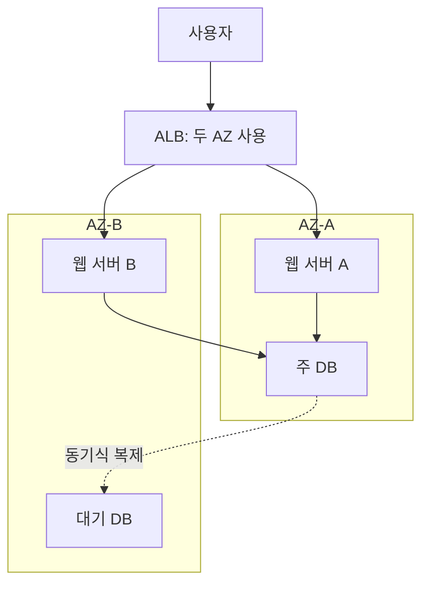

# 1주차 세 번째 수업: 두 AZ 쇼핑몰 설계

예상 30~45분 · 설계 연습만 진행 · AWS 리소스 생성 없음

## 목표

웹 서버뿐 아니라 요청 분산과 DB도 함께 고려해야 AZ 장애에 대비할 수 있음을 설명한다. 전체 네트워크와 보안 설정은 이후 주차에서 다룬다.

## 1. 현재 구성과 요구사항

한 리전의 AZ-A에 웹 서버 두 대와 주문 DB 한 대가 있다. 사용자는 웹 서버를 통해 주문하고, 웹 서버는 DB에 주문을 저장한다.

요구사항:

- 한 AZ에 장애가 나더라도 다른 AZ에서 서비스를 이어갈 수 있어야 한다.
- DB 장애 조치 중에는 일시적인 접속 실패가 발생할 수 있다. 이번 목표는 무중단 보장이 아니다.
- 리전 전체 장애에 대한 대응은 이번 범위에 포함하지 않는다.

현재 문제: 웹 서버를 여러 대 두었지만 모두 같은 AZ에 있고, 주문 DB도 같은 AZ에만 있다.

## 2. 새 개념: 로드 밸런서와 헬스 체크

로드 밸런서는 사용자 요청을 받아 여러 서버에 나누어 전달한다. 웹 요청을 처리하는 AWS 서비스로 Application Load Balancer(ALB)가 있다. ALB는 최소 두 AZ의 서브넷을 사용하도록 구성한다. 아래 구성도에서 ALB 상자 하나는 물리 서버 한 대가 아니라 여러 AZ를 사용하는 관리형 서비스를 뜻한다.

헬스 체크는 서버가 정상적으로 요청을 처리하는지 주기적으로 확인하는 기능이다. 예를 들어 /health 경로의 응답을 확인하도록 설정할 수 있다. 여기서는 장애 판별이 끝난 뒤 정상인 웹 서버로 요청을 보낸다고 가정한다. 실제 장애 감지와 요청 전환에는 시간이 걸릴 수 있다.

ALB는 요청을 분산한다. 웹 서버 대수를 늘리거나 줄이는 기능은 EC2 Auto Scaling 같은 별도 기능이 맡는다. 이번에는 웹 서버 두 대를 고정 배치한다.

## 3. 새 개념: RDS와 DB 장애 조치

Amazon RDS는 관계형 데이터베이스 운영을 지원하는 관리형 서비스다. 주문 데이터를 저장하는 데 사용할 수 있다.

이번 수업에서는 RDS for MySQL의 Multi-AZ DB 인스턴스 배포를 사용한다고 가정한다. 주 DB(Primary)와 다른 AZ의 대기 DB(Standby)를 두고, 데이터를 동기식으로 복제한다. 장애 시 RDS가 대기 DB를 주 DB로 전환할 수 있다. 이 전환을 장애 조치(Failover)라고 한다.

이 배포 방식의 대기 DB는 평소 애플리케이션의 읽기 요청을 처리하지 않는다. 다른 형태인 RDS Multi-AZ DB 클러스터와 혼동하지 않도록 한다.

웹 서버는 RDS 접속 주소(엔드포인트)를 사용한다. 장애 조치 후 연결을 다시 맺을 수 있도록 애플리케이션에도 재연결 처리가 필요하다. 주문 재시도 시 중복 저장을 방지하는 설계는 이후에 다룬다.

### 보충: 드라이버가 재연결을 처리할 수 있는가? (2026-10-31)

사용자 질문: “AWS Driver가 재연결을 해주는 것 아닌가?”

재연결은 애플리케이션이 사용하는 드라이버나 연결 풀 등에서 처리할 수 있다. “애플리케이션이 재연결해야 한다”는 말이 개발자가 모든 재연결 코드를 직접 작성해야 한다는 뜻은 아니다. 애플리케이션이 사용하는 연결 관리 구성이 장애 후 연결을 복구할 수 있어야 한다는 뜻이다.

AWS Advanced JDBC Wrapper를 예로 들면, 지원되는 DB 구성과 Failover 플러그인 설정에서는 새 주 DB에 대한 내부 연결을 자동으로 맺을 수 있다. 다만 공식 문서는 일반 RDS DB에서 해당 Failover 플러그인의 호환성에 제한이 있음을 명시한다. 이번 수업의 RDS Multi-AZ DB 인스턴스 배포와 Aurora 또는 RDS Multi-AZ DB 클러스터 배포를 혼동하지 말고, 사용하는 드라이버·버전·배포 방식의 지원 범위를 확인한다.

자동 재연결이 성공해도 실행 중이던 SQL이나 주문 처리가 자동으로 성공한 것은 아니다. AWS Advanced JDBC Wrapper도 재연결 성공 또는 트랜잭션 결과 불명 등의 예외를 애플리케이션에 전달할 수 있다. 애플리케이션은 결과를 확인하고 필요한 작업을 안전하게 재시도해야 한다. 트랜잭션은 주문 저장처럼 여러 DB 작업을 하나의 단위로 묶는 것이다. 결과를 모르는 주문을 무조건 재시도하면 중복 저장될 수 있으므로, 연결 복구와 주문 처리 복구를 구분한다.

예: 드라이버가 새 주 DB에 연결하는 데 성공했어도, 연결이 끊긴 순간의 주문 저장이 완료됐는지는 별도로 확인해야 할 수 있다.

참고: [AWS Advanced JDBC Wrapper 사용 및 DB 호환성](https://github.com/aws/aws-advanced-jdbc-wrapper/blob/main/docs/using-the-jdbc-driver/UsingTheJdbcDriver.md), [Failover 플러그인과 예외 처리](https://github.com/aws/aws-advanced-jdbc-wrapper/blob/main/docs/using-the-jdbc-driver/using-plugins/UsingTheFailoverPlugin.md).

## 4. 개선 예시

평소 두 웹 서버 모두 주 DB에 접속한다. 대기 DB는 주 DB의 데이터를 복제받으며 장애 조치를 준비한다.

AZ-A에 장애가 발생하면 웹 서버 A와 주 DB가 영향을 받을 수 있다. 정상 웹 서버 B로 요청을 보내고, 대기 DB를 새 주 DB로 전환한 뒤 애플리케이션이 재연결하여 서비스를 이어가도록 설계한다. 남은 웹 서버가 필요한 트래픽을 감당할 용량도 있어야 한다.

## 5. 설계에서 놓치기 쉬운 점

- 웹 서버를 두 AZ에 두어도 DB가 한 AZ에만 있으면 DB가 서비스 중단 지점이 될 수 있다.
- 로그인 정보나 주문 진행 정보를 웹 서버 한 대의 메모리에만 저장하면 다른 서버가 그 정보를 사용하지 못할 수 있다. 이번 예시는 웹 서버가 공유해야 할 정보를 서버 한 대에만 보관하지 않는다고 가정한다. 구체적인 저장 방법은 이후 주차에서 다룬다.
- 헬스 체크, 장애 조치, 재연결에는 시간이 필요하다. Multi-AZ가 무중단을 보장하지는 않는다.
- 여러 AZ 사용은 리전 전체 장애에 대한 대응과 구분한다.

## 6. 직접 설계하기 — 평가 완료 (2문항 정답, 1문항 부분 정답)

아래는 학습용 자체 제작 문제다. 번호와 이유를 함께 답한다.

1. 웹 서버 두 대를 AZ-A와 AZ-B에 나눴지만 DB는 AZ-A 한 곳에만 있다. AZ-A 장애 시 AZ-B 웹 서버가 살아 있어도 주문 저장이 실패할 수 있는 이유는?
2. 개선 예시에서 웹 서버 A가 비정상이고 웹 서버 B는 정상이라고 헬스 체크가 판별했다. ALB는 새 요청을 어느 웹 서버로 보내야 하는가?
3. 개선 예시에서 AZ-A 전체에 장애가 났다. 웹 요청 처리와 DB 복구를 연결하여 서비스가 재개되는 흐름을 설명해 보자. 일시적인 접속 실패가 발생할 수 있는지도 함께 적어보자.

### 2026-10-31 답변 평가와 해설

1. **정답.** AZ-A 장애로 해당 AZ의 DB에 접속할 수 없으므로, AZ-B 웹 서버가 정상이어도 주문을 저장하지 못할 수 있다. 웹 계층과 DB 계층을 함께 고려했다.
2. **정답.** A가 비정상이고 B가 정상으로 판별되었으므로 새 요청은 B로 보낸다. 헬스 체크 비정상은 설정한 정상 기준을 충족하지 못했다는 뜻이다. 서버 자체 고장 외에도 애플리케이션 오류 등이 원인일 수 있다.
3. **부분 정답.** ALB가 정상 웹 서버 B로 요청을 보내고, RDS가 AZ-B 대기 DB를 주 DB로 전환한다는 흐름 및 Failover 용어가 정확하다. 다만 문제에서 요구한 일시적인 접속 실패 가능성과 애플리케이션 재연결 설명은 빠졌다. 장애 감지·DB 전환·재연결에 시간이 걸리므로 그동안 주문 저장이나 접속이 실패할 수 있다. 애플리케이션이 RDS 엔드포인트를 통해 새 주 DB로 연결을 다시 맺어야 한다.

핵심 설계 흐름은 이해했다. 재연결과 일시적 실패는 설명으로 보완했으며, 독립적인 이해 확인은 다음 수업의 새 문제에서 진행한다. 1주차 전체 완료 평가는 아직 끝나지 않았다.

다음: [네 번째 수업: 1주차 종합 확인](04_1주차_종합_확인.md).

## 공식 참고 자료

- [ALB 개요](https://docs.aws.amazon.com/elasticloadbalancing/latest/application/introduction.html)
- [RDS Multi-AZ DB 인스턴스 배포](https://docs.aws.amazon.com/AmazonRDS/latest/UserGuide/Concepts.MultiAZSingleStandby.html)

- [RDS 장애 조치와 재연결](https://docs.aws.amazon.com/AmazonRDS/latest/UserGuide/Concepts.MultiAZ.Failover.html)
