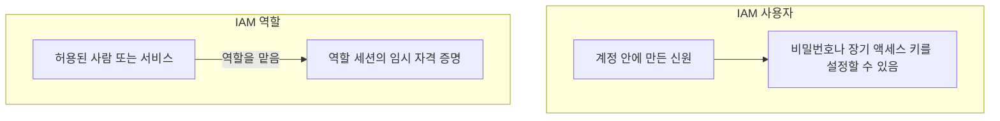
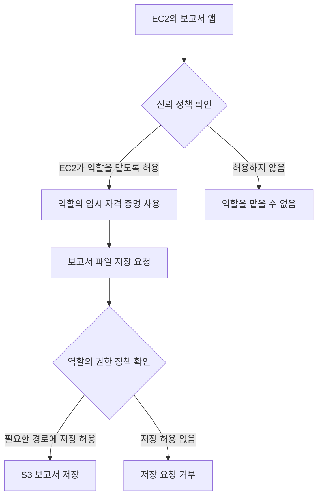
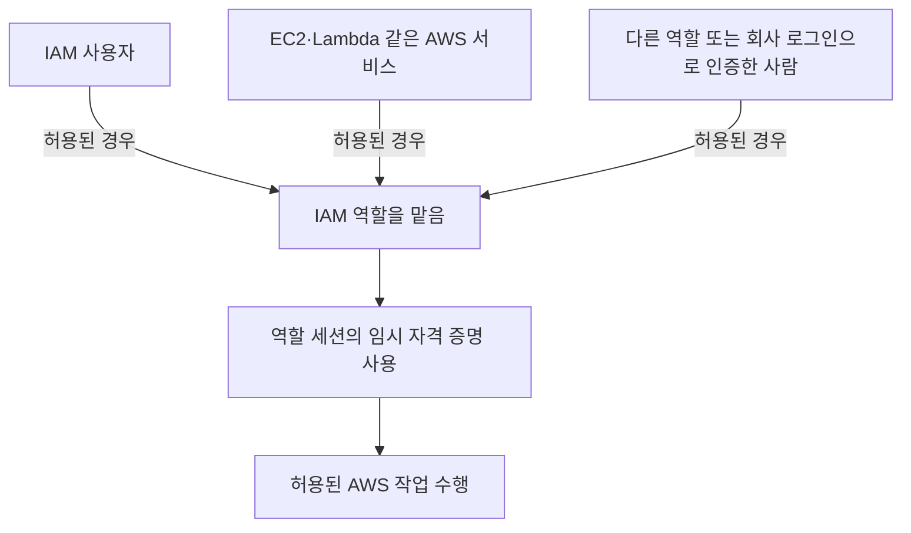
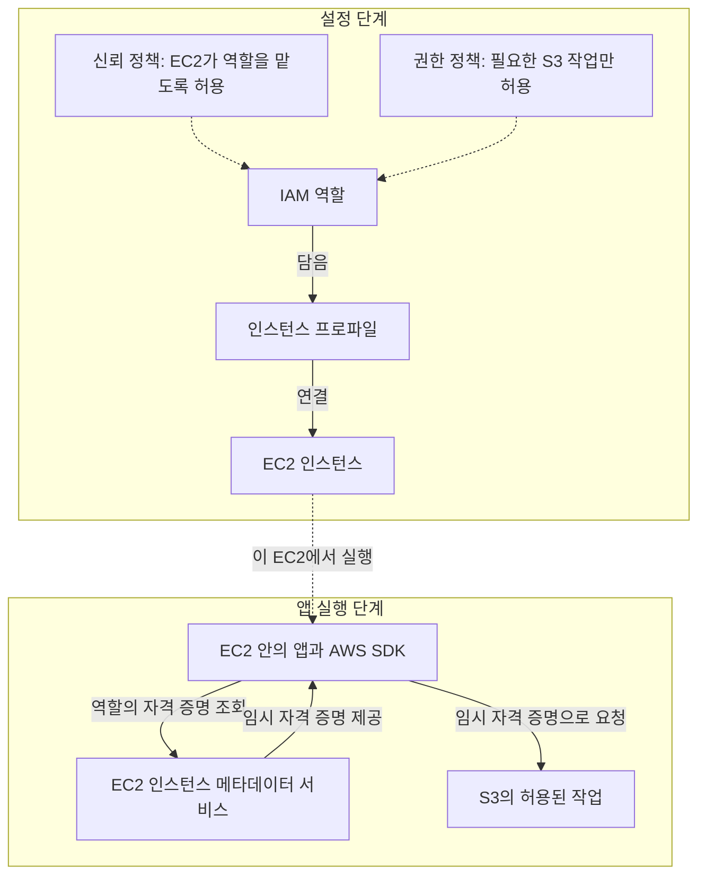
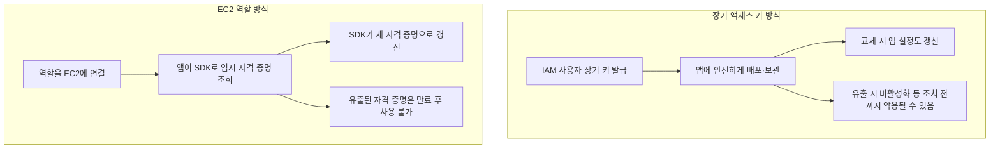

# 2주차 두 번째 수업: IAM 사용자와 역할 및 두 정책

예상 25~35분 · 설계와 개념 학습 · 실제 AWS 설정 변경 없음
확인 문제 평가: 정답 2문항 · 부분 정답 1문항 · EC2 역할 사용 보완 확인 완료

## 목표

IAM 사용자와 IAM 역할을 구분한다.
신뢰 정책과 권한 정책이 각각 어떤 질문에 답하는지 설명한다.

## 그림으로 먼저 이해하기

역할을 “임시 업무용 출입증을 발급받아 사용하는 자리”라고 생각해 보자.
신뢰 정책은 그 출입증을 받을 수 있는 대상을 정한다.
권한 정책은 출입증으로 할 수 있는 일을 정한다.

### 그림 1. IAM 사용자와 역할의 차이

사용자와 역할은 모두 AWS의 신원이다.
사용자는 자격 증명을 설정해 사용할 수 있다.
역할은 허용된 대상이 맡아서 사용한다.
역할을 사용한다고 기존 사용자가 삭제되거나 역할로 영구 변경되는 것은 아니다.
사람도 역할을 맡을 수 있다.

### 그림 2. EC2 보고서 앱이 역할을 사용하는 흐름

첫 번째 확인은 “이 앱이 역할을 사용할 수 있는가?”다.
두 번째 확인은 “그 역할로 이 파일을 저장할 수 있는가?”다.
서로 다른 질문이므로 두 정책을 나누어 확인한다.
그림은 아래 수업의 가정에 따라 다른 허용·거부 정책의 영향은 생략했다.

역할을 맡을 수 있다고 S3에서 모든 작업을 할 수 있는 것은 아니다.
역할의 권한 정책에 저장 작업이 있더라도 역할을 맡을 수 없다면 그 역할의 권한을 사용할 수 없다.

## 1. IAM 사용자와 IAM 역할

IAM 사용자(User)는 AWS 계정 안에 만드는 신원이다.
사람이나 애플리케이션을 나타낼 수 있다.
필요에 따라 로그인 비밀번호나 장기 액세스 키를 설정할 수 있다.
IAM 사용자를 만들었다고 모든 권한이 자동으로 생기는 것은 아니다.
관리자 권한을 가진 IAM 사용자도 루트 사용자와는 다르다.

IAM 역할(Role)도 AWS 신원이다.
허용된 사람이나 서비스가 역할을 맡아 임시 자격 증명으로 작업한다.
역할 자체에는 **일반적인 로그인 비밀번호나 장기 액세스 키가 없다.**
역할은 사람과 애플리케이션 모두 사용할 수 있다.

| 구분 | IAM 사용자 | IAM 역할 |
|---|---|---|
| 사용하는 방식 | 사용자에 설정된 자격 증명 등을 사용 | 허용된 주체가 역할을 맡아 사용 |
| 장기 자격 증명 | 비밀번호나 장기 액세스 키를 설정할 수 있음 | 역할 자체에는 없음 |
| 역할 사용 시 자격 증명 | 사용자가 역할을 맡는 경우 임시 자격 증명 사용 | 역할 세션의 임시 자격 증명 사용 |
| 주의할 점 | 장기 키를 코드에 넣거나 공유하지 않음 | 역할을 맡을 대상과 작업 권한을 제한 |

역할을 맡는 행위를 **Assume role**이라고 한다.
세션(Session)은 역할을 맡아 **임시 자격 증명을 사용하는 한 번의 이용 구간**이다.
AWS STS(Security Token Service)는 이런 **임시 자격 증명을 발급하는 서비스**다.

EC2 앱에서는 역할 연결과 AWS SDK를 통해 이 과정을 활용할 수 있다.
개발자가 매 요청마다 직접 임시 자격 증명을 발급하는 코드를 작성해야 한다는 뜻은 아니다.

사람이 AWS를 사용한다고 반드시 IAM 사용자를 만들어야 하는 것은 아니다.
직원의 일상 접근에는 IAM Identity Center 같은 중앙 접근 관리와 임시 자격 증명을 우선 고려한다.
IAM 사용자는 이런 방식으로 지원하기 어려운 경우 등 필요에 따라 사용한다.

## 2. 신뢰 정책: 누가 이 역할을 맡을 수 있는가?

신뢰 정책(Trust policy)은 역할을 맡도록 허용할 주체와 조건을 정한다.
주체(Principal)는 요청을 수행하는 사람이나 역할 또는 AWS 서비스 등의 신원이다.

예: EC2에서 실행하는 앱에 사용할 역할은 EC2 서비스가 맡을 수 있도록 신뢰 관계를 설정한다.
이것만으로 S3 파일 읽기 권한이 생기는 것은 아니다.
신뢰 정책은 역할을 사용할 대상을 정한다.

## 3. 권한 정책: 이 역할로 무엇을 할 수 있는가?

역할의 권한 정책(Permissions policy)은 그 역할로 수행할 작업과 대상 리소스를 정한다.
작업(Action)은 파일 읽기나 삭제처럼 수행할 동작이다.
리소스(Resource)는 그 동작의 대상이다.

예: 특정 S3 버킷의 상품 이미지 객체에 대한 읽기 작업만 허용한다.
역할이 필요한 대상에 맡겨졌더라도 삭제 권한이 없으면 이미지를 삭제할 수 없다.
권한 정책은 역할을 사용해 할 일을 정한다.

| 정책 | 답하는 질문 | 예 |
|---|---|---|
| 신뢰 정책 | *누가* 이 역할을 맡을 수 있는가? | EC2 서비스가 이 역할을 맡도록 허용 |
| 권한 정책 | 이 역할로 *무엇을* 할 수 있는가? | 특정 상품 이미지 객체 읽기 허용 |

신뢰 정책도 역할을 맡는 동작에 대한 인가 규칙이다.
앞 수업의 인증과 인가를 신뢰 정책과 권한 정책에 각각 일대일로 대응시키지 않는다.

## 4. 예제: EC2 앱이 보고서 파일을 저장한다

EC2의 보고서 앱은 특정 S3 버킷의 보고서 경로에 파일을 저장해야 한다.
읽기나 삭제 기능은 이번 앱에 필요하지 않다.

1. 보고서 저장용 IAM 역할을 만든다.
2. 신뢰 정책에서 EC2 서비스가 역할을 맡도록 허용한다.
3. 역할의 권한 정책에서 필요한 보고서 경로의 파일 저장만 허용한다.
4. EC2에 역할을 연결하고 앱이 SDK로 임시 자격 증명을 사용하도록 구성한다.

신뢰 정책에 EC2를 허용해도 파일 저장 권한을 빠뜨리면 목적을 달성하지 못한다.
파일 저장 권한을 붙여도 EC2가 역할을 맡을 수 없다면 이 역할을 이용할 수 없다.
역할을 맡는 조건과 맡은 뒤의 작업 권한을 각각 확인한다.

실제 EC2에서는 인스턴스 프로파일(Instance profile)이라는 연결용 구성을 통해 역할을 연결한다.
역할에 권한 정책을 붙이는 것만으로 EC2 연결이 끝나는 것은 아니다.
세부 설정 절차는 실습 때 다룬다.

## 5. 이번 수업의 가정

한 계정 안에서 EC2에 연결한 역할을 사용하는 기본 상황을 다룬다.
별도의 리소스 정책으로 권한을 추가하지 않았고 다른 정책의 명시적 거부도 없다고 가정한다.
이 가정 아래에서 역할 권한에 허용되지 않은 파일 작업은 수행할 수 없다.

실제 AWS 접근은 다른 정책과 조건에도 영향을 받는다.
다른 계정의 사람이 역할을 맡는 경우에는 호출자 쪽의 역할 사용 권한도 확인해야 한다.
신뢰 정책에 이름만 넣으면 모든 상황의 접근이 완성된다고 일반화하지 않는다.
다른 정책과 계정 간 접근은 이후에 다룬다.

## 6. 확인 문제 — 번호와 이유를 함께 답하기

위 가정에 따라 답한다.
정답과 해설은 답변 제출 후 추가한다.

1. EC2 앱에 연결한 역할은 EC2가 맡을 수 있다.
   하지만 역할 권한 정책에는 상품 이미지 객체 읽기만 허용되어 있다.
   앱이 이미지를 삭제할 수 있는가?
   어느 정책의 어떤 범위를 근거로 판단했는가?
2. 보고서 저장 역할에는 필요한 S3 파일 저장 권한이 있다.
   그러나 신뢰 정책은 Lambda 서비스만 허용하고 EC2 서비스는 허용하지 않는다.
   Lambda는 코드를 실행하는 또 다른 AWS 서비스다.
   이 역할을 EC2 앱에서 사용하도록 구성할 때 신뢰 정책과 권한 정책 중 무엇을 먼저 보완해야 하는가?
3. 담당자가 “IAM 사용자는 사람만 쓰고 역할은 애플리케이션만 쓴다”고 말했다.
   이 설명이 맞는가?
   역할을 사용할 수 있는 대상과 역할 사용 시 자격 증명의 특징을 설명하자.

2주차 두 번째 수업의 기초 확인이다.
2주차 전체 완료 평가는 별도로 진행한다.

## 공식 참고 자료

확인: 2026-10-31

- [IAM 사용자](https://docs.aws.amazon.com/IAM/latest/UserGuide/id_users.html)
- [IAM 역할](https://docs.aws.amazon.com/IAM/latest/UserGuide/id_roles.html)
- [역할 개념과 위임](https://docs.aws.amazon.com/IAM/latest/UserGuide/id_roles_terms-and-concepts.html)
- [이전 수업과 평가](06_계정과_IAM_기초.md)

## 2026-10-31 답변 평가

1. 정답.
   역할의 권한 정책이 상품 이미지 객체 읽기만 허용하므로 삭제는 허용되지 않는다.
   답변의 “정책”을 “역할의 권한 정책”이라고 명확히 표현하면 더 정확하다.
2. 정답.
   필요한 파일 저장 권한은 이미 있으므로 EC2가 역할을 맡도록 신뢰 정책을 보완한다.
   Lambda 사용도 계속 필요하다면 Lambda 허용을 유지하면서 EC2 허용을 추가할 수 있다.
   Lambda를 반드시 EC2로 교체해야 하는 것은 아니다.
3. 부분 정답.
   IAM 사용자가 사람이나 애플리케이션을 나타낼 수 있다는 설명과 역할 사용 시 임시 자격 증명을 쓴다는 설명은 맞다.
   다만 역할을 맡을 수 있는 대상을 IAM 사용자로 한정한 것은 부정확하다.
   EC2나 Lambda 같은 AWS 서비스도 역할을 맡을 수 있다.
   허용된 다른 역할이나 외부 로그인 시스템으로 인증한 사람도 설정에 따라 역할을 맡을 수 있다.
   외부 로그인 시스템은 회사 로그인처럼 AWS IAM 사용자 외의 신원 확인 시스템을 뜻한다.
   모든 대상이 자동으로 역할을 사용할 수 있는 것은 아니며 해당 역할을 맡도록 허용되어야 한다.

### 보완 그림: 역할은 IAM 사용자만 사용하는가?

EC2 앱이 역할을 사용하기 위해 IAM 사용자의 장기 액세스 키를 먼저 앱에 넣어야 하는 것은 아니다.
EC2에 역할을 올바르게 연결하면 앱은 SDK를 통해 역할의 임시 자격 증명을 사용할 수 있다.

### 짧은 보완 확인 — 답변 확인 완료

EC2에서 새 앱을 실행하려고 한다.
담당자가 “앱이 역할을 사용하려면 먼저 IAM 사용자를 만들고 그 사용자의 장기 액세스 키를 앱에 넣어야 한다”고 말했다.
이 설명이 맞는지와 EC2 앱이 자격 증명을 사용하는 올바른 방법을 설명하자.

2026-10-31 답변 확인: IAM 역할과 인스턴스 프로파일을 연결하고 임시 자격 증명으로 작업하는 흐름을 정확히 설명했다.
EC2 서비스도 IAM 사용자 장기 키 없이 역할을 사용할 수 있음을 확인했다.
“그 방법도 가능하지만 권장하지 않는다”는 표현은 IAM 사용자 장기 키를 앱에 넣어 AWS 요청을 보내는 별도 방식은 가능하다는 뜻으로 정리한다.
그러나 “역할을 사용하려면 반드시 먼저 장기 키를 앱에 넣어야 한다”는 필수 조건 주장은 틀리다.
과거 3번의 부분 정답 기록은 유지하고 이번 보완 확인 결과를 별도로 기록한다.

### 보완 그림: EC2 앱이 임시 자격 증명을 사용하는 흐름

인스턴스 프로파일은 IAM 역할을 EC2에 연결하는 구성이다.
직접 자격 증명을 생성하는 장치는 아니다.
인스턴스 메타데이터 서비스는 EC2 안의 앱이 인스턴스 정보와 연결된 역할의 임시 자격 증명을 조회하는 경로다.
AWS SDK의 인스턴스 역할 자격 증명 공급자를 사용하면 임시 자격 증명의 조회와 갱신을 처리할 수 있다.
임시 자격 증명에도 액세스 키 ID와 비밀 액세스 키가 있고 세션 토큰 및 만료 시간이 있다.
“앱에 키를 설정하지 않는다”는 말은 키가 전혀 없다는 뜻이 아니라 장기 키를 코드나 환경 변수에 직접 넣지 않는다는 뜻이다.

참고: [EC2 앱의 역할 사용](https://docs.aws.amazon.com/IAM/latest/UserGuide/id_roles_use_switch-role-ec2.html)과 [인스턴스 프로파일](https://docs.aws.amazon.com/IAM/latest/UserGuide/id_roles_use_switch-role-ec2_instance-profiles.html).

다음은 2주차 설계 연습 자료를 준비해 역할과 최소 권한을 사례에 적용하는 것이다.

## 보충: EC2 앱에 IAM 역할을 권장하는 이유

핵심은 장기 비밀값을 배포하고 교체하는 부담과 유출 위험을 줄일 수 있다는 것이다.

1. 장기 키를 앱 코드나 설정에 배포할 필요가 줄어든다.
   코드 저장소나 배포 파일에 키를 실수로 포함할 위험을 줄인다.
2. 임시 자격 증명에는 만료 시간이 있다.
   장기 키는 자동 만료되지 않으므로 유출 시 별도 차단 조치가 중요하다.
   임시 자격 증명도 만료 전에는 악용될 수 있다.
3. 임시 자격 증명의 갱신을 SDK가 처리하도록 구성할 수 있다.
   관리자가 서버마다 새 장기 키를 배포하는 작업을 줄인다.
4. 여러 EC2가 같은 역할을 사용하면 해당 역할의 권한 정책을 한 곳에서 관리할 수 있다.
   서버마다 비밀값을 교체하는 일과 권한 변경을 구분해 관리할 수 있다.

최소 권한은 IAM 사용자와 역할 모두에 적용할 수 있다.
역할만 최소 권한이 가능한 것은 아니다.
역할에도 관리자 권한을 부여하면 위험하므로 필요한 작업과 리소스만 허용한다.
EC2 자체가 침해되어 공격자가 새 임시 자격 증명을 계속 얻을 수 있다면 만료만으로 사고가 해결되지는 않는다.

예: 앱 서버가 10대로 늘어도 같은 역할을 연결하면 각 서버에 장기 키를 복사할 필요가 없다.
앱은 SDK를 통해 각 EC2에 제공된 임시 자격 증명을 사용한다.

참고: [EC2 앱 역할 사용의 이점](https://docs.aws.amazon.com/IAM/latest/UserGuide/id_roles_use_switch-role-ec2.html).
