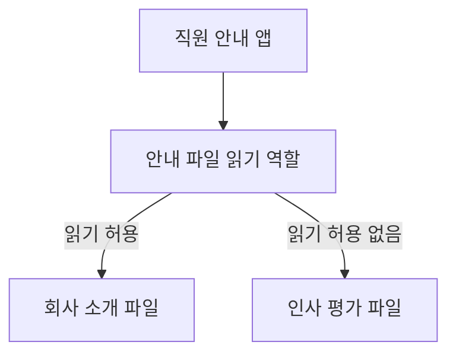
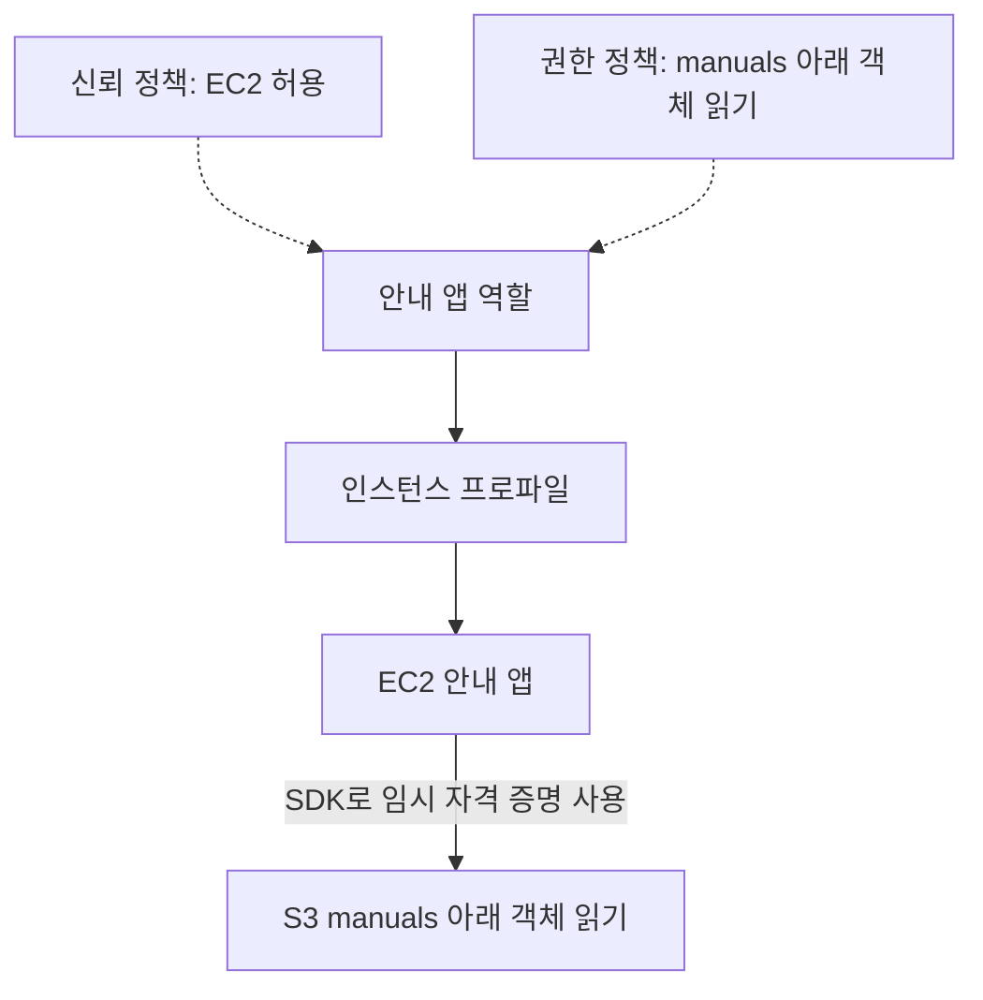
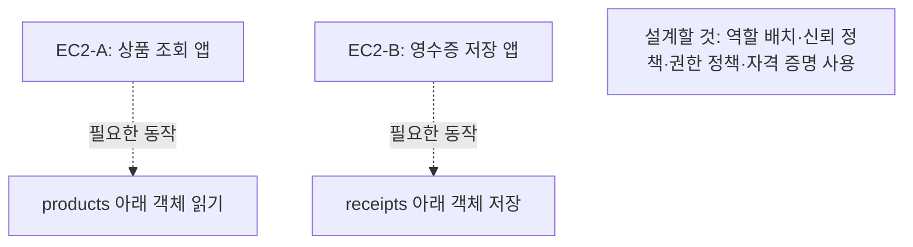
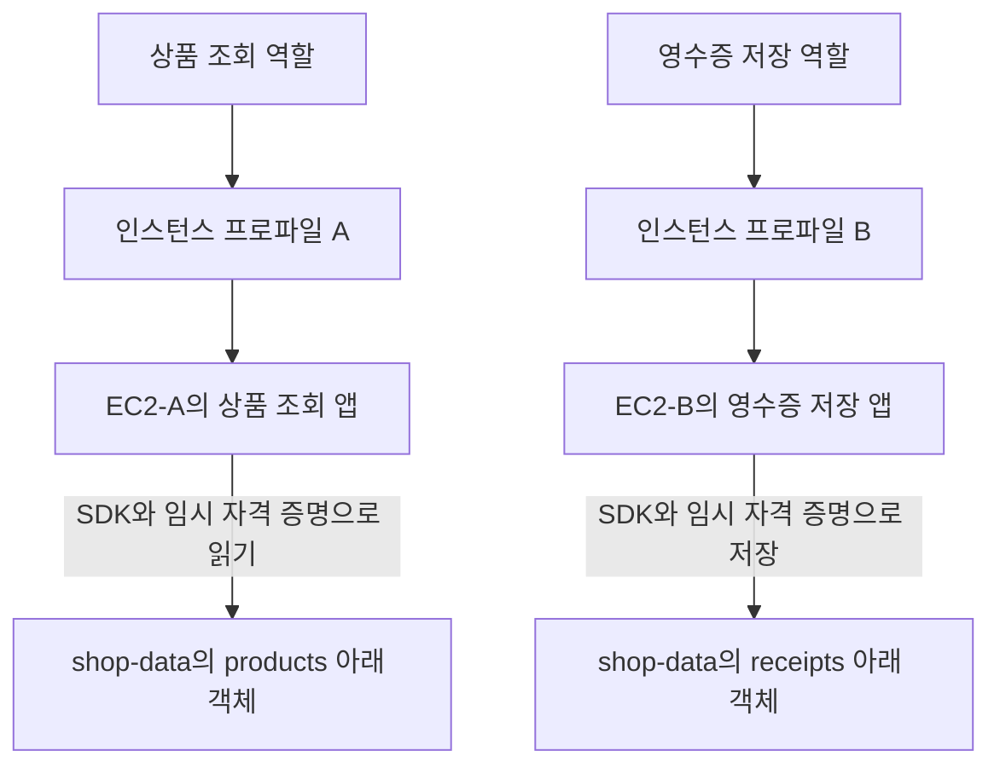

# 2주차 세 번째 수업: 역할과 최소 권한 설계 연습

예상 25~35분 · AWS 계정 조작 없음 · 설계 문제 평가 완료 3/3

## 목표

앱의 요구사항에서 필요한 작업과 대상 범위를 찾아 역할 권한을 정한다.
신뢰 정책과 인스턴스 프로파일 및 임시 자격 증명을 하나의 흐름으로 설명한다.

## 1. 권한은 작업과 대상을 함께 좁힌다

최소 권한은 “읽기만 허용한다”에서 끝나지 않는다.
어느 파일을 읽을 수 있는지도 정해야 한다.

예: 직원 안내 앱이 회사 소개 파일만 보여준다면 인사 평가 파일까지 읽게 할 필요는 없다.
둘 다 읽기 작업이지만 허용할 대상은 서로 다르다.

역할을 나누는 목적은 각 앱이 실제로 필요한 권한만 사용하도록 하는 것이다.
업무가 다르면 같은 역할을 공유하는 것이 불필요한 권한 부여로 이어질 수 있다.
같은 업무와 권한이 필요한 서버 여러 대가 같은 역할을 사용하는 것은 가능하다.

## 2. 이번에 사용할 S3 용어

객체(Object)는 S3에 저장하는 파일과 그 정보를 뜻한다.
객체 키(Key)는 버킷 안에서 객체를 식별하는 이름이다.
여기서 Key는 액세스 키 같은 자격 증명을 뜻하지 않는다.

예: `manuals/start.pdf`는 객체 키다.
`manuals/`로 시작하는 이름들을 묶어 가리킬 때 접두사(Prefix)라고 한다.
화면에서 폴더처럼 보여도 S3에서는 객체 이름의 앞부분이다.

| 필요한 동작 | 대표적인 S3 권한 |
|---|---|
| 객체 내용 읽기 | `s3:GetObject` |
| 객체 저장 | `s3:PutObject` |
| 객체 삭제 | `s3:DeleteObject` |

객체를 읽는 것과 버킷 안의 객체 목록을 보는 것은 별도 동작이다.
이번 앱은 필요한 객체 이름을 이미 알고 있다고 가정하므로 목록 조회는 요구하지 않는다.
암호화 키나 버전별 작업처럼 추가 권한이 필요한 기능은 이번 범위에서 제외한다.
다른 정책의 추가 허용이나 명시적 거부도 없다고 가정한다.

## 3. 예제: 안내 자료 다운로드 앱

안내 앱은 `company-files` 버킷의 `manuals/` 아래 객체를 읽기만 한다.
다른 경로의 파일이나 저장·삭제 권한은 필요하지 않다.

이 앱의 역할 권한은 읽기 작업과 `manuals/` 아래 객체라는 대상 범위를 함께 제한한다.
EC2에서 실행한다면 EC2가 역할을 맡도록 신뢰 정책을 설정한다.
역할을 담은 인스턴스 프로파일을 EC2에 연결한다.
앱은 SDK로 임시 자격 증명을 사용한다.

## 4. 직접 설계하기: 쇼핑몰 앱 두 개

한 계정에서 서로 다른 EC2 두 대를 사용한다.
EC2-A는 상품 조회 앱 전용이다.
EC2-B는 주문 영수증 저장 앱 전용이다.
두 앱이 같은 EC2에서 실행되는 상황은 이번에 다루지 않는다.

버킷 이름은 `shop-data`다.

| 앱 | 필요한 작업 | 필요한 대상 | 필요하지 않은 작업 |
|---|---|---|---|
| 상품 조회 앱 | 이미지 내용 읽기 | `products/` 아래 객체 | 저장·삭제 및 영수증 접근 |
| 영수증 저장 앱 | 새 영수증 객체 저장 | `receipts/` 아래 객체 | 읽기·삭제 및 상품 이미지 접근 |

영수증 앱은 영수증마다 다른 객체 이름으로 저장한다고 가정한다.
이번에는 같은 이름의 파일 덮어쓰기 제한을 설계하지 않는다.

아래 그림은 요구사항이며 역할 배치는 직접 정한다.

### 설계 문제 — 번호와 이유를 함께 답하기

1. 두 앱에 상품 읽기와 영수증 저장을 모두 허용한 역할 하나를 공유할 것인가?
   아니면 앱별 역할을 나눌 것인가?
   최소 권한을 근거로 설명하자.
2. 상품 조회 앱과 영수증 저장 앱에 각각 어떤 작업을 어느 대상 범위로 허용할 것인가?
   위 표의 S3 권한 이름이나 한국어 작업명으로 답해도 된다.
3. 두 앱에서 장기 액세스 키를 직접 설정하지 않고 역할 권한을 사용하게 하려 한다.
   각 역할의 신뢰 정책에서 허용할 서비스와 EC2 연결 방법 및 앱의 자격 증명 사용 흐름을 설명하자.

정답과 해설은 아래 평가에 반영했다.
이번 설계 연습만으로 2주차 전체를 완료 처리하지 않는다.
다음은 새로운 종합 확인과 회상 복습이다.

## 공식 참고 자료

확인: 2026-10-31

- [S3 작업별 필요 권한](https://docs.aws.amazon.com/AmazonS3/latest/userguide/using-with-s3-policy-actions.html)
- [EC2 앱에서 IAM 역할 사용](https://docs.aws.amazon.com/IAM/latest/UserGuide/id_roles_use_switch-role-ec2.html)
- [이전 수업](07_IAM_사용자와_역할_두_정책.md)

## 2026-10-31 설계 문제 평가 — 3/3

1. 정답.
   앱마다 별도 역할을 사용하고 최소 권한 원칙을 근거로 설명했다.
   역할 하나에 두 앱의 권한을 모두 넣으면 각 앱이 필요하지 않은 작업까지 할 수 있다.
2. 정답.
   상품 조회 앱은 `products/` 아래 객체 읽기만 허용한다.
   영수증 저장 앱은 `receipts/` 아래 객체 저장만 허용한다.
   각각 `s3:GetObject`와 `s3:PutObject`에 해당한다.
   `products/`와 `receipts/`라는 파일 하나를 뜻하는 것이 아니라 해당 접두사 아래 객체 범위를 뜻한다.
3. 정답.
   신뢰 정책의 대상인 EC2와 역할 연결 구성 및 SDK를 통한 임시 자격 증명 사용을 정확히 설명했다.
   “EC2 Profile”의 정확한 명칭은 인스턴스 프로파일(Instance profile)이다.
   역할을 담은 인스턴스 프로파일을 각 EC2에 연결한다.
   앱은 SDK로 EC2에 제공되는 역할의 임시 자격 증명을 조회하고 허용된 작업을 수행한다.

### 완성한 설계

각 역할의 신뢰 정책은 EC2 서비스를 허용한다.
각 역할의 권한 정책은 해당 앱에 필요한 작업과 대상만 허용한다.

설계 연습은 3/3으로 완료했다.
2주차 전체는 아직 진행 중이다.
다음은 새로운 종합 확인 5문항을 자료로 먼저 준비하고 진행한다.
