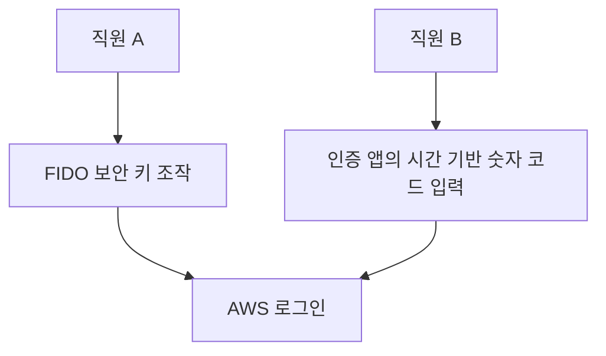
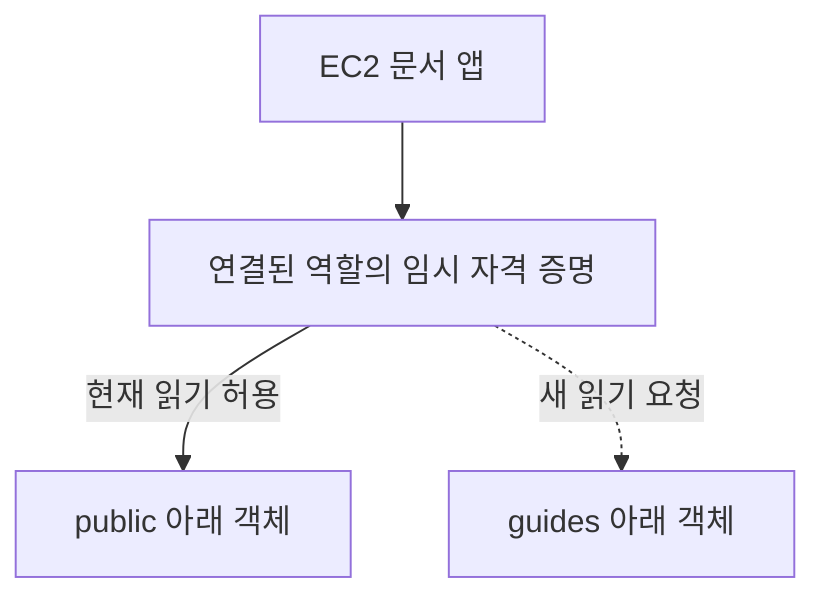
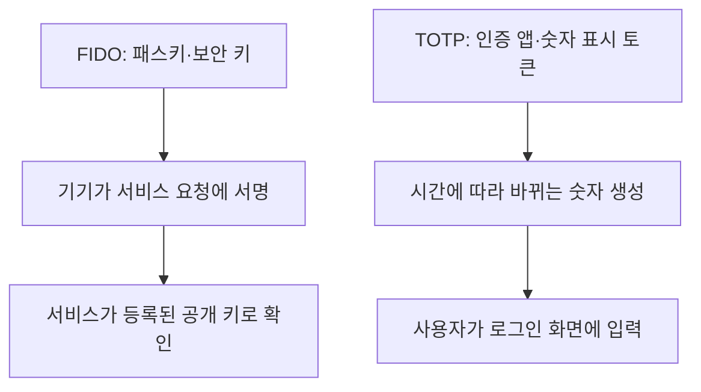
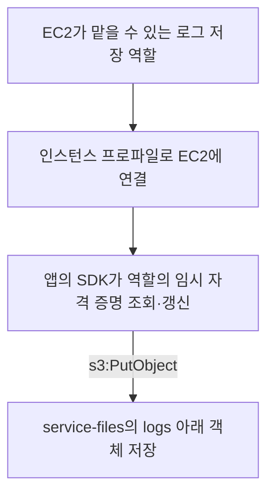
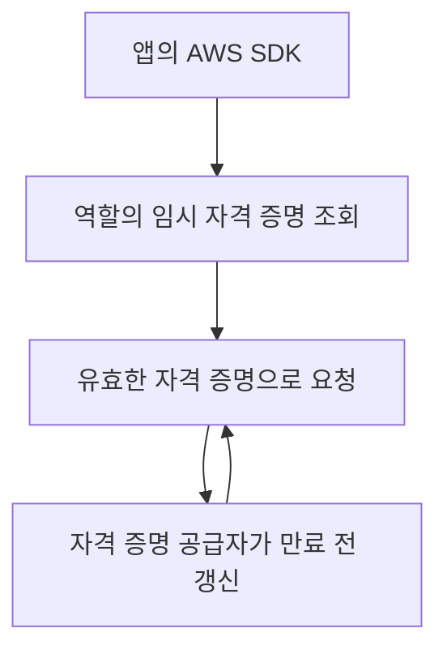

# 2주차 네 번째 수업: 종합 확인

예상 20~30분 · 학습용 자체 제작 문제 · 평가: 정답 3문항 · 부분 정답 1문항 · 미응답 1문항
실제 AWS 계정 조작 없음

## 범위와 진행 방식

2주차 첫 번째부터 세 번째 수업의 개념을 새로운 상황에 적용한다.
번호와 판단 및 이유를 함께 답한다.
정답과 해설은 제출 후 추가한다.
5문항 중 4문항 이상 정답과 선택 이유 설명을 목표로 한다.
개념이 부족하면 보완 후 다른 문제로 확인한다.
이후 마지막 회상 복습까지 확인하고 2주차 완료 여부를 판단한다.

## 공통 가정

한 AWS 계정 안의 기본 상황을 다룬다.
다른 정책의 추가 허용이나 명시적 거부는 없다고 가정한다.
S3 앱은 필요한 객체 이름을 알고 있고 목록 조회는 하지 않는다.
암호화 키나 버전별 작업의 추가 권한은 제외한다.

## 1. 루트 사용자와 MFA

관리자가 루트 사용자에 MFA를 설정했다.
그는 “MFA로 보호했으니 매일 루트 사용자로 S3 자료를 정리해도 된다”고 말한다.
이 판단이 적절한가?
MFA의 역할과 일상 작업의 권한 범위를 구분해 이유를 설명하자.

## 2. 두 가지 MFA 방식

직원 A는 전용 보안 키를 연결해 인증한다.
이 보안 키는 FIDO 방식이며 숫자 코드 표시 화면이 없다.
직원 B는 인증 앱에 표시된 시간 기반 6자리 코드를 입력한다.

A와 B는 각각 FIDO와 TOTP 중 어떤 방식을 사용하는가?
둘 중 피싱에 더 강한 방식은 무엇인가?
코드 입력과 서비스에 연결된 인증의 차이를 근거로 설명하자.

## 3. 파일 읽기 실패 원인과 수정 범위

EC2의 문서 앱은 이미 연결된 역할의 임시 자격 증명을 정상적으로 얻었다.
신뢰 정책은 EC2를 허용한다.
역할의 권한 정책은 `docs-store` 버킷의 `public/` 아래 객체 읽기만 허용한다.
새 요구사항은 기존 자료와 함께 `guides/` 아래 안내서도 읽는 것이다.
저장과 삭제 및 다른 경로의 접근은 필요하지 않다.

`guides/` 아래 파일 읽기 요청은 성공하는가?
새 요구사항을 충족하려면 신뢰 정책과 권한 정책 중 무엇을 어떻게 보완해야 하는가?
최소 권한을 유지하는 작업과 대상 범위도 설명하자.

## 4. 사람의 역할 사용

회사는 회사 로그인 시스템으로 인증한 직원이 필요한 역할을 맡도록 허용해 두었다.
동료가 “역할은 앱만 쓰는 것이므로 직원은 반드시 IAM 사용자를 새로 만들고 장기 액세스 키를 발급받아야 한다”고 말한다.
이 설명이 맞는가?
역할을 맡을 수 있는 대상과 역할을 사용할 때의 자격 증명을 근거로 설명하자.

## 5. 장기 키 제거와 임시 자격 증명 유출

EC2의 로그 저장 앱 코드에 IAM 사용자의 장기 키가 들어 있다.
이 앱은 `service-files` 버킷의 `logs/` 아래 객체 저장만 필요하다.
장기 키를 배포하지 않는 역할 방식으로 바꾸려 한다.

역할의 신뢰 정책에서 허용할 서비스와 권한 정책의 작업·대상 범위를 설명하자.
역할을 EC2에 연결하는 구성과 앱이 자격 증명을 조회·갱신하는 방법도 설명하자.

이후 임시 자격 증명 한 세트가 유출되었지만 아직 만료되지 않았다.
“임시 자격 증명이므로 공격자가 지금도 사용할 수 없다”는 말이 맞는가?
공격자가 새 자격 증명을 계속 얻는 상황은 이번 질문에서 제외한다.

## 답변 형식

1~5번에 판단과 이유를 함께 적는다.
5번은 연결 흐름과 유출 판단을 나누어 적어도 된다.
S3 작업명은 한국어로 써도 된다.

## 복습 자료

- [계정과 IAM 기초 및 MFA](06_계정과_IAM_기초.md)
- [사용자·역할과 두 정책 및 자격 증명 흐름](07_IAM_사용자와_역할_두_정책.md)
- [작업·대상 범위의 최소 권한 설계](08_역할과_최소권한_설계_연습.md)

## 2026-11-01 종합 확인 평가

1. 정답.
   MFA로 인증을 강화해도 루트의 광범위한 권한이 줄어들지는 않는다.
   최소 권한 원칙을 근거로 일상적인 루트 사용이 부적절하다고 정확히 판단했다.
2. 미응답.
   기억나지 않는다고 답했으므로 정답으로 처리하지 않는다.
   아래 그림으로 복습하고 다른 상황에서 다시 확인한다.
3. 정답으로 판단하고 정책 이름과 이유 표현을 보완한다.
   현재 guides 아래 읽기는 허용되지 않으며 기존 역할에 그 범위의 읽기만 추가한다는 해결 방향이 맞다.
   수정 대상은 역할의 권한 정책이다.
   “문서 앱이기 때문에”가 아니라 “업무 요구사항에 guides 아래 읽기가 추가되었기 때문에” 필요한 범위만 허용한다.
   문서 앱이라는 이름만으로 모든 문서 읽기를 허용하지 않는다.
4. 정답.
   허용된 직원도 역할을 사용할 수 있으며 역할 세션의 임시 자격 증명을 사용한다고 설명했다.
5. 부분 정답.
   EC2 신뢰와 인스턴스 프로파일 및 임시 자격 증명 사용과 만료 전 탈취 시 악용 가능성은 맞다.
   저장 앱에는 `s3:GetObject`가 아니라 `s3:PutObject`가 필요하다.
   대상은 service-files 버킷의 logs 아래 객체 범위다.
   조회·갱신 방법은 장기 키를 임시 자격 증명으로 바꾼다는 말에 더해 SDK가 역할의 임시 자격 증명을 조회·갱신하도록 구성한다고 설명해야 한다.

종합 결과는 정답 3문항과 부분 정답 1문항 및 미응답 1문항이다.
4문항 이상 정답 기준은 아직 충족하지 않았다.
MFA 방식과 S3 저장 권한 및 SDK 조회·갱신을 보완하고 아래 새 문제로 재확인한다.

## 보완 1. FIDO와 TOTP

FIDO는 패스키나 보안 키로 서비스의 요청에 전자 서명하는 인증 방식이다.
TOTP는 공유 비밀값과 시간을 바탕으로 만든 일회용 코드를 입력하는 방식이다.
FIDO는 등록한 서비스에 연결된 인증이므로 피싱에 더 강하다.

물리 장치라고 전부 FIDO는 아니다.
숫자를 표시해 사람이 입력하는 하드웨어 TOTP 토큰도 있다.

## 보완 2. S3 동작과 자격 증명 갱신

| 동작 | 권한 이름 |
|---|---|
| 객체 내용 읽기 | s3:GetObject |
| 객체 저장 | s3:PutObject |
| 객체 삭제 | s3:DeleteObject |

인스턴스 역할 자격 증명 공급자를 사용하도록 SDK를 구성한다.
임시 자격 증명을 한 번 복사해 고정해 두는 방식과 구분한다.

## 새로운 보완 확인 — 평가 완료 2/2

A. 직원은 숫자가 표시되는 전용 장치에서 주기적으로 바뀌는 코드를 읽어 로그인 화면에 입력한다.
이 방식은 FIDO인가 TOTP인가?
물리 장치라는 점과 실제 인증 방식을 구분해 설명하자.
패스키 방식과 비교했을 때 어느 쪽이 피싱에 더 강한지도 설명하자.

B. EC2의 백업 앱은 backup-files 버킷의 daily 아래 객체를 저장하기만 한다.
목록 조회와 읽기 및 삭제는 필요하지 않다.
역할의 권한 정책에 필요한 작업과 대상 범위를 설명하자.
장기 키를 직접 넣지 않고 앱이 자격 증명을 얻고 갱신하게 하는 방법도 설명하자.

보완 확인 결과는 최초 종합 확인 기록과 구분한다.
통과하면 마지막 회상 복습 자료를 먼저 준비한다.

## 2026-11-01 보완 확인 평가 — 2/2

A. 정답.
숫자 표시 장치의 방식은 TOTP이고 피싱에 더 강한 것은 FIDO라고 정확히 답했다.
가짜 사이트에 입력한 TOTP 코드를 공격자가 이용할 수 있다는 이유도 정확하다.

B. 정답으로 판단하고 갱신 시점을 보완한다.
저장에 필요한 `s3:PutObject`와 `daily/` 아래 객체 범위를 정확히 설명했다.
문제의 대상 버킷은 `backup-files`이며 다른 버킷의 daily 경로까지 허용하는 것은 아니다.
앱의 SDK로 역할의 임시 자격 증명을 얻는다는 설명도 맞다.
“만료되면 재획득”보다는 SDK의 자격 증명 공급자가 만료를 관리하고 만료 전에 갱신한다고 이해하면 정확하다.
실패 후 수동으로 새 값을 넣거나 만료된 자격 증명을 계속 쓰는 방식이 아니다.

최초 종합 확인은 정답 3문항과 부분 정답 1문항 및 미응답 1문항으로 유지한다.
별도 보완 문제 2/2로 부족했던 개념을 재확인했다.
다음은 [마지막 회상 복습](10_2주차_회상_복습.md)이다.
2주차 전체는 회상 복습까지 확인한 뒤 완료 여부를 판단한다.
