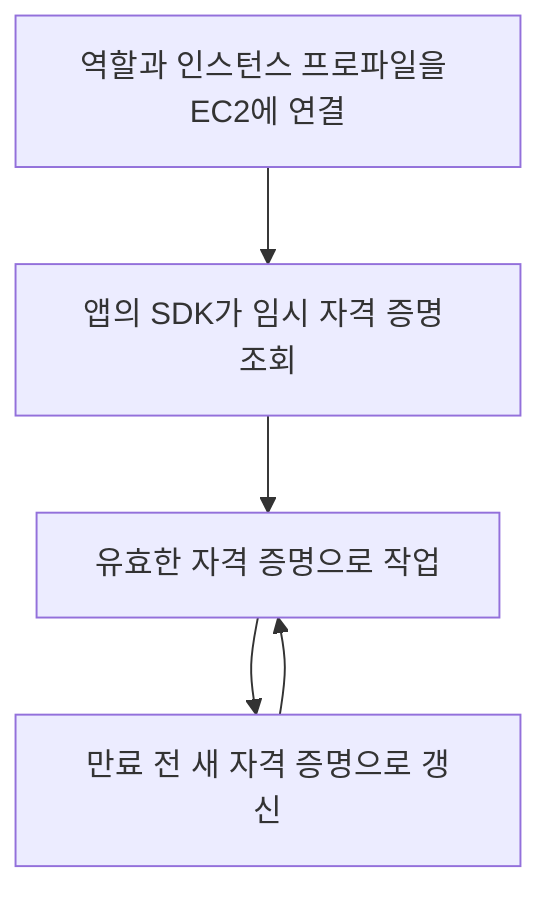
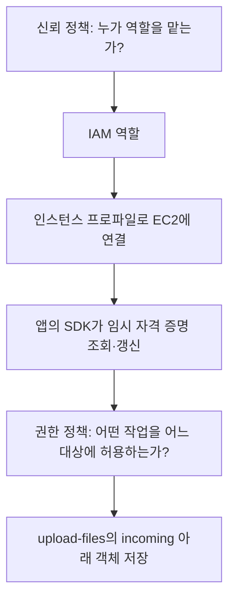

# 2주차 다섯 번째 수업: 회상 복습

예상 10~15분 · 자료를 덮고 자기 말로 설명하기 · 평가 완료
실제 AWS 계정 조작 없음

## 현재 상태

종합 확인의 부족한 개념을 별도 보완 문제 2/2로 재확인했다.
처음 받은 종합 확인 점수는 그대로 유지한다.
이번에는 핵심 개념을 연결해서 설명하고 2주차를 마무리한다.
2026-11-01 회상 답변과 앞선 보완 평가를 함께 확인하고 2주차 완료를 기록했다.

## 보완 설명: 갱신 시점

EC2 앱에서 SDK의 역할 자격 증명 공급자를 사용하면 임시 자격 증명의 조회와 갱신을 맡길 수 있다.
만료 후 요청이 실패할 때마다 사람이 새 값을 넣는 방식이 아니다.
자격 증명 공급자는 만료 전에 갱신해 유효한 자격 증명을 사용하도록 한다.
정확한 갱신 시점은 SDK와 설정 등에 따라 다르다.

## 회상 문제 — 답변 전 해설을 추가하지 않는다

자료를 덮고 각 문항에 짧게 답한다.

1. IAM 역할의 신뢰 정책과 권한 정책은 각각 무엇을 정하는가?
   EC2 앱이 역할을 사용하도록 연결하는 구성의 이름도 설명하자.
2. 루트 사용자에 MFA를 설정하면 일상 작업에 루트를 사용해도 되는가?
   인증 강화와 최소 권한을 구분하고 FIDO와 TOTP의 차이도 한 문장씩 설명하자.
3. EC2 업로드 앱은 `upload-files` 버킷의 `incoming/` 아래 객체만 저장한다.
   필요한 작업과 대상 범위를 설명하자.
   장기 키 없이 자격 증명을 조회하고 갱신하는 방법과 임시 자격 증명이 탈취되었을 때의 한계도 설명하자.

다른 정책의 추가 허용이나 명시적 거부는 없다고 가정한다.
S3 목록 조회와 암호화 키 및 버전별 작업은 요구하지 않는다.

## 다음 주 예고

2주차를 마치면 3주차 네트워크 기초로 넘어간다.
IP와 DNS 및 HTTP/HTTPS 같은 새 용어는 다음 자료에서 쉬운 정의와 그림으로 먼저 설명한다.

## 이전 자료

- [종합 확인과 보완 평가](09_2주차_종합_확인.md)
- [사용자·역할 및 두 정책](07_IAM_사용자와_역할_두_정책.md)
- [최소 권한 설계](08_역할과_최소권한_설계_연습.md)

## 2026-11-01 회상 복습 평가

1. 핵심 이해 확인 및 표현 보완.
   권한 정책과 인스턴스 프로파일은 정확히 설명했다.
   신뢰 정책의 “누가 접근할 수 있는지”는 “누가 이 역할을 맡을 수 있는지”로 표현을 좁힌다.
   S3 접근 허용 자체와 역할을 맡는 허용을 구분한다.
2. 루트 사용 판단은 정답이며 MFA 방식 설명은 이번 답변에서 생략되었다.
   MFA를 설정해도 일상적인 루트 사용은 최소 권한 원칙에 맞지 않는다는 판단이 정확하다.
   FIDO가 더 강하다는 결론 외에 FIDO는 서비스 요청에 서명하고 TOTP는 시간 기반 코드를 입력한다는 차이까지 말하면 완전하다.
   FIDO/TOTP 구분과 피싱 내성의 이유는 앞선 보완 확인 A에서 이미 정확히 답했으므로 함께 반영한다.
3. 작업과 SDK 갱신 및 탈취 한계는 정답이며 대상 범위 설명은 이번 답변에서 생략되었다.
   저장 작업은 정확한 표기로 `s3:PutObject`다.
   대상은 `upload-files` 버킷의 `incoming/` 아래 객체만이다.
   기존 정책에 추가할 때도 이전의 불필요한 작업이나 대상 허용이 남지 않도록 검토한다.
   SDK로 임시 자격 증명을 조회하고 만료 전에 갱신하며 탈취된 자격 증명은 만료 전까지 악용될 수 있다는 설명이 정확하다.
   작업과 대상 범위를 함께 제한하는 이해는 앞선 설계 연습과 보완 확인 B에서 확인했으므로 함께 반영한다.

### 마무리 그림

## 주차 완료 판단

최초 종합 확인은 정답 3문항과 부분 정답 1문항 및 미응답 1문항으로 유지한다.
이후 다른 상황의 보완 문제 2/2에서 부족했던 개념을 확인했다.
이번 회상 답변의 핵심 설명과 이전에 확인한 이유를 함께 반영하고 생략한 표현을 보완했다.
종합 확인 점수를 5/5로 바꾸거나 회상 답변에 임의 점수를 부여하지 않는다.
보완 후 재확인과 회상 복습을 거쳐 **2주차 완료(2/32)**로 기록한다.

다음은 3주차 첫 수업 자료를 준비하는 것이다.
IP와 DNS 및 사용자 요청 경로를 쉬운 정의와 그림부터 설명한다.
3주차 자료는 아직 작성하지 않았다.
