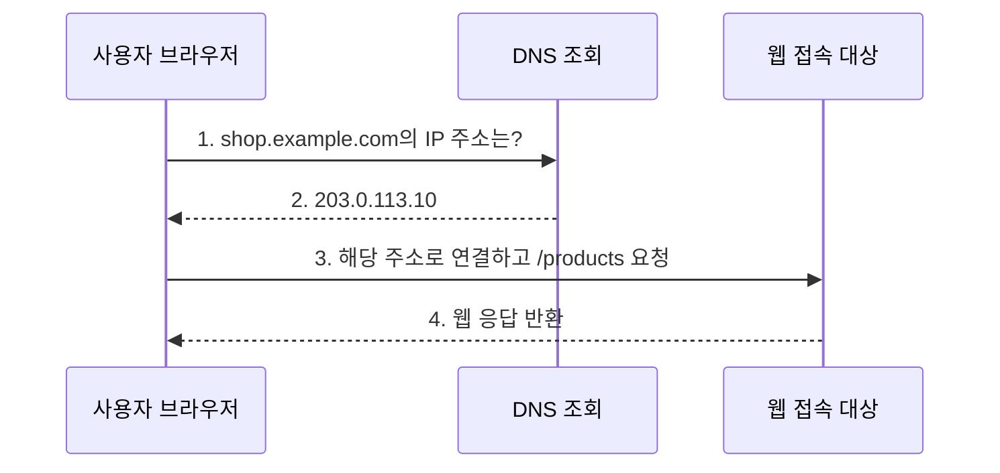
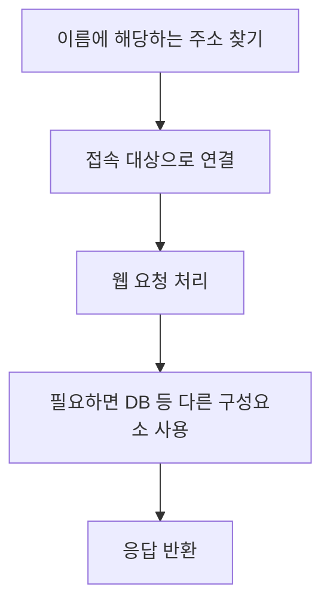
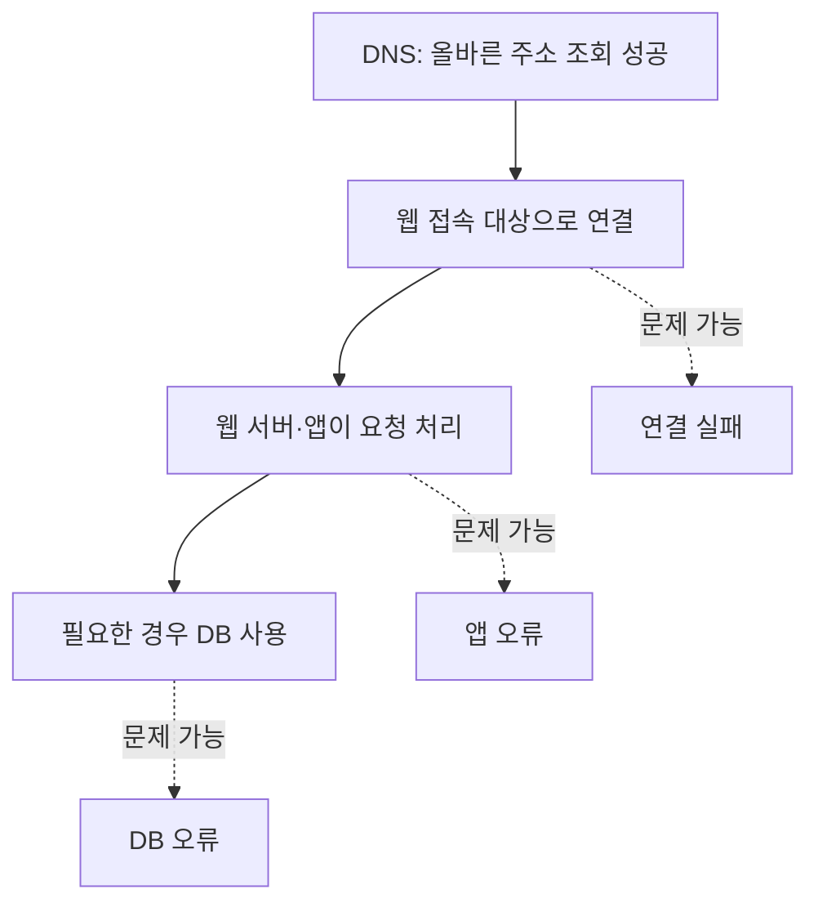

# 3주차 첫 수업: IP와 DNS 및 웹 요청 흐름

예상 25~35분 · 계정 없이 개념 학습 · 확인 문제 평가 완료 3/3

## 목표

도메인 이름과 IP 주소 및 URL 경로를 구분한다.
DNS 조회와 웹 요청이 서로 다른 과정임을 설명한다.
DNS가 정상이라고 웹 서비스 전체가 정상인 것은 아님을 이해한다.

## 1. 네트워크와 IP 주소

네트워크(Network)는 기기들이 데이터를 주고받을 수 있도록 연결한 것이다.
인터넷은 여러 네트워크가 서로 연결된 큰 통신망이다.

IP(Internet Protocol)는 네트워크 사이에서 데이터를 전달하는 데 사용하는 규칙이다.
IP 주소는 그 통신에서 출발지나 목적지를 나타내는 주소다.
실무에서는 “IP”라는 말을 IP 주소의 줄임말로도 사용한다.

예: `203.0.113.10`은 IPv4 주소 형식이다.
IPv4는 숫자 네 부분을 점으로 구분하며 각 부분은 0~255 범위다.
이 자료의 주소는 문서 설명용이므로 실제 접속 대상이 아니다.
IPv6라는 다른 주소 체계도 있지만 이번에는 IPv4 예시로 이해한다.

IP 주소를 서버 한 대의 영구적인 고유 이름이라고 생각하지 않는다.
주소가 바뀌거나 여러 서비스가 같은 주소를 사용할 수도 있다.
공인·사설 IP와 주소 범위 계산은 다음 수업에서 다룬다.

## 2. 도메인 이름과 URL

도메인 이름은 사람이 읽고 기억하기 편한 이름이다.
예: `shop.example.com`.
이번에는 웹 접속 대상의 이름이라는 뜻으로 사용한다.

URL은 웹 자원이 어디에 있고 어떤 방식으로 접근할지 표현한 주소다.
아래 URL의 각 부분을 구분해 보자.

`https://shop.example.com/products`

| 부분 | 의미 |
|---|---|
| https | 웹 통신 방식 |
| shop.example.com | 접속할 호스트의 도메인 이름 |
| /products | 해당 웹 서비스 안에서 요청할 경로 |

호스트(Host)는 네트워크에서 통신하는 대상이다.
도메인 이름과 전체 URL은 같은 말이 아니다.
DNS가 `/products`라는 페이지 경로를 IP 주소로 바꾸는 것은 아니다.

## 3. DNS는 이름에 해당하는 주소를 찾는다

DNS(Domain Name System)는 도메인 이름에 대한 정보를 조회하는 체계다.
웹 접속에서는 이름에 해당하는 IP 주소를 찾는 데 사용한다.
이름으로 전화번호를 찾는 주소록과 비슷하다.

예: 브라우저가 `shop.example.com`의 주소를 조회해 `203.0.113.10`이라는 IP 주소를 얻었다고 가정한다.
브라우저는 그 주소의 접속 대상과 통신한다.
DNS가 웹 페이지 본문을 대신 전달하는 것은 아니다.

DNS 서버의 역할은 구분되어 있고 조회가 여러 단계를 거칠 수 있다.
이번 그림에서는 그 과정을 DNS 조회라는 한 단계로 묶는다.
실제 DNS는 IP 주소 외의 정보도 제공할 수 있지만 이번에는 주소 조회에 집중한다.

## 4. 그림: 이름 조회와 웹 요청을 분리해서 보기

브라우저는 DNS에서 주소를 얻은 뒤 웹 접속 대상으로 요청한다.
사용자의 웹 요청이 반드시 DNS 서버를 거쳐 웹 서버로 전달되는 구조는 아니다.

캐시(Cache)는 이전에 얻은 결과를 잠시 보관하고 재사용하는 것이다.
DNS 결과가 유효하게 캐시되어 있으면 외부 DNS에 매번 새로 조회하지 않을 수 있다.
위 그림은 사용할 캐시가 없고 필요한 연결을 새로 만드는 상황을 단순화했다.

실제 웹 접속 대상은 웹 서버 앞의 ALB 같은 서비스일 수도 있다.
DNS 주소 조회와 ALB의 정상 웹 서버 선택은 서로 다른 역할이다.

## 5. HTTP와 HTTPS의 첫 이해

HTTP는 브라우저와 웹 서버가 요청과 응답을 주고받는 규칙이다.
HTTPS는 TLS라는 보안 기술로 보호되는 HTTP 통신이다.
TLS는 통신 상대를 확인하고 전송 중인 데이터를 보호하는 데 사용된다.
HTTPS 연결을 설정하는 세부 단계와 포트는 이후 수업에서 다룬다.

예: 브라우저가 `/products`를 요청하면 서버가 상품 화면을 응답할 수 있다.
DNS는 접속 대상의 주소를 찾고 HTTP/HTTPS는 웹 요청과 응답에 사용된다.
이번에는 이 역할 구분까지만 이해한다.

## 6. 주소를 찾았다고 서비스가 정상인 것은 아니다

DNS가 올바른 IP 주소를 응답해도 연결 경로의 문제나 웹 서버 오류로 페이지가 열리지 않을 수 있다.
반대로 서버가 정상이어도 이름을 올바른 주소로 찾지 못하면 새로 접속하기 어려울 수 있다.

이 흐름은 장애 원인을 나누어 살펴보기 위한 단순화다.
모든 요청이 DB를 사용한다는 뜻은 아니다.

DNS 성공만으로 서버와 애플리케이션이 정상이라고 단정하지 않는다.
페이지가 안 열린다는 증상만으로 DB 장애라고 단정하지도 않는다.
어느 단계까지 성공했는지 확인하는 것이 출발점이다.

## 7. 확인 문제 — 번호와 이유를 함께 답하기

### 1. URL 구분

URL은 `https://files.example.com/manuals/start`다.

1-1. 도메인 이름은 무엇인가?
1-2. 요청 경로는 무엇인가?
1-3. DNS로 찾으려는 것은 페이지 내용인가 접속 대상의 IP 주소인가?

### 2. DNS와 웹 요청

동료가 “DNS는 사용자의 상품 페이지 요청을 받아 웹 서버에 전달하고 응답도 대신 전달한다”고 말했다.

2-1. 이 설명이 맞는가?
2-2. DNS 조회 이후 브라우저와 웹 접속 대상의 관계를 설명하자.

### 3. DNS 성공과 서비스 정상 여부

DNS가 올바른 IP 주소를 응답했지만 브라우저에 페이지가 표시되지 않는다.

3-1. “DNS가 성공했으므로 웹 서버도 정상이다”라는 판단이 맞는가?
3-2. 이후 어떤 단계에서 문제가 생길 수 있는지 한 가지 이상 설명하자.

정답과 해설은 아래 평가에 반영했다.
3주차 전체 완료 평가는 별도 새로운 문제로 진행한다.

## 참고 자료

확인: 2026-11-01

- [Cloudflare DNS 설명](https://www.cloudflare.com/learning/dns/what-is-dns/)
- [MDN 인터넷의 동작](https://developer.mozilla.org/en-US/docs/Learn_web_development/Howto/Web_mechanics/How_does_the_Internet_work)

## 2026-11-01 답변 평가 — 3/3

1. 정답이며 요청 경로 표기를 보완한다.
   도메인 이름은 `files.example.com`이다.
   요청 경로는 앞의 슬래시를 포함한 `/manuals/start`다.
   사용자는 경로 구성은 정확히 구분했으나 맨 앞의 `/`를 생략했다.
   DNS로 찾는 것은 이 상황에서 접속 대상의 IP 주소라는 답이 정확하다.
2. 정답.
   이름 조회와 브라우저의 웹 요청·응답을 정확히 구분했다.
   DNS가 IP만 반환하는 기능만 있다고 일반화하지는 않는다.
   이번 웹 접속 예제에서는 IP 주소 조회에 집중한 것이고 DNS는 다른 종류의 정보도 제공할 수 있다.
3. 정답이며 장애 후보의 조건을 보완한다.
   DNS 성공과 웹 서비스 정상 여부를 별도로 판단해야 한다는 이유가 정확하다.
   DB 장애는 페이지 처리가 DB에 의존할 경우 가능한 원인이다.
   다만 이 증상만으로 DB 장애라고 확정할 수 없다.
   웹 접속 대상까지의 연결 문제나 웹 서버·앱 오류도 원인일 수 있다.

3주차 첫 수업 기초 확인 완료.
3주차 전체는 아직 진행 중이다.
다음은 공인 IP와 사설 IP의 차이를 설명하는 자료를 먼저 준비한다.
