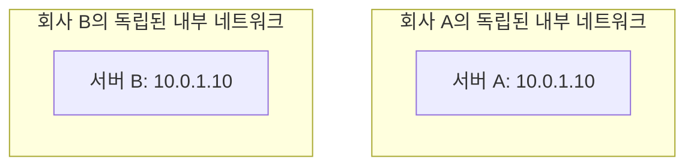
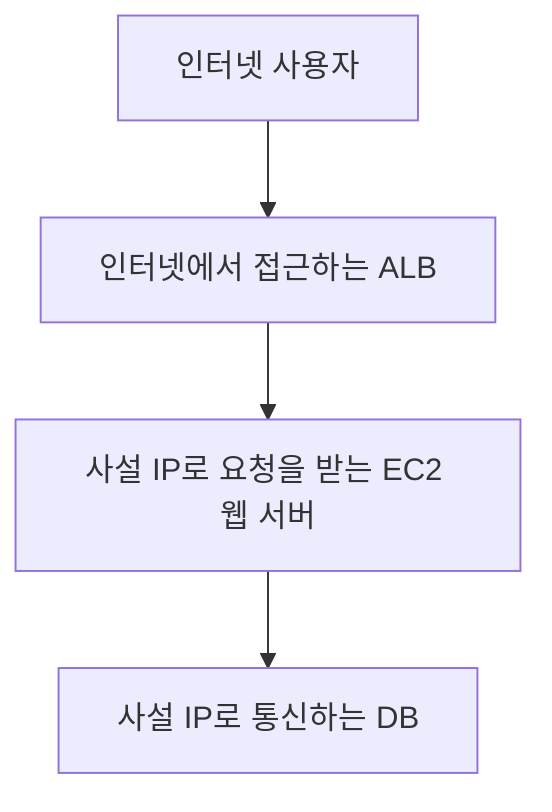
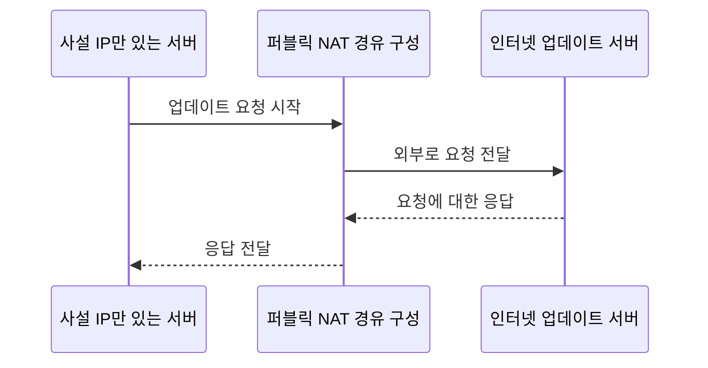
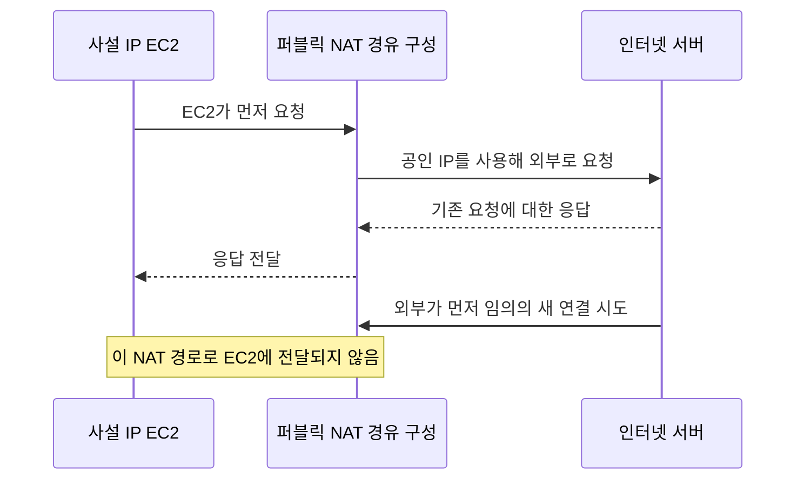
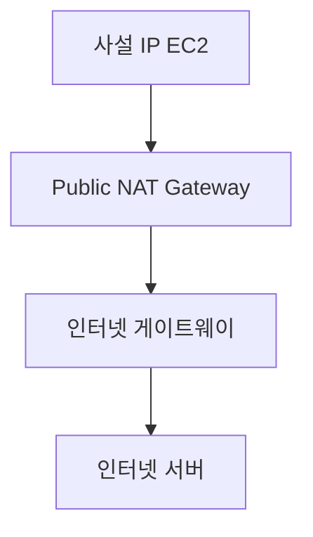
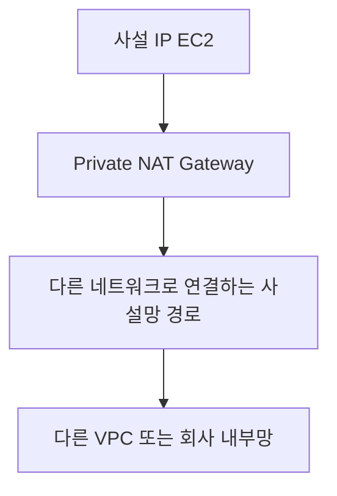

# 3주차 두 번째 수업: 공인 IP와 사설 IP

예상 25~35분 · IPv4 기준 · 실제 AWS 리소스 생성 없음
확인 문제 평가 완료: 정답 2문항 · 부분 정답 1문항

## 목표

공인 IPv4 주소와 사설 IPv4 주소의 용도를 구분한다.
주소의 종류와 실제 연결 가능 여부를 구분한다.
사설 IP 서버의 외부 통신을 개략적으로 설명한다.

## 1. 공인 IP와 사설 IP

공인 IP는 공용 인터넷에서 목적지로 찾아갈 수 있도록 사용하는 주소다.
사설 IP는 내부 네트워크에서 사용하는 주소다.
인터넷에서 사설 IP를 목적지로 지정해 해당 서버에 직접 접속할 수는 없다.

공인 IP를 건물의 외부 주소에 비유하면 사설 IP는 내부 호수와 비슷하다.
다른 건물에도 101호가 있을 수 있듯 서로 분리된 네트워크에서 같은 사설 IP를 사용할 수 있다.
이 비유는 주소의 사용 범위를 설명하기 위한 것이며 실제 네트워크 연결 절차와 완전히 같지는 않다.

| 구분 | 공인 IPv4 | 사설 IPv4 |
|---|---|---|
| 주요 용도 | 인터넷에서 식별하는 주소 | 내부 통신용 주소 |
| 공용 인터넷에서 직접 목적지로 사용 | 가능하도록 설계 | 불가 |
| 서로 분리된 네트워크의 같은 주소 사용 | 일반적인 공인 주소는 전역적으로 중복되지 않게 할당 | 가능 |
| 실제 접속 가능 여부 | 경로·보안 규칙·서비스 상태도 필요 | 내부 연결에서도 경로·보안 규칙·서비스 상태 필요 |

사설 IP라고 자동으로 안전한 것은 아니다.
연결된 내부 네트워크에서도 허용할 통신을 제한해야 한다.

## 2. 사설 IPv4 주소 범위

일반적인 사설 IPv4 주소는 다음 세 범위다.
이번에는 범위와 예시를 보고 구분하며 CIDR 표기는 다음에 배운다.

| 범위 | 예 |
|---|---|
| 10.0.0.0 ~ 10.255.255.255 | 10.0.1.10 |
| 172.16.0.0 ~ 172.31.255.255 | 172.20.1.10 |
| 192.168.0.0 ~ 192.168.255.255 | 192.168.1.10 |

172로 시작한다고 모두 사설 IP는 아니다.
사설 범위가 아니라는 이유만으로 모든 주소가 공인 IP라고 단정하지 않는다.
별도 용도의 예약 주소도 있다.
이번 문제에서는 표 안의 사설 주소를 중심으로 판단한다.

위 구성처럼 서로 연결되지 않은 내부 네트워크는 같은 사설 IP를 쓸 수 있다.
나중에 두 네트워크를 연결하려면 주소가 겹치는 문제도 검토해야 한다.
구체적인 해결 방법은 이후에 다룬다.

## 3. AWS에서 서버에 적용하기

EC2는 내부 통신용 사설 IPv4를 사용할 수 있다.
인터넷과 직접 통신하도록 구성할 때 공인 IPv4를 추가로 연결할 수 있다.
공인 IP가 있다고 자동으로 웹 페이지가 열리지는 않는다.

연결에는 데이터를 전달할 경로와 해당 통신을 허용하는 보안 규칙 및 실제 실행 중인 서비스가 필요하다.
경로는 네트워크가 데이터를 어느 쪽으로 보낼지 정하는 설정이다.
구체적인 라우팅과 보안 그룹 설정은 다음 수업에서 다룬다.

인터넷 사용자를 받는 접점과 내부 서버를 나눌 수도 있다.
이전에 배운 ALB가 공개 접점이 되고 웹 서버는 사설 IP로 요청을 받을 수 있다.
다음 그림은 적절한 경로와 보안 규칙 및 서비스가 준비된 경우다.

EC2와 DB 각각에 공인 IP를 줘야 사용자에게 서비스를 제공할 수 있는 것은 아니다.
사설 IP는 이번에 새로 배운 네트워크 주소 개념이고 IAM 역할의 임시 자격 증명과는 다른 개념이다.

## 4. 사설 IP 서버가 외부에 먼저 연결하는 경우

공인 IP가 없는 서버도 별도 경유 구성을 통해 외부에 먼저 연결할 수 있다.
예를 들어 업데이트 파일을 받기 위해 인터넷 서버에 요청할 수 있다.
인터넷이 서버로 먼저 새 연결을 시작하는 것과 구분한다.

NAT(Network Address Translation)는 통신할 때 IP 주소 등을 변환하는 기술이다.
AWS의 퍼블릭 NAT Gateway는 내부 서버의 인터넷 방향 통신에 사용할 수 있는 관리형 서비스다.
서버가 먼저 시작한 연결의 응답은 돌아올 수 있다.
이 구성만으로 인터넷 사용자가 해당 서버로 임의의 새 연결을 시작할 수 있는 것은 아니다.

실제 AWS 구성에는 인터넷 게이트웨이와 라우팅 및 보안 설정도 필요하다.
인터넷 게이트웨이는 VPC라는 AWS 내부 네트워크와 인터넷 사이의 통신을 지원하는 구성이다.
위 그림은 이를 NAT 경유 구성으로 묶어 표현했다.
VPC와 서브넷 및 상세 연결은 4주차에서 다룬다.
NAT Gateway를 생성하는 실습은 하지 않는다.

## 5. 확인 문제 — 번호와 이유를 함께 답하기

### 1. 사설 주소의 재사용

회사 A와 B는 서로 연결되지 않은 내부 네트워크를 사용한다.
양쪽에 IP 주소가 10.2.3.4인 서버가 있다.

1-1. 이 주소는 공인 IP인가 사설 IP인가?
1-2. 네트워크가 분리된 현재 상황에서 같은 주소를 사용할 수 있는가?
이유도 설명하자.

### 2. 공인 IP와 실제 접속

EC2에 공인 IP를 연결했지만 브라우저에서 웹 페이지가 열리지 않는다.

2-1. “공인 IP만 있으면 언제나 접속할 수 있으므로 서버 문제일 리 없다”는 설명이 맞는가?
2-2. 주소 외에 확인할 조건을 두 가지 이상 설명하자.

### 3. 공인 IP 없는 서버의 업데이트

EC2는 사설 IP만 사용한다.
업데이트 파일을 받기 위한 퍼블릭 NAT 경유 구성이 올바르게 준비되어 있다.

3-1. 이 서버가 인터넷 업데이트 서버에 먼저 요청하고 응답을 받을 수 있는가?
3-2. 이 구성이 있다는 이유만으로 인터넷 사용자가 EC2에 임의의 새 연결을 시작할 수 있는가?
나가는 요청의 응답과 외부에서 먼저 시작하는 연결을 구분해 설명하자.

정답과 해설은 아래 평가에 반영했다.
이번 확인만으로 3주차 전체를 완료하지 않는다.

## 공식 참고 자료

확인: 2026-11-01

- [EC2 IP 주소](https://docs.aws.amazon.com/AWSEC2/latest/UserGuide/using-instance-addressing.html)
- [AWS NAT Gateway](https://docs.aws.amazon.com/vpc/latest/userguide/vpc-nat-gateway.html)
- [사설 주소 범위 RFC 1918](https://datatracker.ietf.org/doc/html/rfc1918)

## 2026-11-01 답변 평가

1. 정답.
   10.2.3.4는 사설 IPv4다.
   서로 연결되지 않은 내부 네트워크에서 같은 사설 주소를 재사용할 수 있다는 이유가 정확하다.
2. 정답.
   공인 IP만으로 접속이 보장되지 않는다는 판단이 정확하다.
   경로와 보안 규칙 및 서비스 상태를 확인해야 한다고 설명했다.
3. 부분 정답이며 결론과 이유를 구분한다.
   3-1의 서버 시작 요청과 NAT를 통한 주소 변환 및 응답 흐름은 정확하다.
   3-2에서 외부가 이 NAT 경로로 임의의 새 연결을 시작할 수 없다는 판단도 맞다.
   다만 “공인 IP가 없기 때문”은 이 구성 전체를 설명하는 정확한 이유가 아니다.
   EC2 자체에는 공인 IP가 없어도 퍼블릭 NAT를 통한 인터넷 통신에는 공인 IP가 사용된다.
   핵심은 이 NAT 구성이 내부에서 시작한 연결과 그 응답을 처리하며 외부의 임의 새 연결을 내부 서버에 전달하는 용도가 아니라는 점이다.
   인터넷에서 접근하는 ALB를 별도로 구성하면 ALB가 사설 IP 웹 서버로 요청을 전달하는 설계도 가능하다.
   NAT와 ALB는 서로 다른 역할을 맡는다.

### 보완 그림: 외부 응답과 새 연결은 다르다

단순화한 그림이며 실제 구성의 인터넷 게이트웨이와 경로를 NAT 경유 구성에 묶었다.
3-2의 이유를 설명으로 보완했으며 독립적인 재확인은 이후 종합 확인에서 진행한다.
다음은 HTTP/HTTPS와 포트 수업 자료를 그림과 함께 먼저 준비한다.
3주차 전체는 아직 진행 중이다.

## 보충: Public NAT Gateway와 Private NAT Gateway

AWS NAT Gateway의 연결 유형을 비교한다.
둘 다 내부 서버가 먼저 시작한 통신의 주소를 변환하고 응답을 돌려보낸다.
Public과 Private은 EC2의 사설 IP 여부를 구분하는 이름이 아니다.
둘 다 사설 IP 서버가 사용할 수 있다.

| 구분 | Public NAT Gateway | Private NAT Gateway |
|---|---|---|
| 대표 용도 | 내부 서버의 인터넷 방향 통신 | 다른 VPC나 회사 내부망 방향 통신 |
| Elastic IP 연결 | 사용 | 연결 불가 |
| 인터넷 게이트웨이를 통한 인터넷 연결 | 필요한 경로를 구성하면 가능 | 불가 |
| 외부에서 임의의 새 연결 시작 | 허용하지 않음 | 허용하지 않음 |

Elastic IP는 AWS에서 할당받아 연결하는 고정 공인 IPv4 주소다.

### 인터넷으로 나가는 예

NAT Gateway가 출발지 주소를 자신의 사설 IP로 변환한다.
인터넷 게이트웨이가 이를 연결된 Elastic IP로 변환한다.
인터넷 서버에서는 이 공인 IP를 출발지로 보게 된다.
응답은 반대 방향으로 변환되어 돌아온다.

### 사설망으로 나가는 예

VPC는 AWS에서 구성하는 가상 네트워크다.
사설망 경로는 Transit Gateway 같은 별도 연결 구성을 뜻하며 NAT만으로 두 네트워크가 연결되지는 않는다.
이 경우 대상에서는 Private NAT Gateway의 사설 IP를 출발지로 보게 된다.

Private NAT를 인터넷 게이트웨이에 연결한다고 Public NAT로 바뀌지는 않는다.
그 경로로 보낸 트래픽은 인터넷 게이트웨이에서 버려진다.
Public NAT도 사설망 연결에 사용할 수 있다.
그때 같은 VPC의 인터넷 게이트웨이를 통과하지 않으면 Elastic IP 대신 NAT의 사설 IP가 출발지로 사용된다.

이번에는 인터넷으로 나가는 NAT와 사설망으로 나가는 NAT의 차이에 집중한다.
세부 경로 설정은 VPC 수업에서 다룬다.

참고: [AWS NAT Gateway 연결 유형](https://docs.aws.amazon.com/vpc/latest/userguide/vpc-nat-gateway.html).
확인: 2026-11-01.
