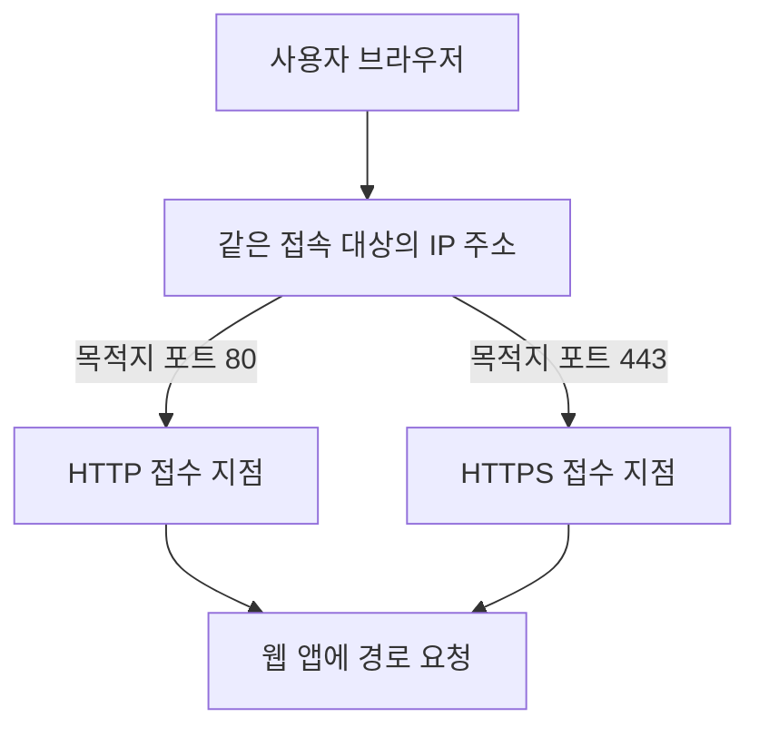
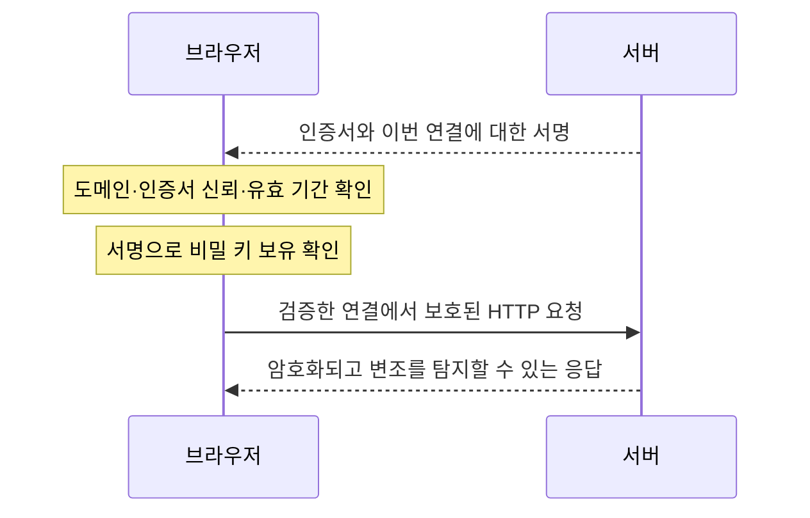
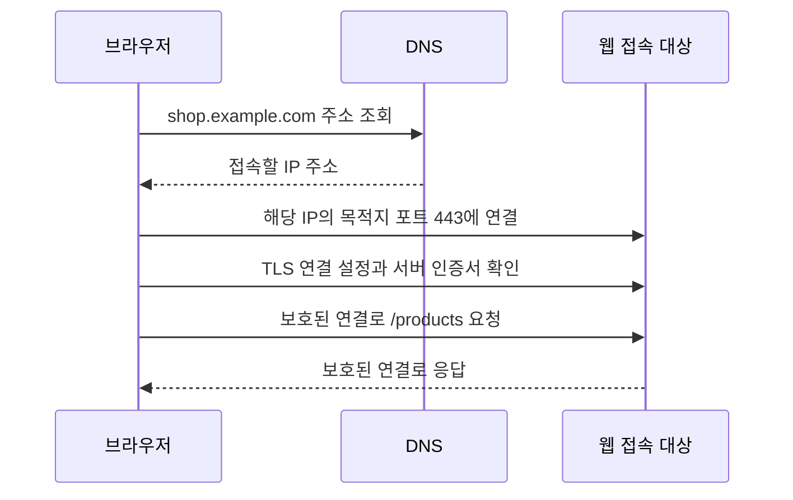

# 3주차 세 번째 수업: HTTP/HTTPS와 포트

예상 25~35분 · 실제 AWS 설정 변경 없음 · 확인 문제 평가 완료 · 3-1 수정 답변 확인

## 목표

IP 주소와 포트 및 URL 경로를 구분한다.
HTTP와 HTTPS의 기본 포트를 알고 다른 포트를 사용할 수도 있음을 이해한다.
HTTPS가 보호하는 범위와 접속에 필요한 조건을 설명한다.

## 1. 포트는 같은 주소에서 통신 대상을 구분한다

IP 주소는 네트워크에서 접속할 주소다.
포트(Port)는 해당 주소에서 어떤 통신 서비스를 사용할지 구분하는 번호다.
물리적인 케이블 연결 구멍을 말하는 것이 아니다.
IP를 건물 주소로 비유하면 포트는 그 건물의 업무별 접수 창구와 비슷하다.
URL 경로는 창구를 찾아간 뒤 요청하는 자료에 비유할 수 있다.

같은 서버에서 여러 포트의 요청을 처리할 수 있다.
각 포트에 실제로 요청을 받는 서비스가 설정되어 있어야 한다.
이를 서비스가 해당 포트에서 수신한다거나 리슨(Listen)한다고 표현한다.
목적지 포트를 선택하는 것과 그 포트를 보안 규칙에서 허용하는 것은 별도다.

## 2. HTTP와 HTTPS

HTTP(Hypertext Transfer Protocol)는 웹 요청과 응답을 주고받는 규칙이다.
예: 브라우저가 `/products` 내용을 요청하고 웹 서비스가 상품 화면을 응답한다.
평문 HTTP 자체는 통신 내용의 암호화를 제공하지 않는다.

HTTPS는 TLS(Transport Layer Security)로 보호하는 HTTP 통신이다.
TLS는 전송 중인 내용을 암호화하고 변조를 탐지하며 인증서와 비밀 키 보유 증명을 이용해 접속 대상 서버의 신원을 확인하는 데 사용한다.
이번에는 인증서가 정상적으로 검증되는 상황을 가정한다.
인증서는 접속 대상의 신원을 확인하는 데 사용하는 디지털 증명서다.

HTTPS라고 웹 서비스 자체의 오류나 모든 공격을 막는 것은 아니다.
사용자에게 어떤 파일을 허용할지 정하는 권한 관리나 서버 보안 패치도 여전히 필요하다.
HTTPS 보호를 웹 서버 안의 데이터나 DB에 자동으로 확대해 해석하지 않는다.
예를 들어 브라우저와 ALB 사이만 HTTPS라면 ALB와 웹 서버 사이의 보호는 따로 확인해야 한다.

### 보충: “인증서 등”이 아니라 무엇을 확인하는가?

일반적인 브라우저의 인증서 기반 HTTPS 연결을 기준으로 설명한다.
TLS 1.3의 새 연결을 예로 들며 세션 재개 같은 예외 흐름은 생략한다.

| 확인 항목 | 확인하는 내용 |
|---|---|
| 접속 이름 | 접속한 도메인 이름이 인증서의 허용된 이름과 맞는가? |
| 인증서 신뢰 | 인증서의 서명이 유효하고 브라우저가 신뢰하는 인증기관까지 검증 경로가 이어지는가? |
| 유효 기간 | 인증서가 아직 유효한 기간 안에 있는가? |
| 비밀 키 보유 | 상대가 인증서의 공개 키에 대응하는 비밀 키로 이번 연결에 대한 서명을 만들 수 있는가? |

인증기관(CA)은 인증서를 발급하고 서명하는 기관이다.
공개 키는 서명을 확인하는 데 쓰고 비밀 키는 서명을 만드는 데 쓴다.
인증서는 공개 정보이므로 인증서 파일을 보여주는 것만으로는 서버 신원을 증명할 수 없다.
서버는 해당 인증서의 비밀 키를 사용할 수 있다는 증거도 제공한다.
브라우저는 비밀 키를 직접 받는 것이 아니라 서명을 검증한다.
위 표는 대표적인 확인 항목이며 모든 인증서 검증 규칙의 전체 목록은 아니다.

이 그림은 서버 인증의 핵심을 단순화했으며 실제 키 합의와 메시지 교환 순서를 모두 그린 것은 아니다.
TLS 연결 설정에서는 양쪽이 사용할 TLS 버전과 암호 방식 및 통신용 키도 합의한다.
이후에는 통신 내용을 암호화하고 수신 데이터가 변조되지 않았는지 검증한다.

일반적인 HTTPS는 서버의 신원을 확인하며 사용자의 로그인 신원이나 파일 접근 권한을 자동으로 확인하는 것은 아니다.
설정에 따라 클라이언트 인증서도 요구하는 상호 TLS(mTLS)를 사용할 수 있다.
HTTPS가 정상이어도 그 사이트의 운영자가 정직하다거나 앱에 취약점이 없다는 뜻은 아니다.

참고: [MDN TLS 기능과 서버 인증](https://developer.mozilla.org/en-US/docs/Web/Security/Defenses/Transport_Layer_Security)과 [TLS 1.3 비밀 키 보유 증명](https://www.rfc-editor.org/rfc/rfc8446.html#section-4.4.3).

## 3. 기본 포트와 명시한 포트

| URL의 통신 방식 | 생략했을 때 사용하는 기본 목적지 포트 |
|---|---|
| http | 80 |
| https | 443 |

`https://shop.example.com/products`는 목적지 포트 443을 기본으로 사용한다.
`https://shop.example.com:8443/products`는 URL에서 지정한 목적지 포트 8443을 사용한다.
HTTPS가 반드시 443에서만 동작하는 것은 아니다.
해당 포트에 TLS와 웹 서비스가 제대로 설정되어 있어야 한다.

반대로 포트 번호를 443으로 바꾼다고 평문 HTTP 서비스가 저절로 HTTPS가 되지는 않는다.
웹 통신 방식과 서비스의 TLS 설정도 맞아야 한다.

### URL을 나누어 보기

`https://shop.example.com:8443/products`

| 요소 | 값 |
|---|---|
| 통신 방식 | https |
| 도메인 이름 | shop.example.com |
| 목적지 포트 | 8443 |
| 요청 경로 | /products |

기본적인 도메인 주소 조회는 DNS로 진행한다.
이번 웹 접속 예제에서 포트는 URL의 지정값이나 통신 방식의 기본값으로 정한다.
DNS가 `/products` 경로나 포트 번호를 IP 주소의 일부로 바꾸는 것은 아니다.

## 4. 전체 흐름

이번에는 TCP를 사용하는 HTTPS 연결을 예로 든다.
TCP는 기기 사이에 연결을 만들고 데이터를 순서 있게 전달하는 통신 규칙이다.
HTTP/3처럼 다른 전송 방식을 사용하는 경우는 이후에 다룬다.

DNS 캐시나 기존 연결은 없다고 가정하고 과정을 단순화했다.
연결을 막는 경로나 보안 규칙이 있거나 해당 포트의 서비스가 실행되지 않으면 요청이 실패할 수 있다.
포트가 허용되어도 TLS 설정 오류나 앱 오류가 있으면 서비스가 정상 동작하지 않을 수 있다.

## 5. 확인 문제 — 하위 번호와 이유를 함께 답하기

### 1. URL 구분

URL은 `https://docs.example.com:9443/help/start`다.

1-1. 도메인 이름과 요청 경로를 각각 쓰자.
1-2. 목적지 포트는 무엇인가?
1-3. `:9443`을 생략하면 HTTPS의 기본 목적지 포트는 무엇인가?

### 2. 포트별 허용과 접속

DNS는 올바른 주소를 응답한다.
서버의 HTTPS 서비스는 TCP 443에서 정상적으로 수신하고 있다.
필요한 경로는 정상이나 보안 규칙은 외부에서 들어오는 TCP 80만 허용한다.
브라우저는 `https://shop.example.com`에 접속한다.

2-1. TCP 80을 허용했으므로 이 HTTPS 연결도 통과한다고 볼 수 있는가?
2-2. 목적지 포트 관점에서 어떤 허용 규칙이 필요한가?
실제 운영에서는 허용할 출발지 범위도 필요한 수준으로 제한한다고 가정한다.

### 3. HTTPS 보호 범위

브라우저와 ALB는 정상적으로 HTTPS를 사용한다.
ALB와 웹 서버는 평문 HTTP로 통신한다.

3-1. 브라우저부터 웹 서버까지 모든 구간이 암호화되어 있다고 볼 수 있는가?
3-2. HTTPS를 사용하므로 파일 접근 권한 관리나 서버 패치가 필요 없다는 주장이 맞는가?
이유를 설명하자.

정답과 해설은 아래 평가에 반영했다.
3주차 전체는 아직 진행 중이다.

## 참고 자료

확인: 2026-11-01

- [MDN HTTP 개요](https://developer.mozilla.org/en-US/docs/Web/HTTP/Guides/Overview)
- [MDN URL의 호스트와 포트](https://developer.mozilla.org/en-US/docs/Web/URI/Reference/Authority)
- [MDN TLS 설명](https://developer.mozilla.org/en-US/docs/Web/Security/Defenses/Transport_Layer_Security)
- [이전 수업](12_공인_IP와_사설_IP.md)

## 2026-11-01 답변 평가

1. 정답.
   도메인은 docs.example.com이고 경로는 /help/start다.
   명시한 목적지 포트 9443과 HTTPS 기본 포트 443을 정확히 구분했다.
2. 정답.
   TCP 80만 허용되어 있으면 목적지 TCP 443의 HTTPS 연결도 허용되는 것은 아니다.
   서버가 TCP 443에서 수신하더라도 보안 규칙에서 그 통신이 허용되어야 한다.
   사용자는 TCP 443 허용이 필요하다고 정확히 답했다.
3. 초기 답변은 부분 정답이며 이후 3-1 수정 답변으로 이해를 확인했다.
   처음에는 모든 구간이 암호화되었다고 답했으나 이어서 “ALB에서 웹 서버는 암호화되어 있지 않다”고 수정했다.
   수정 답변이 정확하다.
   3-2는 처음부터 정답으로 HTTPS와 파일 권한·패치 책임을 구분했다.
   HTTPS는 암호화뿐 아니라 전송 중 변조 탐지와 서버 인증도 제공하지만 파일 권한과 패치까지 대신하지 않는다.

### 보완 그림: 두 연결의 보호 범위를 나누기

ALB가 브라우저와 맺은 TLS 연결을 끝내고 요청을 처리하는 것을 TLS 종료 또는 TLS termination이라고 한다.
여기서 종료는 장애로 연결이 끊긴다는 뜻이 아니라 해당 TLS 보호 구간의 끝이 ALB라는 뜻이다.
ALB에서 웹 서버로 보내는 연결은 별도 설정을 사용한다.
웹 서버까지 전송 중 암호화가 필요하면 이 구간도 HTTPS로 구성한다.
그 경우에도 브라우저와 ALB 및 ALB와 서버 사이에 별도의 TLS 연결이 존재한다.

초기 평가는 정답 2문항과 부분 정답 1문항이다.
사용자의 연속된 수정 답변으로 3-1 이해를 확인했다.
별도 새 재시험을 치르거나 처음부터 3/3을 받았다고 기록하지 않는다.

다음은 IPv4 주소 범위를 표현하는 CIDR의 기초 자료를 그림과 예제로 먼저 준비한다.
3주차 전체는 아직 진행 중이다.

참고: [ALB HTTPS 연결 종료](https://docs.aws.amazon.com/elasticloadbalancing/latest/application/create-https-listener.html)와 [대상 연결의 HTTP/HTTPS 설정](https://docs.aws.amazon.com/elasticloadbalancing/latest/application/load-balancer-target-groups.html).
