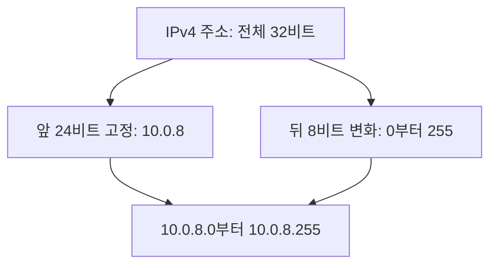
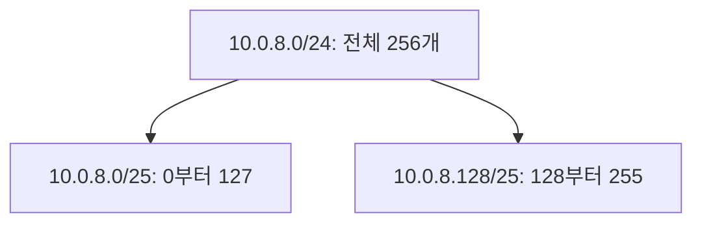
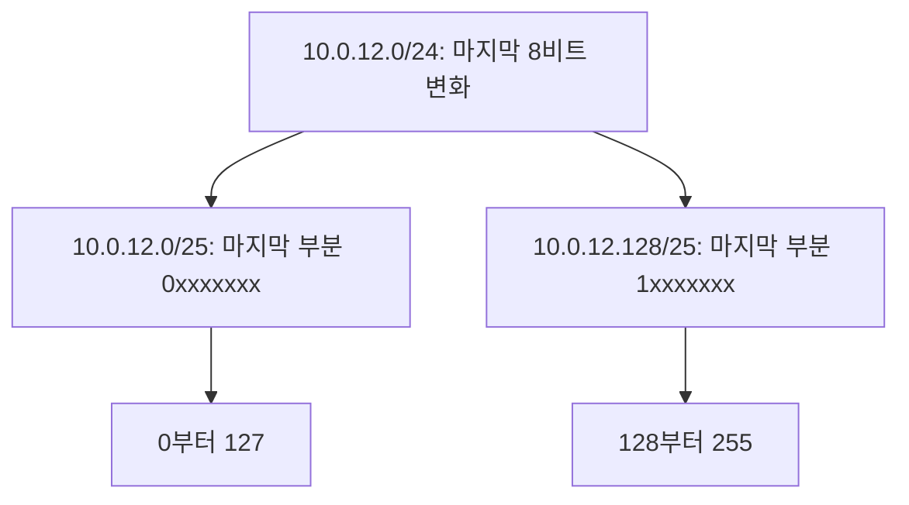

# 3주차 네 번째 수업: CIDR 주소 범위 기초

예상 30~40분 · IPv4 기준 · 실제 AWS 설정 변경 없음
확인 문제 평가 완료 3/3

## 목표

CIDR가 IP 주소 범위를 나타내는 표기임을 이해한다.
/24와 /25 및 /32의 주소 범위와 크기를 구분한다.
주소 범위의 포함 관계와 겹침을 판단한다.

## 1. CIDR는 여러 IP 주소를 한 묶음으로 표현한다

CIDR(Classless Inter-Domain Routing)는 IP 주소와 앞부분의 고정 길이를 함께 쓰는 표기법이다.
IP 범위를 표현할 때 `10.0.8.0/24`처럼 쓴다.
이번에는 CIDR의 주소 범위 표기에 집중한다.
라우팅의 상세 동작은 다음 주에 다룬다.

`10.0.8.0/24`는 IP 하나가 아니라 주소 범위다.
범위는 `10.0.8.0`부터 `10.0.8.255`까지다.
양 끝 주소를 포함해 총 256개다.
/24는 포트 번호나 서버 대수가 아니다.

## 2. /24의 24는 무엇인가?

비트(Bit)는 0 또는 1로 표현하는 정보의 단위다.
IPv4 주소는 총 32비트이며 화면에서는 8비트씩 네 부분의 숫자로 표현한다.
한 부분은 0~255의 값을 가진다.

/24는 앞 24비트를 범위를 구분하는 공통 부분으로 고정한다는 뜻이다.
남은 8비트가 달라질 수 있으므로 주소는 2의 8제곱인 256개다.

주소 개수는 `2^(32 - / 뒤의 숫자)`로 계산한다.
/ 뒤의 숫자를 접두사 길이(Prefix length)라고 한다.
숫자가 커질수록 고정하는 비트가 많아지고 변할 수 있는 비트가 줄어든다.
따라서 주소 범위도 작아진다.

| CIDR 예 | 범위의 전체 주소 개수 |
|---|---|
| 10.0.0.0/16 | 65,536개 |
| 10.0.8.0/24 | 256개 |
| 10.0.8.0/25 | 128개 |
| 10.0.8.0/26 | 64개 |
| 10.0.8.10/32 | 1개 |

CIDR 표기의 전체 주소 개수와 실제 AWS 리소스에 할당할 수 있는 주소 개수는 다르다.
일반적인 AWS IPv4 서브넷은 예약 주소가 있으므로 전체 주소를 모두 EC2에 할당할 수 없다.
서브넷은 VPC의 주소 범위를 나누어 사용하는 네트워크 구획이다.
예약 주소 계산과 실제 서브넷 설계는 4주차에서 다룬다.
이번 문제에서는 전체 주소 개수만 계산한다.

## 3. /24를 /25 두 개로 나누기

앞 24비트가 같던 범위에서 한 비트를 더 고정하면 /25가 된다.
/24의 주소 256개를 앞쪽 128개와 뒤쪽 128개로 나눌 수 있다.

앞쪽 범위는 10.0.8.0~10.0.8.127이다.
뒤쪽 범위는 10.0.8.128~10.0.8.255다.
두 /25 범위는 서로 겹치지 않는다.
상위 /24는 두 /25를 모두 포함한다.

이 예시의 /25에서는 마지막 숫자가 0 또는 128에서 범위가 시작한다.
주소 개수만큼 아무 위치에서나 자유롭게 시작하는 표기가 아니다.
예를 들어 10.0.8.50은 10.0.8.0/25 안의 주소다.
범위 이름으로는 공통 부분에 맞춘 시작 주소를 사용한다.

## 4. /32와 /0

/32는 32비트를 모두 고정하므로 IPv4 주소 하나를 나타낸다.
예: `10.0.8.10/32`는 10.0.8.10 하나다.

`0.0.0.0/0`는 고정하는 공통 비트가 없으므로 모든 IPv4 주소를 포함한다.
보안 규칙이나 경로 설정에서 자주 보이지만 어떤 설정에서 사용하는지에 따라 의미가 달라진다.
CIDR 표기 자체가 통신을 허용하거나 안전을 보장하는 것은 아니다.
/0라고 적혀 있다는 이유만으로 모든 통신이 실제로 가능하다고 단정하지 않는다.

## 5. 범위 포함과 겹침

`10.0.8.30`은 `10.0.8.0/24` 안에 있다.
`10.0.9.30`은 그 범위 밖이다.

`10.0.8.0/24`와 `10.0.8.128/25`는 주소가 겹친다.
두 번째 범위가 첫 번째 범위 안에 들어 있기 때문이다.

서로 독립된 네트워크에서 같은 사설 범위를 재사용할 수는 있다.
하지만 나중에 연결하려면 겹친 주소 때문에 목적지 구분 문제가 생길 수 있다.
CIDR 범위를 적는 것과 실제로 통신 경로를 만드는 것도 별도다.

## 6. 확인 문제 — 하위 번호와 이유를 함께 답하기

### 1. /24 범위

주소 범위는 `10.0.12.0/24`다.

1-1. 전체 주소 개수와 시작·끝 주소를 쓰자.
1-2. `10.0.12.200`과 `10.0.13.10` 중 이 범위에 속하는 주소는 무엇인가?

### 2. /25와 /32

주소 범위 A는 `10.0.12.0/24`이고 B는 `10.0.12.0/25`다.

2-1. 어느 범위가 더 크며 각각 전체 주소는 몇 개인가?
고정하는 비트와 달라질 수 있는 비트를 근거로 설명하자.
2-2. `10.0.12.50/32`는 주소 몇 개를 나타내는가?

### 3. 범위 나누기와 겹침

주소 범위 C는 `10.0.12.0/25`이고 D는 `10.0.12.128/25`다.

3-1. C와 D의 시작·끝 주소를 각각 쓰고 두 범위가 겹치는지 판단하자.
3-2. `10.0.12.0/24`는 C와 D를 모두 포함하는가?
이유를 설명하자.

정답과 해설은 아래 평가에 반영했다.
이번 확인은 CIDR 기초 평가이며 3주차 전체 완료 평가는 별도로 진행한다.
다음 단계는 지금까지 배운 네트워크 개념을 묶은 새로운 종합 확인이다.

## 공식 참고 자료

확인: 2026-11-01

- [AWS VPC의 CIDR 표기](https://docs.aws.amazon.com/vpc/latest/userguide/vpc-cidr-blocks.html)
- [AWS 서브넷 범위와 분할 예](https://docs.aws.amazon.com/vpc/latest/userguide/subnet-sizing.html)
- [이전 수업](13_HTTP_HTTPS와_포트.md)

## 2026-11-01 답변 평가 — 3/3

총 3문항의 하위 질문 6개 모두 정답이다.
사용자가 두 번째로 적은 2-1은 내용에 따라 2-2의 답변으로 처리했다.

1. 정답.
   10.0.12.0/24는 전체 256개이며 시작은 10.0.12.0이고 끝은 10.0.12.255다.
   10.0.12.200은 포함되고 10.0.13.10은 포함되지 않는다.
2. 정답.
   A인 /24가 B인 /25보다 크고 각각 256개와 128개다.
   고정 비트와 변하는 비트를 직접 표현해 /24는 8비트가 변하고 /25는 7비트가 변한다는 이유를 정확히 설명했다.
   /32는 32비트가 모두 고정되어 주소 하나를 나타낸다.
3. 정답.
   C는 10.0.12.0~10.0.12.127이고 D는 10.0.12.128~10.0.12.255다.
   서로 겹치지 않고 두 범위는 모두 10.0.12.0/24 안에 있다.
   시작과 끝 주소를 근거로 포함 관계를 정확히 설명했다.

### 확인한 비트 구조

x는 0 또는 1로 변할 수 있는 비트다.
두 /25는 앞 25비트가 각각 고정되며 마지막 7비트가 변한다.

CIDR 기초 확인을 완료했다.
다음은 3주차 전체 범위를 적용하는 새로운 종합 확인 5문항 자료를 먼저 준비한다.
NAT 외부 새 연결 제한 이유와 ALB 앞뒤 TLS 구간도 새 상황에서 확인한다.
아직 3주차 전체는 완료하지 않았다.
