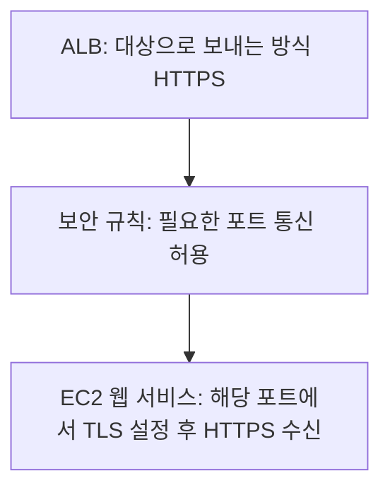

# 3주차 다섯 번째 수업: 종합 확인

예상 25~35분 · 학습용 자체 제작 문제 · 평가 완료: 정답 4문항 · 부분 정답 1문항 · 보완 확인 완료
실제 AWS 계정 조작 없음

## 범위와 진행 방식

IP와 DNS 및 공인·사설 주소와 NAT 및 HTTP/HTTPS·포트와 CIDR를 새로운 상황에 적용한다.
하위 번호별로 판단과 이유를 함께 답한다.
각 큰 문항의 판단과 핵심 이유를 기준으로 평가한다.
정답과 해설은 답변 후 추가한다.
5문항 중 4문항 이상 정답과 이유 설명을 목표로 한다.
부족한 개념은 보완하고 다른 문제로 재확인한다.
이후 마지막 회상 복습까지 확인하고 3주차 완료 여부를 판단한다.

## 공통 가정

IPv4를 사용한다.
CIDR 문제는 예약 주소를 빼지 않은 전체 주소 개수를 묻는다.
인터넷 경로와 보안 설정은 각 문제에서 제시한 조건에 따라 판단한다.
제시되지 않은 별도 연결이나 우회 경로는 가정하지 않는다.
새 AWS 서비스나 새로운 설정 문법은 사용하지 않는다.

## 1. DNS와 URL

브라우저가 `https://portal.example.com:9443/reports/today`에 새로 접속한다.
사용할 DNS 캐시나 기존 연결은 없다고 가정한다.

1-1. 도메인 이름과 목적지 포트 및 요청 경로를 각각 쓰자.
1-2. DNS가 도메인 이름의 IP 주소를 응답한 뒤 페이지 요청과 응답은 누구와 누구 사이에서 이루어지는가?
DNS의 역할도 함께 설명하자.

## 2. CIDR 범위

범위 A는 `10.6.4.128/25`이고 범위 B는 `10.6.4.0/24`다.

2-1. A의 시작·끝 주소와 전체 주소 개수를 쓰자.
2-2. A와 B는 서로 겹치는가?
범위가 포함되는 관계라면 어느 쪽이 어느 쪽을 포함하는지도 설명하자.

## 3. 퍼블릭 NAT와 연결 시작 방향

사설 IP만 있는 EC2가 퍼블릭 NAT Gateway와 인터넷 게이트웨이를 사용하는 정상적인 인터넷 통신 경로를 갖고 있다.
이 경로의 인터넷 통신에는 Elastic IP라는 공인 IPv4가 사용된다.

3-1. EC2가 먼저 보낸 업데이트 요청에 대해 인터넷 서버의 응답이 돌아올 수 있는가?
3-2. 외부인이 이 경로의 공인 IP를 안다는 이유만으로 NAT를 통해 EC2에 임의의 새 연결을 시작할 수 있는가?
공인 IP 유무만으로 설명하지 말고 연결 시작 방향을 근거로 설명하자.

## 4. ALB 앞뒤의 보호 구간

다음 구성은 정상적으로 요청을 처리하고 있다.

4-1. 어느 구간이 TLS로 암호화되고 어느 구간이 평문인가?
4-2. 브라우저의 접속 방식은 유지하면서 ALB에서 EC2까지도 전송 중 암호화하려면 어느 구간의 통신 설정을 바꿔야 하는가?
포트 숫자만 변경하는 것과 구분해 설명하자.

## 5. 공인 IP와 포트별 접속 조건

EC2는 공인 IP가 있고 DNS는 그 올바른 주소를 응답한다.
필요한 네트워크 경로도 정상이다.
HTTPS 서비스는 TCP 8443에서 정상적으로 수신 중이다.
보안 규칙은 필요한 사용자로부터 들어오는 TCP 443만 허용한다.
브라우저는 `https://app.example.com:8443/status`에 접속한다.

5-1. 이 연결이 현재 보안 규칙을 통과할 수 있는가?
URL의 포트와 규칙을 근거로 설명하자.
5-2. 서비스가 현재 포트에서 계속 수신하도록 유지하려면 어떤 허용 규칙을 추가해야 하는가?
모든 포트를 열지 않는 방식으로 답하자.

## 복습 자료

- [IP·DNS·웹 요청 흐름](11_IP와_DNS_요청_흐름.md)
- [공인·사설 IP와 NAT](12_공인_IP와_사설_IP.md)
- [HTTP/HTTPS와 포트](13_HTTP_HTTPS와_포트.md)
- [CIDR 기초](14_CIDR_주소범위_기초.md)

## 2026-11-01 종합 확인 평가

1. 정답으로 평가하되 표기와 생략을 보완한다.
   porta.example.com은 문제의 portal.example.com에서 l이 빠진 오타로 판단한다.
   목적지 포트 9443과 경로 /reports/today는 정확하다.
   1-2에서 “브라우저”라고만 답하여 웹 접속 대상이라는 상대를 명시하지 않았다.
   DNS의 주소 조회 역할 설명과 이전 DNS 확인의 정확한 요청·응답 설명을 함께 반영했다.
   DNS 조회 이후 페이지 요청·응답의 주체는 브라우저와 웹 접속 대상이다.
2. 정답.
   A는 10.6.4.128~10.6.4.255의 128개 주소다.
   B의 10.6.4.0~10.6.4.255 안에 A가 포함되어 주소가 겹친다는 근거가 정확하다.
3. 정답.
   내부에서 먼저 시작한 연결의 요청·응답을 처리하며 외부 시작 임의 새 연결은 전달하지 않는다는 설명이 정확하다.
   앞선 “공인 IP가 없기 때문”이라는 이유를 이번 새 상황에서 바로잡았다.
4. 부분 정답.
   4-1은 브라우저→ALB 암호화와 ALB→EC2 평문을 정확히 구분했다.
   4-2에서 ALB→EC2도 TLS를 사용해야 한다는 방향은 맞다.
   다만 “8080 포트에 보안 규칙으로 HTTPS가 가능하도록 설정”한다는 표현은 보안 규칙만으로 TLS를 활성화할 수 있다는 오해로 이어진다.
   아래 보완 설명과 새 문제로 설정 역할을 구분한다.
5. 정답.
   URL의 목적지 TCP 8443이 허용되어 있지 않으므로 통과하지 못한다.
   필요한 출발지에서 TCP 8443을 허용하는 규칙을 추가한다는 답변이 정확하다.

정답 4문항으로 종합 확인의 수치 기준은 충족했다.
다만 4-2의 TLS 서비스 설정과 보안 규칙 구분을 보완 확인한 뒤 마지막 회상 복습으로 진행한다.
3주차 전체는 아직 미완료다.

## 보완: TLS 설정과 포트 허용은 다르다

보안 규칙은 정해진 출발지에서 정해진 목적지 포트로 통신해도 되는지를 결정한다.
이 규칙 자체가 데이터를 암호화하거나 인증서를 설정하지는 않는다.

ALB→EC2를 HTTPS로 바꾸려면 다음을 각각 구성한다.

1. EC2 쪽 웹 서비스에 인증서와 비밀 키 등 TLS 설정을 준비하고 선택한 포트에서 HTTPS로 수신하도록 한다.
2. ALB가 그 EC2로 보내는 연결의 통신 방식을 HTTPS로 정하고 목적지 포트를 맞춘다.
3. 보안 규칙에서 ALB와 EC2 사이의 필요한 포트 통신을 허용한다.

8080도 서비스가 HTTPS로 설정되어 있다면 사용할 수 있다.
443이나 8443으로 숫자만 바꿔도 HTTPS가 되는 것은 아니다.

보안 규칙 노드는 별도 중계 서버가 아니라 통신 허용 조건을 표현한 것이다.

## 새로운 보완 확인 — 두 하위 질문 모두 정답

EC2 웹 서비스는 TCP 8443에서 평문 HTTP로 수신 중이다.
ALB→EC2의 필요한 TCP 8443 통신은 보안 규칙에서 이미 허용되어 있다.
담당자가 ALB의 대상 연결 방식만 HTTPS로 바꿨다.

6-1. 이 상태에서 ALB와 EC2가 정상적인 HTTPS 통신을 할 수 있는가?
6-2. EC2 웹 서비스 쪽에서 추가로 필요한 설정은 무엇인가?
보안 규칙을 다시 여는 것과 구분해 설명하자.

### 2026-11-01 보완 답변 평가

6-1. 정답.
EC2 웹 서비스에 TLS 설정이 없으므로 HTTPS로 통신할 수 없다는 이유가 정확하다.
6-2. 정답.
EC2 쪽 TLS 설정이 필요하다는 수정 방향이 정확하다.
구체적으로 웹 서비스가 인증서와 비밀 키를 사용해 TCP 8443에서 HTTPS로 수신하도록 구성한다.
이미 필요한 통신이 허용되어 있으므로 포트를 다시 여는 것으로 해결할 문제가 아니다.

초기 종합 확인은 정답 4문항과 부분 정답 1문항으로 유지한다.
다른 상황의 보완 문제에서 TLS 서비스 설정과 포트 허용의 차이를 확인했다.
다음은 [마지막 회상 복습](16_3주차_회상_복습.md)이다.
3주차 전체는 회상 복습 후 완료 여부를 판단한다.

참고: [ALB 대상 연결의 프로토콜과 포트](https://docs.aws.amazon.com/elasticloadbalancing/latest/application/load-balancer-target-groups.html).
