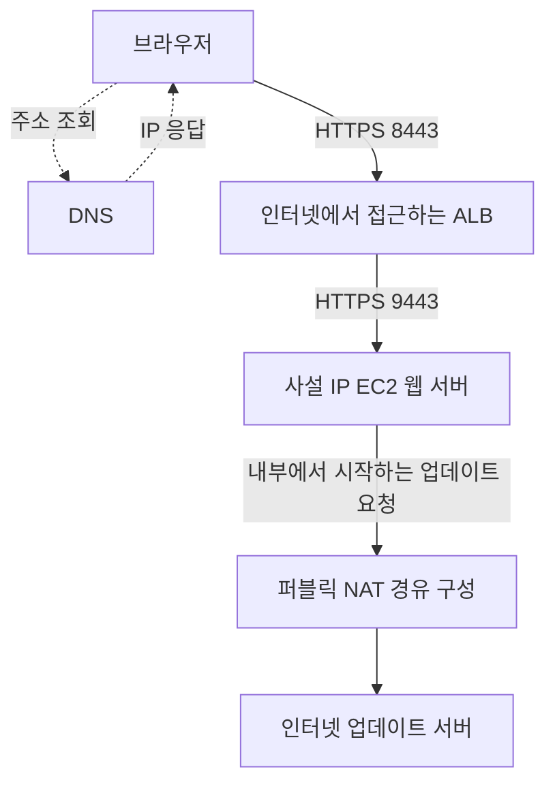

# 3주차 여섯 번째 수업: 회상 복습

예상 10~15분 · 자료를 덮고 자기 말로 설명하기 · 평가 완료
실제 AWS 설정 변경 없음

## 현재 상태

종합 확인은 정답 4문항과 부분 정답 1문항이었다.
이후 TLS 서비스 설정과 포트 허용의 차이는 다른 상황의 보완 문제에서 확인했다.
2026-11-02 회상 답변과 앞선 평가를 함께 확인하고 3주차 완료를 기록했다.

## 이번 주의 연결 그림

실제 구성에 필요한 경로와 보안 규칙 및 HTTPS 서비스 설정은 준비되었다고 가정한다.
ALB와 NAT는 서로 다른 용도의 통신 경로다.
NAT 그림은 인터넷 게이트웨이 등을 경유 구성에 묶어 단순화했다.

## 회상 문제

자료를 덮고 아래 질문에 짧게 답한다.

### 1. 이름 조회와 웹 요청

브라우저는 `https://review.example.com:8443/start`에 접속한다.

1-1. DNS의 역할과 DNS 조회 이후 웹 요청·응답의 주체를 설명하자.
1-2. 브라우저가 접속하는 목적지 포트와 요청 경로를 쓰자.

### 2. HTTPS와 보안 규칙

위 그림처럼 브라우저→ALB는 HTTPS 8443이고 ALB→EC2는 HTTPS 9443이다.

2-1. 어느 구간이 암호화되며 앞뒤가 하나의 TLS 연결인지 별도 연결인지 설명하자.
2-2. “보안 규칙에서 TCP 9443을 허용하면 평문 HTTP 서비스도 HTTPS로 바뀐다”는 주장을 판단하고 이유를 설명하자.

### 3. 내부 주소 범위와 외부 통신

EC2의 사설 IP는 `10.8.2.150`이며 주소 범위는 `10.8.2.128/25`다.

3-1. 이 CIDR의 전체 주소 개수와 시작·끝을 쓰고 EC2 주소가 포함되는지 판단하자.
AWS 예약 주소는 빼지 않고 전체 주소를 계산한다.
3-2. EC2가 NAT로 먼저 시작한 요청의 응답은 받을 수 있지만 외부에서 NAT로 임의의 새 연결을 시작할 수 없는 이유를 설명하자.

답변 후 해설과 진도 기록을 추가한다.

## 다음 주 예고

3주차를 마치면 4주차 VPC 기초로 넘어간다.
서브넷과 라우팅 및 인터넷 게이트웨이·NAT 경로와 보안 그룹을 그림으로 연결한다.
새 개념은 다음 자료에서 먼저 설명한다.

## 이전 자료

- [종합 확인과 보완 평가](15_3주차_종합_확인.md)
- [IP·DNS](11_IP와_DNS_요청_흐름.md)
- [공인·사설 IP와 NAT](12_공인_IP와_사설_IP.md)
- [HTTP/HTTPS·포트](13_HTTP_HTTPS와_포트.md)
- [CIDR](14_CIDR_주소범위_기초.md)

## 2026-11-02 회상 복습 평가

1. 핵심 이해 확인 및 응답 상대 표현 보완.
   DNS의 도메인 이름→IP 조회 설명과 목적지 포트 8443 및 경로 /start는 정확하다.
   1-1에서 “브라우저”라고만 썼으므로 요청·응답의 양쪽을 명시해 “브라우저와 웹 접속 대상”으로 보완한다.
   이전 DNS 확인의 정확한 전체 흐름 설명도 함께 반영한다.
2. 정답.
   앞뒤 모두 암호화되며 별도 TLS 연결이라는 설명이 정확하다.
   포트 허용만으로 평문 HTTP가 HTTPS로 바뀌지 않는다는 판단과 TLS 설정이 필요하다는 이유도 맞다.
3-1. 정답.
   전체 주소는 128개이며 범위는 10.8.2.128~10.8.2.255다.
   10.8.2.150이 포함된다는 판단도 정확하다.
3-2. 사용자 답변이 아니라 문제 표현에 대한 지적이다.
   이미 NAT의 동작을 그대로 서술한 질문이라 무엇을 비교하거나 판단해야 하는지 불분명했다.
   미응답을 정답으로 처리하지 않는다.
   앞선 새로운 종합 확인 3번에서 내부 시작 연결의 응답과 외부 시작 임의 새 연결의 차이를 정확히 설명했으므로 그 결과를 이해 확인 근거로 반영한다.
   같은 질문에 다시 답하도록 요구하지 않는다.

### 3-2에서 의도했던 구분

EC2가 요청한 업데이트 파일이 돌아오는 것은 이미 내부에서 시작한 연결에 대한 응답이다.
외부 사용자가 EC2의 웹 서비스에 먼저 접속하려는 것은 새로운 연결 시작이다.
이번 NAT Gateway 구성은 전자를 처리하며 후자를 EC2로 전달하는 용도는 아니다.
문제에서는 이 결론을 이미 서술했으므로 회상 평가 질문으로 명확하지 않았다.

## 주차 완료 판단

3주차 종합 확인은 정답 4문항과 부분 정답 1문항으로 유지한다.
이후 다른 상황의 TLS 보완 확인과 이번 회상에서 TLS 서비스 설정·보안 규칙 구분 및 별도 연결 이해를 확인했다.
CIDR 범위도 정확히 설명했다.
NAT는 종합 확인에서 이미 확인한 답변을 반영하며 불명확한 회상 3-2를 맞혔다고 기록하지 않는다.
회상 전체에 임의 점수를 부여하지 않는다.
이 근거로 **2026-11-02 3주차 완료(3/32)** 처리한다.

다음은 4주차 첫 수업 VPC·서브넷 자료를 쉬운 정의와 그림으로 먼저 준비하는 것이다.
4주차 자료는 아직 작성하지 않았다.
실제 AWS 계정 조작이나 리소스 생성은 진행하지 않았다.
