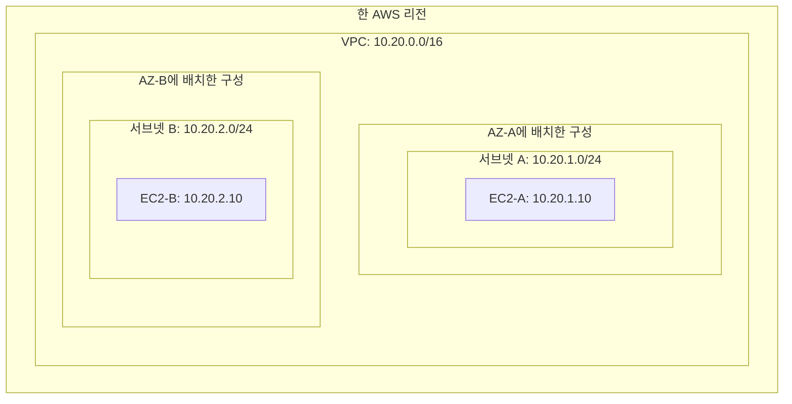
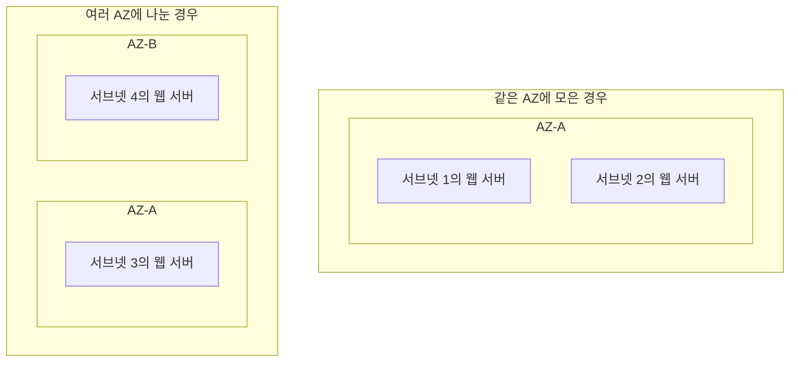
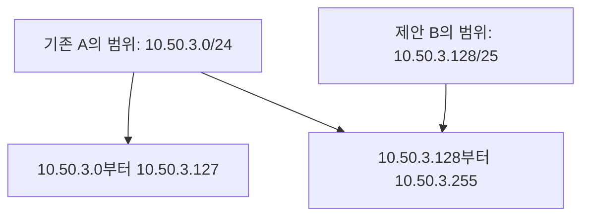

# 4주차 첫 수업: VPC와 서브넷 기초

예상 25~35분 · IPv4 기본 구성 기준 · 실제 AWS 리소스 생성 없음
확인 문제 평가: 정답 2문항 · 부분 정답 1문항 · 보완 확인 완료

## 목표

VPC와 서브넷을 구분한다.
리전·AZ와 VPC·서브넷의 관계를 설명한다.
VPC 내부의 서브넷 주소 범위와 AZ 배치를 검토한다.

## 1. VPC는 AWS에서 정의하는 가상 네트워크다

VPC(Virtual Private Cloud)는 AWS에서 리소스를 배치하기 위해 정의하는 논리적으로 분리된 가상 네트워크다.
IP 주소 범위와 서브넷 및 통신 경로 등을 구성할 수 있다.
EC2 같은 리소스를 이 네트워크 안에 배치한다.

한 VPC는 한 리전 안에 있다.
그 리전의 여러 AZ에 걸쳐 서브넷을 만들 수 있다.
하나의 VPC가 서울 리전과 도쿄 리전을 동시에 포함하는 구조는 아니다.

VPC를 회사의 네트워크 전체라고 비유하면 서브넷은 그 안을 나누어 사용하는 구획과 비슷하다.
Private라는 이름이 있어도 모든 리소스가 자동으로 인터넷과 단절된다는 뜻은 아니다.
실제 연결은 경로와 주소 및 보안 규칙으로 결정한다.

## 2. 서브넷은 VPC 안의 주소 범위다

서브넷(Subnet)은 VPC의 IP 주소 범위 안에서 나누어 사용하는 구획이다.
AWS의 서브넷 하나는 반드시 한 AZ 안에만 위치한다.
서브넷 하나가 두 AZ에 걸쳐 있을 수는 없다.
한 AZ에 여러 서브넷을 만드는 것은 가능하다.

예: VPC의 주소가 10.20.0.0/16이면 다음 서브넷을 만들 수 있다.

| 구성 | 주소 범위 | 배치 |
|---|---|---|
| VPC | 10.20.0.0/16 | 한 리전의 가상 네트워크 |
| 서브넷 A | 10.20.1.0/24 | AZ-A |
| 서브넷 B | 10.20.2.0/24 | AZ-B |

이 그림의 AZ 상자는 해당 VPC가 그 AZ에 배치한 구성을 보여준다.
AZ 자체가 이 VPC의 소유이거나 이 VPC 안에만 존재한다는 뜻은 아니다.
VPC는 논리적 네트워크 경계이고 AZ는 장애 격리를 위한 인프라 영역이다.

## 3. CIDR로 서브넷 범위를 검토한다

이번에는 한 개의 IPv4 CIDR를 가진 기본 VPC를 가정한다.
서브넷 CIDR는 해당 VPC의 주소 범위 안에 있어야 한다.
같은 VPC 안의 서브넷끼리는 주소 범위가 겹치면 안 된다.

예: VPC가 10.20.0.0/16일 때 10.21.1.0/24는 VPC 밖의 범위다.
따라서 이 VPC의 서브넷으로 사용할 수 없다.

서브넷 A가 10.20.1.0/24라면 다른 서브넷에 10.20.1.128/25를 쓰면 범위가 겹친다.
두 번째 범위가 첫 번째 범위 안에 들어 있기 때문이다.
서브넷을 서로 다른 AZ에 두어도 같은 VPC 안에서 겹치는 범위를 쓸 수는 없다.

/24의 전체 주소는 256개다.
실제 AWS 리소스에 할당 가능한 개수는 예약 주소 때문에 다르다.
이번에는 범위 포함과 겹침에 집중하고 예약 주소 계산은 이후 설계 수업에서 다룬다.

## 4. 여러 서브넷과 여러 AZ는 다른 개념이다

서브넷을 두 개 만들었다는 사실만으로 AZ 장애에 대비했다고 판단하지 않는다.
두 서브넷이 모두 AZ-A에 있으면 AZ-A 장애에 함께 영향을 받을 수 있다.

한 AZ 장애 시 다른 AZ에서 웹 요청을 처리하려면 웹 서버를 서로 다른 AZ의 서브넷에 배치해야 한다.
그 뒤에도 정상 서버로의 요청 전달과 남은 용량 및 DB 복구 등을 함께 고려해야 한다.
서브넷만 나눈다고 고가용성이 완성되는 것은 아니다.

## 5. 이번 수업에서 아직 정하지 않는 것

10으로 시작하는 사설 주소라고 퍼블릭·프라이빗 서브넷을 구분하지 않는다.
AWS에서 서브넷의 퍼블릭·프라이빗 구분은 인터넷 게이트웨이로 직접 가는 경로가 있는지에 따라 정한다.
사설 IP와 프라이빗 서브넷은 서로 다른 구분이다.

이번 그림은 주소 범위와 AZ 배치만 보여준다.
퍼블릭·프라이빗 서브넷의 구체적인 경로는 다음 수업에서 표와 그림으로 다룬다.
VPC와 서브넷을 만들었다고 외부 인터넷 연결이 자동으로 생긴다고 가정하지 않는다.

## 6. 확인 문제 — 하위 번호와 이유를 함께 답하기

### 1. 한 서브넷과 두 AZ

담당자가 “한 VPC 안의 서브넷 하나를 AZ-A와 AZ-B에 걸쳐 만들고 웹 서버를 나누겠다”고 한다.

1-1. AWS에서 서브넷 하나를 두 AZ에 걸쳐 만들 수 있는가?
1-2. 한 VPC 안에서 두 AZ에 웹 서버를 배치하려면 서브넷을 어떻게 구성해야 하는가?

### 2. 서브넷 주소 범위 검토

VPC의 IPv4 범위는 `10.50.0.0/16`이다.
서브넷 A는 이미 `10.50.3.0/24`를 사용한다.

2-1. `10.51.4.0/24`를 이 VPC의 새 서브넷에 사용할 수 있는가?
VPC 범위와의 관계를 근거로 설명하자.
2-2. 다른 AZ에 새 서브넷 B를 만들면서 `10.50.3.128/25`를 쓰려고 한다.
가능한가?
기존 서브넷 A와의 관계를 근거로 설명하자.

### 3. 서브넷 수와 장애 범위

웹 서버 두 대를 서로 다른 서브넷에 넣었지만 두 서브넷 모두 AZ-A에 있다.
요구사항은 AZ-A 장애가 나도 다른 AZ의 웹 서버로 요청을 처리하는 것이다.

3-1. 현재의 웹 서버 배치가 요구사항을 충족하는가?
3-2. 웹 서버와 서브넷의 AZ 배치를 어떻게 개선해야 하는가?
ALB나 DB의 세부 설정은 이번 답변에서 제외한다.

정답과 해설은 아래 평가에 반영했다.
이번 확인은 첫 수업 점검이며 4주차 전체 완료 평가는 별도로 진행한다.

## 공식 참고 자료

확인: 2026-11-02

- [Amazon VPC 소개](https://docs.aws.amazon.com/vpc/latest/userguide/what-is-amazon-vpc.html)
- [VPC의 동작과 구성](https://docs.aws.amazon.com/vpc/latest/userguide/how-it-works.html)
- [서브넷의 AZ와 주소 범위](https://docs.aws.amazon.com/vpc/latest/userguide/configure-subnets.html)
- [이전 주차 복습](16_3주차_회상_복습.md)

## 2026-11-02 답변 평가

1. 정답.
   서브넷 하나는 한 AZ에 속하며 두 AZ에 웹 서버를 배치하려면 각 AZ에 별도 서브넷을 구성한다는 설명이 정확하다.
2. 부분 정답.
   2-1은 정답이다.
   VPC 범위는 10.50.0.0~10.50.255.255이므로 10.51.4.0/24는 사용할 수 없다.
   2-2는 오답이다.
   서브넷 A의 10.50.3.0/24는 10.50.3.0~10.50.3.255다.
   새 서브넷 B의 10.50.3.128/25는 10.50.3.128~10.50.3.255다.
   B의 전체 주소가 A에 포함되므로 겹친다.
   AZ가 달라도 같은 VPC의 서브넷 주소 중첩은 허용되지 않는다.
   “서브넷 하나는 한 AZ”라는 배치 조건과 “서브넷끼리 주소가 겹치지 않아야 함”이라는 주소 조건을 동시에 지켜야 한다.
3. 정답이며 장애 범위 표현을 보완한다.
   현재는 다른 AZ에 웹 서버가 없으므로 요구사항을 충족하지 못한다.
   AZ-A의 장애가 다른 AZ 자체를 중단시킨다는 뜻은 아니다.
   AZ-A·AZ-B에 각각 서브넷과 웹 서버를 두겠다는 개선 방향이 정확하다.

### 보완 그림: 같은 VPC에서는 AZ가 달라도 주소가 겹치면 안 된다

같은 위쪽 주소 범위를 두 서브넷에 동시에 배정하려 하므로 이 제안은 사용할 수 없다.
AZ가 다른 것이 같은 VPC의 중복 주소 사용을 허용하지는 않는다.

서브넷을 설계할 때는 다음 두 조건을 별도로 확인한다.

- 위치: 서브넷 하나는 한 AZ 안에 둔다.
- 주소: VPC 범위 안에 있으면서 기존 서브넷과 겹치지 않게 한다.

## 새로운 보완 확인 — 두 하위 질문 모두 정답

VPC는 `10.60.0.0/16`이다.
AZ-A의 기존 서브넷은 `10.60.4.0/25`를 사용한다.
이제 AZ-B에 새 서브넷 하나를 만들려고 두 후보를 검토한다.
B와 C는 동시에 생성하는 것이 아니라 각각 기존 서브넷과 비교하는 대안이다.

4-1. 후보 B인 `10.60.4.128/25`를 사용할 수 있는가?
기존 서브넷과 후보의 시작·끝 주소를 근거로 설명하자.
4-2. 후보 C인 `10.60.4.0/24`를 사용할 수 있는가?
기존 서브넷과의 포함·겹침 관계를 설명하자.

### 2026-11-02 보완 평가

4-1. 정답.
기존 범위 10.60.4.0~10.60.4.127과 후보 B의 10.60.4.128~10.60.4.255는 겹치지 않는다.
둘 다 VPC 10.60.0.0/16 안에 있으므로 후보 B를 사용할 수 있다.
시작·끝 주소를 근거로 정확히 설명했다.

4-2. 정답.
후보 C의 10.60.4.0/24는 기존 10.60.4.0/25 전체를 포함한다.
기존 서브넷과 주소가 겹치므로 다른 AZ라도 이 VPC의 새 서브넷에 사용할 수 없다는 설명이 정확하다.

보완 확인은 두 하위 질문 모두 정답이다.
최초 평가는 정답 2문항과 부분 정답 1문항으로 유지하고 이후의 재확인 결과를 별도로 기록한다.
주소 포함·비중첩과 AZ 배치 조건을 구분하는 이해를 확인했다.
다음은 라우팅과 퍼블릭·프라이빗 서브넷 수업 자료를 그림과 예제로 먼저 준비한다.
4주차 전체는 아직 진행 중이다.
