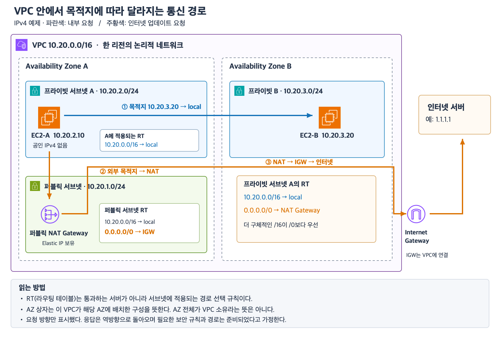
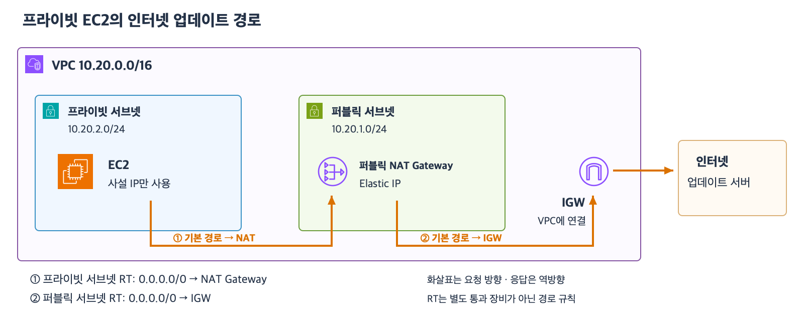
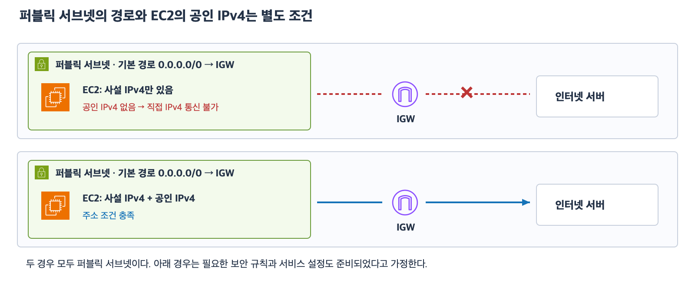

# 4주차 두 번째 수업: 라우팅과 퍼블릭·프라이빗 서브넷

예상 25~35분 · IPv4 기본 구성 · 실제 AWS 설정 변경 없음 · 정답 2문항 / 부분 정답 1문항 · 보완 하위 질문 2/2 정답

## AWS 공식 아이콘으로 보는 전체 경로

[확대 가능한 SVG 원본](images/vpc-routing-aws-icons.svg)

파란 화살표는 AZ-A의 EC2가 AZ-B의 사설 IP로 보내는 내부 요청이다.
주황 화살표는 같은 EC2가 인터넷 서버로 보내는 업데이트 요청이다.
RT는 데이터가 통과하는 별도 장비가 아니라 서브넷에 적용되는 경로 선택 규칙으로 표시했다.
AZ 상자는 해당 VPC가 그 AZ에 배치한 구성만 묶어 보여준다.

## 1. 라우팅 테이블은 목적지별 길 안내표다

라우팅은 목적지 IP를 보고 트래픽을 어느 경로로 보낼지 정하는 것이다.
라우팅 테이블의 목적지는 주소 범위이고 대상은 그쪽으로 보낼 경로다.
각 서브넷에는 하나의 라우팅 테이블이 적용된다.
한 테이블을 여러 서브넷이 함께 사용할 수 있다.
명시적으로 연결하지 않은 서브넷에는 VPC의 기본 라우팅 테이블이 적용된다.

이번 예제의 VPC는 10.20.0.0/16이다.
기본 local 경로는 이 VPC 내부 주소로 보내는 통신에 사용한다.
0.0.0.0/0은 모든 IPv4 주소에 맞는 기본 경로다.
여러 경로가 목적지에 맞으면 더 구체적인 범위인 접두사 길이가 긴 경로를 선택한다.
표의 위쪽 항목을 무조건 고르는 방식은 아니다.

| 목적지 | 대상 | 의미 |
|---|---|---|
| 10.20.0.0/16 | local | VPC 내부 통신 |
| 0.0.0.0/0 | 인터넷 게이트웨이 | 그 밖의 IPv4 목적지로 나가는 기본 경로 |

목적지 10.20.2.10은 두 행에 모두 맞지만 /16이 /0보다 구체적이므로 local을 선택한다.
목적지 1.1.1.1은 /16에 포함되지 않으므로 /0 경로를 선택한다.
local 경로가 있어도 보안 규칙이나 서비스 설정 때문에 실제 통신은 실패할 수 있다.

## 2. 인터넷 게이트웨이와 퍼블릭 서브넷

인터넷 게이트웨이(IGW)는 VPC와 인터넷 사이의 통신에 사용하는 구성요소다.
IGW는 VPC에 연결한다.
서브넷의 라우팅 테이블에 IGW로 직접 가는 경로가 있으면 퍼블릭 서브넷이라고 한다.
이번 수업에서는 0.0.0.0/0 → IGW인 일반적인 구성을 사용한다.

퍼블릭 서브넷의 EC2도 사설 IP를 가진다.
그 EC2가 IGW를 통해 인터넷과 직접 IPv4 통신하려면 공인 IPv4 또는 Elastic IP도 필요하다.
Elastic IP는 계정에 할당해 사용하는 고정 공인 IPv4 주소다.
경로와 주소 외에도 보안 규칙과 서비스 설정이 맞아야 한다.
퍼블릭 서브넷이라는 이름이 모든 서버의 모든 포트를 공개한다는 뜻은 아니다.

## 3. 프라이빗 서브넷의 인터넷 요청

IGW로 직접 가는 경로가 없는 서브넷은 프라이빗 서브넷이다.
인터넷 업데이트가 필요하면 퍼블릭 NAT Gateway를 경유하는 경로를 구성할 수 있다.
이번 예제에서는 퍼블릭 서브넷에 Elastic IP를 가진 퍼블릭 NAT Gateway를 둔다.
프라이빗 서브넷의 기본 경로는 이 NAT Gateway를 향한다.
NAT가 있는 퍼블릭 서브넷의 기본 경로는 IGW를 향한다.

| 테이블 | 목적지 | 대상 |
|---|---|---|
| 퍼블릭 서브넷용 | 10.20.0.0/16 | local |
| 퍼블릭 서브넷용 | 0.0.0.0/0 | IGW |
| 프라이빗 서브넷용 | 10.20.0.0/16 | local |
| 프라이빗 서브넷용 | 0.0.0.0/0 | 퍼블릭 NAT Gateway |

[SVG 원본](images/private-ec2-nat-igw-aws-icons.svg)

화살표는 EC2가 먼저 시작하는 업데이트 요청의 방향이다.
응답은 반대 방향으로 돌아온다.
프라이빗 서브넷의 EC2 자체에는 공인 IPv4가 필요하지 않다.
NAT를 경유해 인터넷에 나갈 수 있어도 그 서브넷이 퍼블릭으로 바뀌지는 않는다.
IGW로 직접 가는 경로와 NAT를 거치는 경로를 구분한다.
NAT는 외부 사용자가 이 EC2에 임의의 새 연결을 시작하는 입구로 사용하지 않는다.

## 4. 경로와 통신 허용을 구분한다

라우팅 테이블은 어디로 보낼지를 정한다.
보안 규칙은 어떤 통신을 허용할지를 정한다.
웹 서비스 설정은 어느 포트에서 HTTP나 HTTPS 요청을 받을지를 정한다.
길 안내가 있다고 문이 열려 있거나 HTTPS 서비스가 실행되는 것은 아니다.
보안 그룹의 상세 규칙은 다음 수업에서 다룬다.

이번에는 기본 local 경로를 유지한 단순 구성만 다룬다.
IPv6와 특수 라우팅 및 NAT의 고가용성 설계는 이후에 다룬다.

## 5. 확인 문제

문제의 경로 대상은 정상 동작하며 별도 언급이 없으면 필요한 보안 규칙과 서비스 설정은 준비되어 있다.

### 1. 목적지에 따른 경로 선택

VPC는 10.70.0.0/16이다.
서브넷 A의 테이블에는 10.70.0.0/16 → local과 0.0.0.0/0 → IGW가 있다.

1-1. A의 EC2가 10.70.8.20으로 보낼 때 어느 경로를 선택하는가?
두 항목 중 그 경로를 선택하는 근거도 설명하자.
1-2. A의 EC2가 1.1.1.1로 보낼 때 어느 경로를 선택하는가?

### 2. 서브넷 종류와 EC2 주소

같은 VPC의 서브넷 B에는 local과 0.0.0.0/0 → IGW가 있다.
B의 EC2는 사설 IPv4만 가지고 있다.

2-1. B는 퍼블릭 서브넷인가 프라이빗 서브넷인가?
경로를 근거로 설명하자.
2-2. 이 EC2가 현재 상태로 IGW를 통해 인터넷 서버와 직접 IPv4 통신할 수 있는가?
주소 조건을 근거로 설명하자.

### 3. 업데이트 경로 복구

서브넷 C의 EC2는 사설 IPv4만 가진다.
C의 테이블에는 VPC 내부 local 경로만 있다.
같은 VPC의 퍼블릭 서브넷에는 Elastic IP가 연결된 정상 퍼블릭 NAT Gateway가 있으며 그 서브넷의 기본 경로는 IGW다.
C의 EC2는 공인 IPv4를 추가하지 않고 인터넷 업데이트를 받아야 한다.

3-1. C의 테이블에 추가할 목적지와 대상을 쓰자.
3-2. 수정 후 C가 퍼블릭·프라이빗 중 어느 서브넷인지 판단하고 업데이트 요청의 경로를 EC2부터 인터넷 서버까지 순서대로 쓰자.

평가와 보완 확인은 아래에 기록한다.

## 공식 참고 자료

확인: 2026-11-02

- [서브넷 라우팅 테이블](https://docs.aws.amazon.com/vpc/latest/userguide/subnet-route-tables.html)
- [경로 우선순위](https://docs.aws.amazon.com/vpc/latest/userguide/route-tables-priority.html)
- [라우팅 구성 예](https://docs.aws.amazon.com/vpc/latest/userguide/route-table-options.html)
- [이전 수업](17_VPC와_서브넷_기초.md)

## 2026-11-02 답변 평가

1번 정답.
1-1은 local 선택과 /16 범위 및 가장 긴 접두사 근거가 정확하다.
1-2는 목적지가 VPC 범위 밖이므로 /0의 IGW 경로를 선택한다는 설명이 정확하다.
0.0.0.0/0은 하나의 0.0.0.0 주소가 아니라 모든 IPv4 주소에 맞는 범위다.

2번 부분 정답.
2-1은 IGW 직접 경로가 있어 퍼블릭 서브넷이라는 설명이 정확하다.
2-2는 오답이다.
퍼블릭 서브넷에 있어도 EC2에 사설 IPv4만 있으면 IGW를 통한 직접 인터넷 IPv4 통신은 할 수 없다.
이 경로를 사용하려면 EC2에 공인 IPv4 또는 Elastic IP를 연결해야 한다.
퍼블릭 서브넷의 분류는 경로로 정하고 EC2의 직접 인터넷 통신 가능 여부는 주소와 경로 및 보안 규칙 등을 함께 확인한다.
IGW는 이 직접 통신에서 EC2 사설 IPv4와 연결된 공인 IPv4 사이의 주소 변환을 수행한다.
퍼블릭 NAT Gateway를 경유하는 구성은 NAT Gateway의 Elastic IP를 사용한다.

3번 정답.
3-1은 0.0.0.0/0 → 퍼블릭 NAT Gateway가 정확하다.
3-2는 프라이빗 서브넷 판단과 EC2 → 퍼블릭 NAT Gateway → IGW → 인터넷 서버 순서가 정확하다.
IGW 직접 경로가 아닌 NAT 경로를 사용하므로 프라이빗 서브넷으로 유지된다.

평가는 정답 2문항과 부분 정답 1문항이다.
하위 질문은 6개 중 5개 정답이다.
최초 점수는 유지한다.
4주차 전체는 아직 진행 중이다.

## 보완 확인 — 다른 상황에서 주소 조건 적용

서브넷 D에는 0.0.0.0/0 → IGW 경로가 있다.
VPC에 IGW가 연결되어 있으며 EC2-D는 사설 IPv4만 가지고 있다.
NAT나 프록시를 경유하지 않고 이 IGW 경로로 직접 인터넷 IPv4 통신을 해야 한다.
필요한 보안 규칙과 서비스 설정은 이미 준비되어 있다.

4-1. 담당자는 보안 규칙을 더 넓게 열면 해결된다고 한다.
이 조치만으로 해결되는가?
부족한 주소 조건과 필요한 변경을 설명하자.
4-2. 그 주소 조건을 보완하면 서브넷 D의 퍼블릭·프라이빗 분류도 바뀌는가?
분류의 근거를 설명하자.

보완 평가 완료.

- [IGW 직접 통신에 필요한 주소 조건과 주소 변환](https://docs.aws.amazon.com/vpc/latest/userguide/VPC_Internet_Gateway.html)

### 후속 답변과 표현 보완

사용자는 “요청/응답 둘 다라면 공인 IPv4가 있어야 한다”고 수정했다.
공인 IPv4 필요라는 결론은 맞다.
다만 응답을 받을 때만 필요한 조건으로 이해하지 않도록 보완한다.
EC2가 먼저 시작하는 외부 요청이어도 IGW를 통한 직접 IPv4 인터넷 통신에는 EC2에 연결된 공인 IPv4 또는 Elastic IP가 필요하다.
IGW 경로만으로 사설 IPv4를 인터넷용 주소로 바꾸어 보내주는 것은 아니다.
IGW는 해당 EC2에 연결된 공인 IPv4와 사설 IPv4 사이의 변환을 수행한다.
NAT Gateway 경유 구성은 NAT의 공인 IPv4를 사용하므로 별도로 구분한다.
이후 독립적인 답변으로 아래와 같이 재확인했다.

### 2026-11-02 보완 평가

4-1 정답.
보안 규칙을 넓혀도 공인 IPv4 조건은 해결되지 않는다고 설명했다.
EC2에 공인 IPv4 또는 Elastic IP가 필요하다는 설명이 정확하다.

4-2 정답.
0.0.0.0/0 → IGW 경로가 이미 있으므로 계속 퍼블릭 서브넷이라는 설명이 정확하다.
EC2 주소 설정과 서브넷의 분류 기준을 구분했다.

보완 하위 질문 2/2 정답으로 공인 IPv4 조건 재확인을 완료했다.
최초 정답 2문항·부분 정답 1문항 기록은 유지한다.
다음은 보안 그룹 기초다.
새 자료를 공식 아이콘 그림과 예제로 먼저 준비한다.
