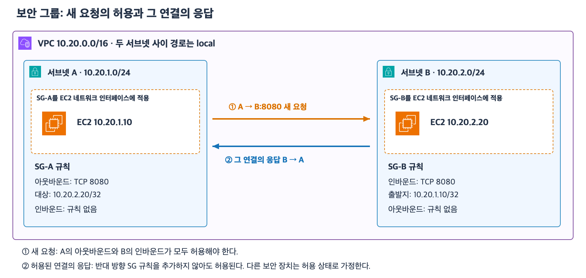

# 4주차 세 번째 수업: 보안 그룹 기초

예상 25~35분 · IPv4와 일반적인 TCP 연결 기준 · 실제 AWS 설정 변경 없음
확인 문제 3/3 정답 · 3-2 IP 입력 후속 정정 반영

## 1. 보안 그룹은 리소스의 통신 허용 규칙이다

보안 그룹(Security Group · SG)은 리소스로 들어오고 나가는 통신을 제어하는 규칙 묶음이다.
EC2에서는 네트워크 인터페이스에 연결하여 적용한다.
네트워크 인터페이스는 EC2가 네트워크에 연결되는 가상의 연결 장치다.
이번에는 EC2마다 인터페이스 하나와 SG 하나가 있다고 가정한다.
SG를 서브넷 전체에 연결하는 것은 아니다.
같은 서브넷의 EC2 두 대에 서로 다른 SG를 적용할 수 있다.
하나의 SG를 여러 EC2가 공유할 수도 있다.

RT는 목적지로 가는 경로를 정한다.
SG는 그 통신을 허용할지를 정한다.
local 경로가 있어도 SG에서 허용하지 않으면 새 연결은 실패할 수 있다.
SG를 허용해도 공인 IPv4나 필요한 경로가 없으면 직접 인터넷 IPv4 통신은 되지 않는다.
SG의 포트 허용은 웹 서비스의 HTTPS 설정을 대신하지 않는다.

## 2. 인바운드와 아웃바운드

인바운드(Inbound)는 SG가 적용된 리소스로 들어오는 방향이다.
아웃바운드(Outbound)는 그 리소스에서 나가는 방향이다.
A가 B에 새 요청을 보내면 A에서는 아웃바운드이고 B에서는 인바운드다.
양쪽 EC2의 관련 허용 규칙을 함께 확인한다.

| 규칙 항목 | 인바운드 예 | 아웃바운드 예 |
|---|---|---|
| 프로토콜 | TCP | TCP |
| 목적지 포트 | 8080 | 8080 |
| 상대 범위 | 출발지 10.20.1.10/32 | 대상 10.20.2.20/32 |

TCP 8080은 요청을 받는 서비스의 목적지 포트다.
출발지 또는 대상의 /32는 IPv4 주소 하나를 뜻한다.
0.0.0.0/0을 상대 범위로 쓰면 모든 IPv4 주소를 뜻한다.
가능하면 필요한 상대와 포트만 허용한다.
이번 수업에서는 상대를 CIDR로 지정한다.
다른 SG를 상대 범위로 지정하는 방식은 다음 설계 수업에서 설명한다.

SG에는 허용 규칙을 작성한다.
명시적인 차단 규칙을 추가하는 방식은 아니다.
어떤 허용 규칙에도 맞지 않는 새 통신은 허용되지 않는다.
따라서 넓은 허용 규칙을 유지한 채 좁은 차단 규칙을 덧붙이는 방식으로 제한할 수 없다.

새로 만든 사용자 정의 SG에는 처음에 인바운드 규칙이 없고 모든 아웃바운드를 허용하는 규칙이 있다.
이 규칙은 변경할 수 있다.
VPC의 기본 SG에는 별도 초기 규칙이 있으므로 새 사용자 정의 SG와 혼동하지 않는다.
문제에서는 초기값을 추정하지 말고 제시된 현재 규칙을 사용한다.

## 3. SG는 허용한 연결의 상태를 기억한다

상태 유지(Stateful)는 허용한 연결을 추적해서 그 연결의 응답도 허용한다는 뜻이다.
A의 아웃바운드와 B의 인바운드가 새 TCP 연결을 허용했다면 B의 응답은 SG에서 허용된다.
그 응답을 위해 B의 아웃바운드나 A의 인바운드에 반대 방향 규칙을 따로 추가할 필요가 없다.
B가 A에 별도의 새 연결을 시작하는 것은 이 응답과 다르다.
별도의 새 연결에는 B의 아웃바운드와 A의 인바운드 규칙을 확인해야 한다.

[확대 가능한 SVG](images/security-groups-request-response.svg)

그림에서 A는 B의 TCP 8080 서비스에 접속한다.
A의 아웃바운드와 B의 인바운드가 일치하므로 새 연결이 허용된다.
B의 응답은 해당 연결의 응답이므로 반대 방향 SG 규칙이 없어도 허용된다.
이것이 B가 A의 임의 포트로 새로운 요청을 시작해도 된다는 뜻은 아니다.

이번 예제는 경로와 서비스가 준비되어 있고 SG 외의 보안 장치는 통신을 허용한다고 가정한다.
SG의 허용만으로 모든 네트워크 조건이 해결된다고 일반화하지 않는다.
연결 추적의 예외와 시간 제한 및 네트워크 ACL의 상세는 이후에 다룬다.

## 4. 확인 문제

모든 문제는 새로운 일반 TCP 연결 기준이다.
필요한 경로와 수신 서비스는 준비되어 있고 SG 외의 보안 장치는 통신을 허용한다.
EC2마다 SG는 하나이며 적힌 규칙 외에는 없다.

### 1. 같은 서브넷의 두 EC2

같은 서브넷의 EC2-A와 EC2-B에 서로 다른 통신 허용 규칙을 적용하려고 한다.

1-1. 두 EC2에 서로 다른 SG를 연결할 수 있는가?
SG의 적용 대상을 근거로 설명하자.
1-2. RT에 local 경로가 있으므로 두 EC2 사이의 새 연결은 SG 규칙과 관계없이 성공한다는 주장을 판단하자.

### 2. 새 요청과 응답

클라이언트 EC2-C는 10.80.1.10이고 서버 EC2-D는 10.80.2.20이다.

| SG | 인바운드 | 아웃바운드 |
|---|---|---|
| C의 SG | 없음 | TCP 8443 · 대상 10.80.2.20/32 |
| D의 SG | TCP 8443 · 출발지 10.80.1.10/32 | 없음 |

2-1. C가 D의 TCP 8443으로 새 연결을 시작할 수 있는가?
C와 D의 어느 방향 규칙을 확인하는지 설명하자.
2-2. 그 연결에서 D가 보내는 응답을 위해 D의 아웃바운드와 C의 인바운드 규칙을 추가해야 하는가?
SG의 특성을 근거로 설명하자.

### 3. 응답과 별도의 새 연결

2번과 같은 규칙에서 D가 C의 TCP 9000 서비스로 별도의 새 연결을 시작하려고 한다.

3-1. 현재 규칙으로 이 새 연결이 허용되는가?
2-2의 응답과 어떻게 다른지 설명하자.
3-2. D가 C의 TCP 9000으로 새 연결을 시작하도록 최소한으로 허용하려면 D의 SG와 C의 SG에 각각 어떤 방향·포트·상대 범위를 추가해야 하는가?
기존 규칙은 유지한다.

답변 후 평가와 해설을 반영한다.

## 공식 참고 자료

확인: 2026-11-02

- [보안 그룹 개요와 상태 유지](https://docs.aws.amazon.com/vpc/latest/userguide/vpc-security-groups.html)
- [보안 그룹 규칙](https://docs.aws.amazon.com/vpc/latest/userguide/security-group-rules.html)
- [기본 보안 그룹의 초기 규칙](https://docs.aws.amazon.com/vpc/latest/userguide/default-security-group.html)
- [그림에 사용한 AWS 공식 아이콘](https://aws.amazon.com/architecture/icons/)
- [이전 수업: 라우팅](18_라우팅과_퍼블릭_프라이빗_서브넷.md)

## 2026-11-02 답변 평가

1번 정답.
1-1은 EC2별 네트워크 인터페이스에 서로 다른 SG를 적용할 수 있다는 설명이 정확하다.
1-2는 RT의 경로와 SG의 통신 허용을 구분했다.

2번 정답.
2-1은 C의 아웃바운드와 D의 인바운드가 새 연결을 허용한다는 설명이 정확하다.
2-2는 SG가 상태를 유지하므로 해당 연결의 응답에 반대 방향 규칙이 필요하지 않다는 설명이 정확하다.

3번 정답. 후속 IP 정정을 반영했다.
3-1은 C의 인바운드 규칙 부재와 새 연결·기존 연결 응답의 차이를 정확히 설명했다.
현재 D의 아웃바운드 규칙도 없으므로 두 방향 모두 보완해야 한다.
3-2는 방향·포트가 맞으며 D 아웃바운드 대상을 처음 10.80.2.10/32로 적었으나 사용자가 10.80.1.10/32의 입력 오류라고 직접 정정했다.
C 인바운드 출발지는 D의 주소로 정확히 썼다.
단일 IPv4의 CIDR 표기를 완성하면 다음과 같다.

| 적용 SG | 방향 | 프로토콜·목적지 포트 | 상대 범위 |
|---|---|---|---|
| D의 SG | 아웃바운드 | TCP 9000 | 대상 10.80.1.10/32 |
| C의 SG | 인바운드 | TCP 9000 | 출발지 10.80.2.20/32 |

사용자의 후속 정정을 포함하여 3/3 정답으로 평가한다.
새 연결에는 보내는 쪽 아웃바운드와 받는 쪽 인바운드를 모두 확인한다.
허용된 연결의 응답은 별도의 새 연결과 구분한다.
다음은 SG를 상대 범위로 참조하는 방법과 최소 권한 설계 연습이다.
4주차 전체는 아직 진행 중이다.
