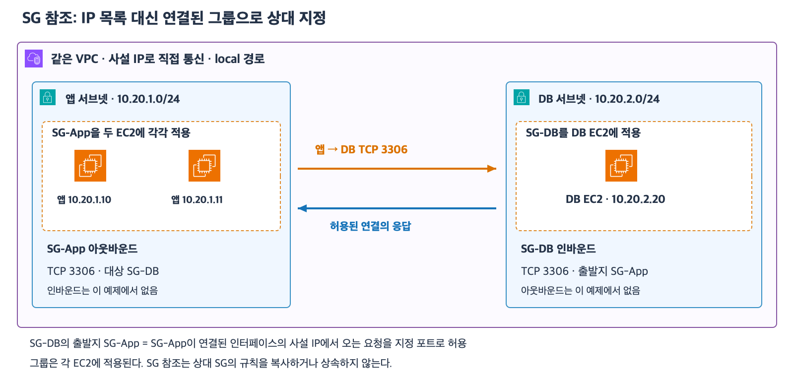
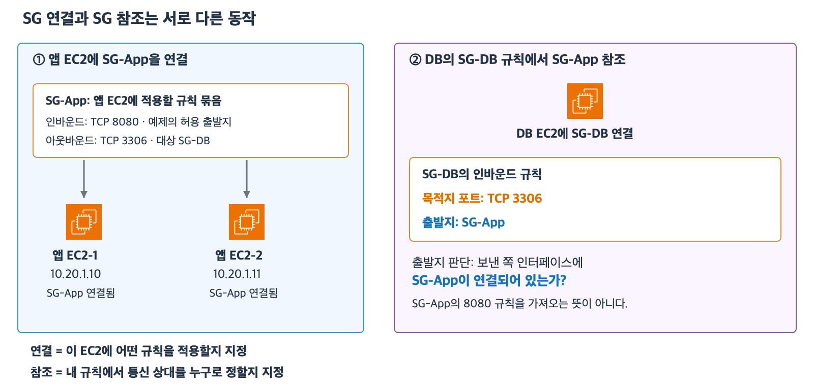

# 4주차 네 번째 수업: SG 참조와 최소 권한 설계

예상 25~35분 · 같은 VPC의 사설 IP 직접 통신 · 실제 AWS 설정 변경 없음
확인 문제 3/3 정답 · 하위 질문 5/5 · 표현 보완

## 1. IP 대신 SG로 통신 상대를 지정한다

지난 수업에서는 상대 IP 하나를 /32로 지정했다.
앱 서버가 여러 대로 늘어나면 각 IP를 규칙에 추가하는 방식은 관리할 대상이 많아진다.
SG 참조는 상대의 SG를 규칙에 지정하는 방법이다.
참조는 다른 SG를 가리킨다는 뜻이다.

예를 들어 앱 서버에는 SG-App을 연결하고 DB 서버에는 SG-DB를 연결한다.
SG-App과 SG-DB는 설명용 이름이며 실제 규칙에서는 sg-로 시작하는 SG ID를 선택한다.
DB는 데이터를 저장하고 조회하는 서비스다.
이번 예제에서는 EC2에서 실행하는 DB 서비스가 TCP 3306에서 요청을 받는다고 가정한다.
3306은 MySQL의 일반적인 기본 포트이며 이번 목표는 포트 암기가 아니라 방향과 상대 범위를 설계하는 것이다.

| 적용 SG | 방향 | 목적지 포트 | 상대 |
|---|---|---|---|
| SG-App | 아웃바운드 | TCP 3306 | 대상 SG-DB |
| SG-DB | 인바운드 | TCP 3306 | 출발지 SG-App |

SG-DB의 출발지 SG-App은 SG-App이 연결된 네트워크 인터페이스의 사설 IP에서 오는 요청을 허용한다는 뜻이다.
허용 포트는 이 규칙에 적힌 TCP 3306이다.
아웃바운드의 대상 SG-DB는 SG-DB가 연결된 인터페이스의 사설 IP로 보내는 요청을 지정 포트로 허용한다.
SG 자체가 요청을 받는 서버나 트래픽이 지나가는 장비는 아니다.

[확대 가능한 SVG](images/security-group-reference.svg)

그림의 SG-App 묶음은 두 EC2에 같은 SG를 각각 적용했다는 뜻이다.
SG를 서브넷 전체에 적용했다는 뜻은 아니다.
필요한 경로와 DB 서비스 및 SG 외의 보안 조건은 준비되어 있다고 가정한다.

## 보충: 연결과 참조를 나누어 보기

SG-App을 EC2에 연결하는 것은 그 EC2에 SG-App의 규칙을 적용하는 것이다.
앱 EC2-1과 앱 EC2-2에 같은 SG-App을 연결하면 둘 다 그 규칙을 적용받는다.

SG-DB의 규칙에서 출발지를 SG-App으로 지정하는 것은 다른 동작이다.
이때 SG-App은 DB가 규칙을 가져올 대상이 아니라 허용할 통신 상대를 고르는 기준이다.
DB의 규칙을 말로 풀면 “SG-App이 연결된 인터페이스의 사설 IP에서 DB의 TCP 3306으로 오는 요청을 허용”다.
보낸 쪽에 SG-App이 연결되어 있는지와 DB에 요청한 목적지 포트를 확인한다.
SG-App 자체에 어떤 인바운드 포트가 열려 있는지를 DB의 허용 포트로 가져오지 않는다.

예를 들어 SG-App의 TCP 8080 인바운드는 앱 서버가 TCP 8080 요청을 받아도 된다는 앱 쪽 규칙이다.
SG-DB의 TCP 3306 인바운드는 DB가 TCP 3306 요청을 받아도 된다는 DB 쪽 규칙이다.
DB가 SG-App을 출발지로 참조해도 앱 쪽의 8080 규칙은 DB에 추가되지 않는다.

새 앱 EC2에 SG-App을 연결하면 두 효과가 생긴다.
새 앱은 SG-App의 아웃바운드 등 규칙을 적용받는다.
동시에 DB의 출발지 SG-App 조건에 맞는 상대가 된다.
따라서 IP를 DB 인바운드에 하나씩 나열하는 대신 그룹 연결 상태로 상대를 지정할 수 있다.
단 같은 서브넷이라는 사실만으로 SG-App이 연결되지는 않는다.

정리하면 연결은 “이 EC2에 적용할 규칙”이고 참조는 “내 규칙에서 지정하는 통신 상대”다.
SG가 패킷에 붙어 전송되거나 SG 자체가 요청을 보내는 것은 아니다.
이번 예제처럼 같은 VPC에서 사설 IP로 직접 통신하는 조건을 전제로 한다.

## 2. SG 참조는 규칙 복사가 아니다

SG-DB에서 SG-App을 출발지로 참조해도 SG-App의 인바운드·아웃바운드 규칙이 SG-DB에 복사되지는 않는다.
예를 들어 SG-App에 TCP 8080 인바운드 규칙이 있어도 DB의 TCP 8080을 자동으로 열지 않는다.
SG-DB는 자신의 인바운드 규칙에 적힌 TCP 3306만 해당 출발지에 허용한다.

SG 참조가 반대쪽 규칙까지 자동으로 추가하는 것도 아니다.
앱이 DB에 새 연결을 시작하려면 앱의 아웃바운드와 DB의 인바운드를 모두 확인한다.
허용된 연결의 응답은 상태 유지에 의해 허용된다.
DB가 앱으로 별도의 새 연결을 시작하는 권한은 따로 확인한다.

## 3. 새 앱 서버를 추가할 때

같은 VPC에 앱 EC2를 한 대 더 만들고 그 인터페이스에 SG-App을 연결한다.
SG-DB가 출발지 SG-App을 참조하고 있으므로 DB 인바운드에 새 앱 IP를 따로 추가할 필요가 없다.
새 앱도 SG-App의 아웃바운드 규칙을 적용받는다.
같은 서브넷에 있다는 이유만으로 SG-App 구성원이 되는 것은 아니다.
그 인터페이스에 SG-App이 연결되어 있어야 한다.
앱 SG를 연결할 수 있는 권한도 주의해서 관리해야 한다.

이번 수업의 적용 범위는 같은 VPC의 사설 IP 직접 통신이다.
인터넷의 공인 IP 경로나 중간 프록시·NAT·검사 장비를 거치는 경우에 이 결론을 그대로 적용하지 않는다.
교차 VPC의 SG 참조 조건은 이후 하이브리드·다중 VPC 수업에서 다룬다.

## 4. 최소 권한은 상대와 포트를 함께 좁힌다

DB를 앱에서만 사용해야 한다면 모든 IPv4 출발지인 0.0.0.0/0보다 SG-App으로 제한한다.
VPC 전체 CIDR도 그 안의 다른 서버까지 포함하므로 요구사항보다 넓을 수 있다.
포트도 모든 TCP 포트가 아니라 필요한 서비스 포트로 제한한다.

이미 넓은 허용 규칙이 있다면 좁은 규칙을 하나 추가하는 것만으로 제한되지 않는다.
SG는 허용 규칙을 합쳐 적용하기 때문이다.
0.0.0.0/0에서 TCP 3306을 허용한 규칙을 유지하면 SG-App만 허용하는 새 규칙을 추가해도 다른 출발지의 허용은 남는다.
요구사항에 맞게 기존 넓은 허용 규칙을 제거하거나 수정해야 한다.

SG의 허용은 네트워크 통신 조건이다.
DB 로그인이나 데이터 조회 권한까지 대신 부여하는 것은 아니다.
이후 DB 수업에서 계정·인증과 데이터 권한을 별도로 다룬다.

## 5. 확인 문제

모든 문제는 같은 VPC의 사설 IP 직접 통신이다.
필요한 경로·수신 서비스와 SG 외의 보안 조건은 준비되어 있다.
리소스마다 SG는 하나이고 별도 언급이 없으면 제시된 규칙만 있다.

### 1. SG 참조와 새 서버

SG-Store의 인바운드는 TCP 5432 · 출발지 SG-Worker다.
이 예제의 저장 서비스는 TCP 5432를 사용한다.
SG-Worker의 아웃바운드는 TCP 5432 · 대상 SG-Store다.
새 EC2-W2의 인터페이스에 SG-Worker를 연결했다.
저장 서버에는 SG-Store가 연결되어 있다.

1-1. W2가 저장 서버의 TCP 5432로 접속하려면 SG-Store에 W2의 /32 주소를 추가해야 하는가?
SG 참조를 근거로 설명하자.
1-2. W2와 같은 서브넷의 EC2-X에는 SG-Other만 연결되어 있다.
SG-Other의 아웃바운드는 모든 통신을 허용한다.
X도 같은 서브넷이라는 이유로 저장 서버의 TCP 5432에 접속할 수 있는가?

### 2. 참조와 규칙 복사 구분

SG-Worker에는 TCP 9000 인바운드 허용 규칙도 있다.
SG-Store의 인바운드는 여전히 TCP 5432 · 출발지 SG-Worker 하나뿐이다.
다른 조건과 관계없이 이번에는 저장 서버의 SG 인바운드 허용 여부만 판단한다.

2-1. Worker에서 오는 TCP 9000 요청도 SG-Store가 허용하는가?
참조하는 SG의 규칙과 자신의 규칙의 관계로 설명하자.

### 3. 최소 권한 설계

앱에는 SG-Report를 연결하고 저장 서버에는 SG-Data를 연결했다.
요구사항은 Report 앱에서 Data 저장 서버의 TCP 7000으로 새 연결을 시작하도록 허용하는 것이다.
다른 서버는 해당 포트에 접속하지 못해야 한다.
SG-Report의 아웃바운드에는 현재 규칙이 없다.
SG-Data의 인바운드에는 현재 TCP 7000 · 출발지 0.0.0.0/0이 있다.

3-1. SG 참조를 사용하여 SG-Report 아웃바운드와 SG-Data 인바운드를 각각 어떻게 구성해야 하는가?
방향·포트·상대 SG를 쓰고 기존 넓은 규칙의 처리도 설명하자.
3-2. 그 연결의 응답을 위해 SG-Data의 아웃바운드에 SG-Report 허용을 추가해야 하는가?
응답과 별도의 새 연결을 구분해 설명하자.

답변 후 채점과 해설을 추가한다.

## 공식 참고 자료

확인: 2026-11-02

- [SG 참조와 허용 규칙](https://docs.aws.amazon.com/vpc/latest/userguide/security-group-rules.html#security-group-referencing)
- [보안 그룹의 동작](https://docs.aws.amazon.com/vpc/latest/userguide/vpc-security-groups.html)
- [그림에 사용한 AWS 공식 아이콘](https://aws.amazon.com/architecture/icons/)
- [이전 수업](19_보안_그룹_기초.md)

## 학습 중 보충 기록

2026-11-02 SG 참조와 새 서버 설명이 이해되지 않는다는 질문을 받았다.
연결은 EC2에 규칙 적용이고 참조는 규칙의 상대 선택이라는 비교 그림과 설명을 추가했다.
이 보충 이후 아래 답변으로 이해를 확인했다.

## 2026-11-02 답변 평가

1번 정답.
1-1은 W2에 SG-Worker가 연결되어 있으므로 SG-Store에 W2의 IP를 별도로 추가할 필요가 없다는 설명이 정확하다.
1-2는 SG-Other의 아웃바운드가 열려 있어도 SG-Store의 출발지 조건이 SG-Worker이므로 X는 접속할 수 없다는 설명이 정확하다.
같은 서브넷 배치와 SG 연결을 구분했다.

2번 정답이며 방향 표현을 보완한다.
참조는 규칙 복사가 아니므로 SG-Store가 TCP 9000을 허용하지 않는다는 판단이 정확하다.
“SG-Worker로 오는 요청”은 “SG-Worker가 연결된 인터페이스의 사설 IP에서 SG-Store 쪽으로 오는 요청”으로 표현한다.
SG-Store의 허용 포트는 자기 규칙에 적힌 TCP 5432다.

3번 정답이며 규칙 결합 원리의 표현을 보완한다.
3-1은 SG-Report 아웃바운드 TCP 7000 · 대상 SG-Data와 SG-Data 인바운드 TCP 7000 · 출발지 SG-Report가 정확하다.
기존 0.0.0.0/0 출발지 규칙을 SG-Report로 변경해 넓은 허용을 없애겠다는 설명도 정확하다.
다만 “넓은 규칙을 우선한다”는 표현은 수정한다.
SG는 넓은 규칙이나 좁은 규칙의 우선순위를 비교하지 않는다.
모든 허용 규칙을 합쳐 적용하므로 하나라도 해당 통신을 허용하면 SG에서 허용된다.
넓은 규칙을 남겨두면 그 규칙이 다른 출발지까지 계속 허용하는 것이다.
이것은 RT에서 가장 긴 접두사의 경로를 선택하는 원리와 다르다.
3-2는 상태 유지에 의해 허용된 연결의 응답은 별도 역방향 규칙 없이 허용되고 별도의 새 연결과 다르다는 설명이 정확하다.

최종 평가는 정답 3/3이며 하위 질문 5/5다.
선택과 실제 규칙 수정은 정확하므로 표현 보완을 별도로 기록한다.
다음은 퍼블릭 웹 계층과 프라이빗 DB 계층의 통합 설계 연습이다.
넓고 좁은 SG 허용 규칙의 결합 원리는 이후 새로운 종합 문제에서 재확인한다.
4주차 전체는 아직 진행 중이다.
