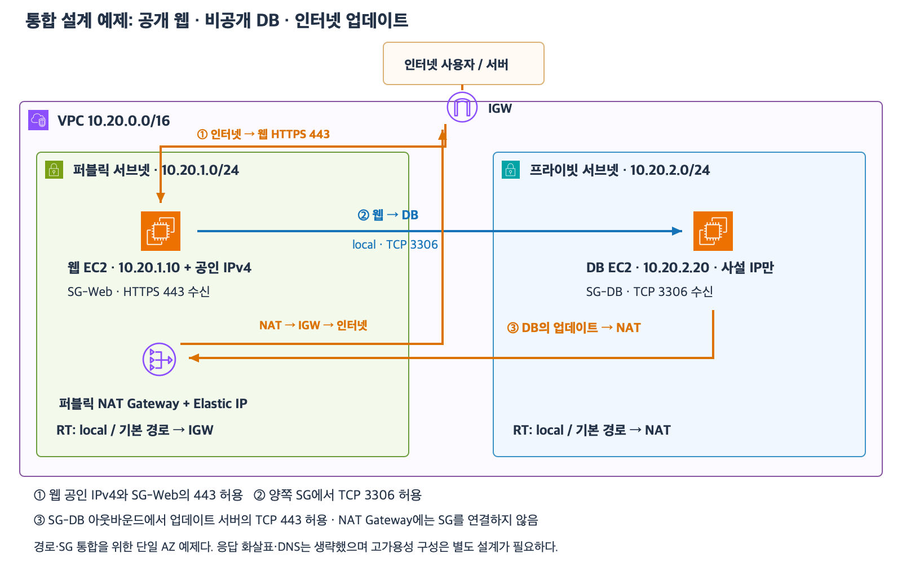

# 4주차 다섯 번째 수업: 퍼블릭 웹과 프라이빗 DB 통합 설계

예상 30~40분 · IPv4 · 실제 AWS 설정 변경 없음 · 정답 2문항 / 부분 정답 2문항 · 보완 하위 질문 2/2 정답

## 1. 이번 설계의 요구사항

인터넷 사용자는 웹 EC2의 HTTPS 443에 접속한다.
웹 EC2는 DB EC2의 사설 IP로 TCP 3306 요청을 보낸다.
DB는 웹 EC2에서 오는 DB 요청만 받고 인터넷에서 직접 접속하지 못하게 한다.
DB EC2는 인터넷 업데이트 서버에 먼저 HTTPS 443 요청을 보내고 응답을 받는다.
이번에는 DB 프로그램을 EC2에서 실행하며 RDS의 세부 구성은 다루지 않는다.

개념 통합을 위해 두 서브넷을 한 AZ에 둔 예제다.
한 AZ 장애에 대비한 완성 설계는 아니며 다음 종합 확인에서 AZ 배치도 검토한다.
공인 주소는 실제 AWS 리소스에 할당하지 않는다.

## 2. 완성 예제의 구조

[확대 가능한 SVG](images/public-web-private-db.svg)

| 구성 | 예제 |
|---|---|
| VPC | 10.20.0.0/16 |
| 퍼블릭 서브넷 | 10.20.1.0/24 |
| 웹 EC2 | 사설 10.20.1.10과 공인 IPv4 · SG-Web 연결 |
| 퍼블릭 NAT Gateway | 퍼블릭 서브넷에 배치 · Elastic IP 연결 |
| 프라이빗 서브넷 | 10.20.2.0/24 |
| DB EC2 | 사설 10.20.2.20만 사용 · SG-DB 연결 |
| IGW | VPC에 연결 |

퍼블릭 서브넷 RT는 10.20.0.0/16 → local과 0.0.0.0/0 → IGW다.
프라이빗 서브넷 RT는 10.20.0.0/16 → local과 0.0.0.0/0 → 퍼블릭 NAT Gateway다.
웹에서 DB로 보낼 때는 목적지가 VPC 안이므로 /0 대신 더 구체적인 /16의 local을 선택한다.
이 내부 통신은 NAT나 IGW를 거치지 않는다.
DB의 인터넷 요청은 NAT와 IGW를 거친다.

## 3. SG 규칙을 요청별로 설계한다

이번 예제는 EC2마다 SG 하나만 적용하며 아래 규칙 외에는 없다.

| SG | 방향 | 목적지 포트 | 상대 |
|---|---|---|---|
| SG-Web | 인바운드 | TCP 443 | 출발지 0.0.0.0/0 |
| SG-Web | 아웃바운드 | TCP 3306 | 대상 SG-DB |
| SG-DB | 인바운드 | TCP 3306 | 출발지 SG-Web |
| SG-DB | 아웃바운드 | TCP 443 | 대상 0.0.0.0/0 |

웹은 모든 인터넷 IPv4 사용자에게 공개해야 하므로 443 출발지를 0.0.0.0/0으로 둔다.
반면 DB 포트는 SG-Web만 출발지로 허용한다.
DB 업데이트 서버의 주소가 제공되지 않아 예제에서는 아웃바운드 TCP 443 대상을 모든 IPv4로 둔다.
이 규칙은 특정 업데이트 서비스 하나로 제한하는 규칙이 아니다.
실제 요구사항에 고정된 대상 주소 범위가 있으면 그 범위로 좁힐 수 있다.

아웃바운드 규칙의 대상은 최종 서버다.
DB 업데이트의 경우 대상은 인터넷 업데이트 서버의 주소 범위이며 NAT의 사설 IP나 SG가 아니다.
NAT를 다음 경로로 선택하는 일은 RT가 담당한다.
NAT Gateway에는 SG를 연결할 수 없다.
SG는 EC2에 적용하고 NAT가 있는 서브넷의 다른 보안 제어는 이후에 배운다.

허용된 요청의 응답에는 반대 방향 SG 규칙을 따로 추가하지 않는다.
예를 들어 웹이 인터넷 사용자에게 보내는 HTTPS 응답은 SG-Web에 모든 인터넷 대상 아웃바운드를 추가하지 않아도 허용된다.
이 응답과 웹 서버가 새로 시작하는 외부 요청은 다르다.

SG는 여러 허용 규칙을 합쳐 적용한다.
DB 인바운드에 0.0.0.0/0 허용을 추가하면 기존 SG-Web 한정 규칙이 그 허용을 좁히지 못한다.
다만 SG를 넓게 허용했다는 사실만으로 공인 주소와 경로까지 자동으로 만들어지는 것은 아니다.

## 4. 접속 조건을 끝까지 확인한다

인터넷→웹은 웹 공인 IPv4와 IGW 경로 및 TCP 443 인바운드와 실제 HTTPS 서비스 설정을 함께 확인한다.
웹→DB는 사설 IP와 local 경로 및 웹 아웃바운드·DB 인바운드와 DB 서비스 설정을 함께 확인한다.
DB→인터넷은 DB 아웃바운드와 프라이빗 RT의 NAT 경로 및 NAT의 Elastic IP와 퍼블릭 RT의 IGW 경로를 확인한다.
DB를 프라이빗에 두어도 허용된 내부 서버는 DB에 접속할 수 있다.
프라이빗은 VPC 안의 모든 접근까지 차단한다는 뜻이 아니다.

실제 접속에 필요한 DNS와 운영체제 방화벽 및 그 밖의 보안 장치는 준비되어 있다고 가정한다.
네트워크 허용과 별개로 DB 인증과 데이터 권한도 필요하다.
TLS 상세와 DB 계정 설계 및 예약 주소 계산은 이번 문제 범위에서 제외한다.

## 5. 통합 설계 문제 — 전체에 답하기

예제와 다른 회사 구성을 설계한다.
VPC는 10.90.0.0/16이다.
웹 서브넷은 10.90.10.0/24이며 웹 EC2의 사설 IP는 10.90.10.10이다.
DB 서브넷은 10.90.20.0/24이며 DB EC2의 사설 IP는 10.90.20.20이다.
웹에는 SG-Front를 연결하고 DB에는 SG-Orders를 연결한다.
IGW는 VPC에 연결되어 있다.
퍼블릭 NAT Gateway와 Elastic IP는 웹 서브넷에 준비되어 있다.
웹에는 아직 공인 IPv4가 없으며 DB는 계속 사설 IPv4만 사용해야 한다.
두 서브넷 RT에는 현재 10.90.0.0/16 → local만 있다.
두 SG의 인바운드·아웃바운드 규칙은 모두 비어 있다.

요구사항은 인터넷 사용자의 웹 HTTPS 443 접속과 웹→DB TCP 5432 접속이다.
DB는 업데이트 서버 198.51.100.80에 HTTPS 443 요청을 시작할 수 있어야 한다.
198.51.100.80은 문제용 문서 예시 주소이며 실제 서비스에 접속하지 않는다.
그 외의 새 연결을 추가로 허용할 필요는 없다.
필요한 서비스 설정과 SG 외의 보안 조건은 준비되어 있다.

### 1. 주소와 경로

1-1. 웹의 인터넷 직접 IPv4 접속을 위해 웹 EC2에 어떤 주소 조건을 추가해야 하는가?
DB에도 같은 주소 조건이 필요한가?
1-2. 웹 서브넷과 DB 서브넷 RT에 추가할 기본 경로의 목적지와 대상을 각각 쓰자.
웹이 DB의 사설 IP로 보낼 때는 어느 경로를 선택하는지도 설명하자.

### 2. 웹과 DB의 허용 규칙

2-1. 인터넷 사용자가 웹의 HTTPS에 접속하도록 SG-Front에 추가할 방향·포트·상대 범위를 쓰자.
2-2. 웹이 DB에 접속하도록 SG-Front와 SG-Orders에 추가할 방향·포트·상대 SG를 각각 쓰자.

### 3. DB 업데이트와 응답

3-1. DB가 지정된 업데이트 서버에 요청하도록 SG-Orders에 추가할 방향·포트·대상을 최소 범위로 쓰자.
그 요청의 실제 경로를 DB부터 인터넷 서버까지 순서대로 쓰자.
3-2. 업데이트 응답을 받기 위해 SG-Orders 인바운드에 인터넷 출발지 TCP 443을 추가해야 하는가?
요구사항의 웹→DB 연결 허용 규칙과 업데이트 응답 처리를 구분해 설명하자.

### 4. 허용 규칙과 실제 외부 접근 구분

담당자가 SG-Orders에 TCP 5432 · 출발지 0.0.0.0/0 인바운드를 추가하자고 한다.
기존 SG-Front 한정 규칙과 이 넓은 규칙을 함께 유지하려고 한다.

4-1. 기존의 좁은 규칙 덕분에 다른 VPC 내부 서버의 DB 접속이 계속 차단되는가?
다른 내부 서버의 경로·아웃바운드 등 나머지 조건은 준비되어 있다고 가정한다.
4-2. 이 SG 변경만으로 인터넷 사용자가 DB에 직접 IPv4 접속할 수 있게 되는가?
DB의 주소와 경로 조건을 근거로 설명하자.

답변 전 정답은 공개하지 않는다.
이번 설계 문제 이후 별도의 새로운 종합 확인과 회상 복습을 거쳐 4주차 완료를 판단한다.

## 공식 참고 자료

확인: 2026-11-02

- [IGW와 퍼블릭 주소·경로](https://docs.aws.amazon.com/vpc/latest/userguide/VPC_Internet_Gateway.html)
- [NAT Gateway 특성과 SG 연결 불가](https://docs.aws.amazon.com/vpc/latest/userguide/nat-gateway-basics.html)
- [SG 허용과 참조](https://docs.aws.amazon.com/vpc/latest/userguide/security-group-rules.html)
- [AWS 공식 아이콘](https://aws.amazon.com/architecture/icons/)
- [이전 수업](20_SG_참조와_최소권한_설계.md)

## 2026-11-02 답변 평가

1번 정답.
웹의 공인 IPv4 추가와 DB의 사설 IPv4 유지가 정확하다.
웹 RT의 /0 → IGW 및 DB RT의 /0 → 퍼블릭 NAT Gateway가 정확하다.
웹→DB는 /16 → local을 선택한다는 설명도 정확하다.

2번 부분 정답.
2-1은 인터넷 공개 TCP 443 인바운드 설계가 정확하다.
2-2는 방향과 TCP 5432 포트는 맞지만 상대를 서브넷 CIDR로 지정해 상대 SG를 사용하라는 조건을 충족하지 못했다.
SG-Front 아웃바운드는 TCP 5432 · 대상 SG-Orders로 둔다.
SG-Orders 인바운드는 TCP 5432 · 출발지 SG-Front로 둔다.
10.90.20.0/24 대상은 그 서브넷의 다른 서버까지 포함한다.
10.90.10.0/24 출발지는 웹 서브넷에 있는 다른 SG의 서버까지 허용하므로 “웹만 DB 접속”이라는 요구사항보다 넓다.
CIDR 자체가 잘못된 방식은 아니지만 이 요구사항에서는 SG 참조로 상대를 제한한다.

3번 정답이며 표현을 보완한다.
업데이트 아웃바운드 TCP 443 · 대상 198.51.100.80/32와 DB→퍼블릭 NAT Gateway→IGW→업데이트 서버 순서가 정확하다.
추가 인바운드가 필요 없다는 상태 유지 설명도 정확하다.
SG는 “연결 경로”를 정하는 것이 아니라 허용된 연결의 상태를 추적한다.
경로 선택은 RT가 담당한다.
“웹에서 받을 수 있도록 인바운드”는 “DB가 웹에서 오는 새 요청을 받을 수 있도록 DB 인바운드”로 정확히 표현한다.

4번 부분 정답. 4-1 판단은 정확하고 4-2의 이유 표현은 확인이 필요하다.
4-1은 허용 규칙을 합치므로 넓은 /0 규칙에 의해 다른 내부 서버도 DB 포트에 접속 가능하다는 설명이 정확하다.
여기서 다른 내부 서버는 같은 VPC의 다른 서버를 뜻한다.
별도 다른 VPC까지 연결이 자동으로 생기는 것은 아니다.
4-2는 SG 변경만으로 직접 인터넷 IPv4 접속이 되지 않고 DB에 공인 IPv4가 없다는 판단이 정확하다.
다만 “퍼블릭 서브넷을 통해 접근 가능”이라는 표현만으로는 어떤 경로를 뜻하는지 불명확하다.
이 구성에서 DB 서브넷은 IGW 직접 경로가 아니라 NAT 경로를 사용한다.
퍼블릭 NAT Gateway는 DB가 먼저 시작한 외부 연결의 응답을 받는 데 사용하며 외부에서 DB로 임의의 새 연결을 시작하는 입구가 아니다.
웹 EC2가 사용자 요청을 처리한 뒤 DB에 별도의 내부 요청을 보내는 것은 가능하다.
이때 사용자의 연결은 웹에서 처리되고 DB 연결은 허용된 웹 EC2가 별도로 시작한다.
퍼블릭 서브넷 자체가 모든 외부 요청을 DB로 전달하지는 않는다.
기존 공식 아이콘 통합 그림에서 인터넷→웹과 웹→DB 및 DB→NAT 업데이트 화살표를 따로 구분한다.

최초 평가는 정답 2문항과 부분 정답 2문항이다.
하위 질문은 정답 6개와 부분 정답 2개다.
4-2의 의도를 NAT 경유 접속이라고 단정하지 않는다.
보완 문제로 규칙 범위와 연결 시작 주체를 재확인한다.

## 보완 확인 — 전체 두 하위 질문

### 5. 상대 범위와 외부 새 연결

같은 VPC에서 Job EC2에는 SG-Job을 연결하고 저장 EC2에는 SG-Archive를 연결했다.
요구사항은 Job에서만 저장 EC2의 TCP 9000으로 새 연결을 시작하게 하는 것이다.
Job과 같은 서브넷에는 SG-Other만 연결된 다른 EC2도 있다.
현재 관련 SG 규칙은 모두 비어 있다.

5-1. SG-Job 아웃바운드와 SG-Archive 인바운드에 추가할 방향·포트·상대 SG를 쓰자.
출발지를 Job 서브넷 전체 CIDR로 허용하면 요구사항보다 넓어지는 이유도 설명하자.

별도 상황에서 저장 EC2는 사설 IPv4만 사용하며 프라이빗 서브넷에 있다.
프라이빗 RT의 기본 경로는 퍼블릭 서브넷의 퍼블릭 NAT Gateway이고 그 NAT는 Elastic IP를 가진다.

5-2. 인터넷 사용자가 NAT의 Elastic IP에 접속하면 NAT가 저장 EC2의 TCP 9000으로 새 연결을 전달해 주는가?
저장 EC2가 먼저 시작한 외부 요청의 응답과 비교해 설명하자.

보완 평가 완료.

## 2026-11-02 보완 평가

5-1 정답.
SG-Job 아웃바운드 TCP 9000 · 대상 SG-Archive와 SG-Archive 인바운드 TCP 9000 · 출발지 SG-Job이 정확하다.
서브넷 CIDR 전체를 출발지로 지정하면 같은 서브넷의 다른 서버도 출발지 조건에 포함된다는 이유도 정확하다.
실제 접속에는 그 서버의 아웃바운드 등 나머지 조건도 필요하다.

5-2 정답이며 응답 표현을 보완한다.
외부 사용자가 NAT의 Elastic IP로 새 연결을 시작해 내부 서버로 전달받을 수 없다는 판단이 정확하다.
EC2가 먼저 요청한 연결의 응답은 받을 수 있다는 구분도 정확하다.
마지막 문장의 “외부 요청”은 “EC2가 먼저 시작한 연결에 대한 외부 서버의 응답”으로 표현한다.
NAT는 그 연결의 변환 정보를 이용하여 응답의 목적지를 내부 EC2로 되돌려 전달한다.
외부에서 임의로 시작하는 새 요청을 내부 EC2에 연결해 주는 기능과 다르다.

보완 하위 질문 2/2로 SG 최소 범위와 NAT의 연결 시작 방향 재확인을 완료했다.
최초 정답 2문항·부분 정답 2문항은 유지한다.
다음은 새로운 5문항의 4주차 종합 확인이다.
종합 확인과 마지막 회상 복습 이후 4주차 완료 여부를 판단한다.
