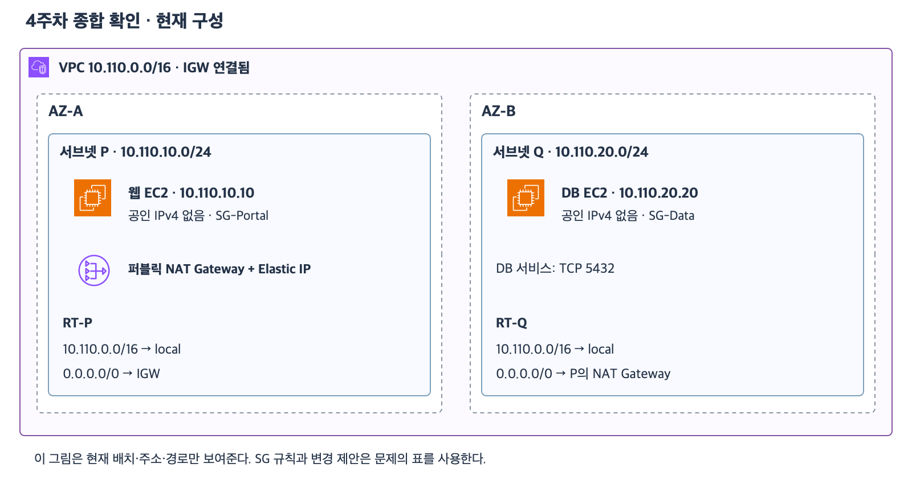
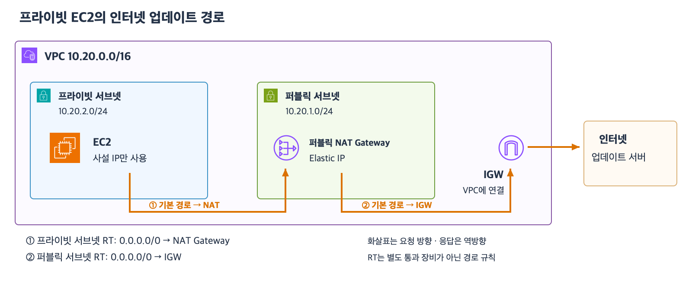

# 4주차 종합 확인

예상 20~30분 · 새로운 5문항 · 이유와 함께 답하기 · 정답 4문항 / 부분 정답 1문항 · 보완 6-1 정답
실제 AWS 설정 변경 없음

## 범위와 가정

VPC·서브넷·AZ와 CIDR 비중첩 및 RT·공인 IPv4·SG 참조·상태 유지·NAT를 확인한다.
17~21 자료에서 배운 내용만 사용한다.
일반 IPv4 TCP 연결이며 같은 VPC의 사설 IP 내부 통신을 가정한다.
서비스 설정과 SG 외의 보안 조건은 준비되어 있다.
각 문제의 변경 제안은 실제 적용하지 않은 별개의 제안이다.

## 공통 구성

[확대 가능한 SVG](images/week4-comprehensive-current.svg)

| 항목 | 현재 설정 |
|---|---|
| VPC | 10.110.0.0/16 · IGW 연결됨 |
| 서브넷 P | 10.110.10.0/24 · AZ-A |
| 서브넷 Q | 10.110.20.0/24 · AZ-B |
| 웹 EC2 | P에 위치 · 사설 10.110.10.10만 사용 · SG-Portal |
| DB EC2 | Q에 위치 · 사설 10.110.20.20만 사용 · SG-Data · TCP 5432 서비스 |
| 퍼블릭 NAT Gateway | P에 위치 · Elastic IP 보유 |
| RT-P | 10.110.0.0/16 → local 및 0.0.0.0/0 → IGW |
| RT-Q | 10.110.0.0/16 → local 및 0.0.0.0/0 → P의 NAT Gateway |

EC2별 SG는 하나이며 아래 규칙 외에는 없다.

| SG | 인바운드 | 아웃바운드 |
|---|---|---|
| SG-Portal | TCP 443 · 출발지 0.0.0.0/0 | TCP 5432 · 대상 SG-Data |
| SG-Data | 없음 | TCP 443 · 대상 203.0.113.80/32 |

203.0.113.80은 인터넷 업데이트 서버를 나타내는 문서용 주소다.
실제로 접속하지 않는다.

## 1. AZ 배치와 주소 중첩

AZ-A 장애 시 다른 AZ의 웹 서버가 요청을 처리하도록 웹 EC2를 한 대 추가하려고 한다.
이번에는 웹 서버의 AZ 배치만 판단하며 ALB·DB 가용성 상세는 제외한다.

1-1. “기존 서브넷 P를 AZ-A와 AZ-B에 걸치도록 확장하고 새 웹 EC2를 AZ-B 쪽에 배치한다”는 제안은 가능한가?
가능하지 않다면 새 웹 서버를 위한 서브넷을 어느 AZ에 어떻게 준비해야 하는지 설명하자.
1-2. 새 서브넷 후보는 10.110.10.128/25와 10.110.11.0/24다.
기존 P·Q를 유지할 때 사용할 수 있는 후보를 고르고 주소 범위의 겹침을 근거로 설명하자.
두 후보를 동시에 만들지는 않는다.

## 2. 서브넷 분류와 웹의 공인 IPv4

2-1. P와 Q는 각각 퍼블릭·프라이빗 중 어느 서브넷인가?
각 RT의 경로를 근거로 설명하자.
2-2. 인터넷 사용자가 현재 웹 EC2의 HTTPS 443으로 직접 IPv4 접속할 수 있는가?
준비된 SG·경로 외에 부족한 조건과 필요한 변경을 설명하자.
서브넷 분류와 EC2 주소 조건을 구분한다.

## 3. 목적지별 경로

이번 문항은 SG 허용 여부와 별도로 RT가 선택하는 경로를 묻는다.

3-1. 웹 EC2가 DB의 10.110.20.20으로 보낼 때 RT-P에서 어느 경로를 선택하는가?
두 경로 중 선택 근거와 NAT·IGW 경유 여부를 설명하자.
3-2. DB가 203.0.113.80으로 업데이트 요청을 보낼 때 선택하는 RT-Q 경로와 최종 서버까지의 순서를 쓰자.
DB 자체에 공인 IPv4를 추가해야 하는지도 설명하자.

## 4. DB의 새 요청 허용과 넓은 규칙

4-1. 웹만 DB의 TCP 5432에 새 연결을 시작하도록 SG-Data에 추가할 방향·포트·상대 SG를 쓰자.
SG-Portal에 이미 있는 관련 규칙도 함께 짚자.
4-2. 4-1 규칙에 더해 SG-Data 인바운드에 TCP 5432 · 출발지 10.110.0.0/16을 추가한다면 같은 VPC의 다른 SG 서버도 출발지 조건을 충족하는가?
그 서버의 아웃바운드와 경로 등 나머지 조건은 준비되어 있다.
어느 허용 규칙이 우선하는지의 문제가 맞는지도 설명하자.

## 5. 업데이트 응답과 외부 새 연결

공통 구성에서 DB가 업데이트 서버에 먼저 새 연결을 시작했다.
4번의 규칙 변경 제안과 별개로 답한다.

5-1. 업데이트 서버가 그 연결로 보내는 응답을 받으려면 SG-Data 인바운드에 TCP 443을 추가해야 하는가?
SG가 기억하는 것이 경로인지 연결 상태인지도 설명하자.
5-2. 별도의 인터넷 사용자가 NAT의 Elastic IP에 접속하면 DB의 TCP 5432로 새 연결을 시작할 수 있는가?
5-1의 응답과 다른 이유를 설명하자.

답변 전 정답·해설은 공개하지 않는다.
문항별 결론과 이유를 함께 평가한다.
이후 부족한 부분은 다른 상황으로 보완 확인하고 마지막 회상 복습까지 확인해 4주차 완료를 판단한다.

## 참고 자료

- [VPC·서브넷](17_VPC와_서브넷_기초.md)
- [라우팅·주소](18_라우팅과_퍼블릭_프라이빗_서브넷.md)
- [보안 그룹](19_보안_그룹_기초.md)
- [SG 참조·최소 권한](20_SG_참조와_최소권한_설계.md)
- [웹·DB 통합 설계](21_퍼블릭_웹과_프라이빗_DB_통합_설계.md)
- [AWS 공식 아이콘](https://aws.amazon.com/architecture/icons/)

## 2026-11-03 답변 평가

1번 정답. AZ 명시를 보완한다.
서브넷 하나가 두 AZ에 걸칠 수 없고 새 서브넷이 필요하다는 설명이 정확하다.
10.110.30.0/24라는 비중첩 범위 예시도 적절하다.
이번 요구사항에 맞게 새 서브넷은 AZ-B에 배치한다고 명시한다.
1-2는 10.110.11.0/24 선택과 기존 P와의 중첩 설명이 정확하다.
10.110.10.128/25는 10.110.10.128~10.110.10.255로 P 안에 포함된다.

2번 정답.
P의 IGW 직접 경로와 Q의 NAT 경로를 근거로 퍼블릭·프라이빗을 구분했다.
웹 EC2에는 공인 IPv4 또는 Elastic IP가 필요하다는 판단이 정확하다.

3번 정답이며 공인 주소 필요 여부의 이유를 보완한다.
3-1은 /16의 local 선택과 가장 긴 접두사 근거 및 NAT·IGW 미경유가 정확하다.
3-2는 /0 → 퍼블릭 NAT Gateway → IGW → 업데이트 서버 경로가 정확하다.
DB 자체의 공인 IPv4가 불필요한 이유는 이 경로에서 NAT Gateway의 Elastic IP를 사용하기 때문이다.
DB가 먼저 시작한 연결이라는 조건은 NAT가 그 연결의 응답을 받아 내부로 돌려보낼 수 있는 이유다.
내부에서 먼저 시작했다는 사실만으로 모든 구성에서 공인 주소가 불필요해지는 것은 아니다.

4번 부분 정답.
4-1의 SG-Data 인바운드 TCP 5432 · 출발지 SG-Portal과 기존 SG-Portal 아웃바운드 설명은 정확하다.
4-2는 다른 내부 서버도 /16 안이면 가능하다는 판단이 맞다.
다만 사용자가 문항을 모호하다고 표시했고 규칙 우선순위 여부에 대한 이유는 생략했다.
10.110.0.0/16은 이번 구성의 VPC 전체 범위이며 하나의 서브넷을 뜻하지 않는다.
그 안의 다른 서브넷에 있는 서버도 출발지 조건에 포함된다.
질문의 의도는 SG-Portal이 없는 다른 내부 서버도 새 /16 규칙으로 허용되는지와 좁은 규칙이 이를 제한하는지를 구분하는 것이다.
SG는 모든 허용 규칙을 합치므로 하나라도 맞으면 SG에서 허용된다.
넓은 규칙이나 좁은 규칙의 우선순위를 비교하는 방식이 아니다.
이 설명 누락을 보완하고 아래 새 상황에서 한 번만 확인한다.

5번 정답이며 NAT의 역할 표현을 보완한다.
5-1은 추가 인바운드가 불필요하고 DB가 시작한 연결의 상태가 유지된다는 설명이 정확하다.
5-2는 외부 사용자가 NAT의 Elastic IP로 임의의 새 연결을 시작해 DB에 전달할 수 없다는 판단이 정확하다.
이전 보완에서 새 연결과 응답을 구분한 설명과 이번 5-1을 함께 반영한다.
“NAT는 프라이빗→퍼블릭 서브넷 요청만 처리하며 반대 역할은 하지 않는다”는 표현은 다듬는다.
핵심은 서브넷 사이의 일방통행이 아니라 내부에서 시작한 연결의 요청과 그 응답을 처리한다는 것이다.
응답은 NAT를 거쳐 내부 EC2로 돌아온다.
외부에서 독립적으로 시작하는 임의의 새 연결은 허용하지 않는다.

그림은 요청 방향이며 해당 연결의 응답은 역방향으로 돌아온다.

평가는 정답 4문항과 부분 정답 1문항이다.
하위 질문은 정답 9개와 부분 정답 1개다.
부분 정답은 4-2의 결론 오류가 아니라 범위 표현과 규칙 결합 근거의 보완이다.
4주차 전체 완료는 마지막 회상 복습까지 확인한 뒤 판단한다.

## 새로운 보완 확인

DB의 SG에 다음 인바운드 두 규칙이 있다.

| 규칙 | 포트 | 출발지 |
|---|---|---|
| A | TCP 6000 | SG-App |
| B | TCP 6000 | 10.120.5.0/24 |

테스트 EC2는 10.120.5.30이며 SG-App은 연결되어 있지 않다.
대신 SG-Test가 연결되어 있다.
경로·테스트 EC2 아웃바운드와 서비스 등 나머지 조건은 준비되어 있다.
일반적인 새 TCP 연결 기준이다.

6-1. 담당자가 규칙 A를 삭제하고 B만 남겼다.
그 뒤 테스트 EC2의 DB TCP 6000 접속은 허용되는가?
남은 규칙과 허용 규칙 결합 원리를 근거로 설명하자.

보완 평가 완료.

## 2026-11-03 보완 6-1 평가

정답.
규칙 B의 TCP 6000 허용과 10.120.5.30이 출발지 범위 10.120.5.0/24에 포함된다는 근거가 정확하다.
규칙 A가 없어져도 B만으로 허용된다는 설명으로 허용 규칙 결합 원리를 재확인했다.
“출발지 subnet”은 여기서는 “SG 규칙의 허용 출발지 CIDR 범위”라고 표현하면 정확하다.
SG 규칙에 CIDR를 적었다고 그 범위가 실제 서브넷으로 생성되어 있다는 뜻은 아니다.
보완 1문항 정답으로 기록한다.
최초 종합 확인 정답 4·부분 정답 1은 유지한다.
다음은 마지막 회상 복습 자료 준비다.
회상까지 확인한 뒤 4주차 완료를 판단한다.
