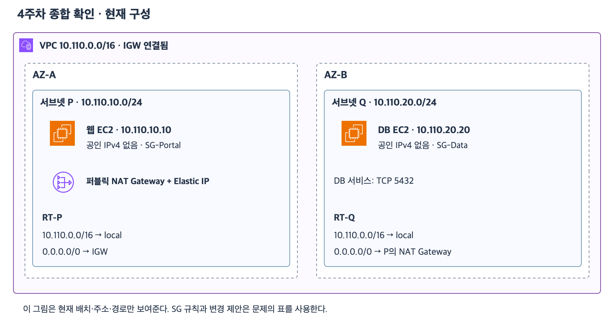

# 4주차 마지막 수업: 회상 복습

예상 10~15분 · 이전 설명을 보지 않고 자기 말로 답하기 · 평가 완료
실제 AWS 설정 변경 없음

## 현재 상태와 진행 방식

새로운 종합 확인은 정답 4문항과 부분 정답 1문항이었다.
이후 SG 허용 규칙 결합 원리는 별도 보완 6-1에서 정답으로 확인했다.
처음 받은 점수는 그대로 유지한다.
2026-11-03 회상 답변과 앞선 종합 확인·보완 결과를 함께 확인하고 4주차 완료를 기록했다.

그림과 설정 표는 문제의 조건이므로 보면서 답해도 된다.
이전 수업의 해설을 덮고 각 판단의 이유를 자기 말로 설명한다.
새 개념이나 실제 계정 조작은 없다.

## 공통 구성

[확대 가능한 SVG](images/week4-comprehensive-current.svg)

22 자료의 그림을 그대로 재사용한다.
그림의 제목은 종합 확인이지만 이번에도 같은 현재 구성을 문제 조건으로 사용한다.
그림은 배치·주소·경로를 나타내며 SG는 아래 표를 기준으로 판단한다.

| 항목 | 조건 |
|---|---|
| VPC | 10.110.0.0/16 · IGW 연결 |
| P | AZ-A · 10.110.10.0/24 · 기본 경로는 IGW |
| Q | AZ-B · 10.110.20.0/24 · 기본 경로는 P의 퍼블릭 NAT Gateway |
| 웹 EC2 | P · 10.110.10.10 · 공인 IPv4 없음 · SG-Portal |
| DB EC2 | Q · 10.110.20.20 · 공인 IPv4 없음 · SG-Data · TCP 5432 |
| 퍼블릭 NAT Gateway | P · Elastic IP 보유 |
| RT-P와 RT-Q의 내부 경로 | 10.110.0.0/16 → local |
| 업데이트 서버 | 203.0.113.80 · 문서용 예시 주소 · 실제 접속 안 함 |

| SG | 인바운드 | 아웃바운드 |
|---|---|---|
| SG-Portal | TCP 443 · 출발지 0.0.0.0/0 | TCP 5432 · 대상 SG-Data |
| SG-Data | 없음 | TCP 443 · 대상 203.0.113.80/32 |

EC2별 SG는 하나이고 위 규칙 외에는 없다.
일반적인 IPv4 TCP 연결을 가정한다.
서비스와 경로 및 SG 외의 보안 조건은 정상이다.
각 변경 제안은 별도로 판단하며 실제로 적용하지 않는다.

## 1. 경로와 주소 조건

1-1. 웹 EC2가 DB의 사설 IP로 요청할 때 선택하는 RT-P 경로와 그 이유를 설명하자.
1-2. 인터넷 사용자가 웹 EC2의 HTTPS에 직접 IPv4로 접속하게 하려 한다.
현재 경로와 SG 외에 보완할 주소 조건을 설명하자.
공인 주소가 없는 현재 상태 때문에 P의 서브넷 분류까지 바뀌는지도 구분하자.

## 2. DB를 웹 서버에만 허용하기

2-1. SG-Portal이 연결된 웹만 DB의 TCP 5432에 새 연결을 시작하도록 하려면 SG-Data에 어떤 규칙을 추가해야 하는가?
방향과 포트 및 상대를 쓰자.
2-2. 별도의 검토 결과 SG-Data에 TCP 5432 · 출발지 10.110.0.0/16 허용 규칙도 남아 있다고 하자.
웹만 접속하게 제한하려면 이 넓은 규칙과 2-1의 규칙을 어떻게 정리해야 하는가?
모든 허용 규칙의 결합 원리를 근거로 설명하자.

## 3. 업데이트 요청과 응답

3-1. DB가 업데이트 서버에 연결할 때의 경로를 DB부터 순서대로 설명하자.
DB 자체에 공인 IPv4가 없는 상태에서 외부 통신에 사용하는 공인 주소가 어디에 연결되어 있는지도 설명하자.
3-2. DB가 허용된 업데이트 연결을 먼저 시작했다.
그 연결로 돌아오는 응답을 받기 위한 SG-Data 인바운드 규칙을 별도로 추가해야 하는가?
SG의 상태 유지와 독립적인 새 연결의 차이를 근거로 설명하자.

자료와 동일한 번호의 전체 문항을 한 번에 제공한다.
정답과 해설은 답변을 받은 뒤 추가한다.
이미 배운 원리를 연결해 설명하면 되며 임의의 새 조건은 가정하지 않는다.

## 완료 후 다음 단계

이번 답변과 이전 종합 확인·보완 평가를 함께 확인해 4주차 완료 여부를 판단한다.
완료 전에는 4/32로 바꾸지 않는다.
이후 5주차 컴퓨팅에서 EC2·AMI·EBS·Auto Scaling·ALB를 다룬다.
새 용어는 다음 자료에서 쉬운 정의와 그림으로 먼저 설명한다.

## 참고 자료

- [4주차 종합 확인과 보완 결과](22_4주차_종합_확인.md)
- [라우팅과 주소 조건](18_라우팅과_퍼블릭_프라이빗_서브넷.md)
- [보안 그룹과 상태 유지](19_보안_그룹_기초.md)
- [SG 참조와 최소 권한](20_SG_참조와_최소권한_설계.md)
- [웹·DB 통합 설계](21_퍼블릭_웹과_프라이빗_DB_통합_설계.md)
- [AWS 공식 아이콘 출처](https://aws.amazon.com/architecture/icons/)

## 2026-11-03 회상 답변 평가

1-1. local 선택과 더 구체적인 범위 우선이라는 원리는 정확하다.
사용자 답변의 10.111.0.0/16은 실제 구성의 10.110.0.0/16과 다르므로 표기를 바로잡는다.
RT-P에 있는 경로는 `10.110.0.0/16 → local`이다.
목적지 10.110.20.20에 일치하는 /16과 /0 중 접두사가 더 긴 /16을 선택한다.
실제로 10.111.0.0/16 경로를 선택하는 것으로 이해하지 않도록 정확한 주소를 명시한다.

1-2. 정답.
웹 EC2에 공인 IPv4 또는 Elastic IP가 필요하다는 조건과 P가 IGW 직접 경로를 가져 퍼블릭 서브넷이라는 설명이 정확하다.
현재 사설 IP만 있는 상태에서도 P의 분류가 바뀌지는 않는다.

2-1. 정답.
SG-Data 인바운드 TCP 5432의 출발지를 SG-Portal로 지정한다는 답이 정확하다.

2-2. 정답이며 변경 범위를 명확히 정리한다.
넓은 출발지 10.110.0.0/16 허용을 없애고 SG-Portal 참조만 허용하도록 바꾼다는 방향이 정확하다.
2-1의 좁은 규칙이 이미 있다면 중복으로 만들지 않고 기존 /16 규칙을 삭제하면 된다.
두 허용 규칙을 함께 유지하면 /16에 속한 다른 서버도 SG 출발지 조건을 충족한다.
하나라도 허용하는 규칙이 있으면 SG에서 허용되기 때문이다.
사용자가 범위 축소 필요성을 정확히 설명했고 앞선 별도 6-1에서도 허용 결합 근거를 확인했으므로 함께 반영한다.

3-1. 정답.
DB → 퍼블릭 NAT Gateway → IGW → 인터넷 업데이트 서버 순서가 정확하다.
해당 경로에서 사용할 공인 주소는 퍼블릭 NAT Gateway에 연결한 Elastic IP다.
DB 자체에 공인 IPv4를 추가하는 방식과 구분했다.

3-2. 결론과 상태 유지 개념은 정확하며 SG와 NAT의 역할을 나누어 표현한다.
허용된 연결의 응답을 위해 SG-Data에 인바운드 규칙을 별도로 추가할 필요는 없다.
이유는 DB에 적용된 SG가 DB에서 시작한 허용된 연결의 상태를 추적하므로 그 연결의 응답을 허용하기 때문이다.
퍼블릭 NAT Gateway의 공인 IP나 NAT 연결 유지 자체가 SG의 응답 허용 근거는 아니다.
NAT는 별도로 연결의 주소 변환 정보를 관리해 응답 목적지를 내부 DB로 되돌린다.
NAT Gateway에 SG가 연결된다는 뜻도 아니다.
이는 별도의 외부 시작 새 연결을 허용한다는 뜻이 아니다.

### 두 상태 정보를 구분하기

| 구성 | 이번 연결에서 하는 일 |
|---|---|
| DB EC2의 SG | 허용된 연결 상태를 추적해 해당 응답 허용 |
| 퍼블릭 NAT Gateway | 주소 변환 정보를 바탕으로 응답을 내부 DB로 전달 |

회상에는 별도 점수를 부여하지 않는다.
정확히 설명한 핵심과 이전 독립 보완 결과를 함께 반영하고 위 표기·이유를 보완했다.

## 4주차 완료 판단

최초 종합 확인 정답 4문항·부분 정답 1문항과 별도 보완 6-1 정답 기록은 유지한다.
이번 회상에서 내부 경로와 공인 주소 조건 및 SG 상대·최소 권한과 업데이트 경로 및 응답 상태 유지의 핵심을 설명했다.
주소 표기와 SG·NAT 역할의 구분은 해설로 보완했다.
이 근거로 **2026-11-03 4주차 완료(4/32)** 처리한다.
실제 AWS 계정 조작과 리소스 생성은 진행하지 않았다.
다음은 5주차 컴퓨팅 첫 수업 자료를 쉬운 정의와 공식 AWS 아이콘 그림으로 먼저 준비하는 것이다.
5주차 자료는 아직 작성하지 않았다.
