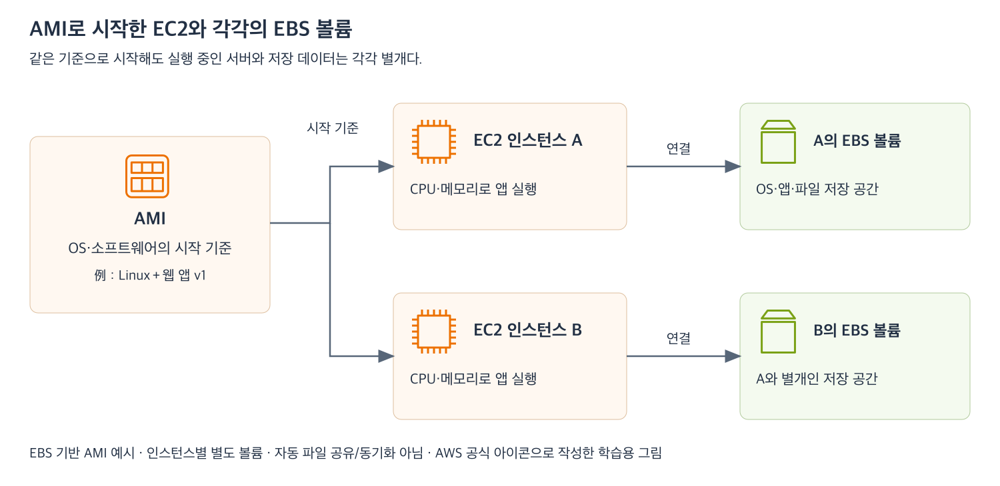

# 5주차 첫 수업: EC2·AMI·EBS 기초

예상 25~35분 · 실제 AWS 리소스 생성 없음 · 확인 문제 평가 완료 3/3 · 하위 질문 6/6

## 목표

가상 서버와 시작 이미지 및 연결 디스크의 역할을 구분한다.
같은 AMI로 시작한 EC2가 실행 이후에도 같은 상태를 공유하는 것은 아님을 설명한다.
메모리 용량과 저장 용량을 구분한다.

## 1. EC2는 앱을 실행하는 가상 서버다

Amazon EC2(Elastic Compute Cloud)는 AWS에서 가상 서버를 실행하고 관리하는 서비스다.
EC2 인스턴스(Instance)는 그 서비스를 통해 실행한 가상 서버 하나를 뜻한다.
지금까지 배운 EC2 웹 서버와 DB 서버가 그 예다.

서버는 CPU와 메모리로 프로그램을 실행한다.
CPU는 프로그램의 명령을 계산하고 처리하는 자원이다.
메모리 또는 RAM은 실행 중인 프로그램과 데이터를 올려 두는 작업 공간이다.

인스턴스 유형(Instance type)은 CPU·메모리·네트워크 등 자원의 구성을 정한다.
이번에는 구체적인 유형 이름보다 앱 실행 자원과 저장 공간의 차이에 집중한다.

## 2. AMI는 서버를 시작하는 소프트웨어 기준이다

AMI(Amazon Machine Image)는 EC2를 설정하고 부팅하는 데 필요한 소프트웨어를 제공하는 이미지다.
운영체제와 필요한 소프트웨어를 준비한 시작 기준으로 이해한다.
여기서 이미지는 그림 파일이 아니라 서버를 만들 때 사용하는 소프트웨어 이미지다.

AMI를 고르고 호환되는 인스턴스 유형과 저장 공간 및 네트워크 설정을 지정해 EC2를 시작한다.
AMI 하나로 EC2 여러 대를 시작할 수 있다.
AMI가 같아도 모든 서버의 CPU·메모리 용량이 반드시 같은 것은 아니다.
호환되는 범위에서 인스턴스 유형을 별도로 선택할 수 있기 때문이다.

예: Linux와 웹 앱 v1을 담은 AMI를 기준으로 서버 A와 B를 만든다.
두 서버는 같은 소프트웨어 기준으로 시작하지만 실행 중인 서버는 각각 별개다.
A에서 파일을 수정하거나 소프트웨어를 업데이트했다고 원래 AMI나 B가 자동으로 바뀌지는 않는다.
업데이트한 구성을 새 시작 기준으로 쓰려면 별도의 새 AMI 생성이나 배포 작업이 필요하다.
배포는 소프트웨어 변경을 실제 실행 환경에 반영하는 작업이다.
AMI 생성 방법과 배포 자동화는 이후에 다룬다.

## 3. EBS는 EC2에 연결하는 디스크다

Amazon EBS(Elastic Block Store)는 EC2에서 디스크처럼 사용하는 블록 스토리지 서비스다.
블록 스토리지는 데이터를 일정 단위로 저장하고 운영체제가 디스크처럼 사용할 수 있는 저장 방식이다.
EBS 볼륨(Volume)은 EC2에 연결하는 저장 공간 하나다.

운영체제나 앱 및 파일을 볼륨에 저장할 수 있다.
이번 수업에서는 EBS를 부팅 디스크로 사용하는 일반적인 EC2를 가정한다.
부팅 디스크 또는 루트 볼륨은 운영체제를 시작하는 데 사용하는 디스크다.
모든 EC2 저장 방식이 EBS 하나뿐이라는 뜻은 아니다.
다른 저장 방식은 이후에 비교한다.

EBS는 실행 중 작업 공간인 RAM과 다르다.
EBS 용량을 늘려도 EC2의 RAM 용량 자체가 늘지는 않는다.
저장 공간 부족과 실행 중 메모리 부족을 구분해야 한다.

EBS는 지속성 있는 저장 공간이지만 영원히 삭제되지 않는다는 뜻은 아니다.
볼륨 삭제나 인스턴스 종료 시의 삭제 설정 및 백업은 별도로 관리해야 한다.
중지·종료와 볼륨 수명주기 및 백업 상세는 다음 수업에서 다룬다.

## 4. 그림으로 연결하기

[확대 가능한 SVG](images/ec2-ami-ebs-basics.svg)

EBS 기반 AMI로 시작한 각 EC2는 별도의 부팅 EBS 볼륨을 가진다고 가정한다.
같은 AMI를 사용한다고 두 EC2가 같은 EBS 볼륨을 공유하는 것은 아니다.
A의 볼륨에 새 파일을 저장해도 B의 별도 볼륨에 자동으로 생기지 않는다.
공유 저장소나 데이터 동기화 구성은 이번 예제에 없다.

| 구성 | 역할 | 비유 |
|---|---|---|
| AMI | 시작할 소프트웨어 구성의 기준 | 준비해 둔 설치 이미지 |
| EC2 인스턴스 | CPU·RAM으로 앱을 실행하는 가상 서버 | 실행 중인 컴퓨터 |
| EBS 볼륨 | OS·앱·파일을 저장하는 디스크 | 연결된 SSD·하드디스크 |

실제 배치에는 앞서 배운 서브넷·SG와 앱이 AWS에 요청할 때 쓰는 IAM 역할도 필요할 수 있다.
이 구성들은 AMI·인스턴스 유형·EBS를 고르는 것과 별도로 설정한다.
AMI만 선택하면 네트워크와 권한 구성이 모두 완성되는 것은 아니다.

## 5. 확인 문제 — 하위 번호와 이유를 함께 답하기

### 1. 각 구성의 역할

새 EC2를 만들 때 AMI와 EBS를 설정한다.

1-1. AMI는 실행 중인 서버인가 서버를 시작할 소프트웨어 기준인가?
그 역할을 설명하자.
1-2. EBS 볼륨은 RAM인가 디스크 저장 공간인가?
어떤 정보를 저장하는지 예를 하나 들자.

### 2. 같은 AMI에서 시작한 서버

웹 앱 v1이 담긴 원래 AMI로 EC2 A와 B를 만들었다.
A에서만 앱을 v2로 업데이트했다.
새 AMI는 만들지 않았고 별도의 자동 배포나 동기화도 없다.

2-1. B의 앱도 자동으로 v2가 되는가?
2-2. 원래 AMI로 새 EC2 C를 만들면 앱의 시작 버전은 무엇인가?
이유도 설명하자.

### 3. 저장 공간과 실행 자원

A와 B는 같은 AMI로 시작했지만 각각 별도의 EBS 볼륨을 사용한다.
공유 저장소나 동기화 설정은 없다.

3-1. A의 프로그램에 필요한 RAM이 부족하다.
EBS 용량을 100GB에서 200GB로 늘리면 RAM 용량 자체가 늘어나는가?
작업 공간과 디스크를 구분해 설명하자.
3-2. 시작 이후 A의 EBS에 새로운 파일을 저장했다.
같은 AMI로 시작한 B의 EBS에도 이 파일이 자동으로 생기는가?
이유를 설명하자.

정답과 해설은 아래 평가에 반영했다.
5주차 전체 완료 평가는 별도로 진행한다.
이번 수업은 실제 인스턴스나 볼륨을 생성하지 않는다.

## 공식 참고 자료

확인: 2026-11-03

- [Amazon EC2와 인스턴스](https://docs.aws.amazon.com/AWSEC2/latest/UserGuide/concepts.html)
- [AMI의 역할과 여러 인스턴스 시작](https://docs.aws.amazon.com/AWSEC2/latest/UserGuide/AMIs.html)
- [EBS 볼륨](https://docs.aws.amazon.com/ebs/latest/userguide/what-is-ebs.html)
- [AWS 공식 아키텍처 아이콘](https://aws.amazon.com/architecture/icons/)
- [이전 주차 복습](23_4주차_회상_복습.md)

## 2026-11-03 답변 평가 — 3/3

큰 문항 3개와 하위 질문 6개 모두 정답이다.

1-1. 정답.
AMI가 EC2를 설정하고 부팅하는 소프트웨어 이미지라는 설명이 정확하다.
실행 중인 서버 자체와 시작 기준을 구분했다.
1-2. 정답.
EBS는 디스크 공간이며 OS와 파일을 저장한다는 예도 적절하다.

2-1. 정답.
A와 B는 별개 서버이며 별도 배포나 동기화가 없으면 B가 자동으로 v2가 되지 않는다.
2-2. 정답.
원래 AMI가 v1이므로 C는 v1으로 시작하며 A에서 한 작업이 원래 AMI에 자동 반영되지 않는다는 이유가 정확하다.

3-1. 정답.
EBS 증설은 저장 용량을 늘리는 것이고 RAM 용량 자체를 늘리지 않는다는 설명이 정확하다.
RAM 증설이 필요하면 더 많은 메모리를 제공하는 인스턴스 유형을 검토한다.
세부 변경 방법과 중지·재시작 영향은 이후 수업에서 다룬다.
3-2. 정답.
같은 AMI로 시작해도 각 EC2와 EBS가 별개이므로 A의 파일이 B에 자동 반영되지 않는다는 설명이 정확하다.

첫 수업 확인을 완료했다.
5주차 전체는 아직 진행 중이다.
다음은 EC2 중지·시작과 종료 및 EBS 삭제 설정·데이터 보존을 자료와 공식 아이콘 그림으로 먼저 준비한다.
실제 AWS 리소스 생성이나 변경은 하지 않았다.
