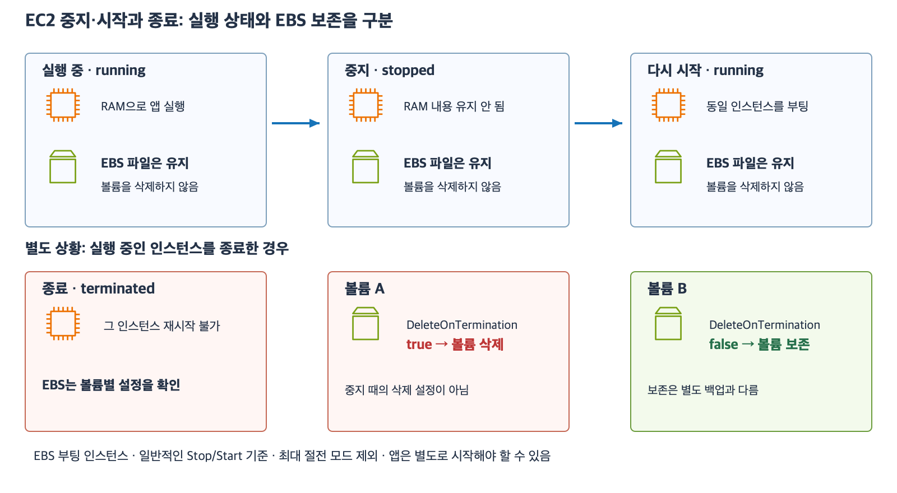

# 5주차 두 번째 수업: EC2 수명주기와 EBS 보존

예상 25~35분 · 실제 AWS 리소스 생성·변경 없음 · 3/3 정답 · 하위 질문 6/6

## 1. 이번 수업의 범위

수명주기는 서버가 실행되고 중지되고 다시 시작되거나 종료되는 과정이다.
EBS를 부팅 디스크로 사용하는 EC2의 일반적인 Stop·Start·Terminate를 다룬다.
최대 절전 모드(Hibernate)는 RAM을 저장해 복원하는 별도 기능이며 이번 문제에서는 사용하지 않는다.
인스턴스 스토어라는 다른 저장 장치도 이번에는 사용하지 않는다.
OS 안의 종료 명령 대신 EC2의 상태 변경 작업을 기준으로 한다.
종료 보호 기능이나 자동 교체 구성은 없다고 가정한다.

## 2. 중지 후 시작은 같은 인스턴스를 다시 부팅한다

중지(Stop)는 EC2를 실행 중 상태에서 멈추는 작업이다.
중지된 상태에서는 앱이 요청을 처리할 수 없다.
일반 중지에서는 RAM 내용이 유지되지 않는다.
메모리에만 있던 계산 결과를 그대로 이어서 실행한다고 기대하면 안 된다.

연결된 EBS 볼륨과 정상적으로 디스크에 저장한 파일은 중지 때문에 삭제되지 않는다.
시작(Start)하면 같은 인스턴스를 다시 부팅하고 보존된 EBS를 사용한다.
새 AMI로 새 인스턴스를 만드는 작업과 다르다.
EBS에 저장한 앱 업데이트가 중지·시작 때문에 원래 AMI 버전으로 되돌아가지는 않는다.
앱 자동 실행 설정이 없다면 앱 프로세스를 별도로 시작해야 할 수 있다.

[확대 가능한 SVG](images/ec2-stop-start-terminate.svg)

재부팅(Reboot)은 실행 중인 EC2의 운영체제를 재시작하는 작업으로 Stop 후 Start와는 별도 작업이다.
재부팅도 일반적인 실행 프로세스의 RAM 상태를 계속 유지하는 방법은 아니다.
이후 문제는 Reboot가 아니라 Stop 후 Start라고 명시한다.

## 3. 종료는 그 인스턴스를 다시 시작할 수 없게 한다

종료(Terminate)는 해당 EC2 인스턴스를 끝내는 작업이다.
종료된 그 인스턴스는 Start로 다시 실행할 수 없다.
새 인스턴스를 만들거나 보존한 데이터와 백업을 활용하는 별도 복구 작업이 필요하다.
보존된 EBS가 있어도 종료된 인스턴스 자체가 되살아나는 것은 아니다.
RAM 내용도 유지되지 않는다.

EBS 볼륨은 무조건 함께 삭제되거나 무조건 보존되는 것이 아니다.
각 볼륨의 DeleteOnTermination 설정에 따라 결정한다.
이 설정은 “인스턴스가 종료될 때 이 볼륨도 삭제할지”를 뜻한다.

| 볼륨 설정 | EC2 일반 중지 | EC2 종료 |
|---|---|---|
| DeleteOnTermination = true | 볼륨 유지 | 볼륨 삭제 |
| DeleteOnTermination = false | 볼륨 유지 | 볼륨 보존 |

true는 참 또는 활성화이고 false는 거짓 또는 비활성화다.
이 설정은 볼륨별로 확인한다.
루트 볼륨인지 추가 데이터 볼륨인지만 보고 결과를 단정하지 않는다.
일반적으로 루트 EBS는 종료 시 삭제가 기본이지만 생성 방식과 AMI 및 설정에 따라 달라질 수 있다.
문제에서는 기본값을 추측하지 말고 제시된 실제 설정을 사용한다.

예: 루트 볼륨 true와 로그 볼륨 false가 연결된 인스턴스를 종료한다.
루트 볼륨은 삭제되고 로그 볼륨은 남는다.
로그 볼륨은 이후 호환되는 다른 인스턴스에서 사용하는 등 별도 작업이 필요하다.
볼륨 연결과 마운트의 상세 절차는 이후 저장소 수업에서 다룬다.

## 4. 중지·시작과 IP 주소

이번에는 네트워크 인터페이스 하나를 사용하며 자동 할당 공인 IPv4 하나를 받은 일반적인 EC2를 가정한다.
Elastic IP나 추가 인터페이스 등 특별한 구성은 없다.

Stop 후 Start에서 기본 사설 IPv4는 유지된다.
자동 할당 공인 IPv4는 중지할 때 반환되고 다시 시작하면 새 주소를 받는다.
따라서 이전 공인 IPv4를 고정 주소처럼 저장해서 계속 사용하면 안 된다.
Elastic IP는 계정에 할당해 관리하는 별도 공인 주소다.
직접 해제하거나 연결을 바꾸지 않는다면 중지·시작으로 자동 할당 주소처럼 반환되지 않는다.
종료 이후의 Elastic IP 해제·재연결 작업은 별도 관리가 필요하다.

## 5. 데이터 보존은 백업과 다르다

DeleteOnTermination=false는 인스턴스 종료로 해당 볼륨이 자동 삭제되는 것을 막는 설정이다.
파일 실수 삭제나 데이터 손상까지 되돌리는 백업 설정은 아니다.

스냅샷(Snapshot)은 EBS 볼륨의 특정 시점 데이터를 복구할 수 있도록 보관하는 백업 방식이다.
볼륨이 남는 것과 그 볼륨에 별도 스냅샷이 있는 것은 다르다.
스냅샷 이후의 새 파일까지 그 스냅샷에 자동으로 추가되지는 않는다.
일관된 백업을 만드는 방법과 스냅샷 복원 절차는 이후에 다룬다.
중요한 데이터는 종료 전에 볼륨별 삭제 설정과 필요한 백업을 확인한다.

중지했다고 연결 EBS 등 모든 자원의 비용이 없어지는 것은 아니다.
남아 있는 저장 공간과 공인 주소 등은 별도 비용 조건을 확인해야 한다.
이번 수업에서는 요금 수치나 실제 과금 실습은 다루지 않는다.

## 6. 확인 문제 — 전체에 이유와 함께 답하기

일반적인 EBS 부팅 EC2이며 Hibernate·인스턴스 스토어·자동 복구·동기화는 사용하지 않는다.
파일은 정상적으로 EBS에 저장을 마친 상태다.

### 1. 중지 후 시작

원래 앱 v1 AMI로 만든 EC2 A에서 앱을 v2로 업데이트해 EBS에 저장했다.
A의 EBS에는 report.csv도 저장했다.
계산 중간값은 파일로 저장하지 않고 RAM에만 보관했다.
새 AMI나 백업은 만들지 않았다.
A를 Stop하고 이후 Start한다.

1-1. report.csv와 RAM의 계산 중간값은 각각 어떻게 되는가?
저장 공간의 차이로 설명하자.
1-2. 다시 시작할 때 EBS의 앱 파일은 v1과 v2 중 어느 버전인가?
새 AMI로 인스턴스를 만드는 경우와 구분해 설명하자.
앱 프로세스의 자동 실행 여부는 묻지 않는다.

### 2. 종료와 볼륨별 설정

EC2 B에는 다음 두 EBS 볼륨이 연결되어 있다.

| 볼륨 | 용도 | DeleteOnTermination |
|---|---|---|
| R | 부팅용 루트 볼륨 | false |
| D | 추가 데이터 볼륨 | true |

2-1. B를 Terminate하면 R과 D는 각각 남는가 삭제되는가?
용도가 아니라 실제 설정을 근거로 설명하자.
2-2. R이 남아 있으므로 종료된 B에 Start를 실행해 같은 인스턴스를 다시 켤 수 있는가?
남아 있는 디스크와 종료된 인스턴스를 구분해 설명하자.

### 3. 주소와 백업

EC2 C는 인터페이스 하나와 자동 할당 공인 IPv4를 사용하고 Elastic IP는 없다.
C의 데이터 EBS는 DeleteOnTermination=false지만 스냅샷 등 별도 백업은 없다.

3-1. C를 Stop 후 Start하면 기존 사설 IPv4와 자동 할당 공인 IPv4는 각각 어떻게 되는가?
3-2. “데이터 EBS가 종료 후에도 남도록 설정했으니 파일을 잘못 삭제해도 그 설정으로 이전 데이터를 복구할 수 있다”는 주장은 맞는가?
보존 설정과 백업의 차이로 설명하자.

답변 전 정답·해설은 공개하지 않는다.
사용자 답변을 받은 뒤 평가와 진도를 기록한다.

## 공식 참고 자료

확인: 2026-11-03

- [EC2 상태 변경](https://docs.aws.amazon.com/AWSEC2/latest/UserGuide/ec2-instance-lifecycle.html)
- [Stop·Start의 데이터·주소 동작](https://docs.aws.amazon.com/AWSEC2/latest/UserGuide/how-ec2-instance-stop-start-works.html)
- [종료와 볼륨 보존](https://docs.aws.amazon.com/AWSEC2/latest/UserGuide/how-ec2-instance-termination-works.html)
- [EBS 스냅샷](https://docs.aws.amazon.com/ebs/latest/userguide/ebs-snapshots.html)
- [공식 AWS 아이콘](https://aws.amazon.com/architecture/icons/)
- [이전 수업](24_EC2_AMI_EBS_기초.md)

## 2026-11-03 답변 평가 — 3/3

1번 정답.
1-1은 EBS의 report.csv 보존과 RAM 중간값 소실을 정확히 구분했다.
1-2는 업데이트된 EBS의 v2를 사용한다는 설명이 정확하다.
다만 “삭제 설정이 없다면”이라는 조건은 일반 Stop/Start의 EBS 보존에는 필요하지 않다.
DeleteOnTermination=true여도 Stop은 Terminate가 아니므로 이 설정에 의해 EBS가 삭제되지 않는다.
별도로 볼륨이나 파일을 삭제하는 작업이 없다는 이번 가정에서 기존 EBS가 유지된다.
“새 AMI로 서버를 만드는 경우 v1”은 “원래 v1 AMI로 새 인스턴스를 만들면 v1”으로 표현한다.
새 AMI라는 말만으로 내용이 v1이라고 결정할 수는 없다.
A 변경이 원래 AMI나 다른 EC2에 자동 반영되지 않는다는 이유는 정확하다.

2번 정답.
2-1은 R의 false에 따른 보존과 D의 true에 따른 삭제를 정확히 설명했다.
루트·추가 볼륨의 용도 대신 실제 설정을 적용했다.
2-2는 남은 EBS와 종료된 인스턴스를 구분하고 기존 B에 Start할 수 없다는 설명이 정확하다.
새 인스턴스와 보존 데이터 활용은 별도 작업이다.

3번 정답.
3-1은 사설 IPv4 유지와 자동 할당 공인 IPv4의 Stop 시 반환·Start 시 새 할당을 정확히 설명했다.
3-2는 종료 시 보존 설정과 백업을 정확히 구분했다.
추가로 파일 복구에는 그 파일이 삭제되기 전 데이터를 포함하는 스냅샷 등 백업이 필요하다고 보충한다.
삭제 후 스냅샷을 새로 만든다고 이미 삭제한 파일이 되살아나는 것은 아니다.
스냅샷 시점 이후 변경은 해당 스냅샷에 포함되지 않는다.

큰 문항 3개와 하위 질문 6개 모두 정답이다.
위 표현 보완을 별도로 기록하고 미확인 오개념으로 점수를 바꾸지 않는다.
다음은 EC2 인스턴스 유형과 수직·수평 확장 선택이다.
새 자료를 공식 AWS 아이콘과 예제로 먼저 준비한다.
5주차 전체는 아직 진행 중이며 완료 주차는 4/32다.
