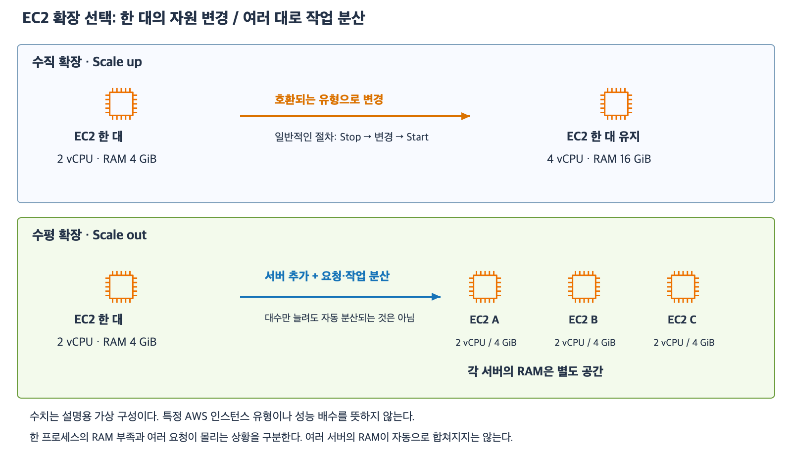

# 5주차 세 번째 수업: EC2 인스턴스 유형과 확장 선택

예상 30~40분 · 실제 AWS 리소스 생성·변경 없음 · 3/3 정답 · 하위 질문 6/6

## 1. 부족한 자원을 먼저 구분한다

인스턴스 유형은 EC2의 CPU·RAM·네트워크 등 자원 구성을 정한다.
vCPU는 가상 서버에 제공되는 CPU 실행 자원의 단위다.
CPU 모델이나 구조가 다르면 같은 vCPU 개수라도 실제 성능은 다를 수 있다.
RAM의 GiB는 메모리 용량 단위다.
이번 수업은 실제 유형 이름 암기보다 어느 자원이 부족한지 판단하는 데 집중한다.

병목은 전체 처리 속도를 제한하는 부분이다.
CPU 계산이 밀리는지 RAM이 부족한지 디스크 저장 공간이 부족한지부터 확인한다.
원인이 DB 응답 지연이라면 웹 EC2 자원을 늘리는 것만으로 문제가 해결되지 않을 수 있다.
사용률 측정과 부하 시험으로 실제 효과를 확인해야 한다.

| 유형 분류 | 자원 특성 | 먼저 검토할 상황 |
|---|---|---|
| 범용 | CPU·메모리·네트워크의 균형 | 요구 자원이 비교적 고른 앱 |
| 컴퓨팅 최적화 | 계산 처리에 적합한 구성 | CPU가 병목인 계산 작업 |
| 메모리 최적화 | 큰 메모리 요구에 적합한 구성 | 큰 데이터를 RAM에 올리는 작업 |

이는 검토 방향이며 특정 분류를 선택하면 무조건 해결된다는 뜻은 아니다.
CPU 작업이 코어 여러 개를 사용할 수 있는지 등 앱의 동작도 확인한다.
인스턴스 유형을 바꿔 RAM을 늘리는 것과 EBS 용량을 늘리는 것은 다른 작업이다.

## 2. 수직 확장은 한 대의 자원을 키운다

수직 확장(Scale up)은 서버 한 대의 CPU·RAM 등 자원 구성을 더 큰 구성으로 바꾸는 것이다.
반대로 줄이는 것은 Scale down이다.
예를 들어 한 프로세스가 12 GiB RAM을 필요로 하는데 서버에는 4 GiB만 있다면 RAM이 더 큰 유형을 검토한다.
프로세스는 실행 중인 프로그램 하나를 뜻한다.

이번에는 호환되는 인스턴스 유형으로 변경하는 일반적인 EBS 부팅 EC2를 가정한다.
일반적인 직접 변경 절차는 Stop → 인스턴스 유형 변경 → Start다.
따라서 이 서버만 사용하는 앱은 그동안 중단될 수 있다.
원래 인스턴스의 EBS 파일을 사용하는 것과 RAM 상태가 소실되는 점은 지난 수업과 연결된다.

모든 유형 사이를 바로 변경할 수 있는 것은 아니다.
AMI와 OS 및 CPU 구조와 드라이버 등의 호환성을 확인해야 한다.
호환되지 않으면 맞는 AMI로 새 인스턴스를 만드는 등 다른 이전 방법이 필요할 수 있다.
이번 문제에서는 변경하려는 유형이 호환된다고 명시한다.

한 대를 크게 만들어도 그 서버의 장애에 대비한 두 번째 서버가 생기지는 않는다.
자원 확대와 장애 대비는 별도로 판단한다.

## 3. 수평 확장은 여러 서버에 일을 나눈다

수평 확장(Scale out)은 서버 대수를 늘려 여러 서버가 요청이나 작업을 나누어 처리하도록 하는 것이다.
반대로 대수를 줄이는 것은 Scale in이다.
요청을 여러 서버로 보내는 분산 구성이나 작업을 나누는 앱 구조가 필요하다.
서버만 추가하고 실제 요청을 기존 서버에만 보내면 새 서버가 부하를 처리하지 못한다.

[확대 가능한 SVG](images/ec2-vertical-horizontal-scaling.svg)

그림의 수치는 설명용이며 실제 인스턴스 사양이나 성능 배수를 뜻하지 않는다.
RAM 4 GiB 서버 세 대가 생겨도 한 프로세스가 자동으로 RAM 12 GiB를 사용할 수 있는 것은 아니다.
각 서버의 RAM은 별도 공간이다.
작업을 쪼개 여러 프로세스와 서버에서 처리하는 구조가 있다면 분산 처리를 검토할 수 있다.
그런 구조 변경이 없다는 조건에서는 단일 프로세스의 메모리 부족을 서버 대수만으로 해결하지 않는다.

여러 서버에 요청을 전달하는 ALB와 대수를 조절하는 Auto Scaling의 세부 동작은 다음 수업에서 연결한다.
이번 수업에서는 자동 설정이나 실습을 하지 않는다.

## 4. 앱의 상태와 장애 대비도 확인한다

상태는 다음 요청에서도 필요한 로그인 정보나 처리 중 데이터 등을 뜻한다.
예를 들어 앱 A의 RAM에만 로그인 상태를 저장하면 같은 사용자의 다음 요청을 B가 받았을 때 그 상태를 알지 못할 수 있다.
A의 EBS에만 저장한 업로드 파일도 B의 별도 EBS에 자동으로 생기지 않는다.
같은 AMI를 쓴다는 것만으로 실행 이후의 RAM·파일이 동기화되는 것은 아니다.

무상태(Stateless) 웹 계층은 특정 서버의 로컬 상태에 의존하지 않도록 구성한 계층이다.
시스템 전체에 데이터가 없다는 뜻은 아니다.
여러 웹 서버가 접근할 수 있는 외부 저장소 등에 필요한 상태를 분리해 두면 어떤 웹 서버가 요청을 받아도 처리할 수 있도록 설계하기 쉽다.
구체적인 저장 서비스 선택은 이후 저장소·DB 수업에서 다룬다.
상태가 있는 앱은 수평 확장이 불가능하다는 뜻이 아니라 상태 공유나 분리 전략을 함께 설계해야 한다는 뜻이다.

  서버가 여러 대여도 모두 같은 AZ에 있으면 AZ 장애에 함께 영향을 받을 수 있다.
AZ 장애 대비가 요구되면 서로 다른 AZ의 서브넷에 서버를 나누고 정상 서버로 요청을 전달해야 한다.
남은 서버의 처리 용량과 DB 같은 의존 서비스도 확인한다.
수평 확장만으로 고가용성이 자동 완성되지는 않는다.

## 5. 확인 문제 — 전체 답변과 이유

CPU·RAM 수치는 설명용이며 실제 인스턴스 이름이나 요금은 묻지 않는다.
특별히 언급하지 않으면 자동 동기화나 분산 처리 구조는 없다.

### 1. 단일 프로세스의 RAM 부족

분석 프로그램 하나가 실행 중 RAM 10 GiB를 필요로 한다.
현재 EC2는 RAM 4 GiB이며 EBS 용량은 충분하다.
작업을 여러 서버에 나누는 구조가 없고 이번에는 프로그램 구조를 변경하지 않는다.

1-1. 다음 중 현재 문제에 맞는 방법을 고르고 이유를 설명하자.
A: EBS를 100 GiB에서 300 GiB로 증설한다.
B: RAM 4 GiB 서버 두 대를 추가하면 기존 프로세스가 자동으로 총 12 GiB를 사용한다.
C: 충분한 RAM을 제공하는 호환 인스턴스 유형으로 변경한다.
1-2. 선택 C를 기존 EC2에 일반적인 방식으로 적용할 때 필요한 상태 변경 순서를 쓰자.
그 서버 한 대만 사용하는 앱이 무중단으로 계속 실행되는지도 설명하자.

### 2. 많은 독립 요청과 서버별 상태

웹 앱이 서로 독립적인 요청을 많이 받는다.
각 요청의 RAM 요구량은 작고 한 서버에 요청이 몰려 처리량이 부족하다.
여러 서버에 요청을 나눌 수 있는 앱이며 적절한 요청 분산 구성을 준비할 수 있다.

2-1. 수평 확장을 적용한다면 서버 대수와 요청 전달 방식을 어떻게 바꿔야 하는가?
서버를 추가하는 것만으로 기존 요청이 자동 분산된다고 볼 수 있는지도 설명하자.
2-2. 이후 이 앱이 로그인 상태를 서버 A의 RAM에만 저장한 사실을 발견했다.
다음 요청을 B가 받으면 어떤 문제가 생길 수 있는가?
어느 웹 서버가 받아도 처리할 수 있게 하려면 상태 저장을 어떤 방향으로 설계해야 하는가?
구체적인 AWS 저장 서비스 이름은 쓰지 않아도 된다.

### 3. 자원 선택과 AZ 장애

서로 별개의 상황이다.

3-1. 작업 관찰 결과 CPU 여유는 충분하지만 큰 데이터를 RAM에 올리는 동안 메모리가 부족하다.
범용·컴퓨팅 최적화·메모리 최적화 중 어느 분류를 먼저 검토할 것인가?
한 프로세스의 메모리 요구가 병목이라고 가정하고 이유를 설명하자.
3-2. 웹 서버를 세 대로 늘렸지만 모두 AZ-A의 서브넷에 있다.
요구사항은 AZ-A가 중단되어도 다른 AZ의 웹 서버가 요청을 처리하는 것이다.
현재 배치가 요구사항을 충족하는가?
서버·서브넷 배치를 어떻게 바꾸고 요청 전달에서 무엇을 준비해야 하는가?
DB 상세 설정은 답변에서 제외한다.

답변 전 정답·해설을 공개하지 않는다.
답변 후 평가와 진도를 갱신한다.

## 공식 참고 자료

확인: 2026-11-03

- [EC2 인스턴스 유형 분류](https://aws.amazon.com/ec2/instance-types/)
- [인스턴스 유형 변경](https://docs.aws.amazon.com/AWSEC2/latest/UserGuide/ec2-instance-resize.html)
- [무상태 설계와 수평 확장](https://docs.aws.amazon.com/wellarchitected/latest/framework/rel_mitigate_interaction_failure_stateless.html)
- [수평 확장의 뜻](https://wa.aws.amazon.com/wellarchitected/2020-07-02T19-33-23/wat.concept.horizontal-scaling.en.html)
- [AWS 공식 아이콘](https://aws.amazon.com/architecture/icons/)
- [이전 수업](25_EC2_수명주기와_EBS_보존.md)

## 2026-11-03 답변 평가 — 3/3

1번 정답.
1-1은 C 선택과 EBS·RAM 구분 및 서버별 RAM이 자동 합산되지 않는다는 근거가 정확하다.
1-2는 Stop → 유형 변경 → Start와 단일 서버 앱의 중단 가능성을 정확히 설명했다.

2번 정답. 상태 저장 방향을 보충한다.
2-1은 서버 추가와 요청 분산이 별도이며 ALB를 요청 전달 수단으로 제시했다.
사용자는 ALB 상세는 다음 수업 범위라는 점도 지적했다.
이 문항은 구체적인 AWS 서비스 이름이나 ALB 설정을 요구하지 않는다.
“요청을 여러 서버로 나누어 전달하는 구성”으로 답하면 충분하며 ALB 명시를 정답 조건으로 삼지 않는다.
2-2는 B가 A의 RAM 로그인 상태를 알 수 없다는 문제와 무상태 설계 방향을 정확히 설명했다.
구체적으로 필요한 로그인 상태는 여러 서버가 접근하는 외부 저장소 등에 분리하여 웹 서버 로컬 RAM에만 의존하지 않도록 한다.
무상태는 로그인 정보 등 필요한 데이터를 전혀 저장하지 않는다는 뜻이 아니다.
구체적인 저장 서비스 이름은 이번 평가에 요구하지 않는다.

3번 정답. 필요한 AZ 개수를 보충한다.
3-1은 메모리 최적화 선택과 큰 RAM 요구의 근거가 정확하다.
3-2는 같은 AZ의 세 서버로 요구사항을 충족하지 못한다는 판단과 다른 AZ의 별도 서브넷·서버 배치 및 ALB 요청 전달 방향이 정확하다.
현재 AZ-A 서버를 유지하고 AZ-B에 추가하는 등 서로 다른 두 AZ에 나누는 구성부터 검토할 수 있다.
AZ-C까지 반드시 세 AZ를 사용해야 한다는 뜻은 아니다.
실제 설계에서는 정상 서버로의 요청 전달과 남은 처리 용량도 함께 확인한다.

큰 문항 3개와 하위 질문 6개 모두 정답이다.
다음은 ALB의 리스너·대상 그룹·헬스 체크를 공식 아이콘 그림과 예제로 먼저 설명한다.
새 용어를 자료에 먼저 정의하고 확인 문제는 전체를 제시한다.
5주차 전체는 진행 중이며 완료 주차는 4/32다.
