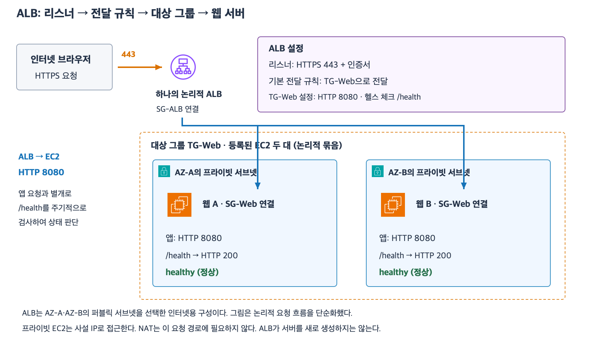
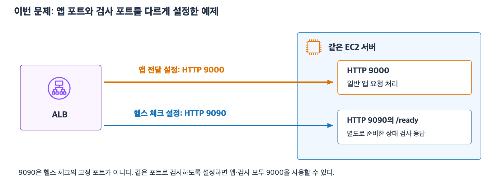

# 5주차 네 번째 수업: ALB 리스너·대상 그룹·헬스 체크

예상 30~40분 · 실제 AWS 리소스 생성·변경 없음 · 정답 2문항 / 부분 정답 1문항 · 보완 4-1 정답

## 1. ALB는 웹 요청을 받아 대상에 전달한다

ALB(Application Load Balancer)는 HTTP·HTTPS 요청을 받아 등록한 웹 서버 등 대상에 분산하는 서비스다.
대상(Target)은 요청을 처리할 서버 등을 뜻한다.
이번에는 EC2 인스턴스를 대상으로 사용한다.
ALB 자체에 앱 코드를 배포해서 실행하는 구조가 아니다.
웹 앱은 EC2에서 실행한다.

일반적인 리전 ALB는 서로 다른 두 개 이상의 AZ에서 서브넷을 선택한다.
이번에는 인터넷용 ALB가 두 AZ의 퍼블릭 서브넷을 사용하고 웹 EC2는 각 AZ의 프라이빗 서브넷에 있다고 가정한다.
ALB는 EC2의 사설 IP로 전달할 수 있으므로 웹 EC2 자체에 공인 IPv4가 필요하지 않다.
인터넷용 ALB의 경로와 주소는 준비되어 있다.
ALB→웹 서버 내부 요청에는 NAT가 필요하지 않다.

## 2. 리스너는 요청을 받는 프로토콜과 포트다

리스너(Listener)는 ALB가 어떤 프로토콜·포트의 연결을 받을지 정하는 설정이다.
예를 들어 HTTPS 443 리스너는 브라우저가 HTTPS 443으로 ALB에 접속하게 한다.
HTTPS 리스너에는 인증서를 설정해야 한다.
SG에 TCP 443을 허용하는 것과 실제 리스너·인증서를 설정하는 것은 별개다.

리스너에는 받은 요청을 어떻게 처리할지 정하는 규칙이 있다.
이번에는 기본 규칙 하나가 모든 요청을 TG-Web으로 전달한다고 가정한다.
경로나 도메인에 따른 여러 규칙과 우선순위는 이후에 다룬다.
RT의 IP 경로 선택이나 SG 허용 규칙과 이 전달 규칙을 혼동하지 않는다.

## 3. 대상 그룹은 전달할 서버를 묶는다

대상 그룹(Target Group)은 요청을 전달할 대상과 전달·상태 확인 설정을 관리하는 논리적 묶음이다.
예를 들어 TG-Web에 웹 EC2 A와 B를 등록한다.
리스너의 규칙이 TG-Web을 선택하면 ALB는 그 그룹의 대상 상태와 설정에 따라 요청을 전달한다.
EC2를 만들었다고 모든 EC2가 대상 그룹에 자동 등록되는 것은 아니다.
이번에는 필요한 등록과 AZ 활성화가 완료되었다고 가정한다.

클라이언트가 접속하는 리스너 포트와 EC2가 받는 포트는 달라도 된다.
예: 브라우저→ALB는 HTTPS 443이고 ALB→EC2는 HTTP 8080이다.
이때 브라우저와 ALB 사이의 TLS는 ALB에서 종료된다.
ALB와 EC2는 별도 연결이며 HTTP 8080 구간은 TLS로 암호화되지 않는다.
내부도 TLS가 필요하면 대상 쪽 HTTPS 설정과 ALB의 HTTPS 전달을 별도로 구성한다.
ALB 앞에 HTTPS를 적용했다고 모든 뒤쪽 구간까지 자동 암호화되는 것은 아니다.

[확대 가능한 SVG](images/alb-listener-target-health.svg)

그림은 하나의 논리적 ALB와 두 AZ의 대상을 단순화했다.
대상 그룹 상자는 서브넷 경계가 아니다.

## 4. 헬스 체크는 대상의 응답을 검사한다

헬스 체크(Health Check)는 ALB가 대상에 주기적으로 요청을 보내 정상 응답 여부를 검사하는 기능이다.
프로토콜·포트·경로·정상 응답 코드와 연속 성공·실패 기준 등을 설정한다.
경로는 /health나 /ready 같은 URL 경로다.
그 이/름을 지정했다고 서버에 해당 기능이 자동으로 생기지는 않는다.
앱이 실제로 그 경로를 제공해야 한다.

예: HTTP 8080의 /health로 요청하고 정상 응답 코드는 200으로 설정한다.
HTTP 200은 요청을 정상 처리했다는 상태 코드다.
HTTP 404는 해당 경로를 찾지 못했다는 상태 코드다.
404 응답이나 시간 초과가 연속 실패 기준을 충족하면 unhealthy(비정상)로 판단할 수 있다.
정상으로 판단된 대상은 healthy라고 한다.
상태 변화는 검사 간격과 연속 횟수에 따라 감지 시간이 걸리며 즉시 알 수 있는 것은 아니다.

이번에는 정상 대상이 하나 이상 남아 있는 기본적인 분산 구성을 가정한다.
A가 비정상으로 판정되고 B가 정상이라면 이후 일반적인 새 요청은 정상인 B로 전달한다.
이미 처리 중인 요청의 성공이나 남은 서버의 충분한 용량까지 보장하는 것은 아니다.
모든 등록 대상이 비정상이면 ALB가 비정상 대상에도 요청을 보내는 fail-open 동작이 있을 수 있다.
따라서 “비정상 대상에는 어떤 상황에서도 절대 보내지 않는다”라고 일반화하지 않는다.
이번 확인 문제는 모든 대상 비정상 상황을 제외한다.

헬스 체크 실패가 항상 EC2 전원 꺼짐이나 CPU 고장을 뜻하지는 않는다.
검사 경로가 틀리거나 앱 응답 코드가 기대값과 다르거나 SG가 검사 포트를 막아도 실패할 수 있다.
반대로 단순 /health의 200 응답만으로 주문·결제 등 앱 전체 기능의 정상을 보장할 수도 없다.
검사 경로가 실제로 어떤 상태를 확인하는지 설계해야 한다.

ALB의 헬스 체크 자체가 EC2를 새로 만들거나 앱을 재시작하지는 않는다.
서버 대수 유지·증감과 교체를 담당하는 EC2 Auto Scaling은 다음 수업에서 다룬다.
이번 문제에서는 그런 별도 복구·증감 구성은 없다고 가정한다.

## 보충: 앱이 9000인데 검사가 9090인 이유

앱 포트가 9000이면 검사 포트가 자동으로 9090이 되는 것이 아니다.
헬스 체크의 기본 포트는 대상이 앱 트래픽을 받는 포트다.
따라서 앱이 HTTP 9000이고 별도 포트로 바꾸지 않으면 HTTP 9000의 /ready 같은 경로로 검사할 수 있다.

이번 확인 문제에서는 서로 다른 포트의 허용을 연습하도록 헬스 체크 포트를 명시적으로 9090으로 지정했다.
같은 EC2가 앱용 9000과 검사용 9090을 각각 수신하고 9090에서 /ready에 응답하도록 준비되어 있다는 가정이다.
운영·상태 확인용 응답을 앱 요청과 별도 포트로 제공하는 구성을 예로 든 것이다.
9090은 AWS 헬스 체크 전용 고정 포트가 아니며 숫자 자체에 특별한 의미는 없다.
다른 포트를 설정하려면 실제 서버에서도 그 포트로 정상 응답할 서비스가 있어야 한다.
ALB 설정만 9090으로 바꾸어도 EC2가 9090을 자동 수신하지는 않는다.

같은 포트를 쓰는 구성과 다른 포트를 쓰는 구성 모두 가능하다.
SG에서 어떤 포트를 허용할지는 실제 대상 전달 포트와 헬스 체크 설정을 보고 판단한다.

## 5. SG는 사용자 접속과 대상 접속을 따로 허용한다

ALB에는 SG-ALB를 연결하고 대상 EC2에는 SG-Web을 연결한다고 하자.
기본 예제는 리스너 HTTPS 443과 전달 HTTP 8080 및 같은 8080 포트의 헬스 체크다.

| SG | 방향 | 포트 | 상대 |
|---|---|---|---|
| SG-ALB | 인바운드 | TCP 443 | 출발지 0.0.0.0/0 |
| SG-ALB | 아웃바운드 | TCP 8080 | 대상 SG-Web |
| SG-Web | 인바운드 | TCP 8080 | 출발지 SG-ALB |

EC2에서 보는 연결 상대는 ALB이므로 SG-Web 출발지를 SG-ALB로 제한한다.
사용자가 ALB의 443으로 들어왔다고 EC2의 443을 무조건 열 필요는 없다.
EC2에 설정된 실제 서비스 포트와 헬스 체크 포트를 허용한다.
헬스 체크가 다른 포트라면 그 포트도 ALB 아웃바운드와 EC2 인바운드에서 허용해야 한다.
SG는 요청 경로 /health와 /ready를 구분하지 않고 프로토콜·포트·상대 범위로 허용한다.
허용된 연결의 응답은 상태 유지로 처리된다.
앱의 로그인 상태 공유와 데이터 저장은 ALB를 추가하는 것만으로 자동 해결되지 않는다.

## 6. 확인 문제 — 전체 답변과 이유

같은 VPC에서 사설 IP로 직접 연결한다.
인터넷용 ALB는 AZ-A·AZ-B의 퍼블릭 서브넷을 사용한다.
웹 EC2 A와 B는 각 AZ의 프라이빗 서브넷에 있으며 공인 IPv4는 없다.
필요한 네트워크 경로·인증서·서비스 설정은 준비되어 있다.

ALB 리스너는 HTTPS 8443이고 기본 규칙은 TG-App으로 전달한다.
TG-App에는 A와 B가 등록되어 있고 전달 설정은 HTTP 9000이다.
헬스 체크는 HTTP 9090의 /ready이며 정상 응답 코드는 200이다.
특수한 분산 설정은 없으며 기본적인 healthy 대상 선택을 사용한다.

### 1. 구성의 역할과 TLS

1-1. 8443에서 요청을 받는 설정은 리스너인가 대상 그룹인가?
A·B를 등록하고 전달 포트 9000을 설정하는 곳은 어디인가?
1-2. 브라우저→ALB와 ALB→EC2의 프로토콜·포트를 각각 쓰고 TLS 보호 구간을 설명하자.
EC2가 프라이빗 서브넷에 있다는 이유만으로 뒤쪽 HTTP 연결이 TLS로 암호화되는가?

### 2. 비정상 대상과 ALB의 역할

A의 /ready가 계속 500을 반환해 이미 unhealthy 판정을 받았다.
500은 앱이 요청을 정상 처리하지 못했다는 서버 오류 상태 코드다.
B는 200을 반환하며 healthy이고 요청을 처리할 충분한 용량이 있다.

2-1. 이후 일반적인 새 앱 요청은 어느 EC2로 전달되는가?
감지 시점 전의 요청이나 이미 진행 중이던 요청까지 무조건 성공한다고 볼 수 있는지도 설명하자.
2-2. ALB의 헬스 체크 자체가 A를 종료하고 새 EC2 C를 생성하는가?
별도의 Auto Scaling이나 복구 자동화는 없다.

### 3. SG와 헬스 체크 설정

ALB에는 SG-LB가 연결되고 A·B에는 SG-App이 연결되어 있다.
SG 규칙은 모두 비어 있다고 가정한다.
다른 조건은 공통 구성대로 준비되어 있다.

3-1. 인터넷 사용자의 ALB 접속과 ALB의 앱 전달·헬스 체크를 허용할 최소한의 SG 규칙을 쓰자.
각 규칙의 적용 SG·방향·포트·출발지 또는 대상을 명시하자.
포트가 서로 다른 앱 전달과 헬스 체크를 모두 고려한다.
3-2. 이후 필요한 SG를 준비했지만 헬스 체크 경로를 실수로 /missing으로 지정했다.
앱은 /missing에 404를 반환하고 실제 /ready에는 200을 반환한다.
기대 정상 코드는 여전히 200이다.
이 상태에서 연속 실패 기준을 충족해 비정상 판정이 났다면 EC2가 꺼졌다고 단정할 수 있는가?
어떤 설정을 우선 확인·수정해야 하는가?
이 하위 질문은 두 대상 모두 비정상일 때의 트래픽 처리를 묻는 문제가 아니다.

답변 전 정답·해설은 공개하지 않는다.
답변 후 평가와 진도를 갱신한다.

## 공식 참고 자료

확인: 2026-11-03

- [리스너](https://docs.aws.amazon.com/elasticloadbalancing/latest/application/load-balancer-listeners.html)
- [대상 그룹](https://docs.aws.amazon.com/elasticloadbalancing/latest/application/load-balancer-target-groups.html)
- [헬스 체크와 fail-open](https://docs.aws.amazon.com/elasticloadbalancing/latest/application/target-group-health-checks.html)
- [ALB·대상 SG 규칙](https://docs.aws.amazon.com/elasticloadbalancing/latest/application/load-balancer-update-security-groups.html)
- [ALB의 AZ와 서브넷](https://docs.aws.amazon.com/elasticloadbalancing/latest/application/load-balancer-subnets.html)
- [AWS 공식 아이콘](https://aws.amazon.com/architecture/icons/)
- [이전 수업](26_EC2_인스턴스_유형과_확장_선택.md)

## 2026-11-03 답변 평가

1번 정답이며 대상 그룹과 전달 규칙의 표현을 구분한다.
1-1은 요청 수신이 리스너이고 A·B 등록과 전달 포트 설정이 대상 그룹이라는 답이 정확하다.
괄호의 “전달 규칙”은 대상 그룹 자체와 동일하지 않다.
리스너의 전달 규칙은 어느 대상 그룹으로 보낼지를 정한다.
선택된 대상 그룹은 등록된 서버와 대상 쪽 전달 설정을 관리한다.
1-2의 HTTPS 8443과 HTTP 9000 및 앞쪽만 TLS 보호라는 설명이 정확하다.

2번 정답.
2-1은 healthy B로 새 요청을 보내고 무조건 성공을 보장하지 않는다는 판단이 정확하다.
헬스 체크가 검사하는 상태는 앱 전체 기능의 완전한 정상과 동일하지 않다.
추가로 감지에는 시간이 걸려 감지 전 또는 이미 진행 중인 요청이 실패할 수 있다고 보충한다.
2-2는 헬스 체크 자체와 EC2 종료·생성 작업을 구분했다.

3번 부분 정답.
3-1은 사용자 접속과 앱 전달 방향 및 상대 SG가 정확하다.
헬스 체크의 EC2 인바운드 TCP 9090 · 출발지 SG-LB도 맞다.
이 예제의 헬스 체크 포트는 앱의 9000과 별도로 지정된 9090이므로 9090을 사용한다.
누락된 규칙은 SG-LB 아웃바운드 TCP 9090 · 대상 SG-App이다.
ALB가 새 검사 연결을 시작하므로 ALB 아웃바운드와 EC2 인바운드를 모두 확인한다.
사용자가 HTTP·HTTPS로 표현한 SG 규칙은 의도는 맞지만 실제 프로토콜 항목은 TCP로 작성한다.
HTTP·HTTPS 서비스 설정과 SG의 TCP 포트 허용을 구분한다.

| 용도 | 적용 SG | 방향 | 프로토콜·포트 | 상대 |
|---|---|---|---|---|
| 사용자 접속 | SG-LB | 인바운드 | TCP 8443 | 출발지 0.0.0.0/0 |
| 앱 전달 | SG-LB | 아웃바운드 | TCP 9000 | 대상 SG-App |
| 앱 수신 | SG-App | 인바운드 | TCP 9000 | 출발지 SG-LB |
| 검사 전송 | SG-LB | 아웃바운드 | TCP 9090 | 대상 SG-App |
| 검사 수신 | SG-App | 인바운드 | TCP 9090 | 출발지 SG-LB |

HTTP 9000과 HTTP 9090은 ALB가 EC2로 시작하는 별도의 연결이다.
허용된 앱 연결의 응답에 적용하는 상태 유지가 별도 검사 연결까지 허용해 주는 것은 아니다.
3-2는 비정상을 EC2 전원 꺼짐으로 단정하지 않고 검사 경로를 /missing에서 /ready로 바로잡겠다는 설명이 정확하다.

최초 평가는 정답 2문항과 부분 정답 1문항이다.
하위 질문은 정답 5개와 부분 정답 1개다.
다음은 포트가 다른 새 예제로 양쪽 SG 조건을 보완 확인한다.

## 보완 확인

별도의 ALB는 앱을 HTTP 7000으로 전달하고 HTTP 7001의 /health로 검사한다.
ALB에는 SG-Gateway가 연결되고 EC2에는 SG-Service가 연결되어 있다.
사용자→ALB 접속 조건은 준비되어 있다.
대상 앱은 두 포트의 요청을 정상적으로 처리하며 검사 경로·정상 코드도 맞다.
현재 관련 규칙은 다음과 같다.

| SG | 방향 | 허용 |
|---|---|---|
| SG-Gateway | 아웃바운드 | TCP 7000 · 대상 SG-Service |
| SG-Gateway | 아웃바운드 | TCP 7001 · 대상 SG-Service |
| SG-Service | 인바운드 | TCP 7000 · 출발지 SG-Gateway |

다른 SG 허용 규칙은 없고 경로 등 나머지 조건은 준비되어 있다.

4-1. 앱 요청은 허용되지만 검사 연결은 허용되지 않는 이유를 설명하자.
검사 연결을 허용하기 위해 추가할 적용 SG·방향·프로토콜·포트·상대를 쓰자.

보완 평가 완료.

### 후속 질문 기록

사용자가 앱 9000인데 헬스 체크가 9090인 이유를 질문했다.
기본은 대상 트래픽 포트이고 이번에는 문제에서 별도로 지정한 예시라고 설명하고 비교 그림을 추가했다.
이 질문은 보완 4-1의 답변으로 점수화하지 않는다.
이후 아래 답변으로 보완을 확인했다.

## 2026-11-03 보완 4-1 평가

정답.
SG-Service 인바운드 TCP 7001 · 출발지 SG-Gateway가 없다는 설명이 정확하다.
누락된 SG·방향·프로토콜·포트·상대를 모두 명시했다.
SG-Gateway 아웃바운드는 이미 앱 포트 7000과 검사 포트 7001을 허용한다.
SG-Service 인바운드는 앱 포트 7000만 허용하므로 검사 포트 7001 인바운드를 추가해야 한다.
별도로 지정한 검사 포트와 양쪽 SG 허용 조건을 재확인했다.
최초 정답 2문항·부분 정답 1문항은 유지하며 보완 1문항 정답을 별도로 기록한다.
다음은 EC2 Auto Scaling의 대수 유지·증감·장애 교체와 ALB 역할 구분이다.
새 자료를 공식 AWS 아이콘과 예제로 먼저 준비한다.
5주차 전체는 아직 진행 중이며 완료 주차는 4/32다.
