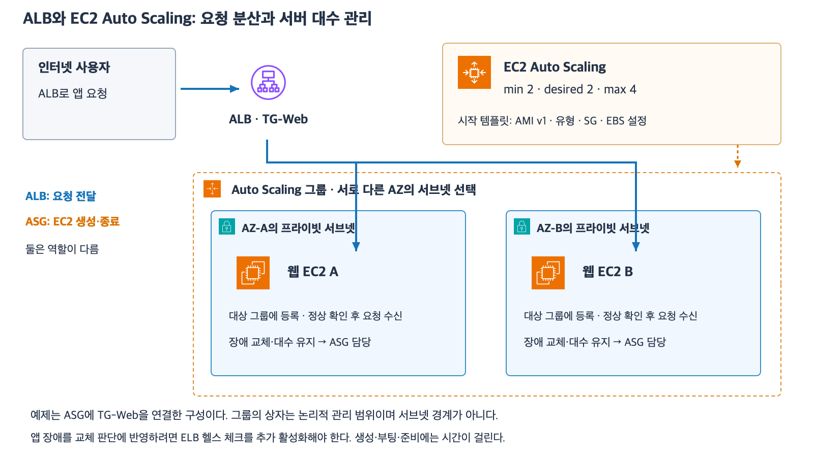
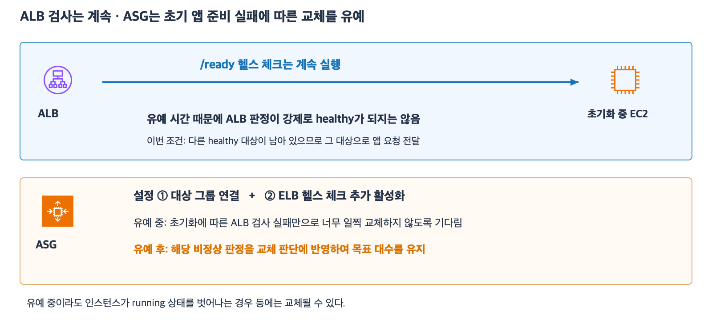

# 5주차 다섯 번째 수업: EC2 Auto Scaling 기초

예상 30~40분 · 실제 AWS 리소스 생성·변경 없음 · 정답 1문항 / 부분 정답 2문항 · 보완 4-1·4-2 확인 완료

## 1. ALB와 Auto Scaling의 역할은 다르다

ALB는 등록된 대상 중 요청을 받을 대상을 선택해 전달한다.
EC2 Auto Scaling은 관리 대상 EC2의 대수를 유지하고 설정에 따라 늘리거나 줄이며 비정상 인스턴스를 교체한다.
Auto Scaling 그룹(ASG)은 함께 관리할 EC2와 대수·배치·시작 설정 등을 묶는 논리적 관리 단위다.
ALB의 대상 그룹은 요청 전달 대상을 묶고 ASG는 인스턴스 관리를 묶는다.
대상 그룹과 ASG는 같은 개념이 아니다.

이번에는 같은 유형의 EC2를 사용하며 용량 단위가 서버 대수인 단순 구성을 가정한다.
가중치·혼합 인스턴스·Spot·특수 유지 정책은 제외한다.
서로 다른 AZ의 서브넷을 선택한 ASG와 준비된 ALB를 사용한다.
인스턴스 생성과 부팅 및 앱 준비에는 시간이 걸리므로 즉시·무조건 대수나 서비스 성공을 보장하지는 않는다.

## 2. 최소·희망·최대 용량

| 항목 | 뜻 | 예제 |
|---|---|---|
| 최소 용량 min | 일반적인 대수 조절에서 내려가지 않도록 정한 하한 | 2 |
| 희망 용량 desired | 그룹이 유지하려고 하는 현재 목표 대수 | 3 |
| 최대 용량 max | 일반적인 대수 조절에서 올라가지 않도록 정한 상한 | 5 |

이 예제의 현재 목표는 3대다.
항상 최소 2대만 유지하거나 처음부터 최대 5대를 만드는 뜻이 아니다.
실제 정상 대수가 부족하면 ASG는 목표를 맞추기 위해 인스턴스를 시작한다.
비정상 서버 한 대를 새 서버로 교체하는 작업은 희망 대수를 늘리는 것과 다르다.
희망 3을 유지하면서도 구성원인 서버는 바뀔 수 있다.
일시적인 교체 순서와 총 대수 예외는 이후 심화에서 다룬다.

희망 용량은 최소와 최대 사이로 설정한다.
부하에 따라 자동으로 목표를 변경하려면 확장 정책이 필요하다.
확장 정책은 CPU 사용률 같은 관측값이나 정해진 조건을 바탕으로 서버 대수 조절을 결정하는 규칙이다.
이번에는 어떤 정책이 어떤 목표를 요구하는지 문제에서 명시한다.
ASG를 만들었다는 이유만으로 CPU가 높을 때 무조건 최대 대수까지 늘어나는 것은 아니다.
정책이나 예약 변경이 없다면 ASG는 주어진 희망 대수를 유지한다.
CPU 지표와 구체적인 정책 설정 절차는 이후 설계 연습에서 다룬다.

## 3. 시작 템플릿은 새 EC2를 만드는 설정이다

시작 템플릿(Launch Template)은 AMI·인스턴스 유형·SG·디스크 등 EC2를 시작할 때 사용할 설정을 담는다.
ASG에는 사용할 서브넷과 희망 대수 및 시작 템플릿 등을 지정한다.
시작 템플릿과 AMI는 같지 않다.
AMI는 소프트웨어 시작 기준이고 시작 템플릿은 그 AMI 선택을 포함하는 EC2 생성 설정이다.

ASG가 새 인스턴스를 만들면 그룹에 지정한 시작 설정을 사용한다.
기존 서버 A를 수동으로 업데이트했다고 A의 현재 RAM이나 새 파일을 자동 복제하지 않는다.
예를 들어 템플릿이 원래 v1 AMI를 고정해서 사용하면 새 서버도 그 기준으로 시작한다.
A만 v2로 바꿨다고 새 서버가 자동으로 v2가 되지는 않는다.
새 서버에도 필요한 소프트웨어와 설정이 준비되도록 시작 기준이나 배포 절차를 관리해야 한다.
중요한 데이터와 로그인 상태도 교체될 수 있는 한 서버의 로컬 저장소에만 의존하지 않게 설계한다.

[확대 가능한 SVG](images/ec2-auto-scaling-basics.svg)

파란 선은 앱 요청 전달이며 ASG 관리 기능을 요청이 통과하는 장비로 그린 것이 아니다.
그림은 하나의 논리적 ALB를 단순화했다.

## 4. 장애 교체가 무엇을 기준으로 하는지 확인한다

기본적으로 ASG는 EC2 상태 확인을 사용한다.
EC2 상태 확인은 기반 인프라나 인스턴스의 상태 등을 확인하지만 앱의 /ready 응답을 대신 검사하는 것은 아니다.
EC2 상태는 정상이면서 앱만 오류를 반환할 수 있다.

ALB 대상 그룹의 비정상 판정도 교체에 반영하려면 ASG에 대상 그룹을 연결하고 ELB 헬스 체크를 추가로 활성화한다.
여기서 ELB는 Elastic Load Balancing의 이름이며 ALB가 이 서비스에 속한다.
대상 그룹을 연결하는 것과 ELB 헬스 체크를 켜는 것은 별도 조건이다.
단순히 ALB 대상에 등록되어 있다고 앱 오류가 항상 ASG 교체로 이어지는 것은 아니다.

ELB 헬스 체크를 사용하고 적용 유예 시간이 지난 뒤 ASG가 비정상을 확인하면 해당 인스턴스를 새 인스턴스로 교체할 수 있다.
ALB는 비정상 대상으로의 요청 전달을 조절하고 ASG는 인스턴스 교체를 담당한다.
교체 순서·배치와 소요 시간은 설정·상황에 따라 달라지므로 특정 순간에 교체가 끝난다고 단정하지 않는다.
다른 정상 대상이 남아 있어도 남은 용량이 부족하면 요청이 실패할 수 있다.

## 5. 대상 그룹 연결과 앱 준비 시간

ASG에 ALB의 대상 그룹을 연결하면 ASG가 시작하는 인스턴스를 해당 그룹에 등록하는 연동을 사용할 수 있다.
이번에는 그 연동이 준비된 구성이다.
서버가 생성되어 등록됐다고 즉시 앱이 정상 응답하는 것은 아니다.
ALB는 새 대상이 초기 헬스 체크를 통과해야 일반적인 요청 대상으로 사용한다.
모든 대상 비정상 시의 fail-open 예외는 지난 수업에서 설명했으며 이번 문제에는 정상 대상이 남아 있다.

헬스 체크 유예 시간(Health check grace period)은 새 인스턴스의 초기화 중 검사 실패 때문에 ASG가 너무 일찍 교체하지 않도록 두는 시간이다.
ASG의 InService 상태에 들어간 뒤 적용하며 InService는 그룹에서 서비스에 투입하는 단계의 상태 이름이다.
ASG의 InService와 ALB의 healthy 판정은 같은 조건이 아니다.

이 유예 시간은 ALB 검사 자체를 중지하거나 새 대상을 강제로 healthy로 만드는 설정이 아니다.
앱이 검사에 통과하기 전부터 사용자 요청을 무조건 받게 하는 것도 아니다.
일반적인 초기 앱 준비 실패를 ASG가 즉시 장애 교체로 처리하지 않도록 기다리는 것이다.
실행 중 상태를 벗어난 인스턴스 등은 유예 중에도 교체 대상이 될 수 있다.
유예 시간과 확장 정책의 준비 시간 설정 상세는 이후 심화에서 구분한다.

## 6. 확인 문제 — 전체 답변과 이유

같은 유형의 EC2를 대수 단위로 관리한다.
필요한 생성 권한·호환성·용량과 네트워크는 준비되어 있다.
특수 유지 정책·혼합 유형·프로세스 중단 설정 등은 없다.
실제 생성에 시간은 걸리지만 정상적으로 시작할 수 있는 상황이다.

### 1. 목표 대수와 자동 증감

ASG의 min=2, desired=3, max=5다.
현재 정상 EC2는 2대이고 생성·종료 중인 인스턴스는 없다.
확장 정책·예약 변경·외부 자동화는 전혀 없다.

1-1. ASG가 목표 대수를 맞추려면 몇 대를 추가로 시작해야 하는가?
최소·희망·최대 중 어떤 값을 현재 목표로 쓰는지 설명하자.
1-2. CPU 사용률이 높아졌다는 사실만으로 ASG가 자동으로 5대까지 늘어나는가?
추가로 필요한 설정을 설명하자.

### 2. 앱 오류와 교체 조건

ASG에 ALB 대상 그룹이 연결되어 있다.
A는 EC2 상태 확인은 정상이지만 앱의 /ready가 계속 오류를 반환해 ALB에서는 unhealthy다.
B·C는 healthy이고 처리 용량도 충분하다.
ASG에는 별도 사용자 정의 상태 확인이나 수동 장애 표시는 없다.

2-1. ASG가 기본 EC2 상태 확인만 사용한다면 A의 ALB unhealthy 판정만으로 ASG 교체가 이루어지는가?
어느 추가 헬스 체크 설정이 필요한지 설명하자.
2-2. 해당 추가 헬스 체크를 켰고 유예 시간도 지났다.
ASG가 A를 비정상으로 확인해 교체할 때 ALB와 ASG의 역할을 각각 설명하자.
희망 대수 3을 유지하는 교체와 부하 때문에 희망 대수를 늘리는 작업이 같은지도 설명하자.

### 3. 새 서버의 버전과 준비 상태

ASG의 시작 템플릿은 원래 앱 v1 AMI를 고정 사용한다.
기존 A만 수동으로 v2로 업데이트하고 A의 EBS에 extra.txt를 저장했다.
새 AMI·공유 저장소·데이터 동기화·별도 배포 절차는 없다.
ASG가 동일 템플릿으로 새 EC2 D와 그 전용 EBS를 시작했다.
대상 그룹 연동도 준비되어 있다.

3-1. D의 앱 시작 버전은 무엇인가?
A에서 실행 이후에 저장한 extra.txt도 D에 자동으로 생기는가?
시작 템플릿·AMI와 기존 서버 변경을 구분해 설명하자.
3-2. D가 대상 그룹에 등록되었지만 앱 초기화가 끝나지 않아 /ready가 실패한다.
다른 healthy 대상은 남아 있고 D는 ASG의 헬스 체크 유예 시간 안에 있다.
유예 시간은 ALB가 D를 강제로 정상 처리해 사용자 요청을 보내게 하는 설정인가?
유예 시간이 어느 서비스의 어떤 행동을 늦추는지 설명하자.

답변 전 정답·해설은 공개하지 않는다.
답변 후 채점과 진도를 기록한다.

## 공식 참고 자료

확인: 2026-11-03

- [최소·희망·최대 용량](https://docs.aws.amazon.com/autoscaling/ec2/userguide/asg-capacity-limits.html)
- [시작 템플릿](https://docs.aws.amazon.com/autoscaling/ec2/userguide/launch-templates.html)
- [ASG 헬스 체크](https://docs.aws.amazon.com/autoscaling/ec2/userguide/ec2-auto-scaling-health-checks.html)
- [대상 그룹 연결·ELB 헬스 체크](https://docs.aws.amazon.com/autoscaling/ec2/userguide/attach-load-balancer-asg.html)
- [헬스 체크 유예 시간](https://docs.aws.amazon.com/autoscaling/ec2/userguide/health-check-grace-period.html)
- [AWS 공식 아이콘](https://aws.amazon.com/architecture/icons/)
- [이전 수업](27_ALB_리스너_대상그룹_헬스체크.md)

## 2026-11-03 답변 평가

1번 정답.
1-1은 desired=3을 목표로 1대 추가한다는 설명이 정확하다.
1-2는 부하 기반 자동 증감에 확장 정책이 필요하며 정책에 따라 최대 5대까지 늘어날 수 있다는 설명이 정확하다.
CPU 정책을 만들면 반드시 5대가 되는 것은 아니고 정책 판단과 한도 안에서 목표를 조절한다.

2번 부분 정답.
2-1은 기본 EC2 검사만으로 앱 오류에 따른 교체가 이루어지지 않는다는 결론은 맞다.
하지만 대상 그룹은 문제에서 이미 연결되어 있다.
추가로 필요한 것은 ASG의 ELB 헬스 체크 활성화다.
대상 그룹 연결만으로 이 옵션이 자동 활성화되는 것은 아니다.
2-2는 ALB의 전달과 ASG의 장애 교체라는 역할 구분은 대체로 맞다.
이번에는 B·C가 정상이며 특별한 설정이 없으므로 이후 일반적인 새 요청은 B·C로 전달한다.
모든 대상 비정상 때의 fail-open 예외는 이번 조건이 아니다.
ASG는 활성화한 검사로 비정상을 판단해 교체하며 교체 원인이 앱 검사만으로 한정되지는 않는다.
대상 그룹 결과를 쓰려면 2-1의 ELB 옵션 활성화가 필요하다.
장애 교체는 기존 desired=3을 유지하는 구성원 교체이고 확장은 정책에 따라 desired를 늘리는 작업이다.
확장은 “EC2 자체 상태 CPU·Memory를 항상 검사한다”는 고정 동작이 아니라 선택한 관측 지표와 정책을 사용한다.
메모리 사용률 등을 사용하려면 해당 지표 수집과 정책이 준비되어 있어야 한다.

3번 부분 정답.
3-1은 D가 원래 v1 AMI 기준으로 시작하며 전용 EBS에 extra.txt가 자동 복제되지 않는다는 설명이 정확하다.
“기존 A의 AMI가 v2로 업데이트”는 “A에서 실행 중인 앱을 v2로 업데이트”로 표현한다.
원래 AMI 자체가 자동으로 v2가 되지 않는다.
3-2는 유예 시간이 D를 강제로 정상 처리하는 기능이 아니라는 결론은 맞다.
“헬스 체크 시간을 유예”라는 설명은 어느 서비스의 어떤 동작을 늦추는지 모호하다.
ALB의 검사는 계속 실행된다.
ASG가 새 인스턴스의 초기화에 따른 ALB 검사 실패를 근거로 너무 일찍 비정상 처리·교체하지 않도록 유예하는 것이다.
ALB 검사 중단과 ASG 교체 판단 유예를 구분한다.
다른 정상 대상이 남아 있는 이번 조건에서 ALB는 새 D가 정상 검사를 통과하기 전까지 그 정상 대상들로 요청을 보낸다.

최초 평가는 정답 1문항과 부분 정답 2문항이다.
2번은 ELB 검사 활성화 누락과 대수 유지·증감 이유를 보완한다.
3번은 3-2의 서비스·행동 구분을 재확인한다.
핵심 결론이 맞는 부분과 구체적인 설정·이유의 부족을 구분하여 기록한다.

## 새로운 보완 확인 — 전체 두 하위 질문

4-1. ASG에 대상 그룹이 연결되어 있고 앱 EC2는 EC2 상태 검사상 정상이다.
그런데 앱이 계속 503을 반환해 ALB에서는 unhealthy다.
초기화 유예 시간은 이미 지났으며 ASG는 기본 EC2 상태 확인만 사용한다.
앱 장애 판정을 교체에 반영하려면 어떤 ASG 설정을 추가해야 하는가?
그 교체의 목표가 기존 desired=2 유지인지 부하 대응으로 desired 증가인지도 설명하자.

4-2. 별도 ASG에서는 ELB 헬스 체크가 활성화되어 있다.
새 서버는 running이며 앱 초기화 중이고 ASG 유예 시간 안에 있다.
다른 healthy 대상은 남아 있다.
“유예 중에는 ALB가 /ready 검사를 멈춘다”는 주장은 맞는가?
실제로 계속되는 작업과 유예되는 판단·행동을 서비스 이름으로 구분해 설명하자.

보완 답변 대기.

## 2026-11-03 보완 4-1·4-2 답변 평가

4-1 정답.
ASG의 ELB 헬스 체크 활성화와 기존 희망 대수 유지라는 목적을 정확히 답했다.

4-2 부분 정답. 마지막 ASG 표현은 재확인한다.
“아니오”와 ALB가 정상 서버에 요청을 보낸다는 설명은 정확하다.
“/ready 검사를 맞추지 않습니다”는 문맥상 “멈추지 않습니다”의 입력 오류로 보이지만 단어 자체를 확정하지 않는다.
ALB는 유예 중에도 검사를 계속한다는 정확한 표현을 다시 제시한다.
마지막 “교체 대상이 아니므로 유예하지 않습니다”는 ASG의 유예 동작 설명과 반대이거나 표현 오류라서 완료로 추정하지 않는다.
이번 조건에서는 새 인스턴스의 초기 앱 검사 실패에 따른 즉시 교체를 하지 않고 ASG가 그 판단을 유예한다.
ASG가 아무 검사도 하지 않거나 모든 상황에서 절대 교체하지 않는다는 뜻은 아니다.

정확한 표현은 “ALB는 검사를 계속하고 정상 대상으로 요청을 전달한다. ASG는 초기 앱 검사 실패만으로 새 서버를 즉시 교체하지 않고 유예 시간 동안 기다린다”다.
4-1은 완료로 유지하고 4-2의 ASG 행동만 짧게 재서술받아 확인한다.
최초 정답 1문항·부분 정답 2문항 평가는 유지한다.

### 2026-11-03 후속 정정 확인

사용자가 마지막 문장을 “유예한다”라고 써야 한다고 직접 정정했다.
ALB는 검사를 계속하고 ASG는 초기 앱 검사 실패에 따른 조기 교체 판단을 유예한다는 뜻으로 확인했다.
4-2는 이 후속 정정을 반영해 보완 완료로 기록한다.
보완 4-1·4-2 모두 확인 완료이며 최초 정답 1문항·부분 정답 2문항 평가는 유지한다.
다음은 ALB·ASG 통합 설계와 확장 정책 판단 연습이다.
새 자료를 공식 AWS 아이콘과 예제로 먼저 준비한다.
5주차 전체는 아직 진행 중이며 완료 주차는 4/32다.
