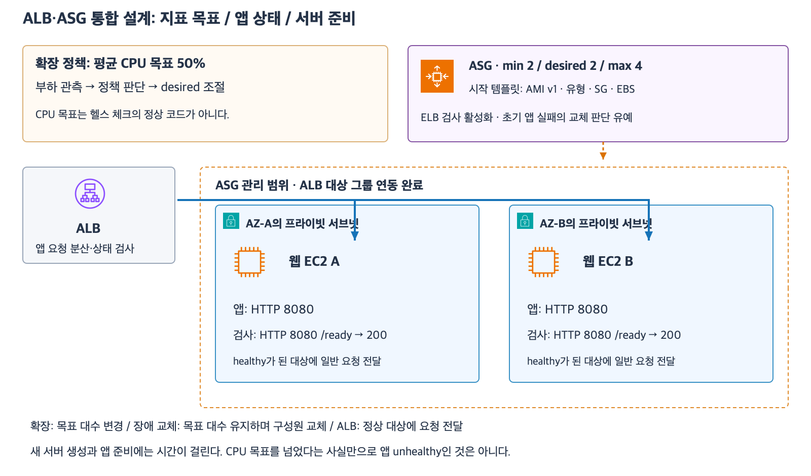
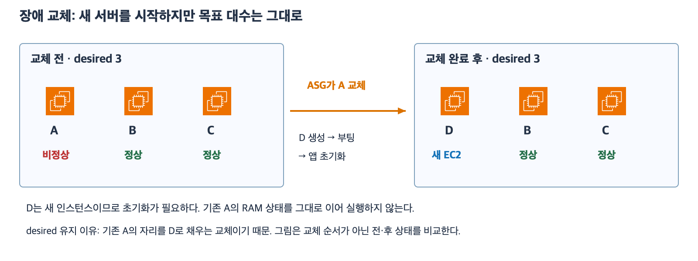

# 5주차 여섯 번째 수업: ALB·ASG 통합 설계와 확장 정책

예상 30~40분 · 실제 AWS 리소스 생성·변경 없음 · 정답 2문항 / 부분 정답 1문항 · 보완 4-1 정답

## 1. 통합 구성

인터넷 사용자 요청은 두 AZ의 퍼블릭 서브넷을 사용하는 ALB가 받는다.
ALB는 대상 그룹을 통해 각 AZ의 프라이빗 웹 EC2에 사설 IP로 전달한다.
ASG는 두 AZ의 웹 서브넷을 선택하고 해당 대상 그룹과 연동되어 있다.
요청 분산과 인스턴스 대수 관리를 서로 다른 기능으로 구분한다.

예제는 HTTPS 443 리스너와 HTTP 8080 전달을 사용한다.
헬스 체크도 HTTP 8080의 /ready이며 정상 코드는 200이다.
이번에는 앱 전달과 검사 포트가 같다고 명시한다.
필요한 인증서·경로·SG는 준비되어 있다.
ASG는 min=2, desired=2, max=4이고 같은 유형 EC2를 대수 단위로 관리한다.
ELB 헬스 체크가 추가 활성화되어 있다.

[확대 가능한 SVG](images/alb-asg-integrated-policy.svg)

그림은 하나의 논리적 ALB를 단순화했으며 실제 관리 설정과 앱 요청 경로를 구분했다.
ASG를 사용자 요청이 통과하는 네트워크 장비로 보지 않는다.

## 2. 목표 추적 확장 정책

지표(Metric)는 CPU 사용률처럼 시간에 따라 측정하는 값이다.
CloudWatch는 AWS 리소스의 지표 등을 수집·관찰하는 서비스다.
이번에는 ASG의 평균 CPU 사용률 지표를 사용한다.
평균 CPU는 앱 부하가 서버들에 적절히 나뉘는 상황에서 대수 조절 지표로 검토할 수 있다.

목표 추적(Target tracking) 정책은 선택한 지표가 목표값 근처에 오도록 용량을 조절하는 확장 방식이다.
예: 평균 CPU 목표를 50%로 설정한다.
처리량 요구가 늘어 CPU가 높으면 정책이 서버 추가를 판단할 수 있다.
부하가 줄면 설정과 조건에 따라 서버 축소를 판단할 수 있다.
ASG의 min·max 안에서 desired를 조절하며 실제 생성·종료에는 시간이 걸린다.
한 번의 CPU 관측값만으로 추가 대수를 정확하게 계산하거나 즉시 동작한다고 단정하지 않는다.
이번 문제에서는 정책이 결정한 새 desired 값을 제공한다.

CPU 목표 50%는 헬스 체크 정상 기준이 아니다.
CPU가 목표보다 높아도 /ready가 200이면 ALB 검사에서는 healthy일 수 있다.
반대로 CPU가 낮아도 앱이 오류를 반환하면 ALB 검사에서 unhealthy일 수 있다.
따라서 “부하 때문에 더 많은 서버가 필요함”과 “특정 서버가 앱 요청을 처리하지 못함”을 구분한다.

## 3. 확장·교체·새 서버 준비를 구분한다

확장 정책이 desired를 2에서 3으로 바꾸면 ASG는 목표를 맞추기 위해 서버를 추가한다.
추가 서버가 등록되었더라도 앱 초기화와 ALB의 초기 정상 확인이 필요하다.
생성과 등록만 끝났다고 무조건 바로 일반 요청을 받는 것은 아니다.
이번에는 다른 healthy 대상이 남아 있고 특수한 라우팅 설정은 없다.
ASG의 헬스 체크 유예 시간 동안에도 ALB 검사는 계속된다.
유예는 ASG가 초기 앱 실패만으로 너무 일찍 교체하지 않도록 하는 것이지 강제 healthy 설정이 아니다.

ELB 검사 활성화와 유예 조건을 충족한 뒤 A가 비정상이면 ASG는 A를 새 서버로 교체한다.
다른 확장 정책 동작이 없으면 이 교체만으로 desired가 증가하지 않는다.
교체 순서나 일시적인 총 대수는 별도 유지 정책 등에 따라 다를 수 있다.
이번에는 최종 목표와 역할 구분만 판단한다.

max에 도달했더라도 요구 부하가 모두 처리된다고 보장할 수 없다.
처리량과 지연 및 의존 서비스의 병목을 확인하고 용량 한도·구조·비용을 함께 검토한다.
예를 들어 DB가 느리고 웹 CPU는 충분히 낮은 상황에서 웹 대수만 늘려도 DB 병목이 자동으로 해결되지 않는다.

## 4. 새로운 시작 기준과 기존 서버

새 앱 v2 AMI를 만들고 그것을 선택하는 시작 템플릿 버전을 만들 수 있다.
ASG가 그 버전을 사용하도록 바꾸면 이후 그 설정으로 시작하는 서버는 v2 기준을 사용한다.
기존 실행 서버가 그 설정 변경만으로 모두 v2로 업데이트되는 것은 아니다.

인스턴스 새로 고침(Instance refresh)은 ASG의 기존 인스턴스를 원하는 시작 구성으로 교체해 나가는 기능이다.
순차적인 교체나 별도 배포 절차를 준비해야 기존 서버까지 새 구성을 적용할 수 있다.
이번에는 시작 설정 변경과 기존 서버 자동 업데이트가 다르다는 개념까지만 다룬다.
교체 비율·롤백·무중단 보장 등 상세는 이후 자동화 수업에서 배운다.

축소나 장애 교체로 EC2가 종료될 수 있으므로 로컬 파일의 삭제 설정과 백업도 함께 확인한다.
DeleteOnTermination=true인 해당 EBS가 삭제되면 그 볼륨에만 있던 파일도 잃을 수 있다.
중요한 상태를 외부 저장소 등에 분리하거나 필요한 시점의 백업을 마련한다.
새 AMI나 새 서버 생성이 실행 이후의 모든 로컬 데이터를 자동 백업하는 것은 아니다.

## 5. 통합 설계 문제 — 전체에 답하기

예제와 다른 회사의 구성이다.
같은 유형 EC2를 대수 단위로 관리하며 자원 생성 조건과 네트워크는 준비되어 있다.
각 문항은 별도 상황이며 변경을 서로 이어 적용하지 않는다.

### 1. CPU 목표와 새 대상

ASG는 min=2, desired=2, max=5이고 정상 웹 서버 A·B가 있다.
평균 CPU 목표 55%의 목표 추적 정책이 설정되어 있다.
앱 요청이 늘어 평균 CPU가 80%이고 A·B의 /ready는 여전히 200이다.
정책이 조건을 평가한 결과 desired를 3으로 변경했다고 명시한다.

1-1. CPU가 목표를 넘었다는 이유만으로 A·B를 unhealthy로 판정해야 하는가?
ASG가 새 목표를 맞추기 위해 추가로 시작할 서버 수도 설명하자.
1-2. 새 C가 대상 그룹에 등록되었지만 초기화 중이라 /ready가 실패한다.
A·B는 healthy이고 충분한 용량이 있다.
유예 시간이 설정되어 있다는 이유로 ALB가 C에 일반 요청을 강제로 보내는가?
ALB 검사와 ASG 유예의 역할을 구분하자.

### 2. 앱 장애와 대수 변화

ASG는 desired=3이며 A·B·C가 있다.
ELB 헬스 체크가 활성화되어 있고 유예 시간은 지났다.
A는 EC2 상태는 정상이지만 /ready가 계속 503이어서 ALB가 unhealthy로 판정했다.
B·C는 healthy다.
이 기간에는 확장 정책이나 외부 작업으로 desired가 변경되지 않는다.

2-1. ALB와 ASG는 각각 어떤 역할을 하는가?
A의 장애 교체 자체로 desired가 4가 되는지도 설명하자.
2-2. 웹 CPU는 낮은데 DB 응답 지연 때문에 전체 요청이 느리다.
웹 EC2 대수만 늘리면 반드시 해결되는가?
어느 병목을 확인해야 하는지 설명하자.

### 3. 시작 템플릿과 로컬 데이터

ASG가 원래 앱 v1 AMI를 사용하는 템플릿으로 A·B를 시작했다.
이후 앱 v2 AMI를 만들고 그것을 선택하는 새 템플릿 버전을 ASG가 사용하도록 변경했다.
기존 서버 새로 고침·자동 배포·파일 동기화는 실행하지 않았다.
그 뒤 ASG가 새 설정으로 D를 시작했다.

3-1. 기존 B와 새 D의 앱 버전은 각각 무엇인가?
시작 설정 변경과 기존 서버 업데이트의 차이로 설명하자.
3-2. 별도 상황에서 축소 대상으로 선택된 서버 E가 실제로 종료되었다.
E의 로그는 DeleteOnTermination=true인 EBS에만 있고 백업이나 외부 저장은 없다.
로그가 자동 보존되는가?
축소·교체 후에도 로그가 필요하다면 종료 전에 어떤 저장·백업 방향을 준비해야 하는가?

답변 전 정답·해설은 공개하지 않는다.
이번 통합 연습 이후 새로운 종합 확인과 마지막 회상 복습을 거쳐 5주차 완료 여부를 판단한다.

## 공식 참고 자료

확인: 2026-11-03

- [목표 추적 확장 정책](https://docs.aws.amazon.com/autoscaling/ec2/userguide/as-scaling-target-tracking.html)
- [최소·희망·최대 용량](https://docs.aws.amazon.com/autoscaling/ec2/userguide/asg-capacity-limits.html)
- [ASG 헬스 체크](https://docs.aws.amazon.com/autoscaling/ec2/userguide/ec2-auto-scaling-health-checks.html)
- [유예 시간](https://docs.aws.amazon.com/autoscaling/ec2/userguide/health-check-grace-period.html)
- [기존 인스턴스 새로 고침](https://docs.aws.amazon.com/autoscaling/ec2/userguide/asg-instance-refresh.html)
- [종료와 EBS 보존](https://docs.aws.amazon.com/AWSEC2/latest/UserGuide/how-ec2-instance-termination-works.html)
- [AWS 공식 아이콘](https://aws.amazon.com/architecture/icons/)
- [이전 수업](28_EC2_Auto_Scaling_기초.md)

## 2026-11-03 답변 평가

1번 정답이며 용어를 보완한다.
1-1은 /ready=200에 따른 healthy와 CPU 목표의 차이를 정확히 설명했다.
desired=3에 맞춰 2대에서 3대로 늘리는 판단도 정확하다.
1-2는 ALB 검사가 유예와 관계없이 계속되고 ASG는 초기 앱 실패에 따른 판단을 기다린다는 설명과 이후 교체 흐름이 정확하다.
검사 경로는 이번 문제에서 /health가 아니라 /ready다.
“ALB와 관련없이”는 “ALB 검사의 실행과 별개로 ASG가 초기화 중 검사 실패에 따른 교체 판단을 유예한다”로 표현한다.
ELB 검사가 활성화되어 있으므로 ALB의 결과는 ASG 교체 판단과 관련이 있다.
ASG 유예와 ALB의 검사 실행이 같은 동작이 아니라는 뜻으로 구분한다.

2번 부분 정답.
2-1은 ALB의 앱 검사와 ASG의 ELB 판정 반영·유예 경과 후 교체 및 desired=3 유지라는 결론은 정확하다.
ALB는 A가 /ready에 503을 반환하여 비정상으로 판정했고 B·C로 요청을 전달한다.
응답 없음과 오류 코드 응답은 모두 실패 원인이 될 수 있지만 이번에는 503 응답이다.
그러나 “교체는 서버가 별도로 초기화되지 않기 때문에 desired는 3”이라는 이유는 틀리다.
교체 때도 새 EC2 생성과 부팅 및 앱 초기화가 필요하다.
desired가 유지되는 이유는 목표를 늘리는 것이 아니라 기존 비정상 서버의 자리를 새 서버로 채우기 때문이다.
2-2는 DB 병목을 웹 대수 확대만으로 반드시 해결할 수 없고 DB 안의 원인을 확인해야 한다는 설명이 정확하다.
“웹을 확장하면 안 된다”는 일반적인 금지가 아니라 이 원인을 먼저 확인하고 웹 증설만으로 해결된다고 단정하지 않는다는 뜻으로 다듬는다.

3번 정답.
3-1은 기존 B=v1과 새 D=v2 및 시작 설정 변경과 기존 서버 갱신을 구분했다.
3-2는 E 종료 시 true인 해당 EBS 삭제와 로그 소실을 정확히 설명했다.
종료 전 필요한 로그가 포함된 스냅샷을 확보한다는 방향도 정확하다.
계속 쌓이는 운영 로그라면 서버 외부 저장소로 지속 전송하는 방향도 검토할 수 있다.
이는 백업 시점 이후 로그까지 한 번의 스냅샷에 자동 포함된다는 뜻은 아니다.

최초 평가는 정답 2문항과 부분 정답 1문항이다.
하위 질문은 정답 5개와 부분 정답 1개다.
새 인스턴스 초기화와 목표 대수 유지 이유만 다른 상황으로 확인한다.

## 보완 확인

4-1. ASG의 desired=4이고 네 EC2 중 한 대가 비정상으로 판정되었다.
부하 대응 정책 등 다른 desired 변경은 없다.
ASG가 그 서버를 교체하기 위해 새 EC2를 시작한다.
담당자는 “새 EC2를 부팅하고 앱까지 초기화해야 하니 desired도 5로 바꿔야 한다”고 한다.
이 주장이 맞는가?
새 서버 초기화가 필요한지와 교체 완료 후 유지할 목표 대수를 구분해 설명하자.
일시적인 총 인스턴스 수나 교체 순서는 묻지 않는다.

보완 평가 완료.

## 2026-11-03 보완 4-1 평가

정답.
비정상 서버 한 대의 자리를 새 서버로 채우므로 desired=4를 유지한다는 결론과 이유가 정확하다.
이 답변에서는 부팅·앱 초기화 필요 여부를 명시적으로 반복하지 않았으므로 새 설명을 답변으로 추정하지 않는다.
앞선 교정과 함께 “새 서버는 부팅·앱 초기화를 거치지만 목표 대수 확대는 아니다”라고 보충한다.
교체를 위해 새 인스턴스가 생기는 것과 desired 증가를 구분한 설명을 근거로 보완 완료를 기록한다.
최초 정답 2문항·부분 정답 1문항 평가는 유지하고 보완 1문항 정답을 별도로 기록한다.
다음은 새로운 5문항의 5주차 종합 확인이다.
종합 확인과 마지막 회상 복습까지 평가하여 5주차 완료를 판단한다.
완료 주차는 4/32다.
