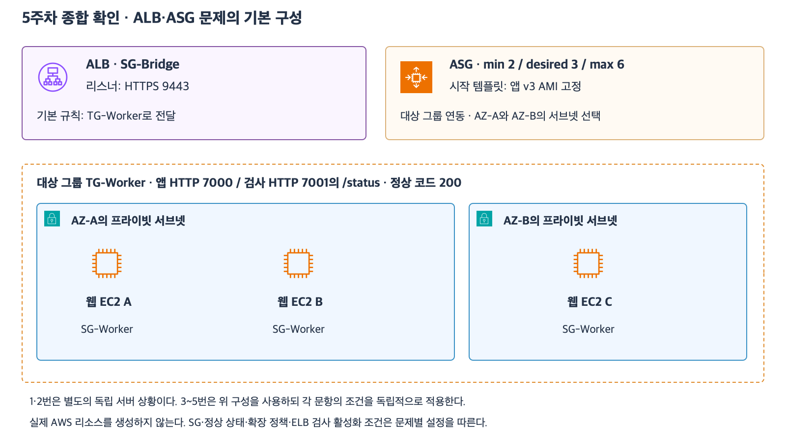

# 5주차 종합 확인

예상 25~35분 · 새로운 5문항 · 이유와 함께 전체 답변 · 정답 4문항 / 부분 정답 1문항 · 3-2 후속 입력 정정 확인 완료
실제 AWS 리소스 생성·변경 없음

## 범위와 공통 가정

24~29 자료의 AMI·EC2·EBS·RAM과 수명주기·유형·ALB·ASG를 연결한다.
최대 절전 모드·인스턴스 스토어·혼합 유형·가중치·특수 유지 정책은 제외한다.
각 문항은 독립적인 상황이며 앞 문항의 변경을 다음 문항에 이어 적용하지 않는다.
파일은 EBS에 정상적으로 저장을 마쳤고 별도 언급이 없으면 자동 배포나 데이터 동기화는 없다.
1·2번은 ASG가 관리하지 않는 별도 독립 서버다.
3~5번은 아래 구성을 바탕으로 하되 문항별 조건을 우선한다.

[확대 가능한 SVG](images/week5-comprehensive-current.svg)

| 구성 | 기본 설정 |
|---|---|
| ALB | 두 AZ의 퍼블릭 서브넷 사용 · SG-Bridge 연결 |
| 리스너 | HTTPS 9443 · 인증서 준비 |
| 기본 규칙 | TG-Worker로 전달 |
| 대상 그룹 | EC2 A·B·C 등록 · 전달 HTTP 7000 |
| 대상 EC2 | 각 AZ의 프라이빗 서브넷 · SG-Worker 연결 |
| 헬스 체크 | HTTP 7001의 /status · 정상 코드 200 |
| ASG | min=2 · desired=3 · max=6 |
| 시작 템플릿 | 원래 앱 v3 AMI 고정 사용 |

3-2를 제외하면 필요한 SG·경로·서비스 설정은 준비되어 있다.
SG는 리소스별 하나이며 같은 VPC의 사설 IP 직접 통신이다.
특수한 요청 분산 설정은 없다.
새 인스턴스 생성 조건과 권한·용량은 준비되어 있지만 생성과 앱 초기화에는 시간이 걸린다.

## 1. 중지와 종료의 데이터

ASG 밖의 EC2 X에 EBS 루트 볼륨과 추가 데이터 볼륨이 연결되어 있다.
루트 EBS의 DeleteOnTermination은 true이고 데이터 EBS는 false다.
데이터 EBS에 invoices.csv를 저장했고 계산 중간값은 RAM에만 있다.
다른 삭제 작업이나 백업·동기화는 없다.

1-1. X를 일반 Stop 후 Start했을 때 invoices.csv와 RAM 중간값은 각각 어떻게 되는가?
루트 볼륨의 true 설정 때문에 Stop에서 루트 볼륨이 삭제되는지도 설명하자.
1-2. 별도 상황으로 같은 설정의 X를 Terminate했다.
루트 EBS와 데이터 EBS는 각각 어떻게 되는가?
데이터 EBS가 남아 있으면 종료된 X 자체를 Start할 수 있는지도 설명하자.

## 2. 한 프로그램의 자원 부족

분석 프로그램 한 개가 RAM 20 GiB를 필요로 하지만 현재 EC2에는 RAM 8 GiB만 있다.
EBS에는 저장 공간이 충분하고 CPU가 병목인 상황도 아니다.
프로그램을 여러 서버에 나누는 구조 변경은 이번에는 할 수 없다.

2-1. RAM 8 GiB 서버를 두 대 추가하는 방법과 RAM 32 GiB의 호환 유형으로 기존 서버를 바꾸는 방법 중 어느 쪽이 현재 요구에 맞는가?
서버별 RAM과 단일 프로그램의 사용 공간을 근거로 설명하자.
2-2. 선택한 호환 유형으로 기존 EBS 부팅 EC2를 직접 변경하는 일반적인 상태 변경 순서를 쓰자.
그 앱을 실행하는 서버가 한 대뿐일 때 무중단을 보장할 수 있는지도 설명하자.

## 3. ALB 연결 구간과 검사 포트

공통 구성의 리스너·전달·헬스 체크 설정을 사용한다.

3-1. 브라우저→ALB와 ALB→EC2의 프로토콜·포트를 각각 쓰고 어느 구간이 TLS로 보호되는지 설명하자.
뒤쪽 EC2가 프라이빗 서브넷이라는 사실만으로 HTTP가 TLS로 바뀌는지도 설명하자.
3-2. 이번 하위 질문에서만 관련 SG 규칙은 다음과 같다고 가정한다.

| 적용 SG | 방향 | 허용 |
|---|---|---|
| SG-Bridge | 인바운드 | TCP 9443 · 출발지 0.0.0.0/0 |
| SG-Bridge | 아웃바운드 | TCP 7000 · 대상 SG-Worker |
| SG-Worker | 인바운드 | TCP 7000 · 출발지 SG-Bridge |
| SG-Worker | 인바운드 | TCP 7001 · 출발지 SG-Bridge |

SG 관점에서 앱 포트의 연결은 허용되어도 검사 포트의 연결은 허용되지 않는 이유를 설명하자.
추가할 SG·방향·프로토콜·포트·상대를 쓰자.
이 하위 질문은 모든 대상 비정상 시의 트래픽 처리나 앱 요청의 최종 성공 여부를 묻지 않는다.

## 4. CPU 목표와 초기화 유예

3-2의 부족한 SG 문제는 없고 A·B·C는 모두 healthy다.
평균 CPU 목표 60%의 목표 추적 정책이 설정되어 있다.
평균 CPU가 높아졌고 정책이 평가한 결과 desired를 5로 변경했다.
현재 EC2는 정상인 A·B·C 세 대뿐이며 생성·종료 중인 서버는 없다.

4-1. 목표를 맞추기 위해 몇 대를 추가로 시작해야 하는가?
CPU가 목표보다 높다는 이유만으로 A·B·C가 ALB에서도 unhealthy라고 판단할 수 있는지도 설명하자.
4-2. 새 D는 running이고 대상 그룹에 등록되었지만 앱 초기화 중이라 /status가 실패한다.
ASG의 ELB 헬스 체크는 활성화되어 있고 D는 유예 시간 안에 있다.
다른 healthy 대상은 남아 있고 처리 용량도 충분하다.
유예 중 ALB 검사와 요청 전달은 어떻게 되는가?
ASG가 유예하는 판단·행동도 구분하자.

## 5. 장애 교체와 새 서버의 시작 기준

공통 구성으로 돌아가 desired=3이다.
ELB 헬스 체크가 활성화되어 있고 A의 유예 시간은 지났다.
A는 EC2 상태는 정상이지만 /status가 계속 503을 반환해 ALB에서 unhealthy다.
B·C는 healthy다.
확장 정책이나 외부 작업으로 desired를 바꾸는 일은 없다.

5-1. 이 앱 비정상 판정을 반영하는 교체는 ALB와 ASG 중 누가 담당하는가?
새 서버를 생성·부팅하고 앱을 초기화해야 하는지와 교체 완료 후 유지할 desired를 설명하자.
일시적인 총 대수나 교체 순서는 묻지 않는다.
5-2. 원래 템플릿은 앱 v3 AMI를 고정 사용하지만 A에서만 수동으로 앱을 v4로 업데이트하고 A의 EBS에 local.log를 저장했다.
새 AMI·시작 템플릿 변경·별도 배포·백업·공유 저장소는 없다.
ASG가 같은 템플릿으로 교체 서버 E와 그 전용 EBS를 시작한다.
E의 앱 시작 버전과 local.log의 자동 복제 여부를 설명하자.

답변 전 정답·해설은 공개하지 않는다.
결론과 이유를 함께 평가한다.
부족한 부분은 다른 상황으로 보완하고 마지막 회상 복습까지 확인해 5주차 완료 여부를 판단한다.

## 참고 자료

- [EC2·AMI·EBS](24_EC2_AMI_EBS_기초.md)
- [수명주기·EBS 보존](25_EC2_수명주기와_EBS_보존.md)
- [유형·확장 선택](26_EC2_인스턴스_유형과_확장_선택.md)
- [ALB](27_ALB_리스너_대상그룹_헬스체크.md)
- [EC2 Auto Scaling](28_EC2_Auto_Scaling_기초.md)
- [ALB·ASG 통합과 정책](29_ALB_ASG_통합_설계와_확장_정책.md)
- [AWS 공식 아이콘](https://aws.amazon.com/architecture/icons/)

## 2026-11-03 답변 평가

1번 정답이며 Stop 보존의 이유를 다듬는다.
1-1은 invoices.csv 보존·RAM 소실과 루트 true라도 Stop에서 삭제되지 않는다는 설명이 정확하다.
파일이 Stop 후 유지되는 것은 데이터 볼륨의 false 때문이 아니라 Stop 자체가 DeleteOnTermination 삭제를 실행하지 않기 때문이다.
false는 Terminate 시 보존 여부를 정한다.
1-2의 루트 삭제·데이터 보존 및 종료된 EC2 자체의 Start 불가도 정확하다.

2번 정답.
단일 프로세스를 나눌 수 없는 조건에서 RAM 32 GiB 호환 유형 선택과 서버별 RAM의 차이를 정확히 설명했다.
Stop → 유형 변경 → Start와 단일 서버 앱 중단 가능성도 정확하다.

3번 부분 정답.
3-1은 HTTPS 9443과 HTTP 7000 및 앞쪽만 TLS 보호라는 설명이 정확하다.
프라이빗 서브넷은 직접 인터넷 경로와 관련된 분류이며 별도의 내부 SG·경로 조건까지 모두 차단한다는 뜻은 아니다.
3-2는 검사 포트 수신은 열렸지만 ALB 아웃바운드가 빠졌다는 원인과 적용 SG·방향·TCP 7001이 정확하다.
다만 대상을 SG-Bridge로 작성했다.
올바른 대상은 EC2에 연결된 SG-Worker다.
정확한 규칙은 SG-Bridge 아웃바운드 TCP 7001 · 대상 SG-Worker다.
아웃바운드 대상은 이 요청을 받는 EC2 쪽이지 ALB 자신의 SG가 아니다.
“ALB→앱 요청 실패”는 이번에는 앱 전달 TCP 7000이 아니라 검사 연결 TCP 7001 실패로 구분한다.
입력 오류인지 이해 오류인지는 추정하지 않고 대상 SG를 짧게 재서술받아 확인한다.

4번 정답이며 상태·시간 조건을 보충한다.
4-1은 2대 추가와 CPU 목표·ALB healthy 판정 구분이 정확하다.
4-2는 ALB 검사 계속과 ASG 유예를 구분했다.
이번에 명시된 다른 healthy 대상들로 앱 요청을 전달한다는 설명은 답변에서 생략되었으나 앞선 27·28 보완에서 확인한 설명과 함께 반영하고 해설에 보충한다.
새 등록 대상은 검사 중 initial 상태를 거칠 수 있으므로 한 번의 실패만으로 즉시 unhealthy라고 단정하지 않는다.
유예 시간이 지났다고 항상 교체되는 것은 아니고 이후에도 관련 검사에서 unhealthy로 판단되는 경우 교체한다.
유예 안에 정상 판정을 받으면 그 실패를 이유로 교체할 필요가 없다.

5번 정답이며 교체 순서를 단정하지 않도록 보충한다.
ASG가 교체를 담당하며 새 EC2 생성·부팅·앱 초기화가 필요하고 desired=3 유지라는 설명이 정확하다.
기존 종료→새 생성 순서는 설정에 따라 다를 수 있으므로 교체의 본질을 그 순서로 정의하지 않는다.
이번에 묻는 최종 목표는 기존 한 대를 새 한 대로 대체하여 3대를 유지하는 것이다.
원래 앱 v3 AMI 사용과 local.log 미복제 설명도 정확하다.

최초 평가는 정답 4문항과 부분 정답 1문항이다.
하위 질문은 정답 9개와 부분 정답 1개다.
다음은 3-2의 추가 규칙에서 대상 SG만 올바르게 지정하여 한 줄로 재서술받는 것이다.
정정 확인 이후 마지막 회상 복습을 준비한다.
5주차 전체는 아직 완료하지 않았으며 완료 주차는 4/32다.

## 2026-11-03 후속 입력 정정 확인

사용자가 “SG-Bridge 아웃바운드 TCP 7001 · 대상 SG-Worker”로 직접 정정하고 입력 오류였다고 밝혔다.
적용 SG·방향·프로토콜·포트·상대가 모두 정확하다.
3-2 대상 SG 정정 확인을 완료했다.
최초 종합 확인 정답 4문항·부분 정답 1문항 기록은 유지하고 후속 입력 정정을 별도로 반영한다.
추가로 같은 SG 문제를 반복하지 않는다.
다음은 5주차 마지막 회상 복습 자료 준비다.
회상 답변까지 확인한 뒤 5주차 완료를 판단한다.
완료 주차는 아직 4/32다.
