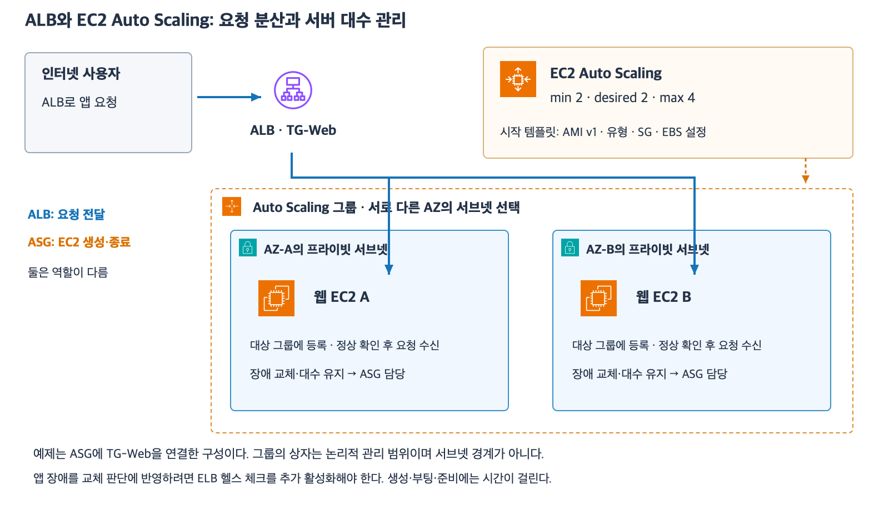
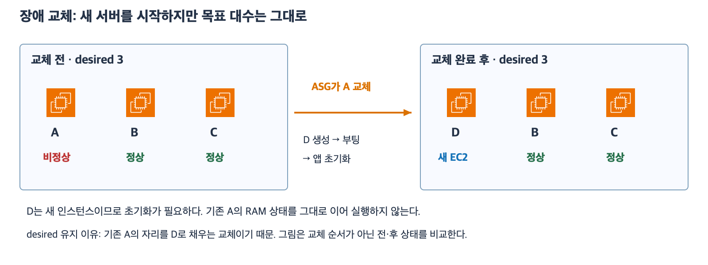
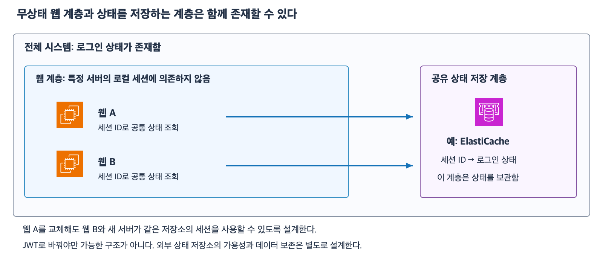

# 5주차 마지막 회상 복습

예상 10~15분 · 자료를 덮고 자기 말로 설명하기 · 후속 대상 구분 확인 / 5주차 완료
실제 AWS 리소스 생성·변경 없음

## 현재 상태

5주차 종합 확인은 정답 4문항과 부분 정답 1문항이었다.
이후 3-2의 대상 SG를 SG-Worker로 사용자가 직접 정정하고 입력 오류였다고 확인했다.
같은 SG 규칙 문제를 다시 요구하지 않는다.
이번 회상까지 확인하고 5주차 완료 여부를 판단한다.

## 회상용 연결 그림

그림은 앞서 학습한 역할을 연결하기 위한 것이며 아래 문제의 개별 설정은 문제 본문을 따른다.
회상 답변은 그림과 이전 자료를 덮고 자신의 말로 설명한다.

## 회상 문제 — 전체 세 문항

이번에는 새 용어나 설정을 추가하지 않는다.
일반 EBS 부팅 EC2이며 최대 절전 모드·인스턴스 스토어·자동 배포·동기화는 없다.
각 상황은 독립적이고 필요한 경로·SG·서비스와 생성 조건은 준비되어 있다.

### 1. 같은 서버를 다시 시작하는 것과 새 서버를 만드는 것

원래 앱 v2 AMI로 EC2 A를 만들고 A의 앱만 v3로 업데이트해 EBS에 저장했다.
원래 AMI나 시작 템플릿은 바꾸지 않았다.

1-1. A를 일반 Stop 후 Start하는 경우와 원래 v2 AMI로 별도 EC2 B를 만드는 경우 앱 파일 버전은 각각 무엇인가?
기존 EBS와 시작 기준의 차이로 설명하자.
1-2. 별도 상황에서 EC2의 데이터 EBS를 DeleteOnTermination=false로 설정했다.
이 설정이 인스턴스 종료 시의 볼륨 보존과 볼륨 안 파일의 실수 삭제 복구에 각각 무엇을 의미하는가?
백업이 필요한 이유를 설명하자.

### 2. 자원 부족과 요청 분산

2-1. 한 프로그램이 필요한 RAM은 18 GiB이고 현재 서버 RAM은 8 GiB다.
프로그램을 여러 서버에 나누는 구조는 없다.
한 대의 RAM 구성을 키우는 방법과 8 GiB 서버 여러 대를 추가하는 방법 중 무엇을 우선 검토할 것인가?
이유를 설명하자.
2-2. 별도 웹 앱은 요청을 여러 서버로 나눌 수 있지만 로그인 상태를 서버 A의 RAM에만 둔다.
서버 B를 추가해 요청을 나누면 어떤 문제가 생길 수 있고 상태 저장을 어떻게 설계해야 하는가?
구체적인 저장 서비스 이름은 요구하지 않는다.

### 3. 앱 장애 교체와 초기화 시간

ASG의 desired=3이며 ALB 대상 그룹과 연동되어 있다.
ELB 헬스 체크도 활성화되어 있다.
A는 유예 시간이 지났지만 앱 검사에 계속 실패하고 B·C는 healthy이며 처리 용량도 충분하다.
정책이나 외부 작업에 의한 desired 변경은 없다.

3-1. ALB와 ASG가 각각 무엇을 해야 하는가?
교체 서버의 부팅·앱 초기화 필요 여부와 교체 완료 후 목표 대수를 함께 설명하자.
일시적인 총 대수나 종료·생성 순서는 묻지 않는다.
3-2. 새 교체 서버 D는 running이고 대상 그룹에 등록되었지만 초기화 중이라 검사에 실패한다.
D는 ASG 유예 시간 안에 있고 B·C는 여전히 healthy다.
ALB가 계속하는 작업과 ASG가 유예하는 행동을 구분하자.
유예 시간이 D를 강제로 healthy로 만드는지도 설명하자.

답변 후 해설과 완료 판단 근거를 기록한다.
미응답 상태에서 점수나 5주차 완료를 추정하지 않는다.

## 다음 주 예고

5주차를 마치면 6주차 스토리지로 넘어간다.
S3·EBS·EFS의 역할과 파일 공유·객체 저장 선택을 공식 AWS 아이콘과 예제로 설명한다.
새 개념은 다음 자료에서 먼저 준비한다.

## 이전 자료

- [5주차 종합 확인과 후속 정정](30_5주차_종합_확인.md)
- [AMI·EC2·EBS](24_EC2_AMI_EBS_기초.md)
- [중지·종료·보존](25_EC2_수명주기와_EBS_보존.md)
- [인스턴스 유형·확장](26_EC2_인스턴스_유형과_확장_선택.md)
- [ALB](27_ALB_리스너_대상그룹_헬스체크.md)
- [ASG](28_EC2_Auto_Scaling_기초.md)
- [통합 설계·확장 정책](29_ALB_ASG_통합_설계와_확장_정책.md)

## 2026-11-04 회상 답변 평가

1번 핵심 설명 확인 완료.
A=v3와 B=v2를 기존 EBS와 원래 시작 기준으로 구분했다.
데이터 EBS의 false 보존과 파일 삭제 복구용 별도 백업 필요도 정확하다.
B가 v2인 직접 근거는 원래 v2 AMI 사용이며 템플릿 관련 표현은 그 시작 기준이 바뀌지 않았다는 뜻으로 반영한다.
파일 복구에는 삭제 전 데이터를 담은 스냅샷 등 백업이 필요하다.

2번 RAM 선택과 로그인 상태 문제 판단은 정확하며 상태 저장 방향을 보충한다.
2-1은 단일 프로그램의 RAM 요구에 맞게 한 대의 RAM을 키운다는 이유가 정확하다.
2-2는 B가 A의 RAM 로그인 상태를 알 수 없다는 문제와 무상태 설계 방향을 설명했다.
“Stateless로 상태 저장”은 “웹 서버 로컬 RAM에만 의존하지 않고 여러 서버가 접근할 수 있는 외부 저장소 등에 필요한 상태를 분리”라고 구체화한다.
무상태는 로그인 정보를 전혀 저장하지 않거나 상태 없이 저장한다는 뜻이 아니다.
이 저장 방향은 26 자료에서 이미 설명한 범위다.

3번은 교체 서버 초기화 문장의 재확인이 필요하다.
3-1은 ALB가 A의 앱 검사 실패를 판단하고 ASG가 ELB 검사와 유예 경과를 바탕으로 교체하며 desired=3 유지라는 설명은 정확하다.
ALB는 이번 조건에서 healthy인 B·C로 일반 요청을 전달한다.
다만 “교체 서버는 서버 부팅·앱 초기화가 필요하지 않고”라고 답했다.
새 EC2로 교체할 때도 부팅과 앱 초기화는 필요하다.
원래 AMI로 시작한다는 것은 시작 소프트웨어 기준이 준비되어 있다는 뜻이지 실행 준비 과정을 생략한다는 뜻이 아니다.
사용자는 앞선 30 종합 확인 5-1에서는 생성·부팅·앱 초기화가 필요하다고 정확히 답했으므로 이번 입력 오류인지 이해 혼선인지 확인한다.
입력 오류로 임의 처리하거나 완료로 추정하지 않는다.

3-2는 ALB 검사 계속·정상 B와 C로 요청 전달 및 ASG 유예와 강제 healthy 아님을 정확히 설명했다.
초기 등록 대상은 initial을 거쳐 실패 기준을 충족하면 unhealthy가 될 수 있다는 상태 세부 표현은 이전 해설과 함께 반영한다.
유예 시간이 끝났을 때에도 관련 검사에서 비정상이면 교체하는 것이며 시간 종료만으로 무조건 교체하는 것은 아니다.

회상에는 새 점수를 추정하지 않는다.
현재 3-1의 “필요하지 않고” 표현을 사용자에게 재확인하는 중이며 5주차 완료는 아직 기록하지 않는다.
나머지 정답을 다시 반복 질문하지 않는다.

## 2026-11-04 후속 설명과 완료 판단

사용자는 기존 정상 C와 새로 생성되는 D를 구분했다.
기존 정상 C는 장애 교체 때문에 다시 부팅하거나 앱 초기화할 필요가 없고 새 D는 부팅·앱 초기화가 필요하다는 뜻으로 확인했다.
기존의 “교체 서버”라는 표현이 새 D를 뜻하는지 명시하지 않아 혼선이 있었다.
교정은 대상을 “새로 생성되는 D”로 명확히 한다.
기존 정상 서버까지 초기화해야 한다는 뜻으로 가르치지 않는다.
이 후속 설명으로 3-1의 남은 확인을 해소했다.

사용자는 무상태 설계에 JWT 방식도 떠올렸다고 설명하고 Redis·DB 등 외부 저장소에 세션을 두는 방향을 이해했다고 밝혔다.
“웹 계층은 무상태지만 상태 저장소와 전체 시스템에는 상태가 존재한다”는 구분을 질문했다.
이 구분은 맞다.
이 수업의 무상태는 시스템 전체의 데이터 부재가 아니라 특정 웹 서버의 요청 간 로컬 세션 상태에 의존하지 않는다는 뜻이다.
서버가 현재 요청을 처리하는 동안 RAM을 전혀 사용하지 않는다는 뜻도 아니다.
공유 세션 저장소가 필요하므로 그 계층의 가용성과 보존은 별도 설계한다.

예제 그림의 ElastiCache는 공유 상태 저장소의 AWS 서비스 예시이며 이번에 실제 서비스 선택이나 생성을 진행한 것은 아니다.
Redis는 이번 사용자 질문에서 든 상태 저장소 예이고 구체적인 엔진 선택은 이후에 다룬다.
JWT는 정보를 담아 전달하는 토큰 형식이며 JWT 사용 자체가 전체 시스템의 무상태를 보장하지 않는다.
JWT를 사용하더라도 검증·인증 설계와 별도 세션·폐기 정보 관리 방식 등에 따라 서버 측 상태를 사용할 수 있다.
이번에는 구현이나 JWT 보안 설정을 다루지 않는다.

종합 확인의 최초 정답 4문항·부분 정답 1문항은 유지한다.
대상 SG 후속 입력 정정과 회상 답변 및 새 D·정상 C의 대상 구분과 상태 저장 범위 확인을 함께 근거로 5주차 완료를 기록한다.
회상 점수를 새로 추정하지 않는다.
완료 날짜는 2026-11-04이며 완료 주차는 5/32다.
다음은 6주차 스토리지 첫 자료를 공식 AWS 아이콘과 예제로 준비하는 것이다.
아직 다음 자료나 실제 AWS 리소스는 생성하지 않았다.

### 보충 공식 자료

- [AWS 무상태 설계와 외부 세션 저장](https://docs.aws.amazon.com/wellarchitected/latest/framework/rel_mitigate_interaction_failure_stateless.html)
- [JWT 토큰 형식 RFC 7519](https://www.rfc-editor.org/rfc/rfc7519.html)
