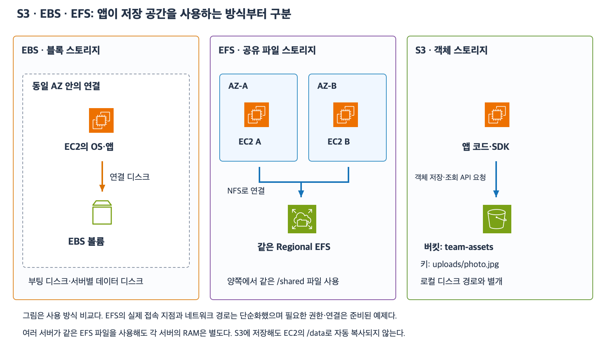

# 6주차 첫 수업: S3·EBS·EFS 역할 비교

예상 30~40분 · 실제 AWS 리소스 생성·변경 없음 · 3/3 정답 · 하위 질문 6/6

## 1. 저장 방식부터 구분한다

같은 사진 파일도 저장 방식에 따라 앱이 접근하는 방법이 달라진다.
디스크가 필요한지 여러 서버가 같은 파일 경로를 써야 하는지 객체 저장·조회 요청을 사용할 수 있는지부터 확인한다.

| 서비스 | 저장 방식 | 앱에서 사용하는 모습 | 예시 |
|---|---|---|---|
| EBS | 블록 스토리지 | EC2에 연결한 디스크를 OS가 사용 | 부팅 디스크·서버별 데이터 디스크 |
| EFS | 파일 스토리지 | 여러 서버에 같은 파일 시스템을 연결 | 여러 Linux 서버의 공통 /shared 경로 |
| S3 | 객체 스토리지 | 버킷과 키로 객체 저장·조회 요청 | 업로드 이미지·문서·백업 객체 |

블록은 디스크 데이터를 나누어 저장하는 단위다.
파일 시스템은 파일과 디렉터리를 관리하고 경로로 읽고 쓰게 하는 체계다.
객체는 데이터와 관련 정보 등을 하나의 저장 단위로 다루는 방식이다.
서비스의 세부 성능·가격·저장 등급은 이번에 비교하지 않는다.

[확대 가능한 SVG](images/s3-ebs-efs-basics.svg)

그림은 세 사용 방식을 비교한 논리적 그림이다.
EFS 접속 지점과 상세 경로 및 권한은 준비되었다고 가정하며 다음 설계 수업에서 연결한다.
S3를 특정 EC2 서브넷 안의 디스크처럼 배치한 뜻은 아니다.

## 2. EBS는 연결한 EC2가 사용하는 디스크다

EBS는 앞서 배운 루트 볼륨이나 추가 데이터 볼륨에 사용한다.
OS가 파일 시스템을 사용하면 앱은 /data/report.csv 같은 경로로 파일을 저장할 수 있다.
이번 예제의 디스크 초기 설정은 준비되어 있다.

EBS 볼륨과 연결 EC2는 같은 AZ에 있어야 한다.
이번에는 일반적인 한 볼륨·한 EC2 연결 구성을 사용한다.
같은 AMI로 만든 두 EC2라도 별도 EBS에 저장한 실행 이후 파일은 자동으로 공유되지 않는다.

특정 조건의 EBS Multi-Attach 기능도 있지만 모든 EBS가 일반 공유 폴더처럼 사용된다는 뜻은 아니다.
이 기능도 같은 AZ 조건이 있으며 파일 시스템과 동시 쓰기 설계가 필요하다.
이번에는 Multi-Attach를 사용하지 않고 상세는 이후 심화에서 다룬다.

EBS는 RAM이 아니며 용량을 늘린다고 프로그램 RAM이 늘지는 않는다.
Stop과 Terminate 및 DeleteOnTermination에 따른 볼륨 보존 조건은 앞선 수업과 같다.

## 3. EFS는 여러 서버가 같은 파일 시스템을 사용한다

EFS(Elastic File System)는 여러 클라이언트가 네트워크로 연결해 사용하는 관리형 파일 시스템이다.
이번에는 지원되는 Linux EC2에서 사용하는 Regional EFS를 가정한다.
Regional EFS는 같은 리전의 여러 AZ에 데이터를 중복 저장하며 여러 AZ의 서버가 공유 파일에 접근할 수 있다.
EFS에는 One Zone 방식도 있지만 이번에는 사용하지 않는다.

마운트(Mount)는 파일 시스템을 OS의 특정 경로에 연결해 사용하게 하는 작업이다.
예를 들어 A와 B가 같은 EFS를 각각 /shared에 마운트하면 같은 공유 파일 시스템을 바라본다.
/shared/reports/result.csv를 별도 디스크 두 개에 복사해 두는 구조와 다르다.

NFS(Network File System)는 네트워크를 통해 파일 시스템을 사용하는 프로토콜이다.
EFS는 NFS를 사용하며 이를 위한 네트워크 접근과 권한 및 클라이언트 설정이 필요하다.
서비스를 만들었다는 사실만으로 모든 EC2에 자동 마운트되지는 않는다.
구체적인 접속 지점·SG·명령은 이후에 설명한다.

EFS 파일을 공유해도 A와 B의 RAM이 합쳐지거나 자동 동기화되지는 않는다.
동일 파일의 동시 수정이나 파일 삭제와 백업은 앱과 저장소 설정에서 별도로 관리한다.
파일 공유가 모든 동시 처리 문제를 자동 해결하는 것은 아니다.

## 4. S3는 버킷과 키로 객체를 저장한다

S3(Simple Storage Service)는 객체 스토리지다.
버킷(Bucket)은 객체를 담는 저장 공간이다.
키(Key)는 버킷 안에서 객체를 식별하는 이름이다.
이번에는 일반 목적 버킷의 기본적인 객체 사용을 다룬다.

  예: team-assets 버킷의 uploads/photo.jpg 키에 이미지 데이터를 저장한다.
이때 uploads/photo.jpg는 S3 객체 이름이며 EC2의 실제 디스크 경로라는 뜻은 아니다.
슬래시로 폴더처럼 정리할 수 있지만 일반 목적 버킷의 키 구조는 파일 시스템 디렉터리와 같지 않다.

앱은 API나 SDK를 이용해 객체를 저장하고 조회할 수 있다.
API는 서비스에 정해진 형식으로 요청하는 인터페이스다.
SDK는 그런 API 사용을 돕는 프로그래밍 도구 모음이다.
앞선 IAM 수업에서 EC2 역할과 SDK로 S3 요청을 보내는 흐름을 배웠다.

앱이 객체 API를 사용해 이미지나 문서를 저장할 수 있다면 S3를 검토한다.
S3에 객체를 저장했다고 그 데이터가 EC2의 /data에 자동으로 파일로 생기는 것은 아니다.
S3를 EC2 부팅 디스크나 일반적인 공유 POSIX 파일 시스템으로 그대로 대체한다고 가정하지 않는다.
POSIX는 운영체제의 파일·프로세스 동작 등 표준 인터페이스를 정의하는 규격이며 이번에는 일반 파일 시스템의 동작을 가리키는 용어로만 소개한다.
특정 연결 도구나 특수 사용 방식은 이후 필요할 때 별도로 다룬다.

S3 객체가 인터넷 전체에 자동 공개되는 것은 아니다.
필요한 읽기·쓰기 권한과 접근 경로를 갖추어야 한다.
버킷 정책·버전 관리·수명주기 규칙은 다음 수업에서 배운다.

## 5. EC2 종료와 저장소는 따로 판단한다

EC2가 종료될 때 연결 EBS의 삭제 여부는 볼륨별 DeleteOnTermination에 따른다.
별도로 저장한 S3 객체나 EFS의 파일 시스템은 EC2 종료 자체만으로 함께 삭제되지 않는다.
하지만 파일·객체 삭제 작업이나 별도 수명주기·자동화는 따로 적용될 수 있다.
보존되는 저장소라고 해서 삭제 실수나 손상을 되돌리는 백업까지 자동으로 준비된 것은 아니다.
이번 비교에서는 별도의 삭제·정리 자동화는 없다고 가정한다.

## 6. 확인 문제 — 전체에 이유와 함께 답하기

필요한 접근 경로·권한·클라이언트 설정은 준비되어 있다.
EFS는 Regional이며 Linux EC2에서 사용한다.
특수 연결 도구·EBS Multi-Attach·자동 동기화는 없다.
아래 세 서비스 중 요구사항에 맞는 것을 선택한다.

### 1. 디스크와 객체 저장

1-1. EC2의 운영체제를 부팅할 디스크가 필요하다.
S3·EBS·EFS 중 무엇을 선택할 것인가?
EC2가 저장소를 사용하는 방식으로 설명하자.
1-2. 앱에서 이미지와 문서를 버킷·키로 저장하고 조회하려고 한다.
앱은 객체 API를 사용할 수 있고 공유 파일 경로는 요구하지 않는다.
어느 서비스를 우선 검토할 것인가?
예시 키 uploads/manual.pdf가 EC2의 실제 디스크 경로인지도 설명하자.

### 2. 여러 AZ의 공유 파일 경로

AZ-A의 Linux EC2 A와 AZ-B의 Linux EC2 B가 같은 /shared 파일 시스템에서 파일을 읽고 써야 한다.
기존 앱은 일반 파일 경로를 사용하며 이번에는 객체 API 방식으로 바꾸지 않는다.

2-1. S3·EBS·EFS 중 어느 서비스가 이 요구에 맞는가?
같은 파일 시스템을 여러 서버가 사용하는 방식으로 설명하자.
2-2. 대신 같은 AMI로 만든 A와 B 각각에 별도 EBS를 붙이고 경로 이름만 /shared로 맞추면 같은 공유 파일 시스템이 되는가?
저장 공간의 실체를 근거로 설명하자.

### 3. 종료와 공유 범위

EC2 C가 다음 저장 작업을 정상적으로 마쳤다.

- DeleteOnTermination=true인 C의 EBS에 local.csv 저장
- S3 버킷에 객체 remote.csv 저장
- C와 다른 서버가 함께 쓰는 EFS에 shared.csv 저장

별도 파일·객체 삭제나 저장소 삭제·정리 자동화는 없다.

3-1. C를 Terminate하면 위 세 데이터는 각각 어떻게 되는가?
EC2 종료와 저장소 수명주기를 구분하자.
3-2. D와 E가 같은 EFS를 마운트했다.
D의 프로그램이 계산 중간값을 RAM에만 두고 파일로 저장하지 않았다.
E도 같은 EFS를 쓰므로 그 RAM 값을 자동으로 알 수 있는가?
공유 파일 시스템과 서버 메모리를 구분하자.

답변 전 정답·해설은 공개하지 않는다.
답변 후 평가와 진도를 갱신한다.

## 공식 참고 자료

확인: 2026-11-04

- [S3 개요](https://docs.aws.amazon.com/AmazonS3/latest/userguide/Welcome.html)
- [S3 객체와 키](https://docs.aws.amazon.com/AmazonS3/latest/userguide/UsingObjects.html)
- [S3 키 이름](https://docs.aws.amazon.com/AmazonS3/latest/userguide/object-keys.html)
- [EBS 볼륨과 AZ](https://docs.aws.amazon.com/ebs/latest/userguide/ebs-volumes.html)
- [EFS 동작과 공유 접근](https://docs.aws.amazon.com/efs/latest/ug/how-it-works.html)
- [EFS Regional·One Zone](https://docs.aws.amazon.com/efs/latest/ug/features.html)
- [AWS 공식 아이콘](https://aws.amazon.com/architecture/icons/)
- [이전 주차 회상](31_5주차_회상_복습.md)

## 2026-11-04 답변 평가 — 3/3

1번 정답. 1-1의 사용 방식을 보충한다.
EBS를 선택하고 EC2에 디스크로 연결하여 부팅에 사용한다는 방향이 맞다.
일반적인 EBS 기반 AMI로 시작할 때는 AMI의 디스크 기준을 바탕으로 루트 EBS가 준비되어 EC2에 연결된다.
EC2는 그 루트 EBS에 있는 운영체제로 부팅한다.
매번 빈 EBS를 연결하고 사용자가 OS를 수동 설치해야 한다는 뜻은 아니다.
답변 예시는 “EBS를 EC2의 루트 디스크로 연결하고 그 안의 OS로 부팅한다”다.
1-2는 S3 선택과 버킷·키의 객체 사용 및 EC2 실제 경로와의 구분이 정확하다.

2번 정답. 복사라는 표현의 범위를 보완한다.
2-1은 여러 서버가 같은 EFS 파일 시스템을 공유하며 Regional로 여러 AZ에서 사용할 수 있다는 설명이 정확하다.
Regional EFS는 서비스 내부에서 여러 AZ에 데이터를 중복 저장하여 가용성과 내구성을 제공한다.
앱이 A와 B의 로컬 디스크로 파일을 각각 복사해 사용하는 구조라는 뜻은 아니다.
A와 B는 같은 EFS 파일 시스템에 접근한다.
별도 “EFS Replication” 기능이나 별도 파일 시스템 간 복제 설정을 구성했다는 뜻도 아니다.
2-2는 별도 EBS와 같은 경로명이 공유를 만들지 않는다는 설명이 정확하다.
이번 다른 AZ 조건에서 EBS Multi-Attach도 대안이 되지 않는다는 이유까지 정확하다.

3번 정답.
3-1은 C 종료 시 true인 EBS와 local.csv 삭제 및 별도 S3 객체·EFS 파일 유지가 정확하다.
정식 속성명은 DeleteOnTermination이다.
3-2는 파일 공유와 서버별 RAM을 정확히 구분했다.
EFS를 통해 중간값을 공유하려면 D가 마운트한 EFS 경로에 파일로 기록하고 E가 해당 파일을 읽는 구조가 필요하다.
“경우에만”은 이번 EFS 기반 공유 범위에서의 설명이며 다른 네트워크 통신이나 별도 공유 서비스까지 불가능하다는 뜻은 아니다.
D의 별도 로컬 디스크에만 저장하면 EFS를 통한 공유가 되지 않는다.

세 문항과 하위 질문 6개 모두 정답으로 평가한다.
사용 방식과 Regional의 데이터 중복 저장 표현을 별도로 보충했다.
6주차 전체는 아직 진행 중이며 완료 주차는 5/32다.
다음은 S3 저장·조회와 접근 권한 기초 자료를 공식 AWS 아이콘과 예제로 먼저 준비한다.

### 보충 공식 자료

- [AMI와 루트 EBS 볼륨](https://docs.aws.amazon.com/AWSEC2/latest/UserGuide/RootDeviceStorage.html)
- [Regional EFS의 중복 저장](https://docs.aws.amazon.com/efs/latest/ug/features.html)

### “중복 저장”과 “복사” 표현 추가 설명

사용자가 중복 저장과 복사가 다른 개념인지 질문했다.
두 용어가 서로 배타적인 것은 아니다.
중복 저장은 동일 데이터를 여러 위치에 보관하는 목적·결과를 설명하고 복사·복제는 그 구현 동작을 설명할 수 있다.
Regional EFS 설명에서 “서비스가 여러 AZ에 데이터를 복제해 중복 보관한다”는 표현은 적절하다.
앞선 사용자 답변은 각 앱의 로컬 디스크 복사를 주장하지 않았으므로 그 뜻으로 오해했다고 단정하지 않는다.
이전 피드백은 복사라는 단어의 오류 지적이 아니라 서비스 내부 복제와 클라이언트별 별도 사본의 범위를 구분하려는 설명이었다.
A·B는 하나의 EFS 파일 시스템에 접근하고 EFS 서비스는 내부적으로 여러 AZ에 데이터를 중복 저장한다.
앱이 A의 로컬 EBS 파일을 B의 별도 EBS에 복사해 두는 구조와는 공유·동기화 책임이 다르다.
최초 3/3 평가는 유지하며 이 질문을 오개념이나 새 오답으로 기록하지 않는다.
