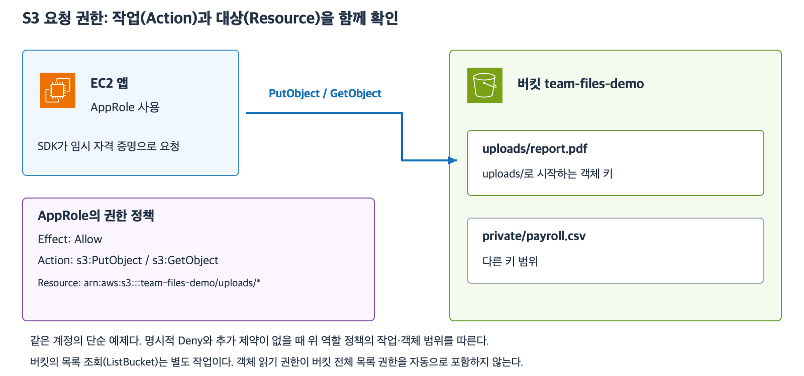

# 6주차 두 번째 수업: S3 저장·조회와 접근 권한

예상 30~40분 · 실제 AWS 계정·버킷·정책 변경 없음 · 정답 2문항 / 부분 정답 1문항 · 보완 4-1 정답

## 1. 어떤 요청인지부터 구분한다

앱은 버킷과 객체 키를 지정해 S3에 요청한다.
같은 객체라도 저장·조회·삭제는 다른 작업이다.

| 하고 싶은 일 | IAM 권한 작업 | 대상 종류 |
|---|---|---|
| 객체 저장 | s3:PutObject | 객체 |
| 객체 내용 조회 | s3:GetObject | 객체 |
| 객체 삭제 | s3:DeleteObject | 객체 |
| 버킷 안 객체 목록 조회 | s3:ListBucket | 버킷 |

객체 목록 조회는 키들의 목록을 확인하는 일이고 객체 내용 조회는 실제 데이터를 가져오는 일이다.
ListObjectsV2라는 목록 API에 필요한 IAM 권한 이름은 s3:ListBucket이다.
API 이름과 IAM 작업 이름이 항상 완전히 같은 것은 아니다.

저장만 허용한 PutObject 권한이 GetObject나 DeleteObject까지 자동 허용하지 않는다.
키를 이미 아는 객체를 GetObject로 가져오는 API 요청에 ListBucket이 항상 필요한 것도 아니다.
콘솔 화면이나 특정 앱이 먼저 목록을 요청하면 그 별도 작업에는 ListBucket이 필요할 수 있다.
이번 문제는 앱이 명시된 API를 직접 호출하는 상황이다.

## 2. ARN으로 버킷과 객체를 구분한다

ARN(Amazon Resource Name)은 AWS 리소스를 식별하는 이름이다.
정책의 Resource는 요청을 허용하거나 거부할 대상을 ARN으로 지정한다.
일반 S3 버킷과 객체는 다음 형식을 사용한다.

| 지정 대상 | 예시 ARN |
|---|---|
| 버킷 자체 | arn:aws:s3:::team-files-demo |
| 특정 객체 | arn:aws:s3:::team-files-demo/uploads/report.pdf |
| uploads/ 범위의 객체 | arn:aws:s3:::team-files-demo/uploads/* |
| 버킷 안 모든 객체 | arn:aws:s3:::team-files-demo/* |

접두사(Prefix)는 객체 키의 시작 부분이다.
uploads/report.pdf의 uploads/가 그 예다.
정책의 *는 이 위치에 여러 키가 맞도록 하는 와일드카드다.
위 uploads/* 범위는 private/payroll.csv를 포함하지 않는다.
정책에서 지정한 범위가 실제 디렉터리 생성이나 파일 공유를 뜻하지 않는다.

GetObject·PutObject는 객체 ARN에 적용한다.
ListBucket은 버킷 ARN에 적용한다.
버킷 ARN과 뒤에 /*가 붙은 객체 범위 ARN을 같은 대상으로 생각하지 않는다.
객체 접근을 특정 접두사로 제한해도 별도의 ListBucket 허용 범위까지 자동으로 제한되지는 않는다.
목록의 접두사 제한 조건은 이후에 다루며 이번 예제 정책에는 ListBucket을 부여하지 않는다.

## 3. EC2 역할의 권한 정책으로 허용한다

앞선 IAM 수업처럼 EC2 앱에는 역할과 인스턴스 프로파일이 연결되어 있고 SDK가 임시 자격 증명을 사용한다고 가정한다.
역할 신뢰 설정과 자격 증명 취득은 준비되어 있다.
이번에는 역할의 권한 정책에서 작업과 대상 범위를 본다.



[확대 가능한 SVG](images/s3-actions-resource-scope.svg)

예: AppRole이 uploads/ 키 범위에 객체를 저장하고 읽어야 한다.
권한 정책을 다음과 같이 쓸 수 있다.
아래는 설명용 정책이며 실제 계정에 적용하지 않는다.

```json
{
  "Version": "2012-10-17",
  "Statement": [
    {
      "Effect": "Allow",
      "Action": ["s3:PutObject", "s3:GetObject"],
      "Resource": "arn:aws:s3:::team-files-demo/uploads/*"
    }
  ]
}
```

Version은 정책 문서 형식 버전이며 오늘 날짜를 쓰는 칸이 아니다.
Statement는 정책 규칙 목록이다.
Effect는 허용 Allow 또는 명시적인 거부 Deny다.
Action은 작업이고 Resource는 대상이다.
이 예제는 uploads/ 범위의 저장·읽기를 허용하며 삭제·목록 조회는 허용하지 않는다.

## 4. 역할 정책과 버킷 정책

역할의 권한 정책은 역할에 연결해 그 역할이 할 수 있는 일을 정한다.
버킷 정책(Bucket policy)은 버킷에 연결하는 리소스 기반 정책이다.
버킷과 그 안 객체에 누가 어떤 작업을 할 수 있는지 등을 정한다.
버킷 정책의 Principal은 적용할 사용자·역할 같은 요청 주체다.
버킷 정책은 역할 신뢰 정책과 다르다.

이번에는 역할·버킷·객체 소유자가 같은 AWS 계정이고 다른 추가 권한 제약이 없는 단순 구성을 가정한다.
공개 허용이 아닌 해당 역할에 대한 일반적인 IAM 허용을 다룬다.
별도의 암호화 키 권한이나 교차 계정·조직 정책은 이번 범위에서 제외한다.

이 조건에서 역할의 적절한 Allow만으로 접근을 허용할 수 있으며 버킷 정책에도 매번 같은 Allow를 추가해야 하는 것은 아니다.
반면 적용되는 명시적 Deny가 있으면 Allow가 있어도 요청은 거부된다.
SG에서 배운 “허용 규칙만 합친다”를 IAM의 명시적 Deny에 그대로 적용하면 안 된다.

예: 역할 정책이 uploads/*의 GetObject를 허용하지만 버킷 정책이 같은 역할의 uploads/secret.pdf GetObject를 명시적으로 거부한다.
그 객체 요청에는 Deny가 적용되어 거부된다.
권한 정책에 이름이 없다는 기본 거부와 명시적인 Deny는 구분한다.

## 5. 공개 차단과 앱의 정상 접근

S3 Block Public Access는 공개 접근을 제한하는 설정이다.
그 설정을 켰다고 적절한 IAM 권한으로 접근하는 같은 계정의 앱까지 모두 차단한다는 뜻은 아니다.
같은 계정 역할의 정상 GetObject 요청을 허용하려고 버킷을 인터넷 전체에 공개할 필요는 없다.
반대로 URL과 키를 안다는 이유만으로 누구나 비공개 객체를 읽을 수 있는 것도 아니다.

SG·네트워크 경로가 서비스까지 연결해 주는 것과 S3가 그 요청 주체의 작업을 허용하는 것은 별도 조건이다.
이번 예제는 필요한 연결과 서명된 자격 증명 및 객체 존재가 준비되어 있다.
브라우저 공유용 서명 URL이나 공개 웹사이트는 이번에 다루지 않는다.
버킷 정책 전체 작성과 권한 평가 심화는 이후에 진행한다.

## 6. 확인 문제 — 전체 답변과 이유

모든 문제는 같은 계정의 일반 목적 버킷과 역할이 요청하는 직접 S3 API다.
객체는 존재하고 필요한 연결·유효한 임시 자격 증명·역할 신뢰 설정은 준비되어 있다.
별도 언급이 없으면 제시된 정책 외에 권한 허용·명시적 거부·추가 제약은 없다.
공개 접근 차단은 켜져 있고 공개 허용 정책은 없다.

### 1. 저장 요청의 최소 권한

UploadRole은 research-files-demo 버킷의 incoming/ 접두사에 객체를 저장하기만 해야 한다.
읽기·삭제·목록 조회는 필요하지 않다.

1-1. 허용할 Action과 Resource ARN을 쓰자.
버킷 전체나 다른 접두사를 허용하지 않도록 한다.
1-2. 그 허용만 받은 앱이 incoming/data.csv의 내용을 GetObject로 읽을 수 있는가?
작업 범위를 근거로 설명하자.

### 2. 목록과 객체 내용

ReadRole은 다음 허용만 가지고 있다.
Action은 s3:GetObject이고 Resource는 arn:aws:s3:::archive-files-demo/manuals/*다.

2-1. 앱이 manuals/start.pdf 키를 이미 알고 직접 GetObject로 요청한다.
ListBucket 권한이 없다는 이유만으로 이 요청이 실패하는가?
목록과 객체 내용 조회를 구분하자.
2-2. 앱에 버킷의 객체 목록을 조회할 요구도 추가되었다.
추가로 필요한 Action과 적용할 버킷 ARN을 쓰자.
이번에는 목록 접두사 제한 조건은 묻지 않는다.

### 3. 명시적 거부와 공개 차단

AppRole은 team-reports-demo/reports/*에 s3:GetObject Allow를 가지고 있다.
버킷 정책에는 AppRole의 reports/payroll.csv GetObject에 적용되는 명시적 Deny가 있다.
reports/readme.txt에는 그런 Deny가 없다.

3-1. AppRole이 reports/payroll.csv를 GetObject로 읽을 수 있는가?
Allow와 Deny 관계로 설명하자.
3-2. AppRole이 reports/readme.txt를 읽으려면 Block Public Access를 끄고 객체를 공개해야 하는가?
공개 접근과 권한 있는 역할의 접근을 구분하자.

답변 전 정답·해설은 공개하지 않는다.
답변 후 평가와 진도를 갱신한다.

## 공식 참고 자료

확인: 2026-11-04

- [S3와 IAM 작업·리소스](https://docs.aws.amazon.com/AmazonS3/latest/userguide/security_iam_service-with-iam.html)
- [버킷·객체 ARN과 명시적 거부](https://docs.aws.amazon.com/AmazonS3/latest/userguide/access-policy-language-overview.html)
- [공개 접근 차단](https://docs.aws.amazon.com/AmazonS3/latest/userguide/access-control-block-public-access.html)
- [AWS 공식 아이콘](https://aws.amazon.com/architecture/icons/)
- [이전 수업](32_S3_EBS_EFS_역할_비교.md)

## 2026-11-04 답변 평가

1번 정답.
1-1은 PutObject 선택과 arn:aws:s3:::research-files-demo/incoming/* 범위가 정확하다.
IAM 정책의 완전한 Action 표기는 s3:PutObject라고 보충한다.
1-2는 저장 허용만으로 읽기가 허용되지 않는다는 이유가 정확하다.

2번 부분 정답.
2-1은 키를 아는 직접 GetObject에 ListBucket이 반드시 필요하지 않다는 설명이 정확하다.
2-2의 버킷 ARN arn:aws:s3:::archive-files-demo는 맞다.
다만 s3:ListObjectsV2는 IAM Action이 아니다.
ListObjectsV2는 API 이름이고 필요한 IAM Action은 s3:ListBucket이다.
목록 조회 요청에 대한 올바른 쌍은 s3:ListBucket과 버킷 ARN이다.

| 구분 | 목록 조회의 이름 또는 대상 |
|---|---|
| 호출할 API | ListObjectsV2 |
| 허용할 IAM Action | s3:ListBucket |
| Resource | arn:aws:s3:::archive-files-demo |

3번 정답이며 공개와 네트워크를 구분해 보충한다.
3-1은 같은 요청에 적용되는 명시적 Deny가 Allow보다 우선하므로 payroll.csv 읽기 불가라는 설명이 정확하다.
3-2는 같은 계정 역할의 정상 허용 접근을 위해 공개 차단을 끌 필요가 없다는 결론이 정확하다.
“공개 접근은 인터넷에서 접근하는 권한”은 네트워크 경로와 구분해 다듬는다.
인터넷 경로로 S3 API에 접속해도 인증된 역할의 허가된 요청이면 비공개 접근일 수 있다.
이번 문제는 Block Public Access를 켜 둔 채 허용된 AppRole이 접근할 수 있는 단순 구성이다.
Block Public Access가 모든 상황에서 권한 평가와 무관하다는 일반화는 하지 않는다.

최초 평가는 정답 2문항과 부분 정답 1문항이다.
하위 질문은 정답 5개와 부분 정답 1개다.
API 이름과 권한 Action을 새 상황에서 한 번 확인한다.

## 보완 확인

4-1. 앱이 audit-assets-demo 버킷의 객체 목록을 ListObjectsV2 API로 조회하려고 한다.
필요한 연결·역할·자격 증명은 준비되어 있고 추가 거부나 제약은 없다.
추가할 IAM Action과 Resource ARN을 한 줄로 쓰자.
객체 내용 읽기나 접두사 제한은 이번 질문에 포함하지 않는다.

보완 평가 완료.

## 2026-11-04 보완 4-1 평가

정답.
ListBucket이라는 IAM 작업과 arn:aws:s3:::audit-assets-demo 버킷 ARN을 정확히 답했다.
정책에서 사용하는 전체 Action 표기는 s3:ListBucket이라고 보충한다.
API ListObjectsV2와 IAM 작업을 구분한 것으로 확인했다.
최초 정답 2문항·부분 정답 1문항은 유지하며 보완 1문항 정답을 별도로 기록한다.
다음은 S3 버전 관리와 객체 삭제·덮어쓰기 복구다.
새 자료를 공식 AWS 아이콘과 예제로 먼저 준비한다.
6주차 전체는 아직 진행 중이며 완료 주차는 5/32다.
