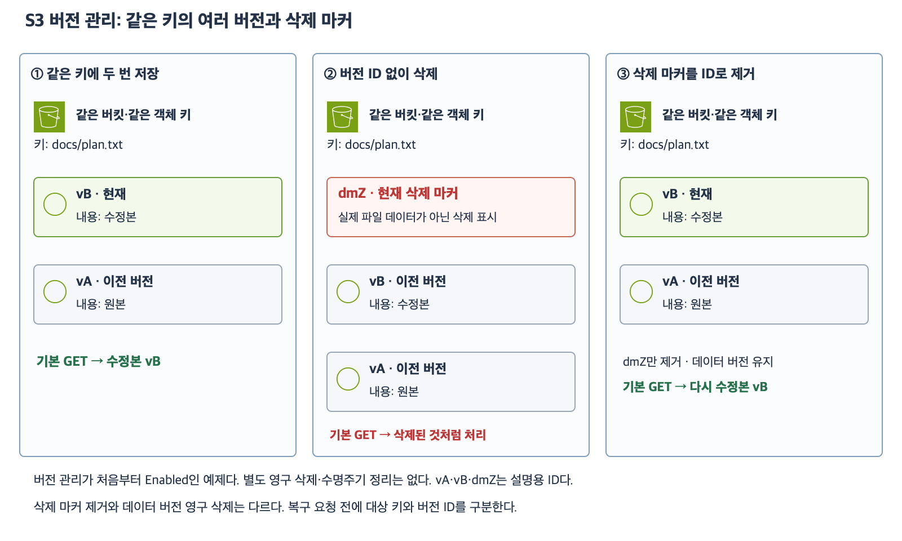

# 6주차 세 번째 수업: S3 버전 관리와 삭제·덮어쓰기 복구

예상 30~40분 · 실제 버킷·객체·정책 변경 없음 · 확인 문제 답변 대기

## 1. 범위와 버전의 뜻

S3 버전 관리(Versioning)는 같은 버킷의 같은 객체 키에 여러 버전의 데이터를 보존하는 기능이다.
키가 같아도 데이터 버전마다 Version ID가 다르다.
Version ID는 S3가 생성하는 고유 식별자이며 사람이 읽는 순번이나 앱 버전과는 다르다.
이번에는 vA·vB·dmZ처럼 읽기 쉬운 설명용 ID로 표시한다.

버전 관리는 버킷 단위로 활성화한다.
이번 예제와 문제는 객체 저장 전에 이미 버전 관리가 Enabled인 일반 목적 버킷이다.
버전 관리 일시 중지·객체 잠금·복제·수명주기 자동 정리 등은 사용하지 않는다.
필요한 요청 권한과 경로는 준비되어 있다.
특정 요청을 예로 설명할 뿐 실제 삭제·복구 작업은 실행하지 않는다.

## 2. 같은 키에 다시 저장하면 새 버전이 생긴다

docs/plan.txt에 원본 데이터를 저장해 vA가 생겼다고 하자.
이후 같은 키에 수정본을 저장하면 새 vB가 만들어진다.
vB가 현재 버전(Current version)이 되고 vA는 이전 버전(Noncurrent version)으로 남는다.
버전 ID를 생략한 일반 GetObject는 현재 버전의 데이터를 가져온다.
vA의 ID를 지정하면 남아 있는 vA 데이터를 따로 가져올 수 있다.
예전 데이터를 조회했다는 사실만으로 현재 버전이 vA로 바뀌지는 않는다.

버전 관리가 없는 같은 키 덮어쓰기와 달리 이전 버전을 보존할 수 있다는 것이 핵심이다.
서로 다른 키로 매번 파일 이름을 바꾸는 기능과는 다르다.

## 3. 삭제 마커와 영구 삭제

버전 관리가 Enabled인 상태에서 버전 ID 없이 DeleteObject로 키를 삭제하면 삭제 마커(Delete marker)가 새 현재 버전이 된다.
삭제 마커는 해당 키를 삭제된 것처럼 다루게 하는 표시이며 원본 파일 데이터가 아니다.
일반 GetObject에서는 삭제된 것처럼 보이지만 이전 데이터 버전들은 그대로 남는다.
“목록에서 안 보이거나 일반 조회가 안 된다”와 “모든 데이터 버전이 영구 삭제됐다”는 다르다.

반면 특정 데이터 버전의 ID를 지정해 삭제하면 그 버전은 영구 삭제된다.
삭제한 버전을 S3 버전 관리 자체가 다시 복구해 주지는 않는다.
별도 백업이나 다른 남은 데이터가 있는지는 따로 확인해야 한다.

| 요청 | Enabled 버킷에서의 효과 |
|---|---|
| 같은 키로 새 데이터 저장 | 새 데이터 버전 생성 |
| ID 없이 GetObject | 현재 버전 조회 |
| 특정 데이터 버전 ID로 조회 | 해당 버전 조회 · 현재 버전은 바뀌지 않음 |
| ID 없이 DeleteObject | 새 삭제 마커 생성 · 데이터 버전은 유지 |
| 특정 데이터 버전 ID로 삭제 | 해당 데이터 버전 영구 삭제 |
| 특정 삭제 마커 ID로 삭제 | 그 삭제 마커 제거 |

[확대 가능한 SVG](images/s3-versioning-delete-marker.svg)

그림은 데이터 버전 vA·vB와 현재 삭제 마커 dmZ 하나만 있는 상황이다.
dmZ의 ID를 지정해 제거하면 직전 데이터 버전 vB가 다시 현재 버전이 된다.
이때 vA·vB 데이터는 삭제하지 않는다.
키만 지정해 DeleteObject를 다시 호출하면 기존 마커를 제거하는 대신 새 마커가 추가될 수 있다.
따라서 복구하려는 삭제 마커의 버전 ID를 정확히 구분해야 한다.

## 4. 덮어쓰기 복구와 삭제 복구

삭제 마커가 현재여서 일반 조회가 안 되는 상황은 현재 마커를 ID로 제거하는 방법을 검토할 수 있다.
여러 마커나 다른 버전이 존재하면 남아 있는 현재·이전 상태를 먼저 확인해야 한다.
이번 문제에서는 명시된 버전과 마커 하나만 있다고 가정한다.

덮어쓴 수정본 vB가 현재지만 원본 vA 내용을 다시 현재로 사용하려는 경우는 다르다.
vA를 조회하기만 하면 현재 버전이 바뀌지 않는다.
vA를 복사 원본으로 지정하여 같은 버킷·같은 키에 새 버전으로 저장하면 새 vC가 현재가 되고 그 내용은 원본과 같다.
기존 vA·vB는 그대로 남는다.
따라서 이전 내용을 현재로 복원하면서 수정본도 이력에 보존할 수 있다.

현재 데이터 버전 vB를 ID로 영구 삭제해 이전 vA를 현재로 만드는 방법도 있지만 vB를 잃는다.
기존 버전들을 모두 남겨야 한다는 요구사항이 있으면 현재 버전 영구 삭제 방식은 요구사항에 맞지 않는다.
이번 수업은 개념 비교이며 실제 영구 삭제는 하지 않는다.

## 5. 권한과 보호 범위

앞선 수업의 작업 이름과 연결하면 다음과 같다.
이번 확인 문제에서는 필요한 권한은 이미 준비되어 있으며 이 새 작업 이름을 암기해 답하도록 요구하지 않는다.

| 할 일 | IAM Action | 리소스 종류 |
|---|---|---|
| 기본 현재 객체 읽기 | s3:GetObject | 객체 |
| 특정 데이터 버전 읽기 | s3:GetObjectVersion | 객체 |
| ID 없이 객체 삭제 | s3:DeleteObject | 객체 |
| 특정 버전·마커를 ID로 삭제 | s3:DeleteObjectVersion | 객체 |
| 버전 목록 보기 | s3:ListBucketVersions | 버킷 |

버전 관리가 있다고 누구든 특정 버전을 삭제할 수 있다는 뜻은 아니다.
삭제 권한과 버전 관리 기능은 별도로 판단한다.
예전 버전도 저장 공간을 사용하므로 버전 수가 늘면 저장량도 늘어난다.
이전 버전 보존 기간과 자동 정리 규칙은 다음 수명주기 수업에서 다룬다.
버전 관리를 켰다는 사실만으로 “이전 버전은 30일 후 자동 삭제” 같은 기간이 정해지는 것은 아니다.

한 번 활성화한 버킷은 단순 미사용 상태로 되돌리는 것이 아니라 일시 중지(Suspended)를 설정할 수 있다.
일시 중지와 기존 null 버전 동작은 이후에 구분하며 이번 문제에는 없다.

버전 관리는 영구 삭제를 절대로 못 하게 하는 잠금 기능이나 별도 격리 백업과 같지는 않다.
필요한 복구 데이터가 버전으로 남아 있어야 이 기능으로 복구할 수 있다.
이미 버전 없이 덮어써 잃은 과거 내용을 나중에 버전 관리만 켠다고 되살릴 수는 없다.
중요 데이터의 별도 백업·삭제 제한 등 요구사항은 따로 설계한다.

## 6. 확인 문제 — 전체 답변과 이유

모든 문항은 첫 저장 전에 버전 관리가 Enabled인 버킷이다.
필요한 조회·복사·삭제 권한과 경로는 준비되어 있다.
제시된 요청 외에 삭제·복제·자동 정리나 별도 백업은 없다.
각 문항은 별도의 상황이다.
버전 ID는 설명용이고 실제 순번 규칙을 뜻하지 않는다.

### 1. 같은 키 저장과 이전 버전 조회

버킷 docs-history-demo의 키 manuals/start.txt에 원본을 저장해 ID a가 생겼다.
그 뒤 같은 키에 수정본을 저장해 ID b가 생겼다.

1-1. 현재 버전과 이전 버전은 각각 무엇인가?
ID 없는 일반 GetObject는 어느 내용을 가져오는가?
1-2. ID a를 지정해 원본을 읽었다.
그 사실만으로 다음 일반 GetObject도 원본을 가져오게 되는가?
버전 조회와 현재 버전 변경을 구분하자.

### 2. 삭제 표시와 복구

다른 키 invoices/may.csv에는 데이터 버전 p와 q가 있고 q가 현재다.
이 키에 ID 없는 DeleteObject를 한 번 요청해 삭제 마커 m이 현재가 되었다.
그 외 버전이나 마커는 없다.

2-1. 일반 GetObject가 삭제된 것처럼 동작하면 p·q도 영구 삭제됐다고 판단할 수 있는가?
실제 남아 있는 것들을 설명하자.
2-2. p·q를 유지하면서 일반 GetObject로 다시 q의 내용을 가져오게 하려면 무엇을 어떤 ID로 제거해야 하는가?
키만 지정한 DeleteObject를 다시 보내는 것과 구분하자.

### 3. 복구 방식과 영구 삭제

다른 키 settings/app.json에 원본 r과 수정본 s가 있고 s가 현재다.
삭제 마커는 없다.

3-1. r의 내용을 다시 현재로 사용하되 r·s 모두 이력으로 보존해야 한다.
r을 조회만 하는 방법과 r을 같은 키의 새 버전으로 복사·저장하는 방법 중 어느 것이 요구에 맞는가?
새 현재 버전과 남는 이력을 설명하자.
3-2. 별도 상황으로 권한 있는 사용자가 데이터 버전 r을 그 ID를 지정해 영구 삭제했다.
별도 백업이나 다른 원본 사본은 없다.
버전 관리가 켜져 있다는 이유만으로 삭제된 r을 복구할 수 있는가?
삭제 마커 복구와 구분해 설명하자.

답변 전 정답·해설은 공개하지 않는다.
답변 후 평가와 진도를 기록한다.

## 공식 참고 자료

확인: 2026-11-04

- [S3 버전 관리](https://docs.aws.amazon.com/AmazonS3/latest/userguide/Versioning.html)
- [삭제와 특정 버전 영구 삭제](https://docs.aws.amazon.com/AmazonS3/latest/userguide/DeletingObjectVersions.html)
- [삭제 마커 제거](https://docs.aws.amazon.com/AmazonS3/latest/userguide/ManagingDelMarkers.html)
- [이전 버전 복구](https://docs.aws.amazon.com/AmazonS3/latest/userguide/RestoringPreviousVersions.html)
- [API 작업별 권한](https://docs.aws.amazon.com/AmazonS3/latest/userguide/using-with-s3-policy-actions.html)
- [AWS 공식 아이콘](https://aws.amazon.com/architecture/icons/)
- [이전 수업](33_S3_저장_조회와_접근_권한.md)

## 최초 답변 평가 — 2026-11-04

문항별 정답 1·부분 정답 2이며 하위 질문별 정답 3·부분 정답 3이다.
1-1·1-2는 정답이다. 현재 b·이전 a 및 특정 버전 조회가 현재를 바꾸지 않는다는 구분이 정확하다.
2-1은 정답이다. p·q와 현재 삭제 마커 m이 남으며 일반 조회는 삭제된 것처럼 동작한다. 버전 ID 지정 조회는 가능하다.
2-2는 부분 정답이다. 삭제 마커 m을 제거한다는 선택은 맞다. m은 키가 아니라 버전 ID이며 Key=invoices/may.csv, VersionId=m으로 지정한다.
Enabled 버킷에서 키만 지정한 DeleteObject는 영구 삭제가 아니라 새 삭제 마커를 추가한다.
3-1은 부분 정답이다. 같은 키에 원본을 새 버전으로 저장하는 선택과 기존 이력 보존은 맞다. 새 현재 버전은 새로운 ID t이며 내용만 r과 같다. 남는 ID는 r·s·t다.
3-2는 부분 정답이다. 복구 불가 결론은 맞다. 영구 삭제된 대상은 키 전체가 아니라 ID r의 데이터 버전이다. 같은 키의 s는 남는다.

### 보완 확인

4-1. invoices/may.csv에 데이터 p·q와 현재 삭제 마커 m이 있다. q를 다시 일반 조회하려고 한다. 삭제 요청의 Key와 VersionId를 각각 적자. VersionId를 생략하면 어떻게 되는가?
4-2. settings/app.json의 r·s를 모두 유지하면서 r 내용을 같은 키에 복사해 새 ID t를 받았다. 현재 버전 ID·현재 내용·남는 버전 ID를 각각 적자. 이후 이전 r만 ID 지정 영구 삭제하면 같은 키의 s·t도 삭제되는가?

## 보완 답변 평가 — 2026-11-04

4-1의 Key=invoices/may.csv·VersionId=m은 정확하다. VersionId 생략 효과는 미응답으로 남기고 새 삭제 마커 추가라고 설명 보충했다. 4-2는 현재 ID t·내용 r과 동일·이력 r/s/t 및 r만 영구 삭제 시 s/t 유지까지 정답이다. 핵심 보완을 마치고 다음 수업은 S3 수명주기다. 최초 점수는 유지한다.
