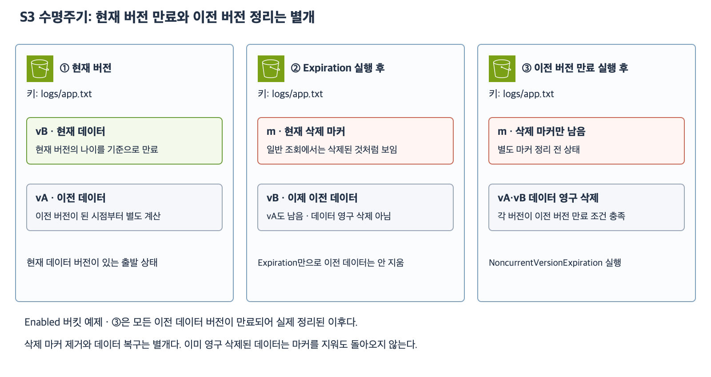

# 6주차 네 번째 수업: S3 수명주기와 버전 자동 정리

예상 30~40분 · 실제 AWS 설정 변경 없음 · 확인 문제 답변 대기

## 1. 수명주기란

S3 수명주기(Lifecycle)는 버킷에 규칙을 설정해 대상 객체를 시간이 지나면 자동으로 관리하는 기능이다.
필터로 대상을 고르고 작업과 시점을 지정한다.
기존에 저장한 객체에도 적용되므로 규칙을 만든 뒤의 새 객체만 대상이라고 생각하면 안 된다.

대표 작업은 전환(Transition)과 만료(Expiration)다.
전환은 같은 버킷·같은 키에서 데이터를 다른 스토리지 클래스로 옮기는 작업이다.
다른 버킷으로 객체를 이동하거나 복사하는 작업은 아니다.
예를 들어 자주 쓰지 않는 데이터를 다른 보관 등급으로 이동할 수 있다.
스토리지 클래스는 데이터를 저장하는 방식·요금·조회 특성이 다른 보관 등급이며 자세한 선택은 다음 수업에서 다룬다.
만료는 데이터를 삭제 대상으로 처리하는 작업이며 버킷의 버전 관리 상태에 따라 효과가 다르다.
전환과 만료는 다르므로 보관 등급을 바꾸는 것을 데이터 삭제라고 해석하지 않는다.

## 2. 필터로 범위를 고른다

접두사 logs/를 지정하면 키가 logs/로 시작하는 객체가 대상이다.
logs/app.txt는 포함되지만 reports/app.txt는 포함되지 않는다.
이 접두사는 S3 키의 문자열 일부이며 EC2 디스크의 실제 폴더 경로가 아니다.
태그 등으로도 필터링할 수 있지만 이번 문제는 접두사만 사용한다.
모든 예제는 활성화된 규칙 하나만 적용한다.

## 3. 현재 버전 만료와 이전 버전 만료

| 작업 | 처음부터 버전 관리 Enabled인 버킷에서의 역할 |
|---|---|
| Expiration | 현재 데이터 버전을 만료시키면 삭제 마커 추가 · 기존 데이터는 이전 버전으로 남음 |
| NoncurrentVersionExpiration | 조건을 만족한 이전 데이터 버전을 영구 삭제 |
| ExpiredObjectDeleteMarker 정리 | 이전 데이터 버전 없이 남은 만료된 삭제 마커 정리 |

버전 관리가 없는 버킷의 Expiration은 객체를 영구 삭제한다.
반면 Enabled 버킷에서 현재 데이터 버전에 대한 Expiration은 삭제 마커를 만든다.
따라서 Expiration만 설정하고 모든 이전 버전의 저장 공간까지 정리됐다고 판단하면 안 된다.
이전 데이터 버전을 정리하려면 별도 NoncurrentVersionExpiration을 검토한다.
이 작업으로 영구 삭제된 데이터는 버전 관리만으로 복구할 수 없다.

현재가 이미 삭제 마커이고 이전 데이터가 남아 있다면 일반 Expiration이 그 데이터까지 정리하지 않는다.
이전 데이터가 모두 사라지고 마커 하나만 남은 상태는 만료된 삭제 마커 정리 대상이 될 수 있다.
마커 정리는 파일 데이터를 되살리는 작업이 아니다.
이번 문제에서는 여러 삭제 마커가 쌓인 상황을 제외한다.

[확대 가능한 SVG](images/s3-lifecycle-expiration.svg)

그림 ③은 모든 이전 데이터 버전이 각각 조건을 만족해 정리된 이후다.
②에서 ③으로 즉시 이동한다는 뜻은 아니다.
마커 자동 정리는 데이터 정리와 구분해서 설명했다.

## 4. 이전 버전의 나이는 언제부터 셀까

현재 버전의 일수 기반 만료는 해당 버전의 생성 시점을 기준으로 본다.
NoncurrentDays는 그 데이터 버전이 이전 버전이 된 시점부터 계산한다.
오래전에 만들었더라도 어제까지 현재였다면 이전 버전이 된 지는 하루 정도다.

예를 들어 vA를 1년 전에 저장하고 어제 같은 키에 vB를 저장했다.
vA는 어제 이전 버전이 되었으므로 NoncurrentDays=30 조건을 이미 만족했다고 볼 수 없다.
생성 후 1년과 이전 버전이 된 후 하루를 구분한다.
현재 버전 만료로 데이터가 이전 버전이 되어도 이 구분이 적용된다.

실제 S3는 일수 계산의 UTC 날짜 처리와 비동기 실행이 있다.
규칙 조건이 충족되는 시점과 실제 정리가 끝나는 시점이 정확히 같다고 보장하지 않는다.
이번 문제는 경계 시각을 피하고 조건 충족 여부 또는 작업 완료 이후의 상태만 묻는다.
유지할 최신 이전 버전 개수 옵션·규칙 충돌·객체 잠금·복제 제약·일시 중지 버킷은 제외한다.
수명주기는 필요한 보존 기간을 정해 관리하는 기능이며 데이터를 영구히 보존하는 잠금 기능은 아니다.

## 5. 확인 문제 — 전체 답변과 이유

공통 조건은 일반 목적 버킷이며 문제에서 지정한 규칙만 활성화되어 있다.
버전 관리 상태는 문항에 명시한다.
별도 백업·복제·잠금과 최신 이전 버전 개수 보존 옵션은 없다.
문항들은 독립된 상황이다.
정확한 UTC 경계 시각이나 실제 실행 시각을 계산하지 않는다.

### 1. 필터와 작업 선택

버전 관리가 없는 버킷에 logs/ 접두사의 객체를 생성 후 90일이 지나면 영구 삭제하는 규칙을 추가했다.
키 logs/a.txt와 reports/a.txt는 모두 생성 후 120일이 지났고 규칙을 추가하기 전부터 존재했다.

1-1. 두 키 중 어느 것이 이 규칙의 대상인가?
규칙 추가 전에 저장했다는 이유로 적용에서 제외되는가?
1-2. 대상 데이터를 다른 보관 등급으로 옮기면서 보존하려는 요구라면 전환과 만료 중 어느 작업을 선택해야 하는가?
지금의 만료 규칙과 결과가 어떻게 다른가?

### 2. 현재 버전 만료 후

첫 저장 전부터 버전 관리가 Enabled인 버킷이다.
logs/app.txt에 데이터 버전 a와 현재 데이터 버전 b가 있었다.
현재 버전 만료 Expiration이 실행되어 삭제 마커 m이 현재가 되었다.
이전 버전 만료 규칙은 없다.

2-1. a·b 데이터도 영구 삭제됐는가?
현재 버전과 남는 데이터 버전을 적자.
2-2. 이전 버전의 저장 공간도 자동으로 정리하려면 어떤 별도 작업이 필요한가?
그 작업으로 영구 삭제된 데이터를 나중에 삭제 마커 제거만으로 복구할 수 있는가?

### 3. 시간 기준과 마커 정리

첫 저장 전부터 버전 관리가 Enabled인 버킷이다.
NoncurrentVersionExpiration의 NoncurrentDays는 30이며 버전 개수 보존 조건은 없다.
데이터 버전 x는 1년 전에 생성했지만 새 버전 저장으로 이전 버전이 된 것은 어제다.

3-1. 생성된 지 1년이므로 x가 이미 이전 버전 30일 조건을 충족했다고 판단해도 되는가?
어느 시점을 기준으로 판단해야 하는가?
3-2. 별도 상황으로 logs/old.txt의 모든 데이터 버전은 이전 버전 만료로 이미 영구 삭제되었다.
현재 삭제 마커 d 하나만 남아 있다.
이 마커를 정리하면 예전 파일 내용이 다시 나타나는가?
마커 정리와 데이터 복구를 구분하자.

답변 후 평가와 진도를 기록한다.
문제의 정답은 답변 전에 공개하지 않는다.

## 공식 참고 자료

확인: 2026-11-04

- [수명주기 개요와 기존 객체 적용](https://docs.aws.amazon.com/AmazonS3/latest/userguide/object-lifecycle-mgmt.html)
- [필터·현재 및 이전 버전 작업](https://docs.aws.amazon.com/AmazonS3/latest/userguide/intro-lifecycle-rules.html)
- [만료와 삭제 마커 및 영구 삭제](https://docs.aws.amazon.com/AmazonS3/latest/userguide/lifecycle-expire-general-considerations.html)
- [AWS 공식 아키텍처 아이콘](https://aws.amazon.com/architecture/icons/)
- [이전 수업](34_S3_버전_관리와_삭제_복구.md)

## 최초 답변 평가 — 2026-11-04

문항별 정답 2·부분 정답 1이며 하위 질문별 정답 5·부분 정답 1이다.
1-1은 정답이다. logs/a.txt만 대상이고 기존 객체에도 적용된다. 이미 조건을 충족해 삭제 대상이 되며 실제 정리는 비동기다.
1-2는 부분 정답이다. 보존하려면 전환이라는 선택은 맞다. 다른 버킷으로 이동한다는 설명은 틀리며 같은 버킷·같은 키의 대상 객체 스토리지 클래스만 바뀐다. reports/a.txt는 접두사 필터 밖이므로 그대로다.
2-1은 정답으로 평가하고 용어를 보충했다. 현재 버전 m과 남은 a·b를 정확히 구분했다. 전체 버전은 a·b·m이지만 데이터 버전은 a·b이며 m은 삭제 마커다.
2-2·3-1·3-2는 정답이다. 이전 버전 만료 작업·영구 삭제 복구 불가·이전 버전이 된 시점 기준·마커 정리 비복구를 정확히 설명했다.

### 보완 확인

4-1. 버킷 study-logs-demo의 logs/a.txt와 reports/a.txt는 모두 S3 Standard에 있다.
logs/ 접두사에만 적용되는 S3 Standard-IA 전환이 성공적으로 완료됐다.
두 객체의 버킷·키·스토리지 클래스는 각각 어떻게 되는가?
이번 문제는 전환 조건을 충족하고 완료된 이후이며 세부 크기·시간 조건은 묻지 않는다.

- [전환 공식 설명](https://docs.aws.amazon.com/AmazonS3/latest/userguide/lifecycle-transition-general-considerations.html)

## 보완 답변과 추가 설명 — 2026-11-04

4-1은 정답이다.
두 객체 모두 버킷 study-logs-demo와 기존 키가 유지된다.
logs/a.txt는 S3 Standard-IA로 전환되고 reports/a.txt는 S3 Standard로 유지된다.
최초 정답 2·부분 정답 1은 유지하고 보완 1문항 정답을 별도로 기록한다.

사용자가 객체별 스토리지 클래스 변경 가능 여부를 질문했다.
일반 목적 버킷 안에서도 객체마다 서로 다른 스토리지 클래스를 사용할 수 있다.
업로드할 때 선택하거나 수명주기 규칙으로 조건에 맞는 객체를 전환할 수 있다.
버전 관리 사용 시 데이터 버전마다 스토리지 클래스가 다를 수도 있으며 현재·이전 버전 전환 규칙을 구분한다.
모든 클래스 사이를 제한 없이 전환할 수 있다는 뜻은 아니며 클래스별 전환 조건은 다음 수업에서 다룬다.

- [객체별 스토리지 클래스 공식 설명](https://docs.aws.amazon.com/AmazonS3/latest/userguide/storage-class-intro.html)
