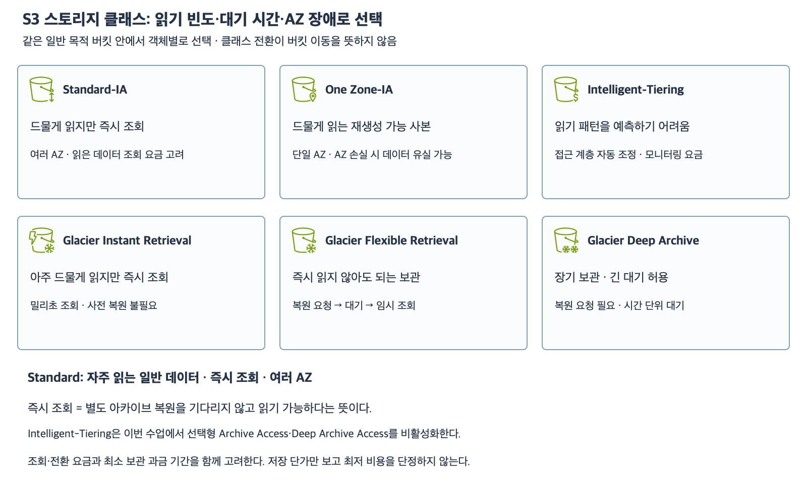

# 6주차 다섯 번째 수업: S3 스토리지 클래스와 선택 기준

예상 35~45분 · 실제 AWS 설정 변경 없음 · 확인 문제 평가 완료
확인 날짜: 2026-11-05

## 1. 선택 기준

스토리지 클래스는 S3 객체의 보관 방식·조회 특성·요금이 다른 저장 등급이다.
일반 목적 버킷 안에서도 객체별로 다를 수 있다.
같은 버킷·같은 키의 클래스를 수명주기로 전환할 수 있으며 다른 버킷으로 옮기는 작업은 아니다.
모든 클래스 사이를 자유롭게 전환할 수 있는 것은 아니다.

자주 읽는지 드물게 읽는지 먼저 확인한다.
읽기 요청 후 즉시 데이터가 필요한지 복원 작업을 기다릴 수 있는지도 구분한다.
여기서 즉시 조회는 사전 아카이브 복원을 기다리지 않는다는 의미이며 모든 네트워크 요청의 시간을 보장한다는 뜻은 아니다.
AZ 하나가 사라져도 데이터가 남아 있어야 하는지와 원본으로부터 재생성 가능한지도 확인한다.
마지막으로 저장 요금 외 조회·전환·모니터링 비용과 최소 보관 과금 기간을 함께 본다.

## 2. 주요 클래스 비교

| 클래스 | 주된 상황 | 읽기 방식 | AZ 범위 |
|---|---|---|---|
| S3 Standard | 자주 읽는 일반 데이터 | 사전 복원 없이 조회 | 여러 AZ |
| S3 Standard-IA | 드물게 읽지만 즉시 조회 필요 | 사전 복원 없이 조회 · 조회 요금 고려 | 여러 AZ |
| S3 One Zone-IA | 재생성 가능한 드문 조회 사본 | 사전 복원 없이 조회 · 조회 요금 고려 | 단일 AZ |
| S3 Intelligent-Tiering | 접근 패턴이 불규칙하거나 예측 어려움 | 기본 자동 접근 계층은 즉시 조회 | 여러 AZ |
| S3 Glacier Instant Retrieval | 아주 드물게 읽지만 즉시 조회 필요 | 밀리초 조회 · 사전 복원 불필요 | 여러 AZ |
| S3 Glacier Flexible Retrieval | 즉시 조회가 필요 없는 아카이브 | 복원 요청과 대기 필요 | 여러 AZ |
| S3 Glacier Deep Archive | 긴 복원 대기를 허용하는 장기 보관 | 복원 요청과 시간 단위 대기 필요 | 여러 AZ |

IA는 Infrequent Access로 드문 접근을 뜻한다.
One Zone-IA는 한 AZ 안에서는 중복 저장하지만 AZ 전체 손실을 견디는 클래스는 아니다.
재생성 불가한 유일한 원본에 AZ 손실 대응이 필요하면 One Zone-IA 선택은 요구에 맞지 않는다.
Standard-IA와 One Zone-IA를 드문 접근이라는 이유만으로 동일하게 취급하지 않는다.

Glacier라는 이름이 들어가도 모두 사전 복원이 필요한 것은 아니다.
Glacier Instant Retrieval은 바로 읽을 수 있다.
Flexible Retrieval과 Deep Archive는 아카이브 복원을 먼저 요청한다.
정확한 복원 시간은 선택한 복원 방식과 조건에 따라 달라지며 이번 문제는 초 단위 보장을 요구하지 않는다.

[확대 가능한 SVG](images/s3-storage-classes.svg)

AWS 공식 리소스 아이콘을 사용해 직접 작성한 학습용 비교 그림이다.
S3 Express One Zone·디렉터리 버킷·Outposts 등은 이번 수업에서 제외한다.

## 3. 아카이브 복원과 삭제 복구의 차이

Deep Archive에 보관된 audit/2020.zip을 읽으려면 복원을 요청하고 완료를 기다린다.
이는 남아 있는 아카이브 데이터를 읽을 수 있도록 준비하는 과정이다.
앞선 수업의 삭제 마커 제거 또는 영구 삭제 데이터 복구와 다르다.

Flexible Retrieval·Deep Archive에서 복원하면 지정한 기간 동안 조회 가능한 임시 사본이 제공된다.
원본 아카이브의 클래스가 자동으로 Standard로 바뀌는 것은 아니다.
임시 조회 기간이 끝나도 별도 만료·삭제가 없다면 아카이브 원본은 남는다.
계속 즉시 읽을 별도 사본이 필요하면 복원 후 원하는 클래스로 복사하는 작업을 검토한다.
이번 설명은 Flexible Retrieval·Deep Archive에 대한 것이며 Intelligent-Tiering의 선택형 아카이브 복원 방식과 혼동하지 않는다.

## 4. Intelligent-Tiering과 수명주기 전환 구분

접근 패턴을 예측하기 어려우면 Intelligent-Tiering을 검토한다.
객체별 접근 패턴을 모니터링해 클래스 내부 접근 계층을 자동 조정한다.
기본 자동 계층은 Frequent Access·Infrequent Access·Archive Instant Access다.
이 계층 사이를 이동해도 스토리지 클래스 이름은 Intelligent-Tiering으로 유지된다.
이름에 Archive가 있어도 기본 Archive Instant Access는 사전 복원 없이 조회한다.

선택형 Archive Access와 Deep Archive Access를 추가로 활성화하면 복원 대기가 필요할 수 있다.
이번 문제는 이 두 선택형 계층을 활성화하지 않는다.
객체별 모니터링·자동화 요금과 작은 객체의 자동 계층 이동 조건도 있으므로 항상 무료이거나 무조건 최저 비용이라는 뜻은 아니다.
이번 자동 계층 문제의 객체는 1 MiB 이상으로 이 크기 제약을 피한다.

수명주기 Transition은 예를 들어 생성 후 일정 기간이 지난 Standard 객체를 Standard-IA로 바꾸는 별도 규칙이다.
Intelligent-Tiering 내부의 접근 패턴 기반 자동 계층 이동과 구분한다.
Intelligent-Tiering으로 보내는 수명주기 규칙 자체는 구성할 수 있다.

## 5. 최소 보관 기간은 삭제 금지 기간이 아니다

일부 클래스에는 최소 보관 과금 기간이 있다.
그 전에 삭제하거나 덮어쓰거나 다른 클래스로 전환하면 남은 기간에 대한 요금이 발생할 수 있다.
이것은 해당 날짜까지 삭제 요청이 금지된다는 뜻이 아니다.

| 클래스 | 최소 보관 과금 기간 |
|---|---|
| Standard-IA·One Zone-IA | 30일 |
| Glacier Instant Retrieval·Glacier Flexible Retrieval | 90일 |
| Glacier Deep Archive | 180일 |

예를 들어 버전 관리가 없는 객체를 Standard-IA에 저장한 지 7일 만에 영구 삭제해도 삭제 자체는 가능하다.
하지만 최소 30일 기준의 보관 요금을 고려해야 한다.
이번 예제는 별도 잠금이나 삭제 권한 제한이 없다.
이 과금 조건과 수명주기 전환이 허용되는 시점·경로는 다른 조건이다.
이번 문제는 실제 달러 금액·작은 객체 과금·전환 경로 세부 제한을 계산하지 않는다.
자주 조회하면 조회 요금 때문에 저장 단가가 낮은 클래스가 전체 비용에서는 불리할 수도 있다.

## 6. 확인 문제 — 전체 답변과 이유

일반 목적 버킷의 클래스 선택 문제다.
필요한 권한·경로는 준비되어 있다.
실제 요금의 최저값을 계산하지 않고 제시된 조건에 맞는 선택과 이유를 묻는다.
문항마다 상황은 독립적이다.

### 1. 조회 빈도와 AZ 손실

1-1. 매일 반복해서 읽는 서비스용 이미지다.
Standard와 Standard-IA 중 기본 선택으로 어느 쪽이 적절한가?
드문 접근용 클래스의 저장 단가만 보고 결정하면 안 되는 이유는 무엇인가?

1-2. 재생성할 수 없는 유일한 원본 문서다.
드물게 읽지만 요청하면 즉시 읽어야 하고 AZ 하나의 손실에도 데이터가 남아야 한다.
Standard-IA와 One Zone-IA 중 어느 쪽이 맞는가?
다른 선택이 요구에 맞지 않는 이유도 설명하자.

### 2. Glacier 조회와 임시 복원

2-1. 오래 보관하는 영상을 아주 드물게 조회하지만 요청 시 사전 복원 대기 없이 읽어야 한다.
Glacier Instant Retrieval과 Glacier Deep Archive 중 어느 쪽이 맞는가?
Glacier라는 이름이 들어가면 모두 복원이 필요하다고 볼 수 있는가?

2-2. 별도 Deep Archive 객체를 복원해 3일 동안 조회 가능한 임시 사본을 받았다.
원본 클래스가 영구적으로 Standard로 변경된 것인가?
별도 삭제·만료 없이 3일이 끝나면 아카이브 원본도 없어지는가?

### 3. 자동 계층과 최소 보관 과금

3-1. 1 MiB 이상인 많은 객체의 접근 패턴을 예측하기 어렵다.
객체별 접근 빈도에 따라 자동으로 저장 비용을 조정하고 싶다.
선택형 아카이브 계층은 사용하지 않고 즉시 조회를 유지한다.
어떤 클래스를 검토할 수 있는가?
그 클래스의 기본 자동 접근 계층 사이를 이동하면 클래스 이름이나 버킷도 바뀌는가?

3-2. 버전 관리가 없는 Standard-IA 객체를 저장한 지 7일 만에 삭제하려고 한다.
권한은 있고 잠금은 없다.
최소 보관 과금 기간이 30일이므로 삭제 요청 자체가 금지되는가?
삭제 가능 여부와 요금 영향을 구분하자.

답변 전 문제 정답·해설은 공개하지 않는다.
답변 후 평가와 진도를 기록한다.

## 공식 참고 자료

- [객체별 스토리지 클래스와 비교](https://docs.aws.amazon.com/AmazonS3/latest/userguide/storage-class-intro.html)
- [Glacier 클래스의 조회·보관 조건](https://docs.aws.amazon.com/AmazonS3/latest/userguide/glacier-storage-classes.html)
- [아카이브 임시 복원](https://docs.aws.amazon.com/AmazonS3/latest/userguide/restoring-objects.html)
- [Intelligent-Tiering 내부 접근 계층](https://docs.aws.amazon.com/AmazonS3/latest/userguide/intelligent-tiering-overview.html)
- [AWS 공식 아키텍처 아이콘](https://aws.amazon.com/architecture/icons/)
- [이전 수업](35_S3_수명주기와_버전_자동_정리.md)

## 답변 평가 — 2026-11-05

전체 3문항 정답이며 하위 6문항 모두 정답이다.
1-1은 자주 읽는 데이터에 Standard를 선택하고 저장 단가 외 조회·전환·모니터링·최소 보관 과금을 함께 고려한다고 설명했다.
비용 항목은 클래스별로 다르며 Standard-IA 자체에 Intelligent-Tiering의 모니터링 요금이 붙는다는 의미로 해석하지 않는다.
1-2는 Standard-IA를 선택하고 One Zone-IA의 AZ 전체 손실 대응 한계를 정확히 설명했다.
2-1은 Glacier Instant Retrieval을 선택하고 Glacier 이름만으로 사전 복원 필요 여부를 판단할 수 없다고 설명했다.
2-2는 Deep Archive 원본 클래스가 Standard로 자동 변경되지 않으며 임시 조회 기간 종료 후에도 아카이브 원본이 남는다고 정확히 답했다.
3-1은 Intelligent-Tiering을 선택하고 내부 접근 계층 이동 시 클래스 이름과 버킷이 유지된다고 설명했다.
3-2는 삭제 가능 여부와 최소 보관 과금 30일 기준을 정확히 구분했다.
철자 오류는 개념 오답으로 취급하지 않는다.
별도 보완 질문 없이 이번 수업을 마친다.
다음 요청 시 6주차 스토리지 통합 설계·종합 확인 자료를 공식 AWS 아이콘과 새로운 문제로 먼저 준비한다.
