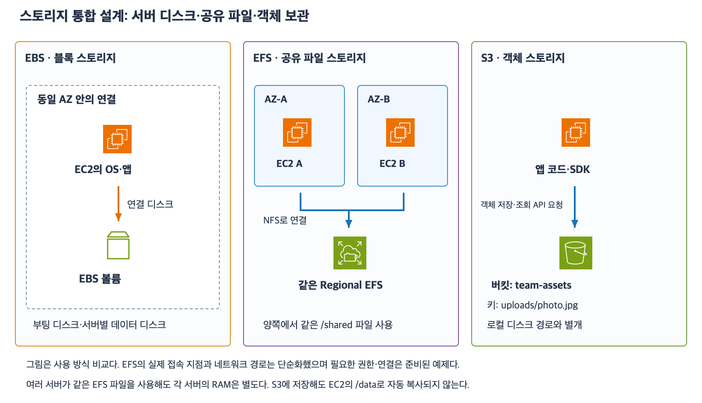

# 6주차 종합 확인: 스토리지 통합 설계

예상 40~50분 · 실제 AWS 리소스 변경 없음 · 최초·보완 평가 완료 · 후속 내용 정정 확인
작성: 2026-11-05

## 1. 지금까지의 연결

이번에는 새로운 서비스 대신 기존 개념을 한 서비스 설계 안에서 연결한다.
서버의 연결 디스크·여러 서버의 공유 파일·버킷과 키 기반 객체 API를 먼저 구분한다.
그다음 보존과 복구·접근 권한·보관 비용 요구를 따로 확인한다.
저장 서비스 선택만으로 백업·접근 허용·RAM 공유까지 자동 해결된다고 판단하지 않는다.

| 설계 질문 | 확인할 기준 |
|---|---|
| 앱이 저장소를 어떻게 사용하는가 | EC2 연결 블록 디스크 / 공유 파일 경로 / 객체 API |
| 새 EC2도 같은 데이터를 읽어야 하는가 | EC2 전용 EBS와 공유 EFS·S3 범위 구분 |
| 어떤 API를 허용하는가 | 객체 조회와 버킷 목록 조회의 Action·ARN 구분 |
| 되돌릴 데이터가 남아 있는가 | 버전·삭제 마커·영구 삭제와 별도 백업 구분 |
| 언제 자동 정리하는가 | 현재 버전과 이전 버전 작업·시간 기준 구분 |
| 얼마나 빨리 읽어야 하는가 | 즉시 조회·아카이브 복원 대기·AZ 손실·총비용 |

[확대 가능한 SVG](images/storage-integrated-review.svg)

기존 역할 비교 그림을 기반으로 작성한 학습용 구성도다.
각 EC2는 자신의 EBS를 사용하고 다른 AZ의 EC2와 Regional EFS 파일을 공유할 수 있다.
S3는 버킷·키로 API를 호출하는 별도 객체 저장소다.
그림의 연결은 사용 관계이며 네트워크 라우팅·EFS 마운트 타깃을 전부 그린 것은 아니다.
각 서버의 RAM은 별도이며 파일을 공유한다고 메모리까지 공유되지는 않는다.

## 2. 풀이 방법과 조건

아래는 그림의 이름과 다른 새 상황이다.
서비스·Action·리소스·버전 ID를 구체적으로 적고 선택 이유를 설명한다.
각 문항은 독립적이며 하위 상황의 변경이 다른 문항에 영향을 주지 않는다.
모든 데이터 버전 ID는 설명용 이름이다.
S3는 일반 목적 버킷이며 Enabled라고 지정한 버킷은 첫 저장 전부터 계속 Enabled다.
잠금·복제·일시 중지·추가 버전 개수 보존·별도 백업·규칙 충돌은 없다.
필요한 네트워크·마운트·파일 권한은 준비되어 있으며 2번에서 지정한 IAM 권한 판단만 별도로 묻는다.
2번의 객체는 사전 복원이 필요 없는 클래스이고 같은 계정 직접 API 요청이다.
암호화 키 추가 권한·명시적 Deny·추가 정책 제한은 없다.
질문에 없는 오류를 가정하지 않는다.
정확한 UTC 경계와 비동기 완료 시각·달러 요금 계산은 요구하지 않는다.

## 3. 종합 확인 문제 — 전체 답변과 이유

### 1. 저장 방식과 서버 교체

Linux EC2 P는 AZ-A에 있고 Q는 AZ-B에 있다.
각 서버는 독립적인 루트 디스크로 OS를 부팅해야 한다.
두 서버는 같은 /shared 경로에서 하나의 파일 시스템을 함께 사용해야 한다.
앱은 완성한 보고서를 버킷과 키를 지정하는 API로 저장·조회한다.

1-1. 루트 디스크 / 두 AZ의 공유 파일 / 보고서 객체 보관에 각각 EBS·Regional EFS·S3 중 무엇을 선택할까?
각 선택의 사용 방식을 간단히 설명하자.

1-2. 위와 같이 구성한 뒤 P가 Terminate되었다.
P의 루트 EBS DeleteOnTermination=true이며 root-only.log는 그 루트 EBS에만 있다.
shared.csv는 EFS에만 있고 completed.csv는 S3에만 있다.
RAM에는 아직 저장하지 않은 중간값이 있다.
어떤 데이터가 사라지고 어떤 데이터는 남는가?
EFS 파일이 남는다는 이유로 Q가 P의 RAM 중간값도 알 수 있는가?

### 2. 객체 조회와 목록 권한

역할 ReaderRole에는 다음 Allow만 있다.
Action=s3:GetObject
Resource=arn:aws:s3:::design-records-demo/published/*
그 외 허용이나 거부는 없다.
대상 키 published/summary.csv는 이미 존재한다.

2-1. ReaderRole이 키를 정확히 알고 GetObject로 내용을 읽을 수 있는가?
ListObjectsV2로 버킷 객체 목록을 조회하는 것도 이 Allow만으로 가능한가?
두 요청을 구분하자.

2-2. 목록 조회도 허용하려고 한다.
필요한 IAM Action과 버킷 Resource ARN을 적자.
이번에는 목록을 특정 접두사로 제한하는 조건은 요구하지 않는다.
기존 GetObject의 객체 범위는 변경하지 않는다.

### 3. 삭제와 덮어쓰기 복구

버전 관리 Enabled 버킷 restore-work-demo의 키 configs/service.json에 데이터 버전 u와 현재 데이터 버전 v가 있다.
버전 ID 없는 DeleteObject를 한 번 요청해 삭제 마커 z가 현재가 되었다.
그 외 버전이나 마커는 없다.
필요한 조회·복사·삭제 권한은 있다.

3-1. 데이터 u·v를 보존하면서 일반 GetObject로 다시 v를 읽으려 한다.
삭제 요청에 지정할 Key와 VersionId는 무엇인가?
VersionId를 생략하고 같은 키를 다시 삭제하면 기존 마커가 제거되는가?

3-2. 3-1 복구를 마쳐 v가 현재라고 하자.
이번에는 u 내용을 일반 조회의 현재 내용으로 사용하면서 u·v 모두 보존해야 한다.
어떤 버전을 어디로 복사해야 하는가?
복사 결과 새 ID w를 받았다면 현재 ID·현재 내용·남는 데이터 버전 ID를 각각 적자.

### 4. 현재 만료와 이전 버전 보존

버전 관리 Enabled 버킷의 logs/task.txt는 현재 버전 만료 Expiration 실행으로 삭제 마커 k가 현재가 되었다.
실행 직전 데이터 버전 c는 이미 이전 버전이었고 d는 현재였다.
이전 버전 만료 규칙은 아직 없다.

4-1. Expiration 실행 직후 c·d 데이터는 모두 영구 삭제된 것인가?
전체 버전과 데이터 버전을 구분해서 적자.
이전 데이터의 저장 공간도 자동 정리하려면 어떤 작업을 추가 검토해야 하는가?

4-2. 별도 상황에서 NoncurrentVersionExpiration의 NoncurrentDays=30을 설정했다.
데이터 버전 h는 생성된 지 200일이지만 이전 버전이 된 지는 2일이다.
이미 이전 버전 30일 조건을 충족했는가?
나중에 이 작업으로 h가 영구 삭제되면 마커 제거로 h를 되살릴 수 있는가?

### 5. 보관 등급과 아카이브 조회

5-1. 유일한 원본 자료를 장기간 보존한다.
드물게 읽지만 요청하면 사전 복원 없이 즉시 읽어야 한다.
AZ 하나의 손실에도 데이터가 남아야 한다.
후보 Standard-IA / One Zone-IA / Glacier Deep Archive 중 어느 것이 조건에 맞는가?
다른 두 후보가 각각 어떤 조건을 충족하지 못하는지도 설명하자.

5-2. 별도의 Deep Archive 객체를 복원해 5일간 조회할 수 있게 했다.
복원 요청이 완료됐다는 이유로 원본 클래스가 Standard로 영구 변경됐는가?
별도 삭제·만료 없이 5일이 끝나면 무엇이 없어지고 무엇이 남는가?

답변 전 정답·해설은 공개하지 않는다.
5문항과 하위 10문항을 모두 제시한다.
답변 후 평가와 필요 보완을 기록하며 이 자료 제공만으로 6주차를 완료 처리하지 않는다.

## 공식 참고 자료

확인: 2026-11-05

- [EBS·EFS·S3 저장 서비스 개요](https://docs.aws.amazon.com/whitepapers/latest/aws-overview/storage-services.html)
- [S3 API별 IAM Action과 리소스](https://docs.aws.amazon.com/AmazonS3/latest/userguide/using-with-s3-policy-actions.html)
- [이전 버전 복사 복구](https://docs.aws.amazon.com/AmazonS3/latest/userguide/RestoringPreviousVersions.html)
- [만료·이전 버전 영구 삭제](https://docs.aws.amazon.com/AmazonS3/latest/userguide/lifecycle-expire-general-considerations.html)
- [스토리지 클래스 비교](https://docs.aws.amazon.com/AmazonS3/latest/userguide/storage-class-intro.html)
- [아카이브 임시 복원](https://docs.aws.amazon.com/AmazonS3/latest/userguide/restoring-objects.html)
- [AWS 공식 아키텍처 아이콘](https://aws.amazon.com/architecture/icons/)
- [이전 수업](36_S3_스토리지_클래스와_선택_기준.md)

## 최초 답변 평가 — 2026-11-05

문항별 정답 3·부분 정답 2이며 하위 질문별 정답 7·부분 정답 3이다.
1·2·5번은 정답이며 3·4번은 부분 정답이다.
1-1의 저장소 선택이 정확하고 1-2는 종료 전에도 다른 서버의 RAM이 자동 공유되지 않는다는 근거까지 정확하다.
2-1의 GetObject와 목록 구분 및 2-2의 s3:ListBucket과 버킷 ARN 형태는 정확하다.
2-2의 design-recoreds-demo는 문맥상 design-records-demo 철자 오타로 처리해 개념 감점하지 않는다. 실제 정책에는 정확한 이름을 써야 한다.
3-1은 Key=configs/service.json·VersionId=z 지정은 맞다. ID 생략 삭제가 영구 삭제라는 설명은 틀리며 Enabled 버킷에서는 새 삭제 마커가 추가된다.
3-2는 u 복사 선택·현재 ID w·이력 u/v/w는 맞다. 같은 버킷·같은 키로 복사하는 목적지를 보충하고 현재 내용은 키 문자열이 아니라 u 버전의 파일 데이터라고 구분한다.
4-1은 전체 c/d/k·데이터 c/d 및 NoncurrentVersionExpiration 선택이 정확하다.
4-2는 이전 버전이 된 지 2일이라 조건 미충족 및 영구 삭제 복구 불가 결론은 맞다. 마커가 없기 때문이라는 이유는 부정확하다. 마커 유무는 제시되지 않았으며 마커가 남아 있어도 영구 삭제된 h 데이터 자체는 돌아오지 않는다.
5-1의 Standard-IA 및 두 대안 배제 근거와 5-2의 임시 사본 종료·아카이브 원본 보존은 정확하다.
최초 점수는 이후 보완과 별도로 유지한다.

### 보완 설명

Enabled 상태의 버전 ID 없는 삭제는 삭제 마커 추가다.
삭제 마커 제거는 같은 키와 마커의 버전 ID를 지정한다.
이전 내용 복원 복사는 같은 버킷·같은 키에 새 버전을 만들며 새 ID의 데이터 내용은 복사 원본 버전과 같다.
키는 객체 이름이고 내용은 그 이름 아래 저장한 실제 데이터다.
영구 삭제된 데이터 버전은 마커가 있든 없든 버전 관리만으로 복구할 수 없다.

### 보완 확인 — 전체 답변과 이유

Enabled 버킷이며 필요한 권한은 있다. 별도 백업은 없다.

6-1. 키 reports/end.csv에 데이터 버전 j와 현재 삭제 마커 n이 있다.
VersionId 없이 이 키를 다시 DeleteObject하면 j가 영구 삭제되는가?
무엇이 추가되고 기존 j·n은 어떻게 되는가?

6-2. 버킷 review-data-demo의 키 settings/app.txt에서 이전 버전 a의 내용은 red이고 현재 버전 b의 내용은 blue다.
a를 복사 원본으로 선택해 같은 버킷·같은 키에 복사했고 새 ID c를 받았다.
복사 목적지 버킷·키와 현재 ID·현재 내용·남는 데이터 버전 ID를 적자.

6-3. 별도 키 data/old.csv에서 삭제 마커 m은 남아 있지만 데이터 버전 x는 이미 영구 삭제되었다.
별도 사본이나 백업은 없다.
m을 제거하면 x를 복구할 수 있는가?
마커 존재 여부와 데이터 버전 존재 여부를 구분하자.

- [버전 ID 생략 삭제는 추가 마커 생성](https://docs.aws.amazon.com/AmazonS3/latest/userguide/ManagingDelMarkers.html)
- [특정 버전 영구 삭제](https://docs.aws.amazon.com/AmazonS3/latest/userguide/DeletingObjectVersions.html)

## 보완 답변 평가 — 2026-11-05

보완 6-1·6-3 정답, 6-2 부분 정답이다.
6-1은 ID 없는 삭제가 새 마커를 추가하고 j·n이 남는다는 설명이 정확하다.
6-2는 목적지 버킷 review-data-demo·키 settings/app.txt·현재 ID c·이력 a/b/c가 정확하다.
현재 내용을 blue로 답했지만 복사 원본 a의 내용은 red이므로 c의 내용도 red다.
기존 현재 버전 b를 복사한 것이 아니므로 b의 blue가 새 c의 내용이 되는 것은 아니다.
6-3은 마커 m이 남아도 영구 삭제된 x는 별도 사본 없이는 복구 불가라는 근거까지 정확하다.
최초 정답 3·부분 정답 2는 유지하고 보완 결과를 별도로 기록한다.

| 데이터 버전 ID | 파일 내용 | a를 복사한 직후 상태 |
|---|---|---|
| a | red | 이전 버전 |
| b | blue | 이전 버전 |
| c | red | 현재 버전 |

새 버전 ID는 새로 생기지만 내용은 지정한 복사 원본 버전에서 가져온다.

### 추가 보완 — 후속 정정으로 생략

7-1. 위 상태에서 이번에는 b를 같은 버킷·같은 키에 복사해 새 ID d를 받았다.
d의 내용은 무엇이며 어느 버전에서 가져온 것인가?
6-1·6-3은 확인 완료이므로 다시 묻지 않는다.

## 후속 정정 확인 — 2026-11-05

사용자가 c의 내용은 red라고 즉시 정정하고 다른 생각을 하다 잘못 적었다고 설명했다.
a=red를 복사한 새 c도 red라는 내용까지 확인 완료다.
직전 준비한 7-1은 제시할 필요가 없어 생략하며 답변 대기로 남기지 않는다.
6-1·6-3 정답과 6-2 후속 정정으로 종합 보완을 마친다.
최초 종합 정답 3·부분 정답 2 및 최초 보완 정답 2·부분 정답 1은 원기록으로 유지한다.
다음 요청 시 6주차 마지막 회상 복습 자료를 준비한다.
6주차 완료는 마지막 회상 확인 후 판단하며 현재 완료 주차는 5/32다.
