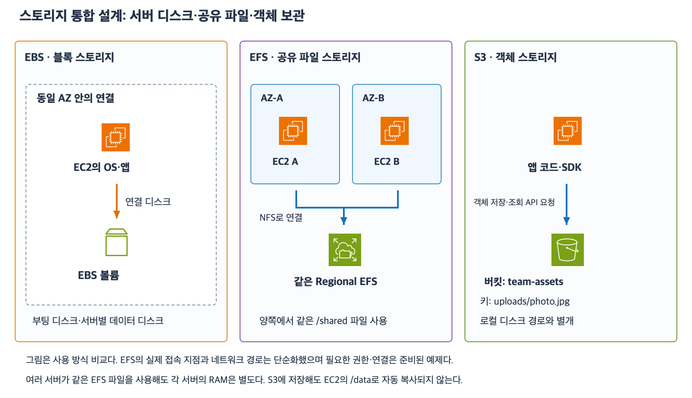
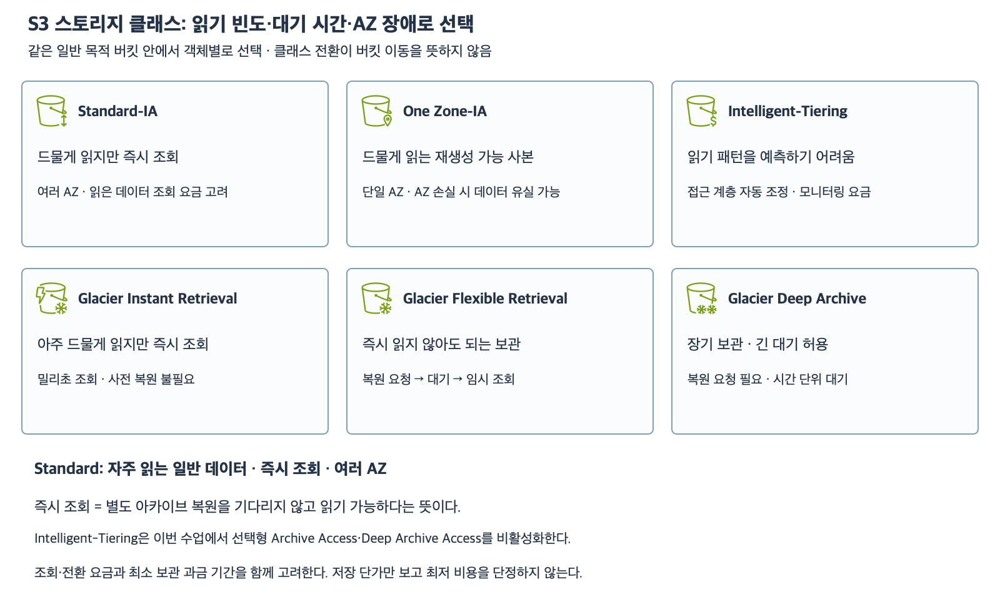

# 6주차 마지막 회상 복습

작성: 2026-11-05
예상 20~30분 · 최초·보완 평가 완료 · 6주차 완료 · 실제 AWS 변경 없음

## 1. 회상 목표와 자료

자료를 가리고 먼저 답한 뒤 헷갈린 부분만 이전 수업에서 확인한다.
직전 보완에서 확인한 ID 생략 삭제·red 복사 내용·영구 삭제 데이터 비복구를 다시 묻지 않는다.
이번에는 보존 설정과 백업·공유 저장소·최소 권한·접근 계층과 자동 정리의 범위를 설명한다.
새 서비스나 새 API는 시험하지 않는다.

그림은 앞선 수업의 학습용 구성도를 재사용했다.
EBS는 연결 블록 디스크이고 Regional EFS는 여러 AZ의 공유 파일 시스템이며 S3는 버킷·키 기반 객체 저장소다.
저장소 공유와 파일 접근 권한은 별개이고 S3 권한도 작업별로 판단한다.

클래스·접근 계층·수명주기 작업을 구분한다.
자세한 설명과 예제는 32~36번 자료를 참고한다.
답변 전 아래 문항의 정답·해설은 공개하지 않는다.

## 2. 조건

각 문항은 독립적이다.
S3는 일반 목적 버킷이고 버전 관리 Enabled는 첫 저장 전부터 계속 Enabled다.
제시하지 않은 백업·복제·추가 자동 정리·객체 잠금·휴지통 보존은 없다.
필요한 네트워크·마운트·파일 접근은 준비되어 있다.
IAM 문항은 같은 계정의 직접 API 요청이다.
2-2에서 명시한 Deny 외에 추가 정책 제한·암호화 키 제약은 없다.
정확한 요금·비동기 실행 시각·UTC 경계는 계산하지 않는다.

## 3. 회상 문제 — 전체 답변과 이유

### 1. 보존과 공유의 범위

1-1. EC2의 데이터 EBS는 DeleteOnTermination=false다.
사용자가 그 볼륨 안의 notes.txt를 실수로 삭제했다.
EC2와 볼륨은 아직 존재하며 삭제 전 스냅샷·다른 사본은 없다.
DeleteOnTermination=false라는 이유로 notes.txt가 자동 복구되는가?
이 설정이 보호하는 사건과 파일 복구에 필요한 준비를 구분하자.

1-2. AZ-A와 AZ-B의 Linux EC2가 같은 Regional EFS의 /shared를 사용한다.
AZ-A의 서버를 제거하고 새 서버 R을 만들었다.
R에도 같은 EFS를 마운트했고 권한·경로는 정상이다.
기존 EFS의 daily.csv를 읽기 위해 제거된 서버의 로컬 EBS에서 파일을 복사해야 하는가?
R에 자신의 루트 EBS만 연결하면 EFS 마운트 없이도 /shared/daily.csv가 자동으로 생기는가?

### 2. 최소 권한과 명시적 거부

2-1. UploaderRole은 버킷 team-recall-demo의 incoming/ 아래에 객체를 저장하는 작업만 허용해야 한다.
필요한 IAM Action과 객체 Resource ARN을 적자.
이 허용만으로 같은 객체를 GetObject로 읽는 권한도 생기는가?
파일 데이터는 사전 복원이 필요 없는 클래스다.

2-2. 별도의 ReaderRole은 다음 Allow가 있다.
Action=s3:GetObject
Resource=arn:aws:s3:::team-recall-demo/published/*
버킷 정책에는 ReaderRole의 published/secret.csv GetObject에만 적용되는 명시적 Deny가 있다.
published/secret.csv와 published/open.csv는 모두 존재하고 사전 복원이 필요 없다.
이 역할은 각각 어느 객체를 읽을 수 있는가?
공개 정책·공개 ACL 없이 해당 역할 권한으로 읽는데 Block Public Access를 켜 두었다는 이유만으로 이를 꺼야 하는가?

### 3. 자동 계층과 자동 삭제 구분

3-1. 버킷의 1 MiB 이상 객체들을 Intelligent-Tiering에 보관한다.
선택형 Archive Access·Deep Archive Access는 비활성화다.
접근 패턴에 따라 Frequent Access에서 Infrequent Access 또는 Archive Instant Access로 자동 이동했다.
이동 후 스토리지 클래스 이름이나 버킷이 바뀌는가?
Archive Instant Access라는 이름 때문에 사전 복원을 기다려야 하는가?

3-2. 버전 관리 Enabled 버킷 archive-recall-demo에서 reports/ 접두사 객체만 Standard에서 Standard-IA로 전환하는 수명주기 규칙이 있다.
다른 전환·현재 버전 만료·이전 버전 만료 규칙은 없다.
reports/annual.csv의 현재 데이터 버전은 전환 조건을 충족하고 전환도 완료했다.
원래 이전 데이터 버전들도 남아 있다.
이 작업으로 버킷·키가 바뀌는가?
전환 규칙만 설정했으므로 현재·이전 데이터가 자동으로 30일 후 삭제된다고 판단할 수 있는가?

답변 후 문항별 결론과 이유를 평가한다.
종합 확인의 최초 점수와 보완 이력은 유지한다.
회상 확인까지 마친 뒤 6주차 완료 여부와 다음 수업을 기록한다.
현재는 답변 대기이며 완료 주차는 5/32다.

## 참고 자료

확인: 2026-11-05

- [EFS 공유와 Regional 저장 범위](https://docs.aws.amazon.com/efs/latest/ug/whatisefs.html)
- [S3 Action·Resource·명시적 Deny](https://docs.aws.amazon.com/AmazonS3/latest/userguide/access-policy-language-overview.html)
- [S3 공개 접근 차단](https://docs.aws.amazon.com/AmazonS3/latest/userguide/access-control-block-public-access.html)
- [클래스와 접근 계층](https://docs.aws.amazon.com/AmazonS3/latest/userguide/storage-class-intro.html)
- [수명주기 필터와 작업](https://docs.aws.amazon.com/AmazonS3/latest/userguide/intro-lifecycle-rules.html)
- [6주차 첫 수업](32_S3_EBS_EFS_역할_비교.md)
- [이전 종합 확인과 보완](37_6주차_스토리지_종합_확인.md)

## 최초 회상 평가 — 2026-11-05

문항별 정답 1·부분 정답 2이며 하위 질문별 정답 4·부분 정답 2다.
1-1·2-1·3-1·3-2는 정답이다. 1-2·2-2는 결론은 맞지만 이유·용어를 보충해 부분 정답으로 기록한다.
1-1은 종료 시 EBS 보존과 파일 백업이 별개라는 설명 및 삭제 전 스냅샷 필요를 정확히 답했다. notest.txt는 notes.txt 철자 오타로 처리한다.
1-2는 같은 EFS 마운트 시 로컬 EBS 복사가 필요 없고 루트 EBS 연결만으로 EFS 파일이 생기지 않는다는 결론이 정확하다.
다만 Regional EFS가 여러 Region에 걸쳐 저장된다는 뜻으로 읽히는 표현은 교정한다. Regional은 한 AWS 리전 안의 여러 AZ에 데이터를 중복 저장하는 유형이다.
다른 리전 클라이언트에서 네트워크를 구성해 접근할 수 있는지와 EFS 자체가 여러 리전에 자동 복제되는지는 다른 문제다. 별도 교차 리전 구성은 이번 범위가 아니다.
2-1은 PutObject 선택·incoming/* 객체 ARN 및 GetObject 별도 필요가 정확하다. 실제 정책 Action 전체 표기는 s3:PutObject다.
2-2는 secret.csv 거부와 open.csv 허용 및 역할 접근을 위해 BPA를 끌 필요 없다는 결론이 정확하다.
BPA를 인터넷 접근을 가능하게 하는 기능이라고 표현한 부분은 반대다. BPA는 공개 권한을 차단·제한하는 기능이며 네트워크 인터넷 연결을 제공하거나 IAM Allow를 생성하지 않는다.
3-1은 기본 계층 이동 후 클래스·버킷 유지 및 Archive Instant Access 사전 복원 불필요가 정확하다.
이름만으로 모든 계층의 동작을 일반화하기보다 기본 즉시 조회 계층과 선택형 아카이브를 구분하면 된다.
3-2는 전환으로 버킷·키가 바뀌지 않으며 만료 규칙 없이 30일 자동 삭제를 단정할 수 없다는 설명이 정확하다.

### 보완 확인 — 4-1 완료

4-1. 아래 두 문장을 정확하게 완성하자.
A. Regional EFS는 여러 리전에 자동으로 중복 저장하는 유형이 아니라 ______ 안의 여러 ______에 중복 저장한다.
B. Block Public Access는 공개 접근을 허용하는 기능인가 차단·제한하는 기능인가?
같은 계정 역할에 명시적으로 허용된 비공개 객체를 읽으려면 이를 꼭 꺼야 하는가?

종합·회상의 최초 점수는 유지하고 보완 결과를 별도로 기록한다.
이 보완 답변 확인 후 6주차 완료 여부를 판단한다.

## 보완 확인과 6주차 완료 — 2026-11-05

4-1에서 사용자가 AZ라고 답해 다중 Region 표현을 AZ로 정정했다.
한 리전 안의 여러 AZ라는 전체 표현을 보충하며 의도한 저장 범위 구분을 확인했다.
BPA는 공개 접근 차단 기능이며 같은 계정 역할에 허용된 비공개 객체 접근을 위해 꼭 끌 필요 없다고 정확히 답했다.
보완 4-1을 정답으로 확인하고 최초 회상 점수는 유지한다.
추가 질문 없이 이번 보완을 마친다.

종합 확인 최초 정답 3·부분 정답 2 및 후속 복사 내용 정정과 회상·보완 확인을 근거로 6주차 스토리지를 완료했다.
완료 날짜는 2026-11-05이며 전체 완료 주차는 6/32다.
다음 요청 시 7주차 관계형 데이터베이스와 RDS 기초 자료를 공식 AWS 아이콘·예제·확인 문제로 먼저 준비한다.
7주차 자료와 실제 AWS 리소스는 아직 생성하지 않았다.
