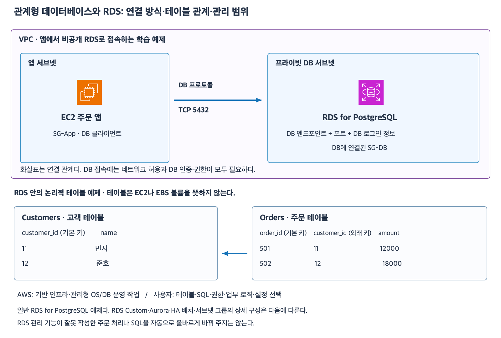

# 7주차 첫 수업: 관계형 데이터베이스와 RDS 기초

작성: 2026-11-05
예상 35~45분 · 확인 문제 3/3·하위 6/6 정답 확인 완료 · 실제 AWS 변경 없음

## 1. 파일 저장에서 데이터 관계 관리로

S3는 버킷과 키로 객체를 저장하고 EFS는 여러 서버가 같은 파일 시스템을 쓰도록 한다.
그 위에 어떤 업무 데이터를 어떻게 해석할지는 앱 설계에 달려 있다.
관계형 데이터베이스는 구조가 정해진 데이터를 테이블에 넣고 테이블 사이 관계·조회·변경을 관리한다.
고객·주문·주문 금액처럼 서로 연결되는 업무 데이터를 다루는 예제로 시작한다.
모든 업무에 관계형 DB가 최선이라는 뜻은 아니며 다른 데이터 모델과의 비교는 이후에 다룬다.

테이블은 같은 종류의 레코드를 모으는 표다.
행(Row)은 고객 한 명이나 주문 한 건 같은 기록이다.
열(Column)은 고객 번호·이름·주문 금액 같은 속성이다.
기본 키(Primary key)는 테이블 안에서 행을 구분하는 식별자다.
외래 키(Foreign key)는 다른 테이블의 키를 참조해 관계를 표현한다.
외래 키 제약을 설정하면 존재하지 않는 고객 번호를 주문에 넣는 등의 오류를 제한할 수 있다.
이번 예제는 외래 키 제약을 설정한 구조다.

| Customers.customer_id — 기본 키 | name |
|---|---|
| 11 | 민지 |
| 12 | 준호 |

다음 주문 테이블은 고객 번호로 위 고객 테이블을 참조한다.

| Orders.order_id — 기본 키 | customer_id — Customers 참조 | amount |
|---|---|---|
| 501 | 11 | 12000 |
| 502 | 12 | 18000 |

Orders의 customer_id=11을 Customers의 11과 연결하면 주문 501의 고객 이름이 민지라는 것을 알 수 있다.
주문 테이블에 고객 이름을 매번 복사해 넣지 않고 관계를 이용해 조회하는 예다.
Orders의 customer_id는 같은 고객이 여러 번 주문할 수 있으므로 중복될 수 있다.
기본 키와 외래 키가 항상 같은 열이거나 둘 다 고유해야 하는 것은 아니다.
테이블은 논리적인 데이터 구조이며 테이블마다 별도 EC2나 EBS를 만든다는 뜻이 아니다.

SQL은 DB에 조회·등록·수정·삭제를 요청하는 언어다.
JOIN은 키 관계를 이용해 여러 테이블의 데이터를 연결해서 조회하는 방식이다.
이번에는 SQL 문법 작성 대신 어떤 데이터를 연결하는지 설명한다.

## 2. 트랜잭션은 여러 변경을 한 묶음으로 다룬다

트랜잭션(Transaction)은 하나의 작업 단위로 묶은 DB 변경이다.
모두 확정하는 것을 COMMIT이라고 한다.
확정하지 않고 그 묶음의 변경을 취소하는 것을 ROLLBACK이라고 한다.

예를 들어 계좌 A에서 1000원을 빼고 계좌 B에 1000원을 더하는 두 변경이 있다.
둘을 같은 트랜잭션으로 묶으면 A에서만 빠지고 B에 들어가지 않는 부분 완료를 막도록 구성할 수 있다.
실패로 전체 트랜잭션을 롤백하면 묶음 안의 두 변경은 모두 확정되지 않는다.
앱이 어떤 변경을 한 트랜잭션에 포함할지 적절하게 구성해야 한다.
RDS를 선택했다는 이유로 서로 따로 확정한 SQL이 자동으로 하나의 업무 트랜잭션이 되지는 않는다.

이번 수업의 트랜잭션은 같은 PostgreSQL DB 안의 변경만 대상으로 한다.
외부 결제 API 호출·이메일 발송·S3 업로드까지 자동 취소된다고 가정하지 않는다.
격리 수준·동시성 충돌·분산 트랜잭션은 다음 심화 범위다.
질문에서 전체 ROLLBACK 완료라고 지정하면 그 트랜잭션 안의 변경은 반영되지 않은 상태로 판단한다.
COMMIT 후 과거 데이터로 복구하는 백업 기능과는 다른 개념이다.

## 3. RDS는 관계형 DB 운영을 맡기는 관리형 서비스다

DB 엔진은 실제로 테이블을 관리하고 SQL을 실행하는 DB 소프트웨어다.
PostgreSQL·MySQL 등이 예다.
Amazon RDS는 지원하는 관계형 DB 엔진을 관리형으로 제공한다.
이번 예제는 일반 Amazon RDS for PostgreSQL이며 RDS Custom·Aurora는 제외한다.

EC2에 PostgreSQL을 직접 설치하면 사용자가 게스트 OS와 DB 설치·패치·백업 운영을 직접 구성해야 한다.
RDS는 기반 인프라와 OS·DB 설치 및 패치·백업 실행 같은 공통 운영 작업을 서비스로 관리한다.
하지만 사용자가 테이블·SQL·DB 사용자 권한·접근 범위·업무 처리를 설계해야 한다.
엔진·용량·백업 보존 기간·유지 관리 정책 등 필요한 설정을 선택하고 검증하는 책임도 남는다.
기능을 제공한다는 것과 요구사항에 맞게 설정됐다는 것은 다르다.
패치 시점·백업·장애 전환·읽기 확장은 뒤 수업에서 구체적으로 다룬다.

| 할 일 | 일반 RDS에서의 구분 |
|---|---|
| 기반 서버·OS 및 관리형 DB 설치·패치 운영 | AWS의 관리형 기능 |
| 테이블 관계·SQL·인덱스·업무 트랜잭션 설계 | 사용자 |
| DB 로그인 계정과 읽기·쓰기 권한 설계 | 사용자 |
| SG·비공개 배치·백업 보존 설정 선택 | 사용자 |
| 기능 설정에 따른 백업 실행 등 공통 운영 | RDS가 수행 · 사용자는 설정·복구 요구 검증 |

RDS가 느린 SQL과 잘못된 데이터 모델을 자동으로 고쳐 준다고 판단하면 안 된다.
일반 RDS DB 인스턴스는 사용자가 자유롭게 OS에 접속해 앱을 설치하는 EC2 서버와 사용 방식이 다르다.
앱은 보통 별도 EC2 등에서 실행하고 DB 클라이언트로 RDS에 접속한다.
이번에는 자동 확장·무중단·모든 장애 복구가 기본 보장된다고 설명하지 않는다.

## 4. 앱이 RDS에 연결하는 방식

DB 엔드포인트는 DB 접속에 사용하는 DNS 이름이다.
앱은 엔드포인트·DB 포트·DB 로그인 정보 등을 사용해 접속한다.
엔드포인트 자체가 비밀번호나 접근 허용 권한은 아니다.
PostgreSQL 기본 포트는 TCP 5432이며 이번 예제에서도 5432를 쓴다.

같은 VPC의 EC2 주문 앱과 비공개 RDS를 예로 든다.
필요한 내부 경로·DNS·서브넷 배치는 준비되어 있다.
SG-App 아웃바운드에서 TCP 5432 대상 SG-DB를 허용한다.
SG-DB 인바운드에서 TCP 5432 출발지 SG-App을 허용한다.
이렇게 네트워크 연결을 허용해도 DB 로그인과 테이블 접근 권한이 자동 생성되지는 않는다.
앱이 사용하는 DB 계정에 필요한 테이블 읽기·쓰기 권한도 있어야 한다.
이번에는 일반 DB 사용자 이름·비밀번호 방식이며 IAM DB 인증은 제외한다.
IAM으로 RDS 인스턴스를 생성·변경할 수 있는 권한과 DB 테이블 데이터를 읽는 권한도 구분한다.

[확대 가능한 SVG](images/rds-relational-basics.svg)

AWS 공식 서비스 아이콘을 이용해 직접 작성한 학습용 구성도다.
상단은 앱과 DB 연결이고 하단은 DB 안의 논리적 테이블이다.
서브넷 그룹·HA와 실제 내부 저장 구조는 단순화했다.
그림은 Multi-AZ 설정이나 장애 전환을 보장한다는 의미가 아니다.

## 5. 확인 문제 — 전체 답변과 이유

이 수업에 설명한 개념만 사용한다.
SQL 문법 작성은 요구하지 않는다.
문항은 독립적인 상황이다.
실제 AWS 자원이나 DB를 생성하지 않는다.

### 1. 테이블과 관계

Customers 테이블은 기본 키 customer_id와 name을 가진다.
행은 21/수진과 22/태호다.
Orders 테이블은 기본 키 order_id와 외래 키 customer_id 및 amount를 가진다.
주문 701의 customer_id는 22이고 amount는 35000이다.
외래 키는 Customers.customer_id를 참조한다.

1-1. 주문 701의 고객 이름을 알려면 어떤 열을 기준으로 어느 테이블의 데이터를 연결해야 하는가?
고객 이름과 주문 금액을 적자.
1-2. 같은 고객 22가 주문 702도 만들면 Orders.customer_id=22가 두 번 나와도 되는가?
Orders.order_id가 두 행 모두 701이어도 되는지와 비교하자.

### 2. 트랜잭션과 앱 설계

처음 계좌 A는 10000원이고 B는 5000원이다.
A에서 2000원을 빼고 B에 2000원을 더하는 작업을 같은 트랜잭션으로 묶었다.

2-1. A를 줄인 뒤 두 번째 처리에 실패했고 전체 ROLLBACK이 완료됐다.
최종 A·B 잔액은 각각 얼마인가?
두 작업을 한 묶음으로 처리하려는 이유를 설명하자.
2-2. 별도 상황에서 앱이 A 차감을 먼저 COMMIT한 뒤 B 증가를 별도 작업으로 실행했다.
B 증가만 실패했다.
RDS를 사용한다는 이유로 먼저 확정한 A 차감이 자동으로 취소되는가?
앱에서 어떤 작업 범위 설계를 확인해야 하는가?

### 3. RDS 관리 범위와 DB 접근

일반 RDS for PostgreSQL과 EC2 앱을 사용한다.
RDS Custom·IAM DB 인증은 없다.

3-1. RDS로 바꿨으므로 고객·주문 테이블 설계와 느린 SQL 수정 및 DB 사용자 권한 설정도 AWS가 대신 결정한다고 볼 수 있는가?
AWS가 맡는 공통 운영 작업과 사용자가 해야 할 일을 구분하자.
3-2. 내부 경로·DNS는 정상이고 SG-App 아웃바운드 및 SG-DB 인바운드 TCP 5432도 허용되어 있다.
그러나 앱 DB 계정의 Orders 테이블 읽기 권한은 없다.
SG가 허용됐으므로 Orders 조회도 자동 허용되는가?
어떤 권한 계층을 추가로 확인해야 하는가?

답변 전 확인 문제의 정답·해설은 공개하지 않는다.
답변 후 평가와 진도를 기록한다.
이번 수업 제공만으로 7주차를 완료 처리하지 않는다.

## 공식 참고 자료

확인: 2026-11-05

- [관계형 테이블·키·SQL](https://aws.amazon.com/rds/what-is-a-relational-database/)
- [PostgreSQL 트랜잭션 공식 설명](https://www.postgresql.org/docs/current/tutorial-transactions.html)
- [RDS 역할과 관리 책임](https://docs.aws.amazon.com/AmazonRDS/latest/UserGuide/Welcome.html)
- [RDS 네트워크·IAM·DB 사용자 접근 구분](https://docs.aws.amazon.com/AmazonRDS/latest/UserGuide/UsingWithRDS.html)
- [AWS 공식 아키텍처 아이콘](https://aws.amazon.com/architecture/icons/)
- [직전 6주차 회상](38_6주차_회상_복습.md)

## 답변 평가와 IAM 질문 보충 — 2026-11-05

3문항 모두 정답이며 하위 6문항도 모두 정답이다.
1-1은 두 customer_id 연결과 태호·35000이 정확하다.
1-2는 외래 키 customer_id 반복과 기본 키 order_id 고유성을 정확히 구분했다. custom_id는 customer_id 철자 오타로 처리한다.
2-1은 전체 롤백 후 A=10000·B=5000 및 부분 완료 방지 이유가 정확하다.
2-2는 먼저 COMMIT한 A 차감이 자동 취소되지 않고 앱의 트랜잭션 범위를 확인해야 한다는 답이 정확하다.
3-1은 테이블·SQL·DB 사용자 권한은 사용자 책임이고 OS·엔진 운영·백업 실행 등은 관리형 기능이라는 구분이 정확하다.
3-2는 앱 DB 계정에 Orders 읽기 권한이 필요하고 SG는 테이블 조회 권한과 별개라는 답이 정확하다.
마지막 '한다면 IAM?'은 추가 질문이며 IAM이 조회 권한을 자동 부여한다고 단정한 오답으로 처리하지 않는다.

| 구분 | 이 예제에서 제어하는 것 |
|---|---|
| AWS IAM 정책 | RDS 인스턴스 생성·변경 등 AWS 리소스 관리 작업 |
| 보안 그룹 | DB 포트로 네트워크 연결 허용 |
| PostgreSQL DB 계정·권한 | DB 로그인 및 Orders 같은 테이블 읽기·쓰기 권한 |

이번 문제는 일반 DB 계정 로그인 방식이므로 Orders 읽기는 DB 안에서 앱 DB 계정에 SELECT 권한을 부여하는 문제다.
읽을 객체가 속한 스키마 접근 등 DB 안의 필요한 권한도 함께 확인한다.
AWS IAM에서 RDS 인스턴스 관리 권한을 줬다는 이유로 앱 DB 계정의 테이블 읽기가 자동 허용되지는 않는다.

별도 기능인 IAM DB 인증은 IAM 기반 토큰을 사용해 DB에 로그인할 수 있도록 하는 방식이다.
이 기능을 사용하더라도 테이블에서 할 수 있는 작업은 DB 안의 권한을 별도로 확인한다.
IAM DB 인증의 설정과 토큰 사용은 이번 확인 문제 범위가 아니며 추가 암기 문제를 내지 않는다.
보완 질문 없이 이번 수업을 마친다.
다음 요청 시 RDS Multi-AZ와 읽기 복제본 기초를 공식 아이콘·예제로 먼저 준비한다.
실제 배포 유형별 차이를 명시하고 전통적 Multi-AZ DB 인스턴스 대기본과 읽기 가능한 구성들을 혼동하지 않도록 한다.
7주차는 진행 중이며 완료 주차는 6/32다.

- [RDS 관리·SG·DB 접근 구분](https://docs.aws.amazon.com/AmazonRDS/latest/UserGuide/UsingWithRDS.html)
- [IAM DB 인증 개요](https://docs.aws.amazon.com/AmazonRDS/latest/UserGuide/UsingWithRDS.IAMDBAuth.html)
