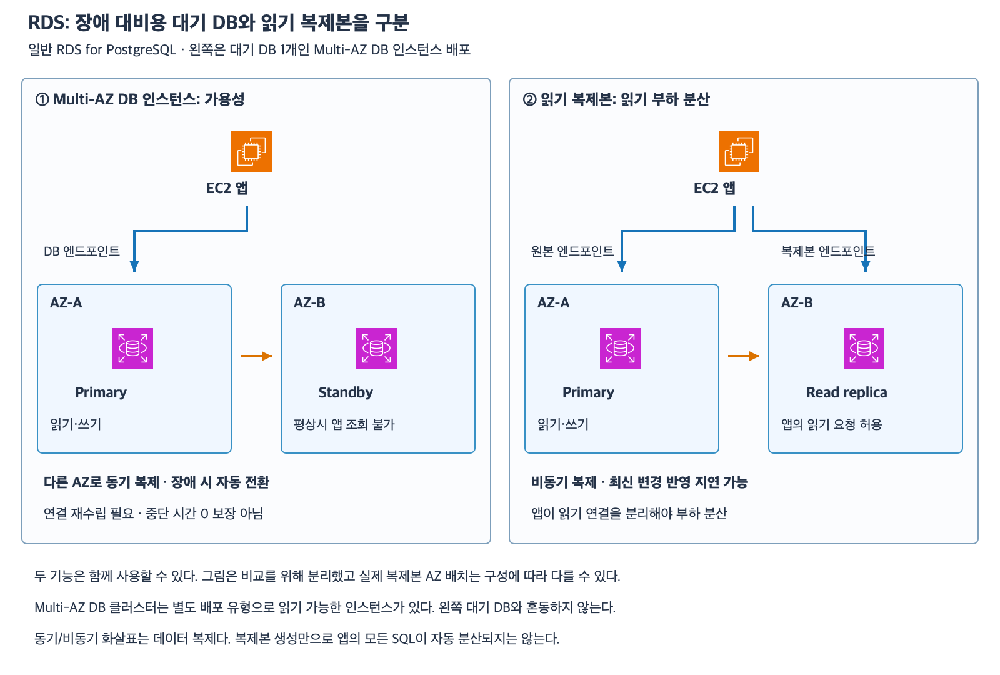

# 7주차 두 번째 수업: RDS Multi-AZ와 읽기 복제본

작성: 2026-11-05
예상 35~45분 · 3/3·하위 6/6 정답 확인 완료 · 실제 AWS 변경 없음

## 1. 두 가지 다른 요구

DB 장애 후 서비스를 계속하려는 요구와 읽기 요청 증가를 처리하려는 요구는 다르다.
가용성은 장애가 있어도 서비스를 제공할 수 있는 성질이다.
읽기 확장은 조회 부하를 여러 처리 자원으로 나누는 것이다.
이름에 복제본이 들어간다고 모두 같은 일을 하는 것은 아니다.

이번 예제는 일반 RDS for PostgreSQL이다.
Multi-AZ는 Primary 1개와 다른 AZ의 Standby 1개인 Multi-AZ DB 인스턴스 배포를 뜻한다.
별도 배포 유형인 Multi-AZ DB 클러스터는 읽기 가능한 인스턴스가 있으므로 모든 Multi-AZ 대기 노드는 조회 불가라고 일반화하지 않는다.
Aurora·RDS Custom·Multi-AZ DB 클러스터 상세는 이번 확인 문제에서 제외한다.

## 2. Multi-AZ DB 인스턴스 배포

Primary는 평상시 앱이 읽고 쓰는 주 DB다.
Standby는 다른 AZ에 두는 장애 대비 대기 DB다.
데이터 변경을 동기 복제한다.
동기 복제는 변경을 확정하는 과정에 다른 쪽 반영을 함께 맞추는 방식이라고 이해하자.
네트워크 지연이나 DB 처리 시간이 없어지는 뜻은 아니다.

이번 배포 유형의 Standby는 평상시 앱의 읽기 요청을 처리하지 않는다.
따라서 읽기 요청이 많다고 Standby에 SELECT를 보내는 방식은 맞지 않는다.
Primary DB·호스트·AZ 등에 문제가 생겨 RDS의 장애 전환 조건을 충족하면 다른 AZ의 Standby가 새 Primary 역할을 맡도록 자동 전환한다.
이런 역할 전환을 Failover라고 한다.
동일 리전의 다른 AZ 장애 대비이며 여러 리전 전체 재해 대응을 자동 구성한다는 뜻은 아니다.

앱은 DB 엔드포인트의 DNS 이름을 사용한다.
장애 전환 시 그 이름이 가리키는 대상이 새 Primary로 바뀐다.
일반적인 장애 전환 때문에 앱 설정의 엔드포인트 이름을 새 이름으로 직접 교체하는 방식은 아니다.
다만 기존 연결은 끊길 수 있어 앱이 DNS를 새로 확인하고 연결을 재수립하도록 구성해야 한다.
실패한 요청 재시도도 업무의 중복 처리 여부를 고려해야 한다.
자동 전환이므로 중단 시간이 0초이고 모든 진행 중 요청이 자동 성공한다는 뜻은 아니다.
  이번에는 초 단위 장애 전환 시간이나 재시도 구현을 시험하지 않는다.

## 3. 읽기 복제본

읽기 복제본(Read replica)은 조회 부하를 나눌 수 있는 읽기용 복사본이다.
이번 RDS for PostgreSQL DB 인스턴스 읽기 복제본은 원본 변경을 비동기 복제한다.
비동기는 원본에서 확정한 변경을 복제본이 뒤따라 적용하는 방식이다.
그 사이 차이를 복제 지연(Replica lag)이라고 한다.
복제본에서 방금 쓴 데이터가 아직 보이지 않을 수 있다.

앱은 읽기 복제본의 별도 엔드포인트로 조회 연결을 보낸다.
복제본을 생성했어도 앱이 계속 원본 엔드포인트만 사용하면 조회 부하가 저절로 분산되지 않는다.
앱이나 적절한 연결 계층에서 읽기 대상 선택을 구성해야 한다.
이번 예제에는 자동 라우팅 프록시가 없으며 ALB가 DB SQL의 읽기·쓰기를 분리해 주는 것으로 가정하지 않는다.

쓰기와 즉시 최신 결과 확인이 필요한 읽기는 원본을 대상으로 판단한다.
지연을 허용할 수 있는 통계·보고서 조회는 복제본으로 옮기는 후보가 된다.
원본 읽기가 다른 동시 변경까지 모두 통제해 준다는 뜻은 아니며 이번 문제는 복제 지연만 다룬다.
쓰기 요청을 그대로 읽기 전용 복제본으로 보내는 것은 맞지 않는다.

읽기 복제본을 만들었다는 사실만으로 원본 장애 시 Multi-AZ Standby처럼 자동 쓰기 전환까지 설정된 것은 아니다.
읽기 복제본을 독립적인 쓰기 DB로 승격하는 기능은 별도 작업이며 상세는 이후 범위다.
이 역할 구분을 모든 엔진·모든 배포 유형에 그대로 일반화하지 않는다.

[확대 가능한 SVG](images/rds-multiaz-read-replica.svg)

AWS 공식 서비스 아이콘으로 직접 작성한 학습용 구성도다.
왼쪽은 하나의 Multi-AZ DB 인스턴스 배포 안의 Primary와 Standby다.
오른쪽은 원본 DB 인스턴스와 별도 읽기 복제본이다.
그림은 기능 비교이며 필요한 VPC·서브넷·SG·DB 권한은 준비되어 있다.
복제본의 AZ 위치는 예시이며 모든 읽기 복제본이 반드시 다른 AZ여야 한다는 뜻은 아니다.

## 4. 함께 사용할 수 있지만 백업 역할은 따로 본다

장애 대비와 읽기 확장이 모두 필요하면 Multi-AZ DB 인스턴스 배포에 별도 읽기 복제본을 함께 구성할 수 있다.
둘 중 하나만 반드시 선택하는 관계는 아니다.
원본의 Standby와 앱 조회용 복제본은 목적이 다르다.

| 구분 | Multi-AZ DB 인스턴스 Standby | 이번 읽기 복제본 |
|---|---|---|
| 주 목적 | 장애 대비·가용성 | 읽기 부하 분산 |
| 복제 | 동기 | 비동기 |
| 평상시 앱 조회 | 불가 | 가능 |
| 최신 변경 반영 | 동기 복제 대상 | 복제 지연 가능 |
| 원본 장애 시 쓰기 역할 | RDS의 자동 장애 전환 대상 | 생성만으로 자동 쓰기 전환 구성 아님 |
| 앱 연결 | DB 엔드포인트·장애 후 재연결 고려 | 별도 읽기 엔드포인트로 분리 |

복제는 정상 변경뿐 아니라 잘못된 삭제도 전달할 수 있다.
예를 들어 사용자가 주문 행을 잘못 삭제하고 COMMIT했고 그 변경이 Standby에 반영됐다면 장애 전환만으로 이전 행이 돌아오지 않는다.
고가용성 복제는 과거 시점으로 되돌리는 백업과 다르다.
백업 보존과 시점 복원은 다음 수업에서 다룬다.
이번에는 복원 절차·복구 시점 수치·백업 생성 정책을 새로 외우도록 요구하지 않는다.

## 5. 확인 문제 — 전체 답변과 이유

일반 RDS for PostgreSQL이며 Multi-AZ는 대기 DB 1개인 DB 인스턴스 배포다.
Aurora·Multi-AZ DB 클러스터·프록시·교차 리전 구성은 없다.
필요한 연결·권한·DNS는 준비되어 있다.
문항은 독립적이다.

### 1. 장애 대비와 대기 DB

Primary P는 AZ-A, Standby S는 AZ-B에 있다.

1-1. 읽기 부하가 커졌으니 평상시에 S로 SELECT 요청을 보내려 한다.
이 배포에서 가능한가?
S의 주 역할과 읽기 확장을 위해 검토할 별도 기능을 설명하자.

1-2. P 장애가 RDS의 전환 조건에 해당해 S로 자동 전환됐다.
앱이 설정한 DB 엔드포인트 이름을 반드시 새 이름으로 바꿔야 하는가?
이름이 유지된다는 이유로 기존 연결도 끊김 없이 유지되고 모든 요청이 성공한다고 볼 수 있는가?

### 2. 읽기 복제본과 최신 결과

원본 P와 비동기 읽기 복제본 R이 있다.
앱에서 주문 등록을 P에 COMMIT했지만 R에는 아직 그 주문이 반영되지 않았다.

2-1. 등록 직후 같은 주문을 R에서 읽었더니 보이지 않았다.
곧바로 원본의 COMMIT이 실패했다고 단정할 수 있는가?
최신 등록 결과를 즉시 확인하려는 읽기는 어느 쪽을 우선 대상으로 잡아야 하는가?

2-2. R을 추가했지만 앱의 모든 조회는 여전히 P 엔드포인트로 연결된다.
복제본 생성만으로 조회 부하가 R로 자동 분산되는가?
앱의 조회 연결과 쓰기 연결을 어떻게 구분해야 하는가?

### 3. 기능 조합과 과거 데이터

3-1. 주문 서비스에 AZ 장애 대비와 지연을 허용할 수 있는 보고서 조회 확장이 모두 필요하다.
Multi-AZ DB 인스턴스 배포와 별도 읽기 복제본 중 반드시 하나만 선택해야 하는가?
함께 쓴다면 Primary·Standby·읽기 복제본의 역할을 나눠 설명하자.

3-2. 별도 상황으로 사용자가 주문 행을 잘못 삭제하고 COMMIT했다.
그 삭제는 Standby에도 이미 반영됐다.
Standby로 장애 전환하면 삭제 전 주문 행이 자동 복구되는가?
고가용성 복제와 어떤 별도 보호 목적을 구분해야 하는가?

답변 전 확인 문제 정답·해설은 공개하지 않는다.
답변 후 평가와 진도를 기록한다.
7주차는 진행 중이며 완료 주차는 6/32다.

## 공식 참고 자료

확인: 2026-11-05

- [Multi-AZ DB 인스턴스와 Standby 조회 제한](https://docs.aws.amazon.com/AmazonRDS/latest/UserGuide/Concepts.MultiAZSingleStandby.html)
- [자동 장애 전환과 DNS·기존 연결 재수립](https://docs.aws.amazon.com/AmazonRDS/latest/UserGuide/Concepts.MultiAZ.Failover.html)
- [읽기 복제본·비동기 복제·Multi-AZ 조합](https://docs.aws.amazon.com/AmazonRDS/latest/UserGuide/USER_ReadRepl.html)
- [별도 Multi-AZ DB 클러스터 유형](https://docs.aws.amazon.com/AmazonRDS/latest/UserGuide/multi-az-db-clusters-concepts.html)
- [AWS 공식 아키텍처 아이콘](https://aws.amazon.com/architecture/icons/)
- [이전 수업](39_관계형_데이터베이스와_RDS_기초.md)

## 답변 평가 — 2026-11-05

3문항 모두 정답이며 하위 6문항도 모두 정답이다.
1-1은 이번 Standby의 조회 불가·장애 대비 역할과 별도 읽기 복제본 필요를 정확히 구분했다.
1-2는 엔드포인트 이름 유지와 기존 연결 재수립·일시 실패 가능성을 정확히 설명했다.
2-1은 COMMIT 실패와 비동기 복제 지연을 구분하고 즉시 최신 결과 확인은 원본 P에서 읽는다고 답했다.
2-2는 별도 조회 엔드포인트를 지정하고 쓰기·조회 연결을 나누어야 한다고 정확히 답했다.
3-1은 Multi-AZ Primary/Standby와 지연 허용 보고서용 읽기 복제본을 함께 구성한다고 설명했다.
3-2는 이미 반영된 삭제가 장애 전환으로 취소되지 않으며 고가용성 복제와 백업 목적을 구분해야 한다고 답했다.
삭제가 Standby에 이미 반영됐다는 조건이 핵심이며 동기 복제 자체가 복구 불가의 유일한 원인이라는 뜻으로 해석하지 않는다.
별도 보완 질문 없이 이번 수업을 마친다.
다음 요청 시 RDS 자동 백업·수동 스냅샷·시점 복원과 복구 후 연결을 공식 아이콘·예제로 먼저 준비한다.
다음 자료는 아직 작성하지 않았으며 실제 AWS 변경은 없다.
7주차는 진행 중이고 완료 주차는 6/32다.
