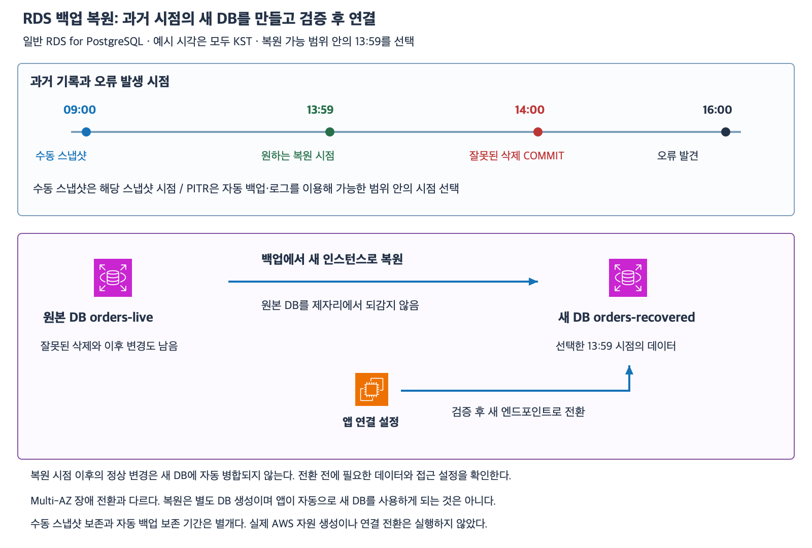

# 7주차 세 번째 수업: RDS 백업·스냅샷·시점 복원

작성: 2026-11-05
예상 35~45분 · 3/3·하위 6/6 정답 확인 완료 · 실제 AWS 변경 없음

## 1. 장애 전환과 과거 복원은 다르다

Multi-AZ는 장애 때 다른 DB가 역할을 이어받는 기능이다.
잘못된 삭제가 복제됐다면 장애 전환만으로 이전 데이터가 돌아오지 않는다.
백업 복원은 남아 있는 과거 기록에서 데이터를 되찾는 기능이다.
이번에는 일반 RDS for PostgreSQL DB 인스턴스의 자동 백업·수동 스냅샷과 복원만 다룬다.
Aurora·Multi-AZ DB 클러스터·RDS Custom·교차 리전·AWS Backup 별도 정책은 제외한다.

## 2. 자동 백업과 수동 스냅샷

자동 백업은 설정에 따라 RDS가 관리하는 DB 백업이다.
DB 스냅샷과 트랜잭션 로그를 이용해 보존된 범위 안에서 시점 복원을 지원한다.
보존 기간(Retention period)은 자동 백업 기록을 유지하는 기간이다.
이번 일반 DB 인스턴스는 0~35일로 설정할 수 있고 0은 자동 백업 비활성화다.
기본값을 추정하지 않고 문제에서 명시한 값을 사용한다.

수동 DB 스냅샷은 사용자가 요청한 시점의 DB 인스턴스 백업이다.
배포나 대량 변경 전 상태를 별도로 남기는 예가 있다.
자동 백업 보존 기간이 지나도 수동 스냅샷은 그 기간 때문에 자동 만료되지 않는다.
사용자가 삭제하지 않는 등 남아 있는 스냅샷을 대상으로 복원할 수 있다.
수동 스냅샷 하나만으로 그 이후 임의 시점까지 되돌릴 수 있는 것은 아니다.
둘 다 백업 저장 비용 등 운영 관리가 필요하며 이번에는 금액을 계산하지 않는다.

| 구분 | 자동 백업 | 수동 DB 스냅샷 |
|---|---|---|
| 생성 | 설정에 따라 RDS가 수행 | 사용자가 요청 |
| 보존 | 설정한 자동 백업 보존 기간 | 자동 백업 보존 기간에 의해 만료되지 않음 |
| 복원 선택 | 보존된 로그 등으로 가능한 시점 범위 | 해당 스냅샷 상태 |
| 이번 활용 | 실수 직전 시점으로 복원 | 변경 전 상태를 별도로 보관 |

DB 인스턴스 백업은 한 테이블만 복사하는 내보내기와 다르다.
백업 기능이 있다는 것과 필요한 시점의 백업이 실제 남아 있다는 것은 다르다.
나중에 보존 기간을 늘리거나 자동 백업을 켜도 이미 사라진 과거 기록이 되살아나지는 않는다.

## 3. 시점 복원 PITR

PITR은 Point-in-time recovery로 원하는 과거 시점의 DB 상태를 복원하는 기능이다.
자동 백업과 기록된 트랜잭션 로그를 이용한다.
선택할 시점은 가장 이른 복원 가능 시각과 최신 복원 가능 시각 사이에 있어야 한다.
최신 복원 가능 시각은 현재 시각과 항상 같지는 않다.
RDS가 표시하는 EarliestRestorableTime·LatestRestorableTime 등 실제 복원 가능 범위를 확인한다.
정확한 필드명 암기는 요구하지 않는다.

예를 들어 수동 스냅샷은 09:00이고 잘못된 삭제가 14:00에 COMMIT됐다.
13:59가 복원 가능 범위에 있다면 삭제 직전 상태를 원하는 경우 그 시점을 PITR 대상으로 검토한다.
09:00 스냅샷만 복원하면 09:00 이후 정상 변경도 포함되지 않는다.
삭제가 이미 반영된 14:00 이후를 골라 놓고 잘못 삭제한 데이터가 돌아온다고 기대하면 안 된다.
시점별 데이터 포함 여부는 문제가 명시한 COMMIT 시각을 기준으로 단순화해 판단한다.

## 4. 복원하면 새 DB 인스턴스가 생긴다

일반 RDS DB 인스턴스의 스냅샷 복원과 PITR은 새 DB 인스턴스를 만든다.
원본 DB를 제자리에서 과거로 되감는 작업이 아니다.
새 DB에는 별도 식별자와 엔드포인트가 생기며 원본은 복원 작업 자체로 수정되지 않는다.
원본을 유지할지 나중에 삭제할지는 별도 운영 결정이다.

앱이 기존 엔드포인트만 사용하면 새 복원 DB를 자동으로 사용하지 않는다.
복원 DB의 데이터·접속 정보·네트워크와 SG·DB 사용자 권한 및 필요한 설정을 확인하고 연결 대상을 전환해야 한다.
새 DB의 설정이 요구사항대로 모두 복사됐다고 가정하지 않는다.
Multi-AZ 자동 장애 전환에서 기존 DB 엔드포인트 이름의 대상이 바뀌는 경우와 구분한다.

복원 시점 이후 원본에 쌓인 정상 주문이 새 DB에 자동 합쳐지지는 않는다.
서비스 전체를 과거 상태의 DB로 전환하면 그 시점 이후 정상 변경도 새 DB에는 없을 수 있다.
일부 행만 되찾으려면 새 복원 DB에서 필요한 데이터를 확인하고 현재 DB와 합치는 별도 절차를 검토한다.
이번에는 SQL 추출·병합 구현이나 동시 쓰기 조정 절차를 시험하지 않는다.
복원 소요 시간이 0이거나 복원 직후 모든 성능이 즉시 원래 수준이라고 보장하지 않는다.

[확대 가능한 SVG](images/rds-backup-point-in-time.svg)

AWS 공식 서비스 아이콘을 사용해 직접 작성한 학습 그림이다.
시각은 설명용이며 모두 같은 KST 날짜다.
그림의 새 DB는 원본과 별개이고 앱 연결 전환도 별도 단계다.
실제 RDS 인스턴스나 스냅샷·연결은 생성·변경하지 않았다.

## 5. DB 삭제 후 남는 백업

DB 인스턴스를 삭제할 때 자동 백업을 유지할지 선택할 수 있다.
자동 백업 유지 선택 여부와 남은 보존 기간을 확인해야 한다.
DB를 삭제했다는 이유로 자동 백업이 항상 남거나 항상 사라진다고 일반화하지 않는다.

기존 수동 스냅샷과 선택해 생성한 최종 스냅샷은 자동 백업과 별개다.
수동 스냅샷은 원본 DB 인스턴스를 삭제해도 남는다.
최종 스냅샷은 DB 삭제 전에 최종 상태를 남기도록 선택하는 스냅샷이다.
삭제 전에 이미 잘못된 상태였다면 최종 스냅샷이 자동으로 오류 이전 상태를 기록하는 것은 아니다.
수동 스냅샷까지 별도 삭제하거나 다른 관리 규칙을 적용한 경우는 별도 판단한다.

## 6. 확인 문제 — 전체 답변과 이유

일반 RDS for PostgreSQL DB 인스턴스다.
실제 백업·로그는 정상이고 문제에서 지정한 복원 가능 범위를 그대로 사용한다.
필요한 권한·연결은 준비되어 있다.
문항은 독립적이며 시각은 모두 같은 날 KST다.
질문에 없는 별도 백업·추가 보존 정책·자동 데이터 병합은 없다.
정확한 복원 실행 시간·비용·필드 이름은 암기하지 않아도 된다.

### 1. 복원 시점 선택

자동 백업 보존 기간은 7일이고 수동 스냅샷은 08:00 상태다.
09:00에 정상 주문 A가 COMMIT됐다.
10:30에 잘못된 삭제가 COMMIT됐다.
현재는 12:00이고 최신 복원 가능 시각은 11:55다.
10:29는 가장 이른 복원 가능 시각보다 나중이며 전체 복원 가능 범위 안에 있다.

1-1. 정상 주문 A를 포함하고 잘못된 삭제 직전으로 되돌리려 한다.
08:00 수동 스냅샷 복원과 10:29 PITR 중 무엇이 목적에 맞는가?
다른 선택에서는 주문 A가 포함되는가?
1-2. 현재가 12:00이니 바로 12:00을 PITR 대상으로 고를 수 있는가?
현재 시각과 최신 복원 가능 시각을 구분해 설명하자.

### 2. 복원 대상과 앱 연결

원본 DB는 shop-live다.
14:00 상태로 PITR해 새 DB shop-recovered를 만들었다.
원본에는 15:00에 정상 주문 B가 COMMIT됐다.
필요한 새 DB 접근 설정도 정상이라고 확인했다.

2-1. PITR이 완료됐으므로 shop-live도 14:00 상태로 바뀌었는가?
새 shop-recovered에 15:00 주문 B가 자동 포함되거나 병합되는가?
2-2. 앱이 계속 shop-live 엔드포인트를 사용하고 있다.
새 DB 복원 완료만으로 앱이 shop-recovered를 사용하게 되는가?
전환하려면 무엇을 확인하고 변경해야 하는가?
Multi-AZ 자동 장애 전환의 엔드포인트 동작과 비교하자.

### 3. 보존과 삭제

3-1. 자동 백업 보존 기간은 7일이다.
정상적으로 사용 가능한 수동 스냅샷 before-change는 20일 전에 생성했고 삭제하지 않았다.
자동 백업 보존 기간이 지났다는 이유만으로 이 수동 스냅샷도 자동 만료됐다고 판단할 수 있는가?
두 보존 방식을 구분하자.

3-2. 별도 DB를 삭제하면서 자동 백업 유지는 선택하지 않았다.
기존 수동 스냅샷 saved-manual은 별도로 삭제하지 않았고 추가 삭제 정책도 없다.
삭제 시 최종 스냅샷은 만들지 않았다.
자동 백업과 saved-manual은 각각 남는가?
saved-manual에서 복원하면 삭제된 옛 DB 인스턴스가 다시 시작되는가 아니면 새 DB 인스턴스가 생기는가?

답변 전 확인 문제 정답·해설은 공개하지 않는다.
답변 후 평가와 진도를 기록한다.
7주차는 진행 중이며 완료 주차는 6/32다.

## 공식 참고 자료

확인: 2026-11-05

- [자동 백업·수동 스냅샷 및 DB 삭제 후 보존](https://docs.aws.amazon.com/AmazonRDS/latest/UserGuide/USER_WorkingWithAutomatedBackups.html)
- [자동 백업 보존 기간](https://docs.aws.amazon.com/AmazonRDS/latest/UserGuide/USER_WorkingWithAutomatedBackups.BackupRetention.html)
- [수동 스냅샷 보존](https://docs.aws.amazon.com/AmazonRDS/latest/UserGuide/USER_CreateSnapshot.html)
- [시점 복원·새 DB·최신 복원 가능 시각](https://docs.aws.amazon.com/AmazonRDS/latest/UserGuide/USER_PIT.html)
- [스냅샷 복원은 새 인스턴스 생성](https://docs.aws.amazon.com/AmazonRDS/latest/UserGuide/USER_RestoreFromSnapshot.html)
- [AWS 공식 아키텍처 아이콘](https://aws.amazon.com/architecture/icons/)
- [이전 수업](40_RDS_MultiAZ와_읽기_복제본.md)

## 답변 평가 — 2026-11-05

3문항 모두 정답이며 하위 6문항도 모두 정답이다.
1-1은 10:29 PITR 선택과 08:00 스냅샷에 09:00 COMMIT 주문 A가 포함되지 않는 이유가 정확하다.
사용자의 'A COMMIT이 없어짐'은 스냅샷 복원본에 없다는 뜻으로 읽는다. 원본에서 주문 A가 지워진다는 주장으로 해석하지 않는다.
1-2는 최신 복원 가능 시각이 11:55라 현재 12:00을 선택할 수 없다는 판단이 정확하다. 필드 정식 철자는 LatestRestorableTime이며 철자 암기는 평가하지 않는다.
2-1은 원본 비수정과 이후 정상 주문 B가 새 DB에 자동 포함·병합되지 않음을 정확히 답했다.
2-2는 새 복원 DB를 쓰려면 앱의 DB 접속 대상 엔드포인트를 변경해야 한다는 핵심이 정확하다.
전환 전 복원 데이터와 SG·DB 로그인·권한 등 필요한 접속 설정을 확인한다고 설명 보충한다. 추가 보완 문제는 내지 않는다.
3-1은 수동 스냅샷에 자동 백업 보존 기간이 적용되지 않는다는 구분이 정확하다.
3-2는 자동 백업 비유지 시 삭제 및 수동 스냅샷 보존·복원 시 새 DB 인스턴스 생성까지 정확하다.
별도 보완 없이 이번 수업을 마친다.
다음 요청 시 Aurora 기본 구조·Writer/Reader·공유 클러스터 스토리지를 RDS 배포 유형과 구분해 공식 아이콘·예제로 먼저 준비한다.
다음 자료는 아직 작성하지 않았다. 7주차는 진행 중이며 완료 주차는 6/32다.
