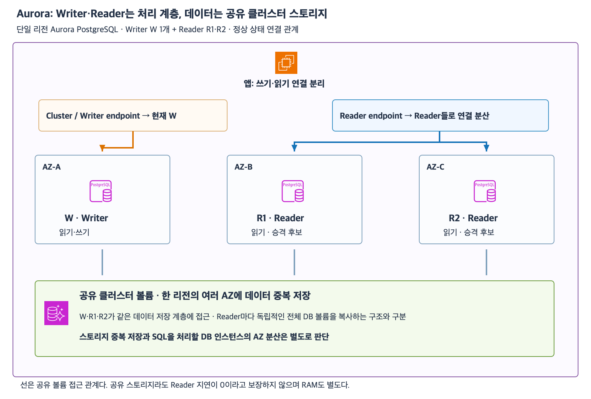

# 7주차 네 번째 수업: Aurora Writer·Reader·공유 스토리지

작성: 2026-11-05
예상 35~45분 · 3문항·하위 6문항 답변 대기 · 실제 AWS 변경 없음

## 1. Aurora와 이번 수업의 범위

Amazon Aurora는 MySQL 또는 PostgreSQL과 호환되는 관리형 관계형 DB 엔진이다.
이번에는 단일 리전의 일반 Aurora PostgreSQL 클러스터를 다룬다.
Writer W 1개와 Reader R1·R2가 있고 각 DB 인스턴스는 서로 다른 AZ에 있다고 가정한다.
Aurora Global Database·Serverless·Limitless·DSQL·쓰기 전달·프록시 등은 이번 범위가 아니다.
일반 RDS for PostgreSQL과 Aurora PostgreSQL을 같은 배포 구조라고 생각하지 않는다.

클러스터는 관련 DB 인스턴스와 데이터 저장 계층을 함께 관리하는 단위다.
Aurora에서는 SQL을 처리하는 컴퓨팅 계층과 데이터를 보관하는 스토리지 계층을 분리해 이해한다.
DB 인스턴스가 하나만 있어도 공유 클러스터 볼륨을 가진 Aurora 클러스터일 수 있다.
클러스터라는 이름만 보고 Reader가 이미 여러 개 있다고 추정하지 않는다.

## 2. Writer와 Reader가 같은 스토리지를 사용한다

Writer는 현재 쓰기를 수행하는 주 DB 인스턴스다.
읽기도 처리할 수 있다.
이번 클러스터에는 Writer가 하나다.
Reader는 Aurora Replica라고도 하며 평상시 읽기를 처리한다.
Writer 장애 때 Reader가 새 Writer로 승격되는 후보가 될 수도 있다.

클러스터 볼륨은 DB 데이터를 보관하는 공유 저장 계층이다.
같은 클러스터의 Writer와 Reader는 이 볼륨을 함께 사용한다.
Reader마다 독립적인 전체 데이터 볼륨을 만들어 원본에서 데이터를 복사하는 일반 RDS DB 인스턴스 읽기 복제본과 구분한다.
각 인스턴스가 SQL을 처리할 CPU·RAM을 갖는다는 점과 저장 계층을 공유한다는 점은 다르다.
EC2가 Aurora 스토리지를 EFS처럼 마운트해 파일을 읽는다는 뜻은 아니다.

Aurora의 데이터는 한 리전 안 여러 AZ의 스토리지에 중복 저장된다.
이 특성은 DB 인스턴스를 어떤 AZ에 배치했는지와 별도로 제공되는 데이터 보호 계층이다.
Writer만 있더라도 저장 계층의 여러 AZ 중복 저장이 없어지는 것은 아니다.
그러나 다른 AZ에 실행 중인 Reader가 자동으로 생겼다는 뜻은 아니다.

공유 스토리지를 사용해도 Reader가 방금 확정한 변경을 즉시 조회할 수 있다고 항상 보장하지는 않는다.
Reader의 변경 적용과 처리 상태에 따른 지연이 있을 수 있다.
쓰기 직후의 최신 결과가 꼭 필요한 읽기는 Writer에서 처리하는 방향으로 구분한다.
이번 문제는 복잡한 동시성·격리 수준 대신 Reader 지연 가능성만 다룬다.

## 3. 엔드포인트 두 종류

| 엔드포인트 | 정상 상태에서 연결하는 대상 | 주된 용도 |
|---|---|---|
| Cluster endpoint / Writer endpoint | 현재 Writer | 쓰기와 Writer에서 수행할 읽기 |
| Reader endpoint | 사용 가능한 Reader들로 연결 분산 | 읽기 부하 분산 |

Writer endpoint와 Cluster endpoint는 여기서 같은 엔드포인트를 가리킨다.
Writer만 읽을 수 없고 Reader만 읽을 수 있다는 뜻은 아니다.
Writer는 읽기·쓰기 모두 가능하다.

앱은 쓰기 연결은 Writer endpoint에 두고 지연을 허용하는 조회 연결은 Reader endpoint로 구분할 수 있다.
Reader endpoint에 연결했다고 SQL을 분석해 쓰기는 Writer로 다시 보내 주는 기능은 아니다.
이번 정상 상태에는 Reader가 있으므로 Reader endpoint에서 만든 Reader 연결로 INSERT를 보내는 설계는 맞지 않는다.

Reader endpoint는 새 연결을 Reader들에 분산한다.
이미 R1에 맺은 연결로 SQL 100개를 실행한다고 각 SQL을 R1·R2에 자동 분산하지 않는다.
연결 풀은 앱이 DB 연결을 재사용하는 방식이며 연결 수·사용 방식에 따라 특정 Reader에 부하가 몰릴 수 있다.
이번에는 연결 풀 최적화 구현은 시험하지 않는다.
쿼리마다 새 연결을 만드는 것을 무조건 권장하는 설명도 아니다.

예외로 Reader가 하나도 없으면 Reader endpoint는 Writer에 연결될 수 있다.
장애 전환 중에도 연결 대상이 일시적으로 달라질 수 있다.
이번 엔드포인트 확인 문제는 Reader가 정상 존재하고 전환 중이 아닌 상태로 한정한다.
개별 인스턴스에 직접 접속하는 Instance endpoint와 Custom endpoint는 이후 범위다.

[확대 가능한 SVG](images/aurora-writer-reader-storage.svg)

AWS 공식 서비스·리소스 아이콘을 사용해 직접 작성한 학습 그림이다.
정상 상태의 Writer와 Reader 접속 관계다.
공유 스토리지 상자는 논리적 저장 계층이며 물리 복제본 수나 VPC 내부 장치 배치를 그대로 그린 것은 아니다.
필요한 VPC·서브넷·SG·DB 로그인과 테이블 권한은 준비되어 있다.

## 4. Reader는 조회와 장애 대비에 함께 쓰일 수 있다

앞서 RDS Multi-AZ DB 인스턴스 배포의 Standby는 평상시 앱 조회에 사용하지 않았다.
반면 이번 Aurora Reader는 평상시 조회를 처리하면서 장애 전환 승격 후보가 될 수 있다.
기능 이름을 보고 모든 대기·복제 인스턴스를 같은 용도로 해석하지 않는다.

Writer 장애 시 Aurora가 정상 Reader를 새 Writer로 승격시키는 장애 전환을 할 수 있다.
승격 순서 정책이 있지만 이번 문제는 R1이 승격됐다고 명시한다.
Cluster endpoint는 새 Writer를 가리키도록 변경된다.
앱의 엔드포인트 이름을 새 인스턴스 이름으로 바꾸는 대신 DNS 갱신과 연결 재수립을 고려한다.
기존 모든 연결이 무중단으로 유지되거나 모든 요청이 성공한다고 보장하지 않는다.

DB 인스턴스를 여러 AZ에 두면 특정 AZ 장애 때 실행 중인 승격 후보를 확보하는 데 도움이 된다.
Writer와 Reader를 전부 AZ-A에 두면 AZ-A 장애 때 모두 영향을 받을 수 있다.
데이터 스토리지가 다른 AZ에도 남는다는 사실만으로 기존 다른 AZ DB 인스턴스가 이미 요청을 처리하고 있다고 볼 수 없다.
Writer만 있는 구성에서 복구를 위해 새 Writer를 만들 수는 있지만 다른 AZ의 준비된 Reader 승격과 같은 상황은 아니다.
스토리지 가용성과 요청 처리 인스턴스 가용성을 따로 설계한다.

## 5. 확인 문제 — 전체 답변과 이유

단일 리전 일반 Aurora PostgreSQL 클러스터다.
Writer W와 정상 Reader R1·R2가 있으며 쓰기 전달·프록시는 없다.
필요한 연결·권한은 준비되어 있다.
문항은 독립적이며 3-1에서 명시한 경우 외에는 장애 전환 중이 아니다.
정확한 복제 시간·승격 시간·용량·비용은 계산하지 않는다.

### 1. 저장과 처리 계층

1-1. R1·R2를 추가하면 각각 원본과 별개의 전체 DB 데이터 볼륨을 복사해 유지하는가?
Writer와 Reader가 사용하는 저장 계층 및 각 인스턴스의 역할을 설명하자.

1-2. 앱이 W에 주문을 COMMIT한 직후 R1에서 조회했더니 아직 보이지 않았다.
같은 스토리지를 공유하므로 이런 결과는 절대 불가능하다고 판단할 수 있는가?
최신 주문을 즉시 확인하는 읽기는 어느 인스턴스를 우선 대상으로 삼아야 하는가?

### 2. 연결 대상과 분산 단위

2-1. 주문 INSERT와 지연을 허용하는 보고서 SELECT가 있다.
각 작업은 Cluster/Writer endpoint와 Reader endpoint 중 어디로 연결할까?
Reader endpoint가 SQL을 보고 INSERT만 자동으로 Writer에 전달한다고 볼 수 있는가?

2-2. Reader endpoint로 만든 연결 하나가 R1에 맺어졌고 그 연결을 계속 사용해 SELECT 100개를 실행했다.
Reader endpoint가 각 SELECT를 R1·R2에 번갈아 자동 분산하는가?
분산 단위가 무엇인지 설명하자.

### 3. 장애 전환과 AZ 배치

3-1. W 장애 후 R1이 새 Writer로 승격됐다.
Cluster endpoint는 계속 옛 W에 고정되는가?
엔드포인트 이름을 반드시 새 인스턴스 이름으로 바꿔야 하는지와 기존 연결 재수립 필요성을 구분하자.

3-2. 별도 구성에서 Writer와 모든 Reader가 AZ-A에만 있다.
공유 클러스터 스토리지는 여러 AZ에 중복 저장된다.
AZ-A 장애 때 스토리지가 남아 있으니 다른 AZ의 실행 중인 DB 인스턴스가 이미 준비되어 요청을 계속 처리한다고 판단해도 되는가?
실행 중인 승격 후보를 확보하려면 DB 인스턴스 배치를 어떻게 검토해야 하는가?

답변 전 확인 문제 정답·해설은 공개하지 않는다.
답변 후 평가와 진도를 기록한다.
7주차는 진행 중이며 완료 주차는 6/32다.

## 공식 참고 자료

확인: 2026-11-05

- [Aurora 클러스터와 공유 볼륨·역할](https://docs.aws.amazon.com/AmazonRDS/latest/AuroraUserGuide/Aurora.Overview.html)
- [Aurora Replica와 AZ 배치](https://docs.aws.amazon.com/AmazonRDS/latest/AuroraUserGuide/aurora-replicas-adding.html)
- [Reader endpoint의 연결 단위 분산과 예외](https://docs.aws.amazon.com/AmazonRDS/latest/AuroraUserGuide/Aurora.Endpoints.Reader.html)
- [Cluster endpoint의 Writer 연결과 장애 전환](https://docs.aws.amazon.com/AmazonRDS/latest/AuroraUserGuide/Aurora.Endpoints.Cluster.html)
- [스토리지·컴퓨팅 고가용성 구분](https://docs.aws.amazon.com/AmazonRDS/latest/AuroraUserGuide/Concepts.AuroraHighAvailability.html)
- [AWS 공식 아키텍처 아이콘](https://aws.amazon.com/architecture/icons/)
- [이전 수업](41_RDS_백업_스냅샷_시점_복원.md)
