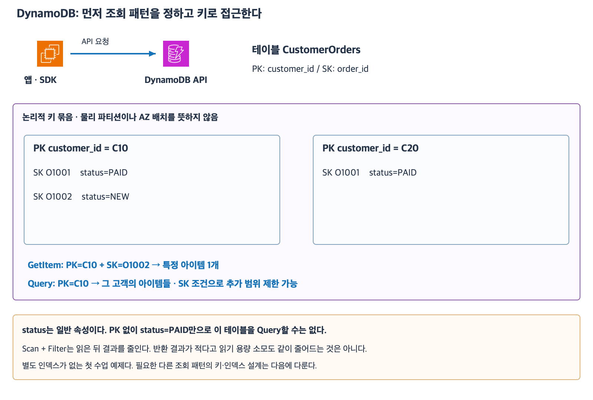

# 7주차 다섯 번째 수업: DynamoDB 키와 조회 패턴 기초

작성: 2026-11-06
예상 35~45분 · 확인 문제 3/3·하위 6/6 정답 확인 완료 · 실제 AWS 변경 없음

## 1. DynamoDB의 출발점

Amazon DynamoDB는 키-값과 문서 데이터 모델을 지원하는 관리형 NoSQL DB다.
사용자가 DB 서버를 설치하거나 OS를 패치하는 방식은 아니다.
테이블·키·접근 권한·용량과 비용·데이터 모델 등 요구에 맞는 설계는 사용자에게 남는다.
앱은 SDK 등의 서비스 API로 접근한다.
일반 RDS PostgreSQL 엔드포인트에 SQL 연결을 맺는 방식과 구분한다.
이번에는 IAM 정책 문법·네트워크 구성이나 실제 자원 생성을 시험하지 않는다.

관계형 DB처럼 서버에서 여러 테이블을 JOIN해 임의 관계 조회를 구성하는 서비스를 뜻하지 않는다.
대신 어떤 키로 어떤 데이터를 자주 조회하는지 접근 패턴을 먼저 정한다.
접근 패턴은 예를 들어 고객 번호로 주문 한 건 조회 또는 고객의 주문 목록 조회처럼 앱이 반복해서 필요한 읽기·쓰기 방식이다.
NoSQL이므로 트랜잭션이나 일관성 기능이 전혀 없다는 뜻은 아니다.
DynamoDB도 관련 기능을 제공하며 상세는 다음 수업 범위다.

## 2. 테이블·아이템·속성

테이블(Table)은 아이템을 모으는 단위다.
아이템(Item)은 주문 한 건 같은 기록이다.
속성(Attribute)은 고객 번호·주문 번호·상태 같은 값이다.
관계형 DB의 행·열과 비교해 생각할 수 있지만 같은 데이터 모델은 아니다.
기본 키 외의 속성은 아이템마다 다를 수 있다.
키를 포함한 모든 규칙이 없다는 뜻은 아니며 지정한 기본 키 속성과 타입은 지켜야 한다.

DynamoDB 기본 키는 파티션 키 하나 또는 파티션 키와 정렬 키의 조합으로 구성한다.
파티션 키(Partition key, PK)는 데이터를 묶고 배치하는 데 사용하는 키 속성이다.
정렬 키(Sort key, SK)는 같은 파티션 키 값 안에서 아이템을 구분하고 순서·범위 조회에 사용하는 키 속성이다.
복합 기본 키 테이블은 PK+SK 조합이 아이템을 고유하게 식별한다.
이때 PK 값 하나는 여러 아이템에서 반복될 수 있다.
같은 SK 값도 다른 PK 아래에서는 반복될 수 있다.
단순 기본 키 테이블은 PK 하나만으로 고유해야 하며 이번 문제는 모두 PK+SK 테이블이다.
논리적 PK 묶음을 물리 파티션 한 개 또는 AZ 하나와 동일시하지 않는다.

## 3. 주문 테이블 예제

테이블 CustomerOrders는 PK=customer_id, SK=order_id를 사용한다.
두 키의 타입은 모두 문자열이다.
status와 amount는 일반 속성이다.
별도 인덱스는 없다.

| customer_id — PK | order_id — SK | status | amount |
|---|---|---|---|
| C10 | O1001 | PAID | 12000 |
| C10 | O1002 | NEW | 18000 |
| C20 | O1001 | PAID | 9000 |

C10/O1001과 C10/O1002는 다른 아이템이다.
C20/O1001도 PK가 다르므로 별도 아이템이다.
C10/O1001이라는 동일 기본 키 조합으로 두 아이템을 동시에 별개 저장할 수는 없다.
쓰기 API와 조건에 따라 기존 아이템 교체·갱신 또는 충돌 방지 등을 구성하므로 무조건 중복 오류가 난다고 일반화하지 않는다.
이번에는 쓰기 API별 덮어쓰기 동작을 시험하지 않는다.

[확대 가능한 SVG](images/dynamodb-keys-access.svg)

AWS 공식 서비스 아이콘을 이용해 직접 작성한 학습 그림이다.
박스는 논리적 키 묶음이며 실제 스토리지 서버·파티션·AZ 구성도가 아니다.

## 4. GetItem·Query·Scan

| 작업 | 기준 | 예제 |
|---|---|---|
| GetItem | 아이템의 전체 기본 키 | PK=C10 및 SK=O1002로 한 건 조회 |
| Query | PK의 정확한 값 필수 · SK 조건 선택 | PK=C10의 주문 목록 또는 그 안의 SK 범위 |
| Scan | 테이블 또는 인덱스를 넓게 읽음 | 키 기반 경로 없이 전체 아이템을 조사 |

GetItem은 이번 복합 키 테이블에서 PK와 SK를 모두 지정해야 한다.
PK만 지정해 여러 주문을 GetItem으로 가져오는 방식은 아니다.
Query는 대상 테이블의 PK 속성과 정확한 PK 값 하나를 지정한다.
같은 PK 안에서 정렬 키 조건으로 범위를 좁힐 수 있다.
일반 속성 status만 알고 PK 값을 모르면 이 테이블의 기본 키 Query 조건을 만들 수 없다.
관계형 DB의 임의 WHERE 조회와 Query API를 같은 뜻으로 해석하지 않는다.

Scan은 테이블을 순회하며 읽는다.
FilterExpression은 읽은 데이터에서 반환할 결과를 거르는 조건이다.
Scan에 필터를 붙여 반환 행을 줄여도 필터 자체가 읽기 용량 소모를 줄이지는 않는다.
읽기 용량은 처리한 읽기 작업량과 관련된 자원이며 정확한 과금 계산은 이후 범위다.
한 번의 요청으로 큰 테이블 전체가 모두 반환되는 것은 아니고 페이지 단위로 이어서 읽을 수 있다.
이번 문제의 테이블은 작고 결과는 한 페이지 안에 들어가며 페이지 처리 문법은 묻지 않는다.

자주 실행하는 요청이 매번 큰 테이블 Scan을 요구한다면 접근 패턴과 키 설계를 다시 검토한다.
다른 조회 기준을 지원하는 보조 인덱스나 데이터 모델 변경을 검토할 수 있다.
보조 인덱스는 다른 키로 조회할 경로를 추가하는 기능이며 상세는 다음 수업에서 다룬다.
이번에는 인덱스가 없다는 조건에서 가능한 기본 키 접근만 판단한다.
DynamoDB가 모든 검색을 알아서 최적화해 주거나 테이블이 커져도 모든 Scan이 싸고 빠르다고 보장하는 것은 아니다.

## 5. 확인 문제 — 전체 답변과 이유

모든 문제는 같은 작은 CustomerOrders 테이블이다.
PK=customer_id, SK=order_id이고 둘 다 문자열이다.
status는 일반 속성이며 보조 인덱스는 없다.
필요한 권한과 연결은 준비되어 있다.
질문에서 주어진 아이템은 모두 존재한다.
일관성 지연·동시 변경·페이지 경계·정확한 비용·쓰기 API 문법은 이번 문제에서 제외한다.

| customer_id — PK | order_id — SK | status |
|---|---|---|
| C30 | O2001 | PAID |
| C30 | O2002 | NEW |
| C40 | O2001 | PAID |

### 1. 아이템 식별

1-1. C30/O2001과 C30/O2002는 PK가 같으므로 같은 아이템인가?
아이템을 고유하게 구분하는 키를 설명하자.
1-2. C30/O2001과 C40/O2001은 SK가 같은데 서로 다른 아이템으로 존재할 수 있는가?
동일 C30/O2001 조합의 아이템 두 개를 별개로 동시에 저장할 수 있는지와 비교하자.

### 2. 한 건과 목록 조회

2-1. 고객 C30의 주문 O2002 한 건을 GetItem으로 읽으려 한다.
어떤 키 값들을 지정해야 하는가?
customer_id=C30만 지정하면 충분한가?
2-2. 고객 C30의 주문 목록을 가져오려 한다.
GetItem과 Query 중 무엇을 선택할까?
필수 키 조건과 이 예제에서 반환할 order_id들을 적자.

### 3. 일반 속성 검색과 읽기 비용

3-1. 고객 번호는 모르고 status=PAID인 모든 고객의 주문을 찾으려 한다.
이 테이블에서 PK 조건 없이 status만으로 Query할 수 있는가?
추가 인덱스가 없는 상황에서 Scan을 쓴다면 어떤 범위를 읽게 되는가?
3-2. Scan에 status=PAID 필터를 붙여 결과가 적어졌다.
필터 덕분에 읽기 용량도 반환 건수만큼 줄었다고 볼 수 있는가?
이 조회가 큰 테이블에서 자주 필요하다면 어떤 설계 방향을 검토해야 하는가?
인덱스 이름이나 생성 문법은 요구하지 않는다.

답변 전 확인 문제의 정답·해설은 공개하지 않는다.
답변 후 평가와 진도를 기록한다.
7주차는 진행 중이며 완료 주차는 6/32다.

## 공식 참고 자료

확인: 2026-11-06

- [DynamoDB 서비스와 데이터 모델](https://docs.aws.amazon.com/amazondynamodb/latest/developerguide/Introduction.html)
- [테이블·아이템·기본 키](https://docs.aws.amazon.com/amazondynamodb/latest/developerguide/HowItWorks.CoreComponents.html)
- [GetItem의 전체 기본 키 요구](https://docs.aws.amazon.com/amazondynamodb/latest/APIReference/API_GetItem.html)
- [Query의 PK와 SK 조건](https://docs.aws.amazon.com/amazondynamodb/latest/developerguide/Query.html)
- [Scan의 필터와 읽기 용량](https://docs.aws.amazon.com/amazondynamodb/latest/developerguide/Scan.html)
- [AWS 공식 아키텍처 아이콘](https://aws.amazon.com/architecture/icons/)
- [이전 수업](42_Aurora_Writer_Reader_공유_스토리지.md)

## 답변 평가 — 2026-11-06

3문항 모두 정답이며 하위 6문항도 모두 정답이다.
1-1·1-2는 PK+SK 조합으로 아이템을 구분하고 다른 PK 아래 동일 SK 허용 및 동일 조합의 별개 중복 아이템 불가를 정확히 설명했다.
O20001은 문맥상 O2001 철자 오타로 처리하며 개념 감점하지 않는다.
2-1은 customer_id=C30 및 order_id=O2002를 함께 지정한다고 답해 전체 기본 키 요구를 충족했다.
2-2는 Query 선택·PK 필수·O2001과 O2002 반환을 정확히 답했다. 문맥의 필수 PK 값은 C30임을 보충한다.
3-1은 별도 인덱스 없이 status만으로 Query 불가 및 이번 작은 테이블 전체를 Scan으로 읽는다고 정확히 답했다.
한 페이지 조건을 정확히 고려했다. 큰 테이블에서는 페이지를 이어 전체 Scan을 완료해야 하는 것이며 한 요청에 무조건 전체 반환된다고 답한 것으로 해석하지 않는다.
3-2는 읽은 뒤 필터하므로 필터 자체로 읽기 용량이 감소하지 않고 빈번한 조회는 인덱스 설계를 검토해야 한다고 설명했다.
추가 보완 없이 이번 수업을 마친다.
다음 요청 시 DynamoDB 보조 인덱스 중 GSI를 중심으로 다른 키의 조회 경로와 비동기 반영·읽기 일관성 범위를 공식 아이콘·예제로 준비한다.
다음 자료는 아직 작성하지 않았으며 완료 주차는 6/32 유지다.
