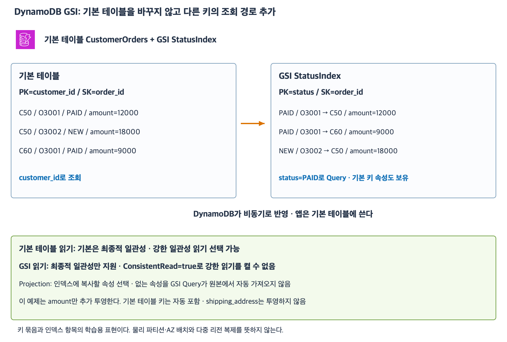
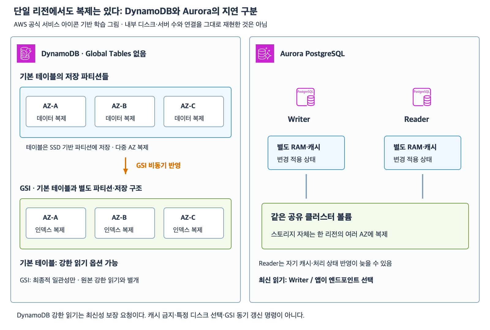

# 7주차 여섯 번째 수업: DynamoDB GSI와 읽기 일관성

작성: 2026-11-06
예상 35~45분 · 최초 정답 2·부분 정답 1 · 저장 구조 추가 설명 · 실제 AWS 변경 없음

## 1. 다른 속성으로 자주 조회한다면

앞선 CustomerOrders 테이블은 customer_id와 order_id로 아이템을 식별했다.
이 구조만으로 고객 번호를 모르는 status=PAID 목록을 기본 키 Query로 찾을 수는 없었다.
글로벌 보조 인덱스(Global Secondary Index, GSI)는 기본 테이블과 다른 키로 조회하는 경로를 추가하는 구조다.
기본 테이블의 기본 키를 status로 교체하는 기능은 아니다.
Global이라는 이름이 여러 리전에 자동 복제한다는 뜻은 아니다.

이번 기본 테이블의 PK는 customer_id, SK는 order_id다.
GSI StatusIndex의 PK는 status, SK는 order_id다.
모든 키 속성은 문자열이며 각각 단일 속성이다.
LSI·다중 속성 인덱스 키·Global Tables·분산 키 설계·조건부 쓰기·용량 수치 계산은 이번 범위가 아니다.

| 기본 테이블 customer_id — PK | order_id — SK | status | amount |
|---|---|---|---|
| C50 | O3001 | PAID | 12000 |
| C50 | O3002 | NEW | 18000 |
| C60 | O3001 | PAID | 9000 |

GSI에는 다음과 같은 다른 조회 경로가 생긴다.
아래 customer_id는 원본 아이템을 찾는 기본 테이블 키 속성이다.

| StatusIndex status — PK | order_id — SK | customer_id | amount |
|---|---|---|---|
| PAID | O3001 | C50 | 12000 |
| PAID | O3001 | C60 | 9000 |
| NEW | O3002 | C50 | 18000 |

StatusIndex에 Query하면서 status=PAID를 키 조건으로 지정하면 고객 번호를 몰라도 결제 완료 주문을 찾을 수 있다.
기본 테이블 이름과 IndexName=StatusIndex를 지정해 조회 대상으로 인덱스를 고른다.
기본 테이블에 status 필터만 추가한 Scan과는 다른 조회 경로다.
같은 status/order_id가 GSI에 반복돼도 기본 테이블 키가 다르면 여러 인덱스 항목으로 존재할 수 있다.
기본 테이블 아이템 식별의 고유성 규칙을 GSI 키에 그대로 적용하지 않는다.

## 2. 쓰기는 기본 테이블, 인덱스 반영은 DynamoDB가 수행

앱은 기본 테이블에 아이템을 쓰거나 갱신한다.
DynamoDB가 GSI를 자동 관리하며 변경을 비동기로 반영한다.
앱이 기본 테이블과 GSI에 각각 같은 쓰기를 직접 수행하는 구조가 아니다.
비동기 반영이므로 기본 테이블 쓰기 성공 직후 GSI에 최신 결과가 없을 수 있다.
GSI 결과만 보고 기본 테이블 쓰기 실패라고 단정하면 안 된다.

여기서 GSI는 별도 저장 구조를 사용하는 조회 경로다.
앞서 Aurora Reader가 공유 DB 볼륨을 사용하는 구조와 내부 구현을 같다고 해석하지 않는다.
둘 다 최신 읽기 주의가 필요하다는 관찰은 비슷해도 서비스 구조는 다르다.

## 3. 읽기 일관성 두 가지

최종적 일관성(Eventually consistent read)은 방금 성공한 쓰기가 아직 읽기에 반영되지 않을 수 있는 방식이다.
기본 테이블 읽기의 기본값이며 GSI 읽기도 이 방식이다.
강한 일관성(Strongly consistent read)은 읽기 전에 성공적으로 완료된 쓰기를 반영하는 방식이다.
동시 변경이 없는 특정 아이템 읽기에서는 그 성공한 쓰기의 최신 결과를 확인하는 데 사용한다.
다른 요청이 읽기 이후 데이터를 바꾸지 못하도록 잠그는 기능은 아니다.

| 읽는 대상 | 최종적 일관성 | 강한 일관성 |
|---|---|---|
| 기본 테이블 | 지원 · 기본값 | 지원 |
| GSI | 지원 | 미지원 |

알고 있는 기본 테이블 PK+SK로 GetItem하면서 ConsistentRead=true를 지정하면 강한 읽기를 요청할 수 있다.
GSI Query에는 ConsistentRead=true로 강한 읽기를 켤 수 없다.
GSI에 없는 아이템을 기본 테이블에서 강하게 읽는다고 GSI 목록 자체가 즉시 최신 목록으로 바뀌는 것도 아니다.
최신 전체 상태 목록이 필수라면 지연을 전제로 한 업무 흐름과 데이터 모델을 별도로 검토한다.
이번 문제는 알고 있는 한 아이템의 최신 결과 확인을 다룬다.
일관성 옵션은 트랜잭션 전체의 반복 조회·Phantom Read 방지 설정과 같지 않다.

## 4. Projection은 인덱스에 보관할 속성

투영(Projection)은 기본 테이블의 어떤 속성을 인덱스에 복사해 둘지 정하는 것이다.
기본 테이블 키 속성은 인덱스에 자동 포함된다.
GSI의 키 속성도 있어야 한다.
그 외 일반 속성은 필요한 것을 포함하도록 선택한다.
이번 StatusIndex는 amount를 추가 포함하고 shipping_address는 포함하지 않는다.

따라서 GSI Query로 amount와 원본 기본 키 customer_id/order_id를 얻을 수 있다.
shipping_address는 이 인덱스 Query가 기본 테이블에서 자동으로 가져오지 않는다.
필요하면 반환된 기본 테이블 키로 GetItem 등 별도 조회를 수행하거나 요구에 맞는 투영 설정을 검토한다.
Query 요청에서 반환 속성을 고르는 ProjectionExpression을 지정하는 것만으로 인덱스에 없는 데이터를 생기게 할 수는 없다.
이번에는 KEYS_ONLY·INCLUDE·ALL 이름이나 변경 절차를 암기하도록 요구하지 않는다.

[확대 가능한 SVG](images/dynamodb-gsi-consistency.svg)

DynamoDB 공식 서비스 아이콘으로 직접 작성한 논리적 조회 경로 그림이다.
GSI 키에 필요한 속성은 모든 예제 아이템에 올바른 타입으로 존재한다.
아직 인덱스 생성 중인 상황이나 누락 키에 따른 제외 문제는 없다.
권한·연결은 준비되어 있다.

GSI는 저장 공간과 인덱스 반영 작업 등의 비용이 추가된다.
자주 필요한 조회 경로에 맞춰 검토하며 무조건 모든 속성에 인덱스를 만드는 것은 아니다.
상태처럼 값 종류가 적은 키의 부하 분산도 실제 설계에서 검토해야 한다.
이번 그림은 첫 개념 학습용이며 모든 규모의 운영에 그대로 최적이라는 뜻은 아니다.

## 5. 확인 문제 — 전체 답변과 이유

기본 테이블 CustomerOrders의 PK=customer_id, SK=order_id다.
GSI StatusIndex의 PK=status, SK=order_id다.
기본 테이블 키는 GSI에 포함되고 amount는 추가 투영되지만 shipping_address는 투영되지 않는다.
모든 키는 문자열이며 필요한 속성과 타입은 정상이다.
아이템은 작고 한 페이지 안에 들어가며 권한·연결은 정상이다.
별도 인덱스와 Global Tables는 없다.
2-1에서 제시한 지연 외에는 인덱스 반영이 완료됐고 추가 동시 변경도 없다.

| customer_id | order_id | status | amount |
|---|---|---|---|
| C70 | O5001 | PAID | 10000 |
| C70 | O5002 | NEW | 20000 |
| C80 | O5001 | PAID | 30000 |

### 1. 조회 경로와 기본 키

1-1. 고객 번호를 모르고 status=PAID인 주문을 조회하려 한다.
Query의 대상은 기본 테이블인가 StatusIndex인가?
필수 인덱스 키 조건과 반환할 기본 테이블 키 조합들을 적자.
1-2. GSI가 생겼으니 기본 테이블의 기본 키도 status/order_id로 바뀌는가?
기본 테이블에서 C70의 O5002를 GetItem으로 읽으려면 어떤 키를 사용해야 하는가?

### 2. 반영 지연과 최신 한 건

2-1. 별도로 아이템 C70/O5002를 NEW에서 PAID로 갱신했고 기본 테이블 쓰기는 성공했다.
아직 GSI 반영이 끝나지 않아 PAID 조회에 이 아이템이 없다.
원본 쓰기가 실패했다고 단정할 수 있는가?
GSI Query에 ConsistentRead=true를 주면 강한 읽기로 해결되는가?
2-2. 이제 기본 테이블에서 알고 있는 C70/O5002의 최신 status를 확인하려 한다.
동시 변경은 없고 해당 쓰기는 성공했다.
어느 대상을 어떤 API·키·일관성 옵션으로 읽어야 하는가?

### 3. 인덱스 항목과 속성

3-1. C70/O5001과 C80/O5001은 GSI에서 둘 다 status=PAID, order_id=O5001이다.
인덱스 키 조합이 중복이므로 둘 중 하나가 반드시 저장 불가인가?
원본 아이템을 구분하려면 어떤 키를 확인해야 하는가?
3-2. GSI 조회 결과에서 shipping_address도 필요하다.
반환 속성 이름만 추가하면 GSI Query가 기본 테이블에서 그 속성을 자동으로 가져오는가?
현재 설정에서 원본의 필요한 속성을 읽으려면 어떤 별도 조회를 검토할 수 있는가?

답변 전 정답·해설은 공개하지 않는다.
답변 후 평가와 진도를 기록한다.
7주차는 진행 중이며 완료 주차는 6/32다.

## 공식 참고 자료

확인: 2026-11-06

- [보조 인덱스의 조회 경로와 자동 관리](https://docs.aws.amazon.com/amazondynamodb/latest/developerguide/SecondaryIndexes.html)
- [GSI 키·투영·비동기 반영](https://docs.aws.amazon.com/amazondynamodb/latest/developerguide/GSI.html)
- [읽기 일관성 지원 범위](https://docs.aws.amazon.com/amazondynamodb/latest/developerguide/HowItWorks.ReadConsistency.html)
- [Query 인덱스 지정과 일관성 옵션](https://docs.aws.amazon.com/amazondynamodb/latest/APIReference/API_Query.html)
- [AWS 공식 아키텍처 아이콘](https://aws.amazon.com/architecture/icons/)
- [이전 수업](43_DynamoDB_키와_조회_패턴_기초.md)

## 최초 답변 평가 — 2026-11-06

문항별 정답 2·부분 정답 1이며 하위 질문별 정답 5·부분 정답 1이다.
1-1은 StatusIndex 선택과 테이블/인덱스 PK 구분은 정확하다. 조건 값과 결과 키 조합 대신 속성 이름을 적어 부분 정답이다.
완전한 조건은 status=PAID이며 원본 키 조합은 C70/O5001과 C80/O5001이다.
원본 기본 키는 customer_id/order_id이고 status는 이 테이블의 기본 키 속성이 아니라 GSI의 PK다.
이를 설명 보충하고 같은 질문을 재출제하지 않는다.
1-2는 기본 테이블 키 유지 및 GetItem의 PK/SK 구분이 정확하다. 문맥의 키 값은 C70/O5002라고 보충한다.
2-1·2-2는 비동기 GSI 반영·강한 읽기 미지원 및 기본 테이블 GetItem+ConsistentRead=true 선택이 정확하다.
3-1은 원본 키가 다르면 GSI 키 중복을 허용한다는 구분이 정확하다.
3-2는 미투영 속성 자동 조회 불가 및 원본 별도 GetItem 또는 투영 설계 검토가 정확하다. '없는 키'는 여기서 미투영 속성 뜻으로 이해한다.
투영 설계 검토를 기존 GSI 설정이 제약 없이 즉시 변경 가능하다는 주장으로 해석하지 않는다.
추가 보완 문제 없이 평가를 마치고 아래 사용자 질문에 설명을 제공한다.

## 추가 질문: Global Tables 없이 왜 지연이 있을까

### 1. 한 리전 안에서도 데이터 복제는 있다

DynamoDB는 테이블 데이터를 SSD 기반 저장 파티션에 보관하고 파티션 데이터를 한 리전의 여러 AZ에 자동 복제한다.
파티션 배치·분할과 실제 디스크·서버 선택은 서비스가 관리한다.
사용자가 특정 디스크·AZ의 Writer/Reader를 지정하는 방식이 아니다.
Global Tables는 별개로 여러 리전에 테이블 복제본을 구성하는 기능이다.
Global Tables가 없다는 것은 여러 리전 복제가 없다는 조건이지 같은 리전의 여러 AZ 복제까지 없다는 뜻은 아니다.

### 2. 기본 테이블 복제와 GSI 갱신은 다른 경로다

GSI 역시 파티션으로 구성되지만 기본 테이블과 별도 저장 구조를 사용한다.
기본 테이블 쓰기 성공과 그 변경의 GSI 반영 완료는 같은 사건이 아니다.
기본 테이블을 여러 AZ에 내구성 있게 저장했어도 status 기준 인덱스 변경은 아직 따라오는 중일 수 있다.
GSI가 기본 테이블 디스크를 즉석에서 다른 키로 검색하는 가상 화면이라고 생각하면 안 된다.
따라서 같은 리전 안에서도 GSI 조회 결과가 뒤처질 수 있다.

### 3. 기본 테이블의 강한 읽기는 디스크 선택이 아니다

기본 테이블 읽기도 기본값은 최종적 일관성이므로 방금 성공한 쓰기보다 이전 값을 반환할 수 있다.
ConsistentRead=true는 읽기 전에 성공한 쓰기를 반영하는 강한 일관성 읽기를 서비스에 요청한다.
모든 복제본의 디스크가 즉시 완전히 같아졌다고 선언하는 옵션이 아니다.
RAM 캐시를 금지하고 무조건 디스크를 직접 읽는 옵션도 아니다.
서비스가 그 보장을 만족하는 내부 읽기 처리를 수행하는 것이며 특정 노드나 읽기 프로토콜의 세부 구현을 여기서 단정하지 않는다.

예를 들어 원본 C70/O5002를 PAID로 갱신하는 쓰기가 성공했다.
동시 변경이 없을 때 기본 테이블에서 전체 키와 ConsistentRead=true로 GetItem하면 성공한 변경을 반영한 PAID를 확인한다.
GSI PAID 목록은 그 순간 아직 이 항목을 빠뜨릴 수 있다.
기본 테이블을 강하게 읽는 행위가 GSI 목록의 비동기 갱신을 완료시키지는 않기 때문이다.
GSI Query에는 강한 일관성 옵션을 사용할 수 없다.

### 4. Aurora Reader와 비교

| 기준 | DynamoDB 기본 테이블·GSI | 단일 클러스터 Aurora PostgreSQL |
|---|---|---|
| 기본 저장 | 다중 AZ로 복제되는 저장 파티션 | 다중 AZ로 복제되는 공유 클러스터 볼륨 |
| 다른 조회 처리 | GSI는 별도 키·파티션·저장 구조 | Reader는 Writer와 같은 볼륨 사용 |
| 지연 구분 | 기본 읽기 최신성 및 별도 GSI 비동기 반영 | Reader 캐시·변경 적용 상태 지연 가능 |
| 최신 한 건 조회 | 기본 테이블 GetItem + 전체 키 + ConsistentRead=true | Writer 대상으로 읽기 |
| 앱 선택 방법 | API의 테이블/인덱스 대상과 일관성 옵션 | Writer/Reader 엔드포인트 |

[확대 가능한 SVG](images/dynamodb-aurora-replication-comparison.svg)

이 그림은 개념 비교이며 각 상자가 실제 디스크 하나·물리 복제본 하나를 의미하지 않는다.
DynamoDB 쪽의 다중 AZ 상자는 복제 범위를 설명할 뿐 내부 정확한 노드 수·리더 선출·정족수 프로토콜을 재현하지 않는다.
최신 읽기 보장이 필요하다는 공통점은 있지만 두 서비스의 내부 구조와 앱의 선택 방법은 다르다.
Global Tables의 리전 간 일관성 모드는 이 질문과 구분하며 이후에 다룬다.

- [DynamoDB 파티션·SSD·리전 내 AZ 복제·GSI 별도 저장](https://docs.aws.amazon.com/amazondynamodb/latest/developerguide/HowItWorks.Partitions.html)
- [DynamoDB 읽기 보장과 Global Tables 범위](https://docs.aws.amazon.com/amazondynamodb/latest/developerguide/HowItWorks.ReadConsistency.html)
- [GSI의 독립 파티션 공간](https://docs.aws.amazon.com/amazondynamodb/latest/developerguide/SecondaryIndexes.html)
- [Aurora 공유 볼륨·Reader 페이지 캐시 지연](https://docs.aws.amazon.com/AmazonRDS/latest/AuroraUserGuide/AuroraPostgreSQL.Replication.html)

평가와 추가 질문 설명은 구분해 기록한다.
다음 요청 시 DynamoDB 조건부 쓰기·트랜잭션 기초를 공식 아이콘·예제로 준비한다.
다음 자료는 아직 작성하지 않았다. 완료 주차는 6/32 유지다.

## 후속 질문: DynamoDB도 Aurora처럼 6개 사본인가 — 2026-11-06

DynamoDB와 Aurora의 복제 수를 동일하게 적용하지 않는다.
현재 DynamoDB 공식 문서는 단일 리전 안 3개 AZ에 자동 복제한다고 명시한다.
Amazon Science의 2022년 DynamoDB 설계 설명은 파티션마다 서로 다른 AZ에 3개 사본을 두는 복제 그룹으로 설명한다.
이는 테이블 전체가 정확히 디스크 3개로 구성된다는 뜻은 아니다. 테이블은 여러 파티션으로 나뉠 수 있다.
서비스 내부 설계의 공개 설명이지 사용자가 사본 수나 물리 서버를 직접 설정하는 옵션은 아니다.
Aurora PostgreSQL/MySQL의 공유 스토리지 계층은 3개 AZ에 걸친 6개 저장 사본/노드로 설명한다.
이 6개는 Writer·Reader DB 인스턴스 개수가 아니다.
GSI는 원본과 별도 파티션 구조라는 점과 원본에서 GSI로 비동기 반영된다는 점은 그대로다.
추가 평가나 진도 변경은 없다.

- [DynamoDB 현재 문서: 3개 AZ 복제](https://docs.aws.amazon.com/amazondynamodb/latest/developerguide/disaster-recovery-resiliency.html)
- [Amazon Science 2022 공개 설계: 파티션당 3개 사본](https://www.amazon.science/blog/lessons-learned-from-10-years-of-dynamodb)
- [Aurora 공유 스토리지 6개 노드](https://docs.aws.amazon.com/AmazonRDS/latest/AuroraUserGuide/Concepts.AuroraHighAvailability.html)

## 후속 질문: 물리 디스크 하나를 나눠 AZ에 두는가 — 2026-11-06

물리 디스크 하나를 분할해 서로 다른 AZ에 배치한다는 뜻은 아니다.
AZ는 물리적으로 분리된 인프라 위치이므로 각 AZ의 사본은 별도 위치의 저장 자원에 존재한다.
DynamoDB 파티션은 테이블 데이터를 담는 논리적인 저장 공간 할당이며 SSD를 기반으로 한다.
테이블을 여러 파티션으로 나누는 것과 각 파티션 데이터를 여러 AZ로 복제하는 것은 다른 단계다.
예를 들어 파티션 P의 같은 데이터 사본을 AZ-A·AZ-B·AZ-C의 별도 저장 자원에 두는 것으로 이해한다.
AZ-A에 P의 앞부분만 두고 AZ-B에 P의 뒷부분만 두는 분산과 복제를 혼동하지 않는다.
테이블에는 여러 파티션이 있을 수 있으며 각각 데이터 배치와 복제를 서비스가 관리한다.
파티션 하나가 물리 SSD 하나와 정확히 1:1이라는 뜻도 아니다.
공식 문서는 SSD 기반 저장 공간 할당과 AZ 복제 범위를 설명하며 특정 물리 디스크 배치를 사용자가 정하거나 확인하는 구조로 설명하지 않는다.

- [DynamoDB 파티션의 정의와 복제](https://docs.aws.amazon.com/amazondynamodb/latest/developerguide/HowItWorks.Partitions.html)
