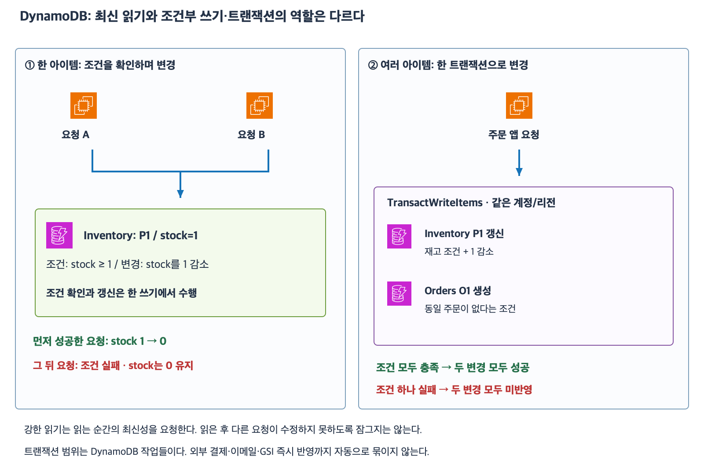
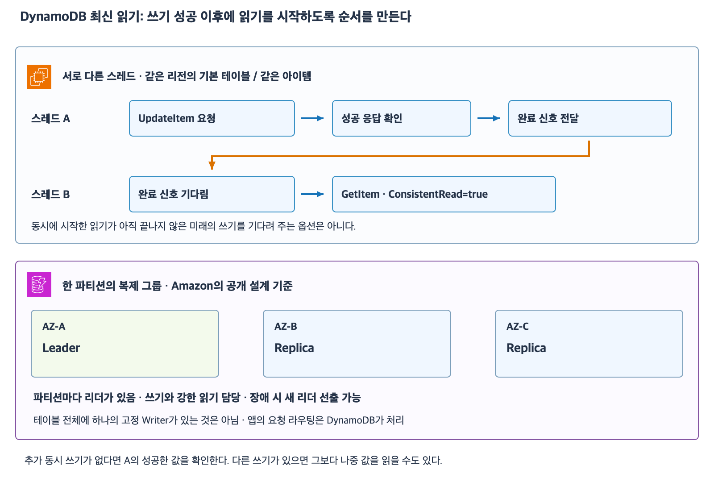

# 7주차 일곱 번째 수업: DynamoDB 조건부 쓰기와 트랜잭션

작성: 2026-11-06
예상 35~45분 · 3/3·하위 6/6 정답 확인 완료 · 스레드 순서·리더 질문 보충 · 실제 AWS 변경 없음

## 1. 최신 읽기가 이후 쓰기까지 보호하지는 않는다

재고 stock가 1인 아이템을 요청 A와 B가 차례로 강하게 읽었다고 하자.
두 읽기 사이에 쓰기가 없으면 둘 다 정확하게 1을 읽을 수 있다.
이후 두 앱이 각각 재고가 있다고 판단해 주문을 처리하면 경쟁 상황이 생긴다.
ConsistentRead=true는 읽기 전 성공한 쓰기를 반영하는 옵션이지 읽은 후 다른 요청을 막는 잠금이 아니다.
최신 읽기와 쓰기 시점의 업무 조건 보장은 다른 문제다.

이번 예제는 같은 계정·리전의 DynamoDB 기본 테이블이다.
Inventory는 단순 기본 키 product_id를 사용하고 stock는 숫자 속성이다.
Orders는 단순 기본 키 order_id를 사용한다.
두 테이블의 키는 문자열이고 보조 인덱스에 직접 쓰는 방식은 아니다.
Global Tables·용량 과금·API 한도 숫자·재시도 토큰 상세는 이번 범위가 아니다.

## 2. 조건부 쓰기

조건부 쓰기는 쓰기 요청에 조건을 붙여 그 조건이 충족될 때만 변경하는 것이다.
ConditionExpression은 그 조건을 지정하는 표현식이다.
조건 판단과 변경을 하나의 원자적 작업으로 수행한다.
원자적이라는 말은 중간 일부만 확정되는 작업으로 나뉘지 않는다는 뜻이다.
앱이 따로 읽고 판단한 뒤 무조건 쓰는 것과 구분한다.

예를 들어 Inventory의 P1을 다음 의미로 UpdateItem한다.
실제 SDK 문법 전체가 아니라 작업의 의미를 나타낸 예다.

조건: 현재 stock가 1 이상이다.
변경: 현재 stock에서 1을 뺀다.

처음 stock=1이고 한 요청이 성공해 0이 됐다.
다음 요청의 조건 판단 때는 stock>=1이 거짓이므로 그 요청은 재고를 감소시키지 못한다.
조건 실패는 네트워크가 고장 났다는 뜻이 아니라 쓰기의 조건이 충족되지 않았다는 뜻일 수 있다.
조건부 감소가 두 주문의 모든 후속 처리를 자동으로 하나로 묶는 것은 아니다.
단일 아이템 조건 보장과 여러 아이템 업무 처리 범위를 구분해야 한다.

## 3. PutItem 중복 덮어쓰기 방지

PutItem은 같은 기본 키 아이템이 있으면 새 아이템으로 전체 교체할 수 있다.
별개 중복 아이템을 추가하는 SQL INSERT와 항상 같은 동작은 아니다.
기존 주문을 덮어쓰지 않고 새 주문만 생성하려면 조건을 붙인다.

Orders 테이블은 order_id 하나가 기본 키다.
PutItem에 attribute_not_exists(order_id) 조건을 붙이면 해당 키 아이템이 없을 때만 생성한다.
동일 order_id가 이미 있으면 조건이 실패하고 기존 주문은 그대로 남는다.
표현식 철자 암기는 요구하지 않으며 같은 키가 없을 때만 쓰기라고 설명해도 된다.
이 한 조건만으로 결제·메일까지 포함한 전체 업무가 자동으로 정확히 한 번 실행된다는 뜻은 아니다.

## 4. 여러 아이템 변경은 TransactWriteItems

재고 감소와 주문 생성을 반드시 함께 성공시키려면 두 기본 테이블의 작업을 TransactWriteItems로 묶을 수 있다.
트랜잭션은 여러 작업을 모두 성공 또는 모두 미반영으로 처리하는 단위다.
같은 계정·리전 안에서 여러 테이블의 서로 다른 아이템을 포함할 수 있다.
각 쓰기 작업에 필요한 조건도 붙일 수 있다.

| 포함할 작업 | 조건과 변경 |
|---|---|
| Inventory의 P1 Update | stock>=1 조건 · 현재 stock에서 1 감소 |
| Orders의 O1 Put | 해당 order_id가 없다는 조건 · 새 주문 생성 |

조건이 모두 충족되고 트랜잭션이 성공하면 두 변경이 모두 반영된다.
주문 O1이 이미 있어 생성 조건이 실패했다면 재고 감소도 반영되지 않는다.
재고 감소를 먼저 독립적으로 성공시킨 다음 주문 생성만 따로 요청한 상황과 다르다.
별도로 성공한 작업을 나중의 다른 요청 실패가 자동 취소해 주지는 않는다.

조건 확인은 같은 Update 작업에 붙인다.
같은 트랜잭션 안에서 동일 아이템을 별도 ConditionCheck와 Update 두 작업으로 중복 대상으로 삼는 방식은 허용되지 않는다.
이번에는 API 요청 JSON 구성은 시험하지 않는다.
여러 건을 보낸다는 이유로 BatchWriteItem도 같은 원자성을 보장한다고 생각하면 안 된다.
BatchWriteItem은 일부만 처리될 수 있고 이 수업의 여러 항목 전체 성공 요구는 TransactWriteItems로 구분한다.

[확대 가능한 SVG](images/dynamodb-conditional-transaction.svg)

AWS 공식 서비스 아이콘을 이용해 직접 작성한 학습 그림이다.
앱은 EC2 예시이며 조건과 트랜잭션은 DynamoDB가 처리한다.
화살표는 요청 관계이고 실제 네트워크 구성은 단순화했다.

## 5. 트랜잭션이 묶어 주지 않는 것

DynamoDB 트랜잭션은 포함한 DynamoDB 작업의 원자성을 보장한다.
앱이 먼저 외부 결제를 완료하고 나중에 DynamoDB 트랜잭션에 실패했다고 결제까지 자동 취소되는 것은 아니다.
외부 시스템의 보상·취소 절차와 재시도는 별도 업무 설계다.
앞서 RDS 트랜잭션과 마찬가지로 작업 범위를 명확히 한다.

트랜잭션 성공 후 GSI 반영도 비동기로 진행된다.
기본 테이블에서 여러 변경이 원자적으로 성공했다고 GSI 목록에서도 모든 관련 항목이 같은 순간 한꺼번에 나타나는 것은 아니다.
GSI에서 아직 주문이 안 보인다는 이유만으로 성공 응답을 받은 트랜잭션이 실패했다고 단정하지 않는다.
알고 있는 한 아이템의 성공 후 최신 결과는 기본 테이블의 강한 읽기로 확인한다.
여러 아이템을 한 일관된 트랜잭션 읽기 단위로 확인하려면 별도 TransactGetItems 기능이 있으며 상세는 이후 범위다.
강한 GetItem을 여러 번 따로 호출한 것을 전체 아이템의 원자적 스냅샷 읽기와 동일시하지 않는다.

## 6. 확인 문제 — 전체 답변과 이유

같은 계정·리전의 Inventory와 Orders 기본 테이블을 사용한다.
Inventory의 PK=product_id, Orders의 PK=order_id이며 키는 문자열이다.
stock는 숫자다.
필요한 권한·연결·용량은 정상이고 질문에 없는 타임아웃·재시도·추가 변경은 없다.
문항들은 독립적인 상황이다.
API 문법 대신 조건과 결과를 말로 설명해도 된다.

### 1. 읽기와 조건부 감소

1-1. Inventory의 P9 재고가 1이다.
A와 B가 쓰기 전에 각각 ConsistentRead=true로 읽어 둘 다 1을 받았다.
강하게 읽었으니 두 앱이 이후 아무 조건 없이 주문을 진행해도 재고 경쟁이 자동 방지되는가?
강한 읽기가 보장하는 범위를 설명하자.

1-2. 별도 상황으로 P9 재고는 처음 1이다.
두 요청 모두 UpdateItem에 stock>=1 조건과 현재 stock를 1 감소하는 변경을 함께 붙였다.
A가 먼저 성공했고 그 뒤 B의 조건을 평가한다.
최종 stock는 얼마이고 B의 감소는 적용되는가?
별도 읽기 후 무조건 갱신하는 방식과 차이를 설명하자.

### 2. 중복 주문과 트랜잭션

2-1. Orders에 O900 아이템이 이미 존재한다.
같은 키로 PutItem을 조건 없이 보내면 기존 주문이 반드시 보호되는가?
기존 주문을 덮어쓰지 않고 새 주문만 생성하려면 어떤 조건을 붙여야 하는가?

2-2. Inventory P9의 stock는 1이고 Orders O900은 이미 존재한다.
TransactWriteItems에 아래 두 작업을 묶었다.
A. P9의 stock>=1 조건을 가진 재고 1 감소 Update
B. O900이 없다는 조건을 가진 주문 Put
B의 조건이 실패해 트랜잭션이 실패했다.
최종 P9 stock와 기존 O900은 어떻게 되는가?
재고만 감소된 채 주문 생성이 실패하는 상태가 이 트랜잭션 결과로 남는가?

### 3. 작업 범위와 반영 시점

3-1. 외부 결제 API 호출은 이미 성공했다.
그 뒤 별도로 실행한 DynamoDB TransactWriteItems는 조건 실패로 모두 미반영됐다.
DynamoDB 트랜잭션 실패가 외부 결제까지 자동 취소하는가?
어떤 업무 범위를 별도로 설계해야 하는가?

3-2. 별도 상황에서 재고 감소와 주문 생성 트랜잭션이 성공 응답을 반환했다.
하지만 Orders의 GSI에는 아직 새 주문이 조회되지 않는다.
이를 근거로 트랜잭션 실패나 재고만 반영된 상태라고 단정할 수 있는가?
기본 테이블 트랜잭션 성공과 GSI 반영 시점을 구분하자.

답변 전 확인 문제 정답·해설은 공개하지 않는다.
답변 후 평가와 진도를 기록한다.
7주차는 진행 중이며 완료 주차는 6/32다.

## 공식 참고 자료

확인: 2026-11-06

- [아이템의 원자적 작업·조건부 쓰기](https://docs.aws.amazon.com/amazondynamodb/latest/developerguide/WorkingWithItems.html)
- [조건 표현식과 덮어쓰기 방지](https://docs.aws.amazon.com/amazondynamodb/latest/developerguide/Expressions.ConditionExpressions.html)
- [PutItem 전체 교체 동작](https://docs.aws.amazon.com/amazondynamodb/latest/APIReference/API_PutItem.html)
- [조건부 UpdateItem](https://docs.aws.amazon.com/amazondynamodb/latest/APIReference/API_UpdateItem.html)
- [트랜잭션 원자성·조건 실패·작업 범위](https://docs.aws.amazon.com/amazondynamodb/latest/APIReference/API_TransactWriteItems.html)
- [Batch와 트랜잭션·GSI 반영 차이](https://docs.aws.amazon.com/amazondynamodb/latest/developerguide/transaction-apis.html)
- [AWS 공식 아키텍처 아이콘](https://aws.amazon.com/architecture/icons/)
- [이전 수업](44_DynamoDB_GSI와_읽기_일관성.md)

## 답변 평가 — 2026-11-06

3문항 모두 정답이며 하위 6문항도 모두 정답이다.
1-1은 강한 읽기가 이후 쓰기 경쟁을 자동 방지하지 않는다는 설명이 정확하다.
강한 읽기는 단순 읽기라는 뜻보다 읽기 전 성공한 쓰기를 반영하는 최신성 보장이며 이후 변경을 막는 잠금은 아니라는 점을 보충한다.
1-2는 A 성공 후 stock=0·B 조건 실패 및 별도 읽기와 원자적 조건부 갱신 차이가 정확하다.
2-1은 PutItem 덮어쓰기 가능과 attribute_not_exists 조건이 정확하다.
2-2는 stock=1과 기존 주문 유지 및 전체 미반영이 정확하다. O9000은 문맥상 O900 오타로 처리한다.
3-1은 외부 결제 비자동취소와 별도 취소 처리 필요를 정확히 설명했다.
3-2는 트랜잭션 성공과 GSI 비동기 반영을 구분해 정답이다.
추가한 ConsistentRead=true는 기본 테이블 읽기에 적용하며 GSI에는 사용할 수 없다고 명확히 한다.
사용자가 GSI에 true를 지정하겠다고 단정한 답이 아니므로 오답으로 과대 해석하지 않는다.
반복 보완 질문은 없다.

## 별도 질문: 서로 다른 스레드의 최신 읽기와 리더

### 1. 쓰기 완료와 읽기 시작 순서를 연결한다

스레드 A가 기본 테이블 아이템을 변경하고 스레드 B가 그 결과를 확인하려 한다.
A의 쓰기 요청과 B의 읽기를 그냥 동시에 시작하면 B가 A의 미래 쓰기 완료를 기다리는 보장은 없다.
ConsistentRead=true는 읽기 전에 성공적으로 완료된 쓰기를 반영하는 요청이다.

확실한 순서는 다음과 같다.
A가 UpdateItem 또는 TransactWriteItems를 요청한다.
A가 성공 응답을 확인한 뒤 완료 신호를 전달한다.
B가 그 신호를 기다린 뒤 기본 테이블의 정확한 키로 GetItem+ConsistentRead=true를 요청한다.
한 프로세스의 스레드라면 Event·Future 등의 동기화 수단을 사용할 수 있다.
서로 다른 프로세스라면 쓰기 성공 후 보낸 메시지 등으로 순서를 연결할 수 있다.
고정 시간 sleep은 쓰기 성공 완료를 확인하는 신호와 같지 않다.

추가 쓰기가 없다면 A가 성공시킨 최신 값을 확인한다.
다른 요청이 이후 다시 변경했다면 그보다 나중의 값을 읽을 수 있다.
읽기 이후 데이터가 바뀌지 않는다는 보장이나 여러 아이템 전체를 한 시점에 고정하는 의미는 아니다.
반환 후 그 값을 기준으로 조건부 업무 변경을 하려면 조건부 쓰기·트랜잭션 범위를 따로 검토한다.
GSI로 읽는 경우 이 강한 읽기 보장은 사용할 수 없다.

### 2. 원본 한 대 대신 파티션별 리더가 있다

Amazon이 공개한 DynamoDB 설계는 한 파티션의 복제 그룹 안에 Leader가 있다고 설명한다.
그 리더가 해당 파티션의 쓰기 복제와 강한 일관성 읽기를 담당한다.
리더가 실패하면 새 리더를 선출할 수 있다.
리더는 역할이며 영구적인 원본 디스크 하나가 고정돼 있다는 뜻이 아니다.
테이블에는 여러 파티션이 있을 수 있으므로 테이블 전체의 단일 Writer를 앱이 선택하는 Aurora와 구분한다.
앱은 해당 키와 읽기 옵션을 API에 지정하고 내부 라우팅은 DynamoDB가 수행한다.

[확대 가능한 SVG](images/dynamodb-read-order-partition-leader.svg)

하단은 Amazon Science의 공개 설계를 바탕으로 한 파티션 복제 그룹을 단순화한 것이다.
실제 물리 디스크·서버 수 전체나 재해 복구 배치를 사용자가 정한다는 뜻은 아니다.

- [기본 테이블 강한 읽기와 성공한 선행 쓰기 반영](https://docs.aws.amazon.com/amazondynamodb/latest/developerguide/HowItWorks.ReadConsistency.html)
- [Amazon Science 공개 설계: 파티션 리더·강한 읽기·선출](https://www.amazon.science/blog/lessons-learned-from-10-years-of-dynamodb)

다음 요청 시 ElastiCache 캐시와 공유 세션의 기초를 공식 아이콘·예제로 준비한다.
다음 자료는 아직 작성하지 않았다. 완료 주차는 6/32 유지다.

## 후속 질문: DynamoDB는 ring 구조인가 — 2026-11-06

파티션마다 리더가 있다는 사실만으로 ring 구조 여부를 판단할 수는 없다.
Ring은 보통 해시 공간을 원형으로 놓고 데이터 담당 범위를 정하는 논리적 분산 방식을 뜻한다.
리더는 같은 데이터 사본들 사이에서 쓰기·읽기·복제를 조율하는 역할이므로 다른 설계 축이다.
물리 서버를 원형 케이블로 연결한다는 뜻도 아니다.

2007년 Amazon Dynamo 논문은 consistent hashing의 원형 키 공간을 사용한다.
현재 관리형 DynamoDB를 이 Dynamo 논문의 ring·복제 방식과 동일한 구조라고 단정하지 않는다.
DynamoDB 공식 문서는 파티션 키를 내부 해시 함수에 넣어 파티션을 찾는 방식을 설명한다.
공개 DynamoDB 설계는 요청 라우터·파티션 메타데이터·파티션별 복제 그룹 리더를 설명한다.
이 공개 정보만으로 앱이 ring을 따라 노드를 순회하는 시스템이라고 가정하지 않는다.
학습에서는 키 해시 기반 파티셔닝·파티션별 리더/복제 그룹·서비스의 요청 라우팅을 구분한다.
추가 평가나 다음 진도 변경은 없다.

- [DynamoDB 내부 해시와 파티션](https://docs.aws.amazon.com/amazondynamodb/latest/developerguide/HowItWorks.Partitions.html)
- [현재 서비스의 공개 아키텍처 설명](https://www.amazon.science/blog/lessons-learned-from-10-years-of-dynamodb)
- [원래 Dynamo 2007 논문](https://cdn.amazon.science/ac/1d/eb50c4064c538c8ac440ce6a1d91/dynamo-amazons-highly-available-key-value-store.pdf)

## 후속 질문: 파티션은 몇 개인가 — 2026-11-06

테이블의 물리 파티션 수는 고정이 아니며 저장 데이터와 필요한 처리량에 맞춰 DynamoDB가 자동 관리한다.
한 개 또는 여러 개의 파티션일 수 있고 데이터·처리량 요구가 커지면 추가 파티션을 할당하거나 분할할 수 있다.
사용자가 이 테이블을 무조건 파티션 3개로 생성한다고 이해하지 않는다.

앞선 그림은 한 파티션 복제 그룹의 예시다.
엄밀히 복제 그룹의 구성원은 AZ 자체가 아니라 각 AZ에 배치된 데이터 사본이다.
AZ-A가 항상 리더인 규칙은 아니며 파티션마다 리더가 다를 수 있고 장애 시 변경될 수 있다.
예를 들어 P1 리더는 AZ-A, P2 리더는 AZ-B인 배치도 개념적으로 가능하다.
서로 다른 파티션 P1·P2는 테이블 데이터의 서로 다른 부분이고 한 파티션의 여러 사본은 같은 부분을 복제한 것이다.
PK 값 하나가 물리 파티션 하나와 정확히 1:1이라는 뜻도 아니다.
GSI의 파티션은 기본 테이블과 별도 저장 구조다.

- [파티션 수 자동 관리와 추가 할당](https://docs.aws.amazon.com/amazondynamodb/latest/developerguide/HowItWorks.Partitions.html)
