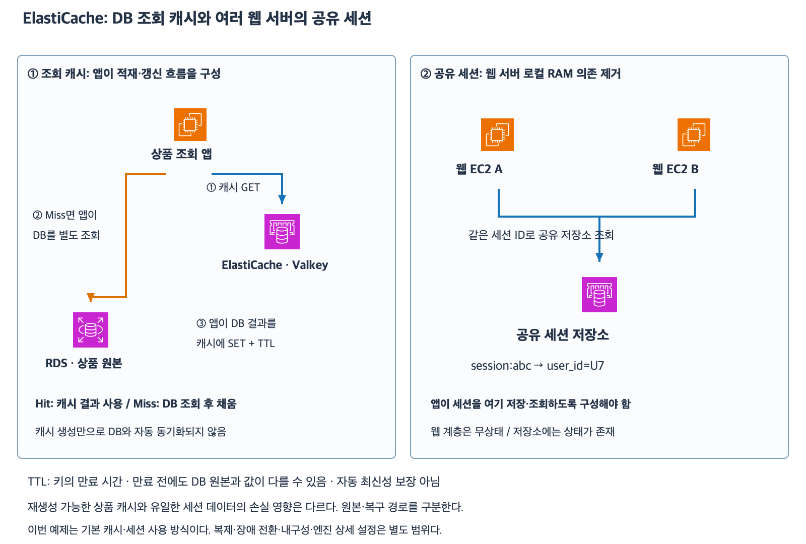

# 7주차 여덟 번째 수업: ElastiCache 조회 캐시와 공유 세션

작성: 2026-11-06
예상 35~45분 · 3/3·하위 6/6 정답 확인 완료 · 실제 AWS 변경 없음

## 1. ElastiCache와 캐시

Amazon ElastiCache는 메모리 기반 데이터 저장소·캐시 환경을 관리형으로 제공한다.
Valkey·Redis OSS·Memcached 엔진을 지원하며 이번 예제는 ElastiCache for Valkey 사용 방식이다.
엔진 선택·노드형/Serverless·복제·장애 전환·내구성 옵션·정확한 요금은 이번 범위가 아니다.
메모리 기반이라고 모든 구성에서 반드시 데이터가 전부 사라진다고 일반화하지 않는다.
실제 보호 범위는 엔진·배포·내구성·백업 설정에 따라 다르다.
이번에는 문제에서 키가 없거나 유실됐다는 상태를 명시한다.

캐시는 자주 쓰는 데이터를 빠르게 다시 사용하려고 따로 보관하는 것이다.
예를 들어 상품 상세의 원본은 RDS에 두고 조회 결과를 ElastiCache에 담을 수 있다.
이번 상품 예제의 기준 데이터 저장소는 RDS이며 캐시는 재생성 가능한 사본이다.
ElastiCache를 만들었다는 이유로 RDS 데이터가 자동으로 복사되지는 않는다.
앱이 언제 읽고 채우고 지울지 구성해야 한다.

## 2. Cache-aside 흐름

Cache-aside는 앱이 캐시를 먼저 확인하고 없으면 DB에서 읽어 채우는 패턴이다.
Lazy loading이라고도 부른다.

| 순서 | 앱의 동작 |
|---|---|
| 1 | 상품 키로 캐시 조회 |
| 2-A | 값이 있으면 사용 · Cache hit |
| 2-B | 값이 없거나 만료되면 Cache miss |
| 3 | Miss면 앱이 RDS 원본 조회 |
| 4 | 앱이 조회 결과를 캐시에 저장하고 응답 |

Cache hit는 캐시에서 값을 찾은 경우다.
Cache miss는 값이 없거나 만료되어 사용할 수 없는 경우다.
Hit일 때 캐시 값이 최신이라고 별도 검증하는 로직이 없다면 DB를 다시 조회하지 않는다.
따라서 Hit는 캐시에 값이 있다는 뜻이지 항상 원본의 최신 값이라는 뜻은 아니다.
Miss가 상품 자체가 DB에도 없다는 뜻은 아니다.
캐시가 비어도 원본이 남아 있으면 다시 조회해서 채울 수 있다.
이때 DB 조회 부하는 늘 수 있어 캐시 손실이 언제나 앱에 아무 영향 없다는 뜻도 아니다.

## 3. TTL과 오래된 캐시

TTL(Time to live)은 캐시 키를 얼마 동안 유효하게 둘지 정하는 만료 시간이다.
이번 예제에서는 키 저장 시 TTL=300초를 설정하고 읽기만으로 TTL을 연장하지 않는다.
만료 후 읽기는 그 키가 없는 것처럼 처리한다.
캐시 키 만료가 RDS 원본 상품을 삭제하는 것은 아니다.

예시 타임라인은 모두 같은 날 KST다.
12:00에 DB 가격 10000원을 캐시에 저장하고 TTL=300초를 설정했다.
12:01에 DB 가격만 12000원으로 변경했다.
캐시 무효화·갱신은 하지 않았다.
12:02 캐시 Hit라면 앱이 여전히 10000원을 사용할 수 있다.
12:06이면 기존 키는 만료돼 Miss가 되고 앱이 DB의 12000원을 읽어 캐시를 다시 채운다.

캐시 무효화(Invalidation)는 기존 캐시 값을 더 쓰지 않도록 지우거나 무효 처리하는 것이다.
DB 변경 후 캐시를 무효화하거나 갱신하는 흐름을 설계할 수 있다.
TTL은 오래된 사본이 남는 시간을 제한하는 데 도움을 주지만 변경 직후 최신성을 보장하지 않는다.
동시 읽기·쓰기와 장애 상황까지 엄격한 일관성이 필요한 업무는 추가 설계가 필요하다.
이번에는 캐시 무효화 구현과 경쟁 상황 해결은 시험하지 않는다.
캐시 읽기에 DynamoDB의 ConsistentRead=true를 붙여 RDS 원본과 최신성을 맞추는 것은 아니다.
그 옵션은 DynamoDB API의 읽기 보장이다.

## 4. 공유 세션

세션은 로그인 상태 등 요청 사이에 유지하는 사용자 상태다.
세션 ID는 해당 상태를 찾는 식별자다.
브라우저는 일반적으로 쿠키 등으로 세션 ID를 보내며 이번에는 그 ID가 정상적으로 전달된다고 가정한다.

웹 서버 A의 RAM에만 세션을 저장하면 다음 요청이 B에 도착했을 때 B가 그 내용을 자동으로 알 수 없다.
공유 저장소에 session:abc → user_id=U7 같은 상태를 두고 A·B가 같은 저장소를 조회하도록 구성할 수 있다.
그러면 B도 같은 세션 ID로 로그인 상태를 찾을 수 있다.
ElastiCache를 생성하기만 해서는 앱의 로컬 세션 저장 코드가 자동 변경되지 않는다.

이 구조의 무상태는 웹 계층이 특정 서버의 로컬 세션에 의존하지 않는다는 뜻이다.
ElastiCache의 세션 저장소와 전체 시스템에는 여전히 상태가 존재한다.
JWT 도입이 필수인 문제는 아니며 이번에는 토큰 보안·세션 인증 구현을 다루지 않는다.

## 5. 조회 캐시와 유일한 세션 데이터는 다르다

상품 캐시 키가 없어져도 원본 RDS가 정상이라면 다시 읽어서 채울 수 있다.
하지만 유일한 세션 상태를 ElastiCache에만 두었고 그 키가 실제로 유실됐으며 별도 복구 사본도 없다면 원본 DB에서 자동 복구된다고 볼 수 없다.
앱 정책에 따라 다시 로그인하도록 처리할 수 있다.
이것은 ElastiCache가 모든 장애에서 세션을 잃는다는 뜻이 아니라 키가 이미 사라진 문제 조건에서의 판단이다.
원본·복구 가능성·만료 정책을 데이터별로 구분한다.

[확대 가능한 SVG](images/elasticache-cache-session.svg)

AWS 공식 서비스 아이콘을 사용해 직접 작성한 학습용 구성도다.
상품 캐시와 세션 저장소는 서로 다른 용도의 개념 예제이며 한 캐시를 그대로 혼용해야 한다는 뜻은 아니다.
필요한 네트워크·접근 권한·캐시 클라이언트·DB 연결은 준비되어 있다.

## 6. 확인 문제 — 전체 답변과 이유

ElastiCache for Valkey 사용 예제다.
상품의 원본은 RDS이고 앱은 위 Cache-aside 흐름을 구현했다.
캐시 Hit 시 DB 재조회는 하지 않는다.
별도 자동 동기화·숨은 무효화·추가 동시 변경은 없다.
문제에서 명시한 경우 외에는 필요한 권한과 연결은 정상이다.

### 1. 조회 경로

1-1. 상품 P7 캐시 키는 없지만 RDS에는 상품이 있다.
이 상태를 Hit와 Miss 중 무엇이라 하는가?
앱이 상품을 응답하기 위해 어느 저장소를 조회하고 그 결과를 캐시에 어떻게 처리해야 하는가?
ElastiCache 생성만으로 그 흐름이 자동 구현되는가?
1-2. 별도 상황으로 상품 P7 캐시 키가 사라졌다.
RDS 원본은 그대로 정상이다.
캐시가 없다는 이유로 원본 상품도 삭제됐다고 볼 수 있는가?
다시 채울 수 있는 근거와 DB 조회 부하 영향을 설명하자.

### 2. TTL과 최신성

모두 같은 날 KST다.
12:00에 price=10000을 캐시에 저장하고 TTL=300초를 설정했다.
12:01에 RDS 가격만 12000으로 바꿨고 캐시는 갱신·무효화하지 않았다.
읽기로 TTL을 연장하지 않는다.

2-1. 12:02의 캐시 조회가 Hit라면 앱은 어떤 가격을 사용할 수 있는가?
TTL이 아직 남았으니 최신 12000을 보장한다고 볼 수 있는가?
2-2. 12:06에 다시 조회하면 기존 캐시 키는 어떻게 취급되는가?
DB 조회·캐시 적재 후 앱은 어떤 가격을 응답하는가?
캐시 만료가 DB 상품까지 삭제하는가?

### 3. 공유 세션과 상태 범위

웹 서버 A·B가 있고 브라우저가 보내는 세션 ID는 abc다.

3-1. A가 만든 session:abc를 공유 ElastiCache에 저장했고 B도 같은 저장소를 조회하도록 구현했다.
키는 존재하고 접근도 정상이다.
다음 요청이 B에 도착하면 A의 RAM을 직접 읽지 않고 로그인 상태를 찾을 수 있는가?
이때 웹 계층이 무상태라는 말은 전체 시스템에 상태가 없다는 뜻인가?
3-2. 별도 상황으로 유일한 session:abc 키가 실제로 유실됐고 다른 사본이나 복구 수단은 없다.
RDS에는 로그인 세션 원본을 저장하지 않았다.
RDS 상품 캐시처럼 DB에서 세션을 자동으로 다시 채울 수 있는가?
어떤 사용자 처리와 저장소 보호 요구를 별도로 검토해야 하는가?

답변 전 확인 문제 정답·해설은 공개하지 않는다.
답변 후 평가와 진도를 기록한다.
7주차는 진행 중이며 완료 주차는 6/32다.

## 공식 참고 자료

확인: 2026-11-06

- [ElastiCache 서비스와 지원 엔진](https://docs.aws.amazon.com/AmazonElastiCache/latest/dg/WhatIs.html)
- [Lazy loading·Hit/Miss·TTL 전략](https://docs.aws.amazon.com/AmazonElastiCache/latest/dg/Strategies.html)
- [캐시 유효성과 갱신](https://docs.aws.amazon.com/whitepapers/latest/database-caching-strategies-using-redis/cache-validity.html)
- [Valkey 캐시·세션 사용](https://aws.amazon.com/elasticache/what-is-valkey/)
- [ElastiCache 세션 저장 예시](https://aws.amazon.com/blogs/database/build-a-multi-region-session-store-with-amazon-elasticache-for-valkey-global-datastore/)
- [내구성 구성과 사용 목적 구분](https://aws.amazon.com/blogs/database/announcing-durability-for-amazon-elasticache/)
- [AWS 공식 아키텍처 아이콘](https://aws.amazon.com/architecture/icons/)
- [이전 수업](45_DynamoDB_조건부_쓰기와_트랜잭션.md)

## 답변 평가 — 2026-11-07

3문항 모두 정답이며 하위 6문항도 모두 정답이다.
1-1은 Miss·앱의 RDS 조회 후 캐시 적재·앱 로직 별도 필요가 정확하다.
1-2는 캐시 키 소실과 원본 삭제가 별개이며 원본에서 재적재 가능·Miss로 DB 부하 증가 가능을 정확히 설명했다.
지속 부하 가능이라는 표현은 캐시가 없거나 Miss가 계속되는 상황으로 이해하며 한 번 적재해도 영구히 DB를 매번 읽는다는 오개념으로 해석하지 않는다.
2-1은 만료 전 10000 응답 가능과 TTL이 최신성을 보장하지 않는다는 구분이 정확하다.
2-2는 만료 후 Miss·DB 12000 조회 및 적재·원본 상품 비삭제가 정확하다.
키 제거라는 표현은 만료 키를 사용하지 못한다는 의미로 받아들이고 물리 메모리 제거 시각까지 보장한다고 해석하지 않는다.
3-1은 공유 저장소를 조회하는 B의 로그인 확인과 웹 계층 무상태/저장소 상태 보존을 정확히 구분했다. 웹 계정은 웹 계층 철자 오타로 처리한다.
3-2는 문제 조건의 유일 세션 유실과 별도 복구 수단 부재에 따라 복구 불가·재로그인·중요 상태 보호 검토를 정확히 답했다.
모든 ElastiCache 구성에서 장애 시 복구가 불가능하다고 일반화한 답이 아니므로 별도 오답으로 처리하지 않는다.
추가 보완 질문 없이 이번 수업을 마친다.
다음 요청 시 RDS·Aurora·DynamoDB·ElastiCache를 연결하는 7주차 데이터베이스 통합 설계·종합 확인 자료를 공식 AWS 아이콘과 새로운 5문항으로 먼저 준비한다.
다음 자료는 아직 작성하지 않았다. 완료 주차는 6/32 유지다.
