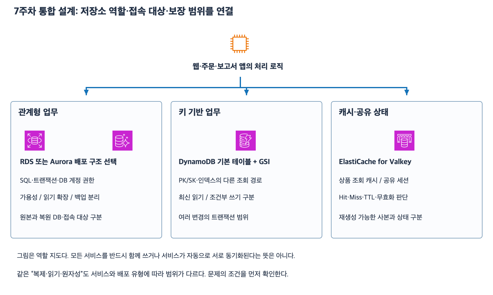

# 7주차 종합 확인: 데이터베이스 통합 설계

작성: 2026-11-07
예상 45~60분 · 정답 2문항·부분 정답 3문항 · 보완 6-1~6-5 평가 완료 · 재확인 2/2 완료 · 실제 AWS 변경 없음

## 1. 개념 연결

이번에는 새로운 서비스 대신 기존 기능을 요구에 연결한다.
저장소 역할·배포 유형·읽기 대상·쓰기 보장·복구 목적을 차례로 확인한다.

| 설계 기준 | 확인할 구분 |
|---|---|
| 관계형 데이터 처리 | 테이블 관계·SQL·업무 트랜잭션·DB 계정 권한 |
| 장애와 조회 증가 | RDS Multi-AZ DB 인스턴스 Standby와 읽기 복제본 |
| 데이터 복구 | 원본 비수정·PITR 새 DB·앱 연결 전환 |
| Aurora | 공유 볼륨·Writer/Reader·연결 단위 분산·인스턴스 AZ 배치 |
| DynamoDB | 기본 키·GSI 키·읽기 일관성·조건부 쓰기·트랜잭션 |
| ElastiCache | 앱의 캐시 적재·TTL 비최신성·공유 세션·상태 범위 |

[확대 가능한 SVG](images/database-week7-review.svg)

보존한 AWS 공식 서비스 아이콘을 사용해 직접 작성한 학습용 역할 지도다.
모든 저장소를 하나의 업무에 반드시 동시에 쓰거나 자동으로 동기화한다는 배포 구성이 아니다.
자세한 개념과 예제는 39~46번 자료를 참고한다.
각 문제는 독립적인 상황이며 지정한 후보와 배포 유형 안에서 판단한다.

## 2. 공통 조건

필요한 네트워크·권한·용량·DB 로그·백업은 지정한 범위 안에서 정상이다.
제시하지 않은 추가 변경·자동 무효화·프록시·교차 리전 복제·숨은 복구 사본은 없다.
SQL·SDK 문법 대신 대상·조건·결과와 이유를 적는다.
시각은 같은 날 KST며 정확한 복구 실행 시간·비용·API 한도 수치는 계산하지 않는다.
같은 문항 안에서 별도 상황으로 지정하면 그 조건을 새로 적용한다.
RDS Custom·Aurora Global/Serverless/쓰기 전달·DynamoDB Global Tables는 없다.
철자 자체를 다시 시험하지 않지만 실제 대상 이름과 결과 값은 문제에 맞춰 적는다.

## 3. 종합 확인 — 전체 답변과 이유

### 1. RDS 장애 대비와 과거 복구

기존 RDS for PostgreSQL을 유지한다.
대기 DB 하나인 Multi-AZ DB 인스턴스 배포이며 Primary P는 AZ-A, Standby S는 AZ-B다.
보고서 조회가 늘었고 그 조회는 약간의 지연을 허용한다.

1-1. 평상시 S에 보고서 SELECT를 보내 읽기를 확장할 수 있는가?
이 요구를 위해 어떤 별도 기능을 검토하고 쓰기·등록 직후 최신 결과 읽기는 어디로 보내야 하는가?

1-2. 별도 상황으로 수동 스냅샷은 11:00 상태다.
12:10에 정상 주문 A가 COMMIT됐고 13:40에 잘못된 삭제가 COMMIT됐다.
13:39는 정상적인 PITR 복원 가능 범위 안에 있다.
주문 A를 포함하고 삭제 전으로 돌아가려면 11:00 스냅샷과 13:39 PITR 중 무엇을 선택할까?
원본 DB가 제자리에서 과거로 바뀌는지와 앱 연결 전환 필요성을 설명하자.

### 2. Aurora 접속과 AZ 배치

단일 리전 Aurora PostgreSQL 클러스터에 Writer W와 정상 Reader R1·R2가 있다.
Writer endpoint와 Reader endpoint를 사용할 수 있고 쓰기 전달은 없다.

2-1. 주문 INSERT와 지연 허용 보고서 SELECT를 각각 어느 엔드포인트로 보낼까?
보고서 연결 하나가 R1에 맺어진 뒤 그 연결로 SELECT 50개를 실행하면 각 SQL이 R1·R2로 자동 분산되는가?
분산 단위를 설명하자.

2-2. 별도 구성에서 W·R1·R2가 모두 AZ-A에만 있다.
공유 스토리지는 여러 AZ에 중복 저장된다.
AZ-A 장애 때 다른 AZ에 실행 중인 DB 인스턴스도 이미 준비됐다고 판단할 수 있는가?
조회 처리와 승격 후보의 가용성을 높이려면 무엇의 배치를 바꿔야 하는가?

### 3. DynamoDB 조회 경로와 최신 한 건

테이블 CustomerOrders의 PK=customer_id, SK=order_id다.
GSI StatusIndex의 PK=status, SK=order_id다.
모든 키 속성은 문자열이고 조회 결과는 한 페이지에 들어간다.
3-1에서는 인덱스 반영이 완료됐고 3-2는 별도 상황이다.

| customer_id | order_id | status |
|---|---|---|
| C90 | O6101 | PAID |
| C90 | O6102 | NEW |
| C91 | O6101 | PAID |

3-1. 고객 번호를 모른 채 PAID 주문을 찾으려 한다.
Query 대상·필수 키 조건과 반환될 기본 테이블 키 값 조합을 적자.
기본 테이블 PK도 status로 바뀐 것인가?

3-2. 별도 상황으로 C90/O6102를 PAID로 변경하는 기본 테이블 쓰기가 성공했지만 GSI에는 아직 보이지 않는다.
추가 동시 쓰기는 없다.
GSI에 ConsistentRead=true를 주면 최신 상태를 확인할 수 있는가?
알고 있는 이 주문 한 건의 최신 status를 확인할 대상·API·키·옵션을 적자.

### 4. DynamoDB 재고와 주문 원자성

같은 계정·리전의 Inventory는 PK=product_id, Orders는 PK=order_id다.
stock는 숫자이고 키는 문자열이다.
재시도·타임아웃·용량 부족은 없다.

4-1. P8 재고가 1이다.
A·B가 쓰기 전에 각각 강하게 읽고 둘 다 1을 받았다.
이 사실만으로 이후 쓰기 경쟁이 방지되는가?
재고가 0보다 작아지지 않도록 감소시키려면 어떤 조건과 변경을 같은 UpdateItem에 붙여야 하는가?

4-2. 별도 상황으로 P8 stock=1이고 주문 O880은 이미 존재한다.
TransactWriteItems에 P8 재고 조건+1 감소 Update와 O880이 없다는 조건의 주문 Put을 묶었다.
주문 생성 조건 실패로 트랜잭션이 실패했다.
최종 재고와 기존 주문은 어떻게 되는가?
여러 작업을 보낸다는 이유로 BatchWriteItem도 같은 전체 성공/미반영을 보장한다고 볼 수 있는가?

### 5. ElastiCache 조회 캐시와 공유 세션

ElastiCache for Valkey를 사용하고 앱은 Cache-aside를 구현했다.
Hit 때는 원본 DB를 재조회하지 않는다.
원본 상품은 RDS에 있고 캐시가 없으면 앱이 DB에서 읽어 채운다.

5-1. 12:00에 가격 8000을 캐시에 저장하고 TTL=300초를 설정했다.
12:01에 DB 가격만 9000으로 변경했고 캐시 갱신·무효화는 없다.
읽기로 TTL을 연장하지 않는다.
12:02 Hit의 가격과 12:06 만료 후 DB 조회·재적재한 응답 가격은 각각 무엇인가?
TTL이 남았다는 사실이 최신성 보장인가?

5-2. 웹 A·B가 같은 세션 저장소를 사용하고 정상 세션 ID sid7을 받는다.
session:sid7은 존재하고 정상 조회 가능하다.
다음 요청이 B로 가면 A의 RAM을 직접 읽지 않고 로그인 상태를 찾을 수 있는가?
웹 계층 무상태와 전체 시스템 상태를 구분하자.
별도 상황으로 이 유일 세션 키가 실제 유실됐고 다른 원본·복구 사본은 없다면 상품 캐시처럼 RDS에서 자동 복구할 수 있는가?

답변 전 정답·해설은 공개하지 않는다.
5문항·하위 10문항을 모두 한 번에 제시한다.
답변 후 결론과 이유를 나눠 평가하고 필요한 부분만 보완한다.
자료 제공만으로 7주차를 완료 처리하지 않으며 현재 완료 주차는 6/32다.

## 공식 참고 자료

확인: 2026-11-07

- [RDS Multi-AZ DB 인스턴스 Standby](https://docs.aws.amazon.com/AmazonRDS/latest/UserGuide/Concepts.MultiAZSingleStandby.html)
- [RDS 시점 복원은 새 DB 생성](https://docs.aws.amazon.com/AmazonRDS/latest/UserGuide/USER_PIT.html)
- [Aurora Reader endpoint 연결 분산](https://docs.aws.amazon.com/AmazonRDS/latest/AuroraUserGuide/Aurora.Endpoints.Reader.html)
- [Aurora 저장·DB 인스턴스 가용성](https://docs.aws.amazon.com/AmazonRDS/latest/AuroraUserGuide/Concepts.AuroraHighAvailability.html)
- [DynamoDB GSI](https://docs.aws.amazon.com/amazondynamodb/latest/developerguide/GSI.html)
- [DynamoDB 읽기 일관성](https://docs.aws.amazon.com/amazondynamodb/latest/developerguide/HowItWorks.ReadConsistency.html)
- [조건 표현식](https://docs.aws.amazon.com/amazondynamodb/latest/developerguide/Expressions.ConditionExpressions.html)
- [트랜잭션과 Batch 차이](https://docs.aws.amazon.com/amazondynamodb/latest/developerguide/transaction-apis.html)
- [ElastiCache 캐시 전략](https://docs.aws.amazon.com/AmazonElastiCache/latest/dg/Strategies.html)
- [AWS 공식 아이콘](https://aws.amazon.com/architecture/icons/)
- [이전 수업](46_ElastiCache_조회_캐시와_공유_세션.md)

## 2026-11-08 답변 평가

| 문항 | 평가 | 확인한 내용과 보완 |
|---|---|---|
| 1 | 정답 | 1-1의 별도 읽기 기능은 RDS 읽기 복제본(Read Replica)이다. 쓰기와 직후 최신 읽기는 Primary P로 보낸다는 판단과 복제 지연 이유가 정확하다. 1-2는 13:39 PITR로 주문 A를 보존한 새 DB를 만들고 앱을 연결한다는 설명이 정확하다. 원본은 그대로 존재한다. |
| 2 | 부분 정답 | 2-1에서 주문은 Writer endpoint로 보낸다. 보고서 SELECT의 접속 주소는 Reader endpoint다. SELECT는 SQL 명령이다. R1에 맺어진 한 연결의 쿼리는 R1에서 처리된다는 판단은 정확하다. 2-2의 다른 AZ에 DB 인스턴스를 배치한다는 판단도 정확하다. |
| 3 | 부분 정답 | 3-1의 Query 대상과 두 결과 행은 정확하다. 조건은 속성 이름만 쓰는 것이 아니라 status=PAID다. 반환 행의 기본 테이블 키는 customer_id와 order_id이며 값은 C90/O6101과 C91/O6101이다. 3-2는 기본 테이블과 키 및 강한 읽기 옵션이 맞고 API 이름 GetItem이 빠졌다. |
| 4 | 부분 정답 | 강한 읽기로 이후 경쟁을 막을 수 없다는 판단은 정확하다. 4-1에서는 재고가 정확히 1일 때도 1개를 판매해야 하므로 stock>=1 조건과 stock을 1 줄이는 갱신을 한 UpdateItem에 넣는다. 4-2의 재고 1과 BatchWriteItem 부분 성공 가능성은 맞다. 기존 O880은 유지되고 이번 새 Put만 반영되지 않는다. |
| 5 | 정답 | 5-1은 8,000원과 9,000원이 맞다. TTL은 캐시 만료 기준이며 남은 TTL이 최신 가격을 보장하지 않는다. 5-2는 B가 공유 저장소에서 세션을 찾고 상태는 외부 저장소에 남으며 유일한 세션 키 유실은 RDS에서 복구할 수 없다는 구분이 맞다. |

## API와 키 구분 보충

이 문제에서 API는 앱이 DynamoDB에 요청하는 작업 이름을 뜻한다.
키를 정확히 아는 아이템 하나를 읽는 작업은 GetItem이다.
파티션 키 조건에 맞는 아이템을 모아 조회하는 작업은 Query다.
따라서 3-2는 CustomerOrders 기본 테이블에 GetItem을 요청하고 customer_id=C90 및 order_id=O6102와 ConsistentRead=true를 지정한다.

| 구분 | 이 문제의 값 |
|---|---|
| GSI Query의 파티션 키 조건 | status=PAID |
| GSI의 정렬 키 속성 | order_id |
| 결과에서 읽는 기본 테이블 키 | customer_id + order_id |
| 기본 테이블 키 값 두 쌍 | C90/O6101 및 C91/O6101 |

트랜잭션의 실패 범위는 이번에 제출한 변경이다.
중복 주문 조건이 실패하면 이번 재고 감소와 새 주문 Put이 모두 반영되지 않는다.
이미 존재하던 주문은 기존 상태를 유지한다.

## 보완 확인 — 하위 질문 5개

6-1. Aurora에서 새 보고서 연결을 정상 Reader들에 분산하려면 앱은 어떤 엔드포인트에 접속해야 하는가?

6-2. 3-1의 표에서 NEW 주문을 고객 번호 없이 찾는다.
Query 대상과 키 조건 값 및 반환되는 기본 테이블 키 값 조합을 적자.

6-3. C91/O6101의 기본 테이블 쓰기가 성공했다.
후속 동시 쓰기가 없을 때 이 한 건을 최신 상태로 확인할 대상과 작업 이름 및 키·옵션을 적자.

6-4. 재고가 2인 상품을 2개 판매한다.
한 UpdateItem에 넣을 재고 조건과 재고 변경을 적자.

6-5. 위 재고 감소와 새 주문 Put을 한 트랜잭션으로 묶었다.
같은 ID의 주문이 이미 있어 새 Put 조건이 실패했다.
재고와 기존 주문은 각각 어떻게 되는가?

최초 평가는 정답 2문항과 부분 정답 3문항이다.
보완 답변을 별도로 평가하고 7주차 완료 여부는 이후 회상 복습까지 확인한다.

## 2026-11-08 보완 평가

| 번호 | 평가 | 해설 |
|---|---|---|
| 6-1 | 정답 | 새 보고서 연결은 Reader endpoint를 사용한다. |
| 6-2 | 부분 정답 | 조건 status=NEW는 맞다. 조회 대상은 GSI StatusIndex다. customer_id와 order_id는 기본 테이블의 키 속성 이름이며 반환되는 값은 C90/O6102다. |
| 6-3 | 정답 | 기본 테이블에서 C91/O6101을 GetItem으로 읽고 ConsistentRead=true를 지정한다. |
| 6-4 | 오답 | 2개 판매를 한 번의 UpdateItem으로 처리하려면 stock>=2와 stock=stock-2를 같은 요청에 넣는다. 재고가 정확히 2개라면 조건을 통과해 0이 된다. |
| 6-5 | 정답 | 이번 트랜잭션의 변경 전체가 미반영된다. 재고는 2이고 기존 주문은 유지된다. |

보완 결과는 정답 3문항과 부분 정답 1문항 및 오답 1문항이다.
최초 종합 확인 점수는 정답 2문항과 부분 정답 3문항이다.

## 재확인 — 하위 질문 2개

7-1. Orders 테이블의 기본 키는 customer_id와 order_id다.
GSI StatusIndex의 파티션 키는 status다.
SHIPPED인 항목은 C72/O804 한 건이다.
고객 번호 없이 이 항목을 찾으려면 Query를 어느 대상에 보내고 어떤 조건을 쓰는가?
반환된 항목을 기본 테이블에서 다시 찾는 데 사용할 키 값도 적자.

7-2. 재고 4개 중 3개를 한 번에 판매한다.
한 UpdateItem에 넣을 조건과 갱신식 및 성공 후 재고를 적자.

답변 후 위 두 항목을 평가한다.

## 2026-11-08 재확인 평가 — 2/2

7-1. 정답으로 평가한다.
Query 대상이 GSI이고 결과의 기본 테이블 키 값이 C72/O804라는 판단이 정확하다.
인덱스 이름은 StatusIndex다.
SIPPED는 문제의 SHIPPED를 옮겨 적을 때 생긴 오타로 처리한다.
실제 Query에는 정확히 status = "SHIPPED"를 사용한다.

7-2. 정답.
재고가 3 이상일 때 현재 재고에서 3을 빼는 변경을 같은 UpdateItem에 넣는다.
초기 재고 4에서 성공 후 재고는 1이다.

최초 평가와 첫 보완 점수는 각각 당시 기록으로 유지한다.
다음은 7주차 마지막 회상 복습이다.
