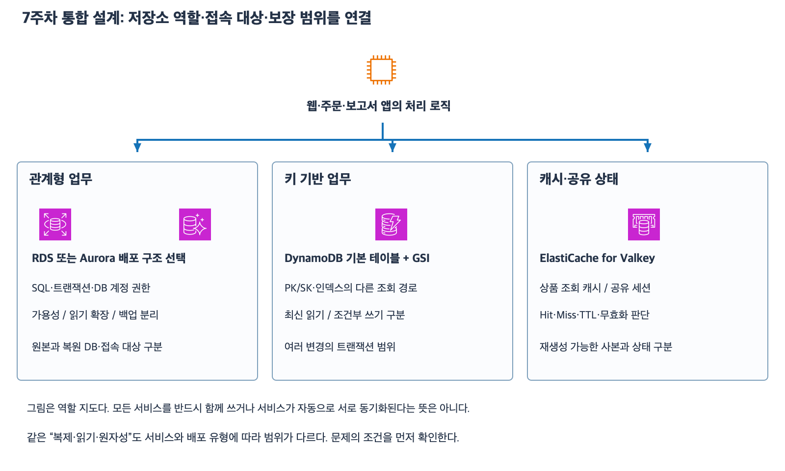

# 7주차 마지막 수업 — 데이터베이스 회상 복습

작성 2026-11-08
예상 15~20분 · 평가 완료 · 정답 2문항과 부분 정답 1문항 · 보완 확인 완료 · 7주차 완료

## 진행 방식

종합 확인의 최초 평가와 보완 결과는 47번 자료에 기록했다.
GSI 조회 대상과 기본 테이블 키 값 및 판매 수량을 반영한 재고 조건은 후속 확인에서 2/2였다.
이번에는 운영 상황 세 가지에서 필요한 판단과 이유를 자기 말로 설명한다.
문제 조건과 그림은 보면서 답해도 된다.
각 하위 질문은 별도 상황이다.

[확대 가능한 SVG](images/database-week7-review.svg)

47번 자료의 역할 지도를 재사용한다.
AWS 공식 서비스 아이콘으로 작성한 학습용 그림이다.

## 1. 관계형 DB의 조회와 복구

1-1. RDS for PostgreSQL에 Multi-AZ DB 인스턴스 배포의 Primary와 Standby 및 별도 읽기 복제본이 있다.
보고서 조회는 복제 지연을 허용한다.
보고서가 사용할 대상을 고르고 그 대상이 적절한 이유를 설명하자.

1-2. 14:00에 정상 결제가 커밋됐고 14:05에 잘못된 삭제가 커밋됐다.
정상 결제를 보존하려고 복원 가능 범위 안의 14:04로 PITR을 실행했다.
복원이 끝난 뒤 앱이 복원된 데이터를 사용하도록 연결을 어떻게 처리하는가?
복원 대상이 현재 운영 DB 자체인지 새 DB인지도 설명하자.

## 2. 주문 처리와 최신 읽기

2-1. Orders 기본 테이블의 키는 customer_id와 order_id다.
C31/O720을 PAID로 변경하는 쓰기가 성공했으나 상태별 GSI에는 아직 반영되지 않았다.
후속 동시 쓰기는 없다.
결제 확인 화면에서 이 한 건의 최신 상태를 읽을 대상과 작업 이름 및 키·옵션을 적자.

2-2. 재고가 3인 상품을 2개 구매하는 요청이다.
기존 주문 ID와 중복되면 재고 감소도 반영하지 않아야 한다.
재고 조건·갱신과 주문 생성 조건을 어떤 작업으로 묶을지 설명하자.
중복 주문 조건이 실패했을 때 최종 재고와 기존 주문 상태를 적자.

## 3. 캐시와 세션의 상태

3-1. Cache-aside 상품 캐시에 가격 5,000원이 남아 있고 TTL이 1분 남았다.
원본 DB 가격은 이미 6,000원이다.
앱은 캐시 Hit 때 DB를 다시 읽거나 캐시를 갱신하지 않는다.
현재 응답 가격과 그 이유를 설명하자.

3-2. 웹 서버들이 공유하는 저장소에서 고객의 유일한 세션 키가 유실됐다.
별도 원본이나 복구 사본은 없다.
고객 요청을 다른 웹 서버로 보내면 기존 로그인 상태를 그대로 이어갈 수 있는가?
공유 세션의 상태가 어디에 있었는지 근거로 설명하자.

## 평가와 다음 단계

사용자 답변을 받은 뒤 해설과 평가를 추가한다.
종합 확인·보완·이번 회상 결과를 함께 검토해 7주차 완료 여부를 판단한다.
8주차는 기초 종합 점검이다.

## 복습 자료

- [RDS 장애 대비와 읽기 복제본](40_RDS_MultiAZ와_읽기_복제본.md)
- [RDS 시점 복원](41_RDS_백업_스냅샷_시점_복원.md)
- [DynamoDB GSI와 읽기 일관성](44_DynamoDB_GSI와_읽기_일관성.md)
- [DynamoDB 조건부 쓰기와 트랜잭션](45_DynamoDB_조건부_쓰기와_트랜잭션.md)
- [ElastiCache 조회 캐시와 공유 세션](46_ElastiCache_조회_캐시와_공유_세션.md)
- [7주차 종합 확인과 보완 평가](47_7주차_데이터베이스_종합_확인.md)

## 2026-11-08 회상 평가

| 번호 | 평가 | 해설 |
|---|---|---|
| 1-1 | 정답 | 지연을 허용하는 보고서는 읽기 복제본으로 보내 Primary의 조회 부담을 줄인다. 이번 배포의 Standby는 장애 조치용이다. |
| 1-2 | 정답 | PITR은 새 DB 인스턴스를 만들며 앱을 그 엔드포인트로 전환한다. |
| 2-1 | 부분 정답 | 기본 테이블, GetItem, ConsistentRead=true는 정확하다. 요청의 키에는 속성 이름과 함께 customer_id=C31 및 order_id=O720을 지정한다. |
| 2-2 | 부분 정답 | 작업 이름은 TransactWriteItems다. 재고 Update에는 stock>=2 조건과 stock=stock-2 갱신을 넣고 주문 Put에는 주문 키가 존재하지 않는다는 조건을 붙인다. 중복 조건 실패 시 재고는 3으로 유지되고 기존 주문은 그대로다. 실패 결과에 대한 설명은 정확하다. |
| 3-1 | 정답 | 캐시 Hit이므로 저장된 5,000원을 반환한다. |
| 3-2 | 정답 | 로그인 상태는 공유 세션 저장소에 있었으므로 유일한 키가 유실되면 다른 웹 서버에서도 기존 상태를 이어갈 수 없다. |

큰 문항 기준 정답 2문항과 부분 정답 1문항이다.
하위 질문 기준 정답 4개와 부분 정답 2개다.
이번에는 두 답변에서 생략한 구체적인 입력만 확인한다.

## 보완 확인

4-1. 같은 Orders 기본 테이블에서 C42/O815를 GetItem으로 조회한다. 요청에 넣는 두 키의 이름과 값을 적자.

4-2. 재고 5개 중 3개를 구매한다. 한 TransactWriteItems에 넣는 재고 조건과 감소량 및 새 주문 Put 조건을 적자.

보완 답변을 받은 뒤 7주차 완료 여부를 판단한다.

## 2026-11-08 보완 평가

4-1. 정답. 키 값은 customer_id=C42와 order_id=O815다. order-id는 order_id로 표기를 보완한다.
4-2. 부분 정답. stock>=3과 stock=stock-3은 정확하다. 새 주문 Put에 붙이는 기존 주문 키 부재 조건이 생략되었다.

4-3. 같은 주문 ID가 이미 있을 때 이번 트랜잭션이 실패하도록 하려면 새 주문 Put에 어떤 조건을 붙이는가? 자연어 한 문장으로 답한다.

### 2026-11-08 보완 4-3 평가와 주차 완료

4-3은 정답이다.
새 주문 Put의 조건은 해당 주문 키가 존재하지 않는다는 것이다.
기존 주문이 있으면 이번 트랜잭션이 실패하고 재고 감소와 새 주문 생성은 모두 반영되지 않는다.

최초 종합 평가와 회상 평가 및 이후 보완 평가를 구분해 기록한다.
GSI 조회와 실제 기본 키 값 및 조건부 재고 감소와 주문 중복 방지까지 보완 확인을 완료했다.
2026-11-08 기준 7주차 데이터베이스를 완료했다.
완료 주차는 7/32다.
다음은 8주차 기초 종합 점검이다.
