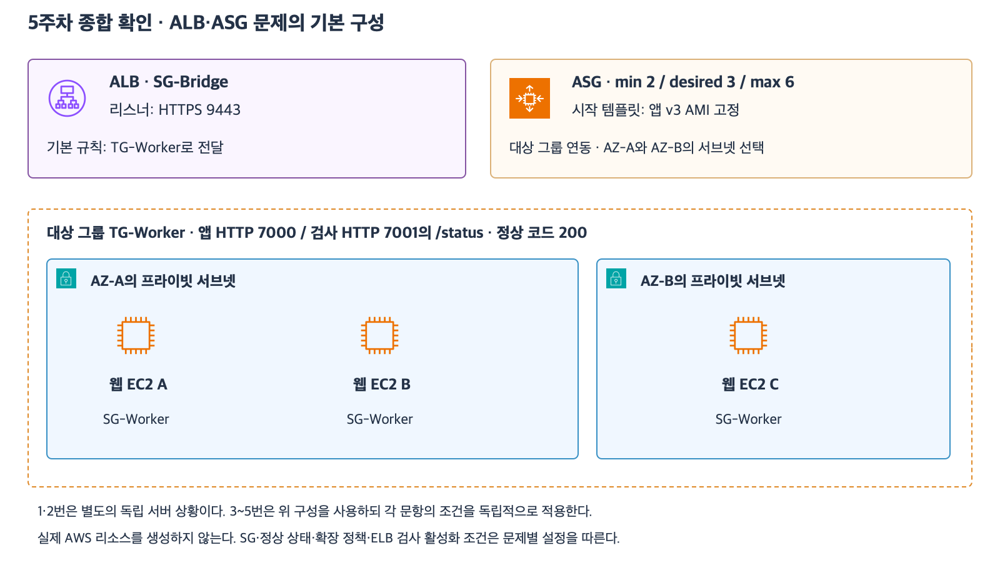

# 8주차 첫 수업 — 두 AZ 웹 서비스 설계

작성 2026-11-08
예상 25~35분 · 설계 4문항과 하위 정답 3개·부분 정답 5개 · 보완 6/6 정답

## 구성과 요구사항

한 리전의 VPC에 AZ-A와 AZ-B가 있다.
브라우저는 인터넷에서 HTTPS 9443으로 접속한다.
웹 EC2는 사설 IPv4만 사용한다.
대상 그룹은 앱 요청을 HTTP 7000으로 보내고 상태 검사는 HTTP 7001의 /status에서 한다.
AZ 하나의 장애를 견디도록 웹 계층과 주문 DB를 설계한다.
남은 AZ의 용량은 충분하고 정상인 웹 대상이 최소 하나 남는다고 가정한다.

[확대 가능한 SVG](images/week5-comprehensive-current.svg)

5주차 그림에서 ALB와 대상 그룹 및 두 AZ의 웹 EC2 구성을 재사용한다.
그림의 이전 문제 번호는 5주차용이다. 이번에는 아래 1-1부터 4-2까지 답한다.
상태가 필요할 때 사용되는 DB와 공유 세션 저장소 및 S3는 아래 요구사항에서 설계한다.
각 하위 질문은 별도 상황이다.

## 1. 인터넷 접점과 웹 접근

1-1. 인터넷에서 접근하는 ALB와 사설 IPv4만 있는 웹 EC2를 각 AZ의 어떤 종류의 서브넷에 배치할까?
브라우저에서 웹까지 요청이 거치는 구성과 구간별 포트를 순서대로 적자.

1-2. 웹 EC2가 앱 요청과 헬스 체크를 ALB에서만 받도록 하려 한다.
웹 SG에 필요한 인바운드 규칙의 출발지와 포트를 적자.
ALB의 아웃바운드와 네트워크 경로 등 나머지 조건은 갖춰져 있다.

## 2. 장애 처리와 새 인스턴스

2-1. 웹 A의 EC2 상태 검사는 통과하지만 ALB 헬스 체크는 실패한다. 다른 대상은 정상이다.
대상 그룹이 A를 비정상으로 판정한 뒤 새 요청을 어디로 보내는가?
ASG는 EC2 상태 검사만 사용한다. A를 앱 장애로 교체 대상으로 삼으려면 ASG의 어떤 검사 설정을 추가해야 하는가?

2-2. 시작 템플릿을 앱 v3 AMI에서 앱 v4 AMI를 쓰는 버전으로 바꾸고 ASG가 그 버전을 사용하도록 지정했다.
이후 새로 시작한 EC2와 이미 실행 중이던 EC2의 앱 버전은 각각 무엇인가?
기존 EC2까지 바꾸려면 어떤 배포 또는 교체 작업이 필요한가?

## 3. 주문 DB와 로그인 상태

3-1. 기존 RDS for PostgreSQL을 사용한다.
목표는 한 AZ의 장애에 대비하는 것이고 비교 후보는 대기 DB 하나인 Multi-AZ DB 인스턴스 배포와 일반 읽기 복제본이다.
어느 구성을 선택하는가?
Primary 장애 조치 중 앱의 기존 DB 연결에 어떤 처리가 필요한가?

3-2. 웹 A에서 로그인한 사용자의 다음 요청이 웹 B로 간다.
로그인 상태는 현재 A의 RAM에만 있다.
웹 A를 교체해도 로그인 상태를 유지하려면 세션 상태를 어디에 두고 B는 무엇으로 찾아야 하는가?
공유 저장소와 세션 키는 정상이라고 가정한다.

## 4. 업로드와 AWS 권한

4-1. 업로드 파일은 여러 웹 서버가 객체 키로 접근해야 하고 웹 EC2 교체 후에도 남아 있어야 한다.
각 웹 EC2의 루트 EBS와 공유 S3 버킷 중 어느 쪽에 저장하는가?
그 선택을 인스턴스 교체와 다른 서버에서의 조회 관점에서 설명하자.

4-2. 웹 앱은 비공개 S3 버킷 shop-files의 uploads/ 아래에 객체를 저장한다.
이 작업의 Action과 Resource 범위를 적자.
장기 액세스 키를 배포하지 않고 웹 EC2에 이 권한을 부여하는 방법도 설명하자.
암호화 키나 멀티파트 업로드의 추가 권한은 이번 범위에서 제외한다.

## 평가

전체 8개 하위 질문의 결론과 이유를 확인한다.
답변 후 해설을 추가한다.
다음 수업은 새로운 기초 확인 20문항이다.
설계와 기초 확인 및 필요한 보완을 함께 평가한 뒤 8주차 완료 여부를 판단한다.

## 복습 자료

- [라우팅과 서브넷](18_라우팅과_퍼블릭_프라이빗_서브넷.md)
- [보안 그룹 참조](20_SG_참조와_최소권한_설계.md)
- [ALB·ASG 통합 설계](29_ALB_ASG_통합_설계와_확장_정책.md)
- [S3 객체 작업과 권한](33_S3_저장_조회와_접근_권한.md)
- [RDS Multi-AZ와 읽기 복제본](40_RDS_MultiAZ와_읽기_복제본.md)
- [공유 세션](46_ElastiCache_조회_캐시와_공유_세션.md)

## 2026-11-08 평가

| 문항 | 평가 | 해설 |
|---|---|---|
| 1-1 | 정답 | 두 AZ의 퍼블릭 서브넷에 인터넷용 ALB를 두고 웹은 프라이빗 서브넷에 둔다. 브라우저→ALB는 HTTPS 9443, ALB→웹은 HTTP 7000이다. |
| 1-2 | 부분 정답 | 출발지 SG-Bridge와 TCP 7001은 맞다. 앱 트래픽용 TCP 7000도 같은 출발지에서 허용한다. |
| 2-1 | 부분 정답 | 정상 대상이 남아 있으므로 ALB는 새 요청을 정상 대상에게 보낸다. ASG에는 ELB 헬스 체크를 활성화해야 ALB의 비정상 결과를 교체 판단에 반영한다. |
| 2-2 | 부분 정답 | 새 인스턴스는 v4, 기존 인스턴스는 v3이라는 구분이 맞다. v4 AMI를 적용하려면 Instance Refresh 등으로 기존 EC2를 교체한다. 기존 서버를 유지한다면 앱 v4를 별도로 배포한다. 단순 재시작은 기존 디스크로 부팅한다. |
| 3-1 | 정답 | Multi-AZ DB 인스턴스 배포를 선택하고 끊어진 연결을 재수립한다. 같은 DB 엔드포인트로 다시 연결해 승격된 Primary에 접속한다. |
| 3-2 | 부분 정답 | 공유 세션 저장소 선택은 맞다. B는 요청에 담긴 세션 ID로 해당 세션을 조회한다. |
| 4-1 | 정답 | 여러 EC2가 같은 S3 객체에 접근하며 파일 수명은 웹 인스턴스 교체와 분리된다. |
| 4-2 | 부분 정답 | PutObject와 EC2 IAM 역할 선택은 맞다. 정책에는 s3:PutObject와 arn:aws:s3:::shop-files/uploads/*를 지정한다. 인스턴스 프로파일을 통해 역할을 EC2에 연결한다. |

### 보완 확인

5-1. SG-Bridge에서 앱과 헬스 체크를 모두 받는 웹 SG의 TCP 포트 두 개를 적자.

5-2. 대상 A는 비정상이고 B는 정상이다. ALB는 새 요청을 어느 대상으로 보내는가?

5-3. EC2 검사에 통과한 A를 ALB 검사 결과에 따라 교체 대상으로 삼으려면 ASG에 어떤 검사 유형을 활성화하는가?

5-4. ASG는 v4 AMI를 가리킨다. 기존 v3 EC2를 v4 AMI로 순차 교체하는 기능의 이름을 적자.

5-5. 다른 웹 서버가 공유 저장소에서 로그인 상태를 찾을 때 어떤 식별자를 사용하는가?

5-6. shop-files의 uploads/ 아래 모든 객체에 저장을 허용하는 Action과 Resource를 전체 표기로 적자.

### 참고

- [ALB 대상 상태와 요청 라우팅](https://docs.aws.amazon.com/elasticloadbalancing/latest/application/target-group-health-checks.html)
- [ASG의 ELB 헬스 체크](https://docs.aws.amazon.com/autoscaling/ec2/userguide/health-checks-overview.html)
- [ASG 인스턴스 교체](https://docs.aws.amazon.com/autoscaling/ec2/userguide/ec2-auto-scaling-group-replacing-instances.html)

## 2026-11-08 보완 평가 — 6/6

| 번호 | 확인한 답 |
|---|---|
| 5-1 | 앱 요청 TCP 7000과 헬스 체크 TCP 7001을 허용한다. |
| 5-2 | ALB는 정상 대상 B로 새 요청을 보낸다. |
| 5-3 | ASG에 ELB 헬스 체크를 활성화한다. |
| 5-4 | Instance Refresh로 순차 교체한다. |
| 5-5 | 세션 ID로 공유 저장소의 로그인 상태를 조회한다. |
| 5-6 | Action은 s3:PutObject이며 Resource는 arn:aws:s3:::shop-files/uploads/*다. |

최초 하위 평가 정답 3·부분 정답 5와 별도로 보완 6/6을 기록한다.
두 AZ 웹 서비스 설계의 보완 확인을 마쳤다.
다음 수업은 1~7주차의 새로운 기초 확인 20문항이다.
