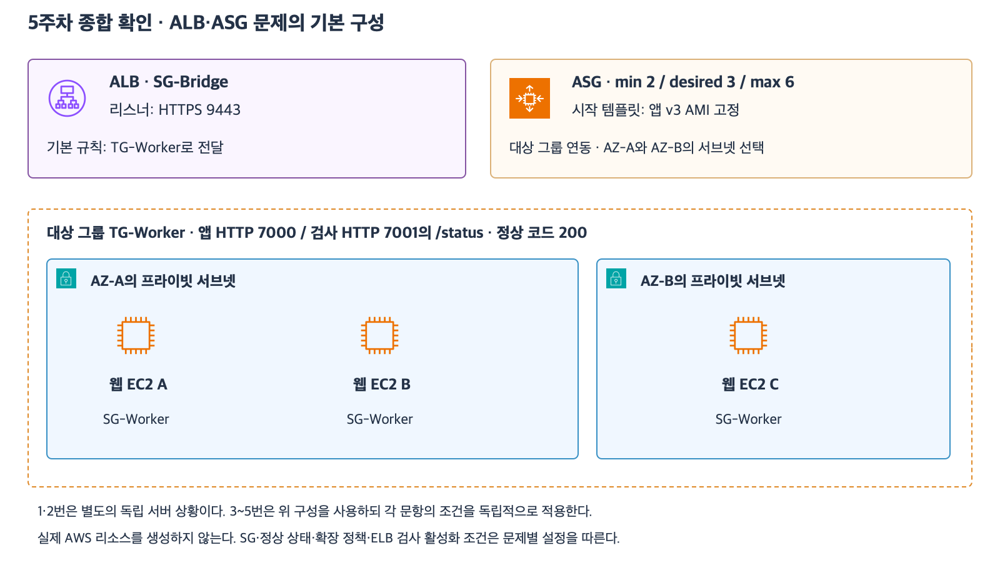

# 8주차 기초 종합 확인 — 20문항

작성 2026-11-08
예상 40~60분 · 1~7주차 범위 · 답변 대기

각 번호에 결론과 핵심 이유를 한두 문장으로 적는다.
문항은 서로 독립적이다.
20문항 중 16문항 이상과 앞선 설계 근거 설명이 이번 학습 목표다.
부분 정답은 따로 기록하고 필요한 개념을 보완한 뒤 8주차 완료를 판단한다.

[확대 가능한 SVG](images/week5-comprehensive-current.svg)

그림은 5주차 학습 자료에서 가져온 참고 구성이다.
이번 문항에 사용하는 수치와 조건은 각 문항의 본문을 따른다.

## 1~6. 클라우드와 IAM

1. 한 리전의 AZ 두 곳에 웹 서버를 나눴다. 해당 리전 전체의 접속 장애까지 견딘다고 판단할 수 있는가?
2. AWS 제공 이미지로 만든 EC2의 게스트 OS에서 보안 취약점이 발견됐다. 이 OS의 패치는 누가 담당하는가?
3. 축제 기간에 웹 서버를 3대에서 12대로 늘리고 종료 후 3대로 줄인다. 수직·수평 중 어떤 확장이며 수요에 따른 증감은 어떤 특성인가?
4. EC2 보고서 앱에 S3 읽기 권한이 필요하다. 앱이 장기 키를 보관하지 않고 권한을 얻도록 어떤 구성을 사용하는가?
5. 한 역할의 권한 정책에 필요한 S3 읽기가 이미 허용돼 있다. 신뢰 정책은 Lambda만 허용한다. EC2가 역할을 맡도록 어느 정책을 어떻게 바꾸는가?
6. 읽기만 허용된 운영자가 FIDO 보안 키로 로그인했다. 이 로그인으로 삭제 권한도 생기는가? 인증과 인가를 구분하자.

## 7~11. 네트워크와 VPC

7. 브라우저가 https://portal.example.com:9443/orders에 접속한다. DNS가 조회할 이름과 웹 연결의 목적지 포트를 적자.
8. 10.30.8.0/24는 이미 서브넷에 배정됐다. 같은 VPC의 다른 AZ에 10.30.8.192/26을 새 서브넷으로 배정할 수 있는가? 주소 범위를 근거로 설명하자.
9. 사설 IPv4만 있는 EC2가 퍼블릭 NAT를 거쳐 업데이트 파일을 받는다. 인터넷 업데이트 서버가 보는 출발지 IPv4는 어느 구성의 주소인가?
10. RT에 10.40.0.0/16 → local과 0.0.0.0/0 → NAT가 있다. 10.40.8.25로 보내는 요청에 어떤 경로를 선택하는가? 이유를 적자.
11. DB SG가 TCP 5432의 출발지로 SG-App과 10.40.0.0/16을 모두 허용한다. SG-App이 없는 10.40.9.30 서버는 DB SG를 통과할 수 있는가? 다른 조건은 모두 갖췄다.

## 12~14. 컴퓨팅

12. EBS 기반 EC2를 종료한다. 루트 볼륨의 DeleteOnTermination은 true이며 추가 데이터 볼륨은 false다. 두 볼륨은 각각 어떻게 되는가?
13. ALB가 대상의 HTTP 8080으로 앱 요청을 보내고 HTTP 8081로 헬스 체크한다. 대상 SG가 ALB SG에서 오는 TCP 8080만 허용한다. 헬스 체크를 통과시키기 위해 대상 SG에서 무엇을 추가하는가? 앱은 두 포트에서 정상이다.
14. ASG의 시작 템플릿을 v2 AMI로 변경한 뒤 수요 증가로 EC2가 한 대 추가됐다. 기존 v1 서버와 새 서버의 앱 버전은 각각 무엇인가? 기존 서버를 v2 AMI로 순차 교체할 기능도 적자.

## 15~17. 스토리지

15. 버전 관리가 활성화된 S3 버킷에서 report.csv를 VersionId 없이 삭제했다. 이전 버전을 영구 삭제한 기록은 없다. 일반 GET이 실패할 때 어떤 상태인지 판단하고 이전 내용을 다시 현재로 보이게 할 방법 하나를 적자.
16. 월 1회 정도 조회하는 파일이다. 사전 복원 없이 즉시 읽어야 하고 여러 AZ에 저장해야 한다. S3 Standard-IA와 S3 Glacier Flexible Retrieval 중 어느 쪽이 요구에 맞는가?
17. 두 AZ의 Linux EC2가 동일한 디렉터리에서 파일을 함께 읽고 수정해야 한다. EFS Regional과 각 EC2에 별도로 연결한 EBS 중 어느 쪽을 선택하는가? 이유를 적자.

## 18~20. 데이터베이스

18. RDS의 10:00 수동 스냅샷이 있다. 10:20 정상 주문 이후 10:45에 잘못된 삭제가 커밋됐다. 10:44가 PITR 가능 범위에 있다. 정상 주문을 포함해 복구할 방법과 복원 후 앱의 연결 대상을 적자.
19. DynamoDB 재고가 6개이고 4개를 한 번에 판매한다. 재고 조건·감소량과 주문 키가 없을 때만 생성하는 Put을 어떤 작업으로 묶는가? 주문 중복으로 조건이 실패하면 재고가 몇 개인가?
20. Cache-aside 캐시에 가격 12,000원이 남아 있고 TTL도 유효하다. 원본 가격은 13,000원이며 앱은 캐시 Hit 때 DB를 다시 읽지 않는다. 이번 응답 가격과 TTL이 의미하는 것을 적자.

## 참고 자료

- [두 AZ 웹 서비스 설계와 보완 평가](49_8주차_두_AZ_웹서비스_설계.md)
- [5주차 컴퓨팅 종합 확인](30_5주차_종합_확인.md)
- [6주차 스토리지 종합 확인](37_6주차_스토리지_종합_확인.md)
- [7주차 데이터베이스 종합 확인](47_7주차_데이터베이스_종합_확인.md)
