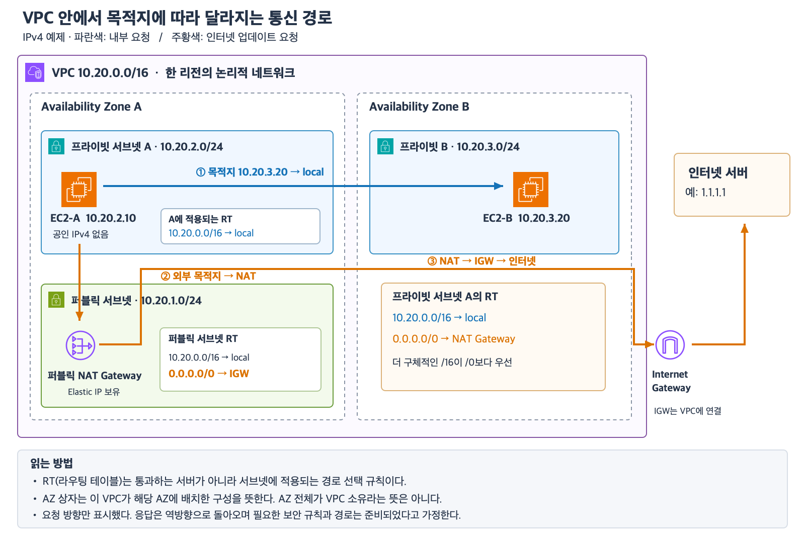
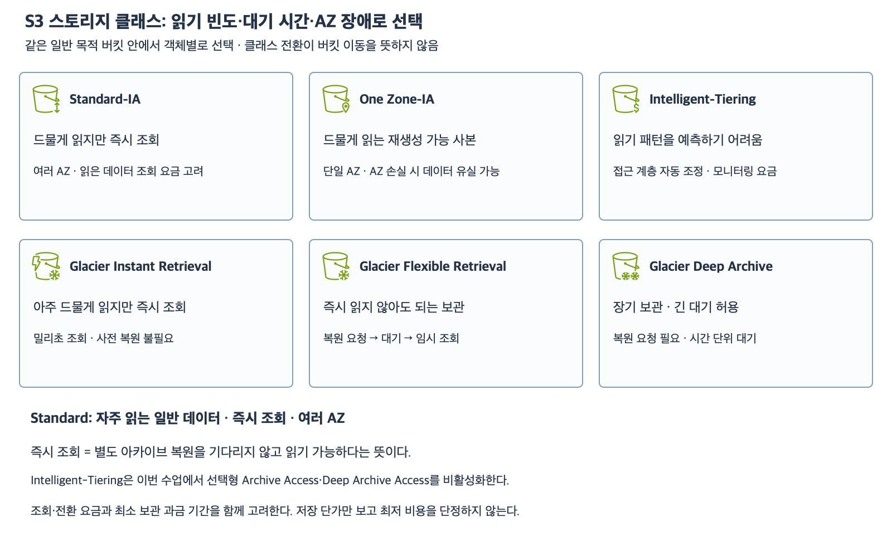
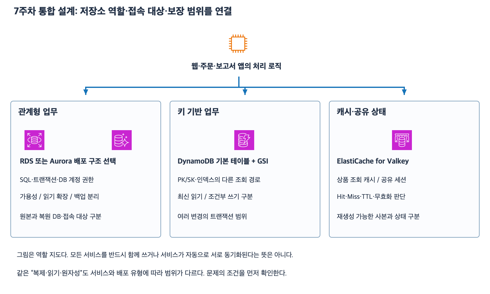

# AWS 1~8주차 개념과 용어 정리

9주차 전 복습용 자료다.
영문 용어와 한 줄 정의를 연결하고 비슷한 이름은 적용 조건으로 구분한다.

## 1주차 · AWS 인프라와 장애 범위

| 용어 | 뜻과 판단 기준 |
|---|---|
| Region / AZ(Availability Zone) | 리전은 지리적 영역이다. AZ는 리전 안에서 장애를 격리하는 인프라 단위다. |
| Multi-AZ / Multi-Region | 여러 AZ는 한 리전 안의 AZ 장애에 대비한다. 리전 장애에 대비하려면 별도 리전에 복구할 데이터와 서비스 전환 경로가 필요하다. |
| High Availability(고가용성) / Failover(장애 조치) | 고가용성은 장애 중에도 서비스를 계속 제공할 수 있는 성질이다. 장애 조치는 장애가 난 구성 요소에서 준비된 대체 구성 요소로 넘어가는 과정이다. |
| Shared Responsibility Model(공동 책임 모델) | AWS는 클라우드 인프라를 보호한다. 고객은 데이터·접근 권한·서비스 설정을 관리한다. EC2 게스트 OS 패치도 고객 책임이다. |
| Scalability(확장성) / Elasticity(탄력성) | 확장성은 부하 증가를 감당하도록 용량을 키울 수 있는 능력이다. 탄력성은 수요에 맞춰 용량을 늘리고 줄이는 성질이다. |
| Vertical / Horizontal Scaling | 수직 확장은 한 대의 성능을 키운다. 수평 확장은 서버 수를 늘린다. 서버 8대가 같은 AZ에 있으면 그 AZ의 장애 범위에 함께 들어간다. |
| Pay-as-you-go(사용량 기반 과금) | 서비스별 과금 단위로 사용량을 계산한다. EC2를 중지해도 남아 있는 EBS 등은 별도 과금될 수 있다. |

[리전과 AZ](01_클라우드와_리전_AZ.md) · [공동 책임과 확장](02_공동책임과_확장성_탄력성.md)

## 2주차 · AWS 계정과 IAM

| 용어 | 뜻과 판단 기준 |
|---|---|
| AWS Account / Root user | AWS 계정은 리소스와 권한 및 비용을 관리하는 기본 단위다. 루트 사용자는 계정의 최상위 신원이며 루트가 필요한 작업에 한정해 사용한다. |
| IAM(Identity and Access Management) / Principal | IAM은 AWS 신원과 접근 권한을 관리한다. Principal은 권한을 요청하거나 정책에서 신뢰 대상으로 지정하는 주체다. |
| Authentication / Authorization | 인증은 신원을 확인한다. 인가는 그 신원이 특정 작업을 할 수 있는지 판단한다. MFA로 로그인해도 S3 읽기 권한에 삭제 권한이 추가되지는 않는다. |
| MFA / TOTP / FIDO | MFA는 인증 요소를 추가한다. TOTP는 시간 기반 일회용 코드다. FIDO 기반 패스키·보안 키는 사이트의 출처에 묶여 피싱에 강하다. |
| IAM User / IAM Role | 사용자는 계정 내에 만든 지속적인 신원이다. 역할은 신뢰된 사용자·연동된 신원·AWS 서비스 등이 맡아 임시 자격 증명으로 사용하는 신원이다. |
| Trust policy / Permissions policy | 신뢰 정책은 누가 역할을 맡을 수 있는지 정한다. EC2를 허용하려면 `Principal.Service`에 `ec2.amazonaws.com`을 지정하고 `sts:AssumeRole`을 허용한다. 권한 정책은 역할을 맡은 후 가능한 작업과 리소스를 정한다. |
| Instance profile / SDK / STS | 인스턴스 프로파일은 EC2에 IAM 역할을 연결한다. AWS SDK의 기본 자격 증명 체인은 EC2 환경에서 인스턴스 메타데이터의 임시 자격 증명을 사용할 수 있다. STS는 임시 AWS 자격 증명을 발급하는 서비스다. |
| Access key / Session token / Least privilege | 임시 자격 증명은 액세스 키 ID와 비밀 액세스 키 및 세션 토큰으로 구성되며 만료된다. 최소 권한은 작업에 필요한 Action과 Resource 범위만 허용한다. |

EC2 앱의 S3 읽기는 역할에 `s3:GetObject`를 필요한 객체 범위로 허용한다.
SDK의 인스턴스 역할 자격 증명 공급자가 갱신을 처리한다.
임시 자격 증명도 유출되면 유효한 동안 사용될 수 있다.

[IAM 기초](06_계정과_IAM_기초.md) · [역할과 두 정책](07_IAM_사용자와_역할_두_정책.md)

## 3주차 · IP와 DNS 및 HTTPS

| 용어 | 뜻과 판단 기준 |
|---|---|
| IP / Public IP / Private IP | IP는 네트워크 주소다. 공인 IPv4는 인터넷에서 라우팅 가능하다. 사설 IPv4는 내부 네트워크에서 사용하며 연결되지 않은 네트워크끼리는 주소가 겹칠 수 있다. |
| DNS(Domain Name System) | 이름에 해당하는 레코드를 조회한다. 브라우저가 조회 결과를 이용해 웹 연결을 맺고 경로를 요청한다. DNS 조회 성공과 앱 응답 성공은 별개다. |
| Port / HTTP / HTTPS | 포트는 연결할 서비스를 식별하는 번호다. 기본 포트는 HTTP 80과 HTTPS 443이다. URL에 포트를 명시하면 그 포트를 사용한다. |
| TLS(Transport Layer Security) / Certificate | TLS는 연결을 암호화하고 서버를 인증한다. 브라우저는 인증서의 이름과 유효 기간 및 신뢰 체인 등을 확인한다. |
| TLS termination | ALB가 브라우저 쪽 TLS 연결을 종료하고 대상으로 별도 연결을 만든다. ALB 리스너가 HTTPS여도 대상 프로토콜이 HTTP면 뒷구간은 평문이다. |
| CIDR(Classless Inter-Domain Routing) | `/24`는 IPv4의 앞 24비트가 고정된 범위다. `/25`는 128개이고 `/32`는 주소 1개다. `/0`은 IPv4 전체 범위다. |
| NAT(Network Address Translation) | 주소를 변환한다. 퍼블릭 NAT를 통해 프라이빗 EC2가 시작한 인터넷 연결의 응답을 받을 수 있다. 인터넷이 NAT를 통해 EC2로 새 연결을 시작할 수는 없다. |

`https://docs.example.com:9443/help/start`에서 DNS가 조회할 이름은 `docs.example.com`이다.
브라우저 연결의 목적지 포트는 `9443`이고 HTTP 요청 경로는 `/help/start`다.
`10.0.12.0/25`는 .0~.127이고 `10.0.12.128/25`는 .128~.255다.

[웹 요청 흐름](11_IP와_DNS_요청_흐름.md) · [HTTPS와 포트](13_HTTP_HTTPS와_포트.md) · [CIDR 주소 범위](14_CIDR_주소범위_기초.md)

## 4주차 · VPC와 서브넷 및 보안 그룹

| 용어 | 뜻과 판단 기준 |
|---|---|
| VPC(Virtual Private Cloud) / Subnet | VPC는 리전 범위의 격리된 네트워크다. 서브넷 하나는 한 AZ에 속하며 VPC CIDR 안에서 다른 서브넷과 겹치지 않는 주소 범위를 가진다. |
| Route table / local / Longest prefix match | 라우팅 테이블은 목적지와 다음 대상을 연결한다. `local`은 VPC 내부 경로다. 목적지에 일치하는 경로가 여러 개면 접두사 길이가 가장 긴 경로를 선택한다. |
| Internet Gateway(IGW) / Public subnet | 서브넷에 연결된 라우팅 테이블에 IGW로 향하는 경로가 있으면 퍼블릭 서브넷이다. EC2가 직접 IPv4 인터넷과 통신하려면 공인 IPv4나 Elastic IP와 허용된 트래픽이 필요하다. |
| Private subnet / Public NAT Gateway | 프라이빗 서브넷에는 IGW로 가는 직접 경로가 없다. 인터넷 송신이 필요하면 기본 경로를 퍼블릭 NAT로 보낼 수 있다. NAT는 퍼블릭 서브넷에서 IGW를 통해 통신하며 외부 서버는 NAT의 Elastic IP를 본다. |
| Private NAT Gateway | 사설 주소를 변환해 사설 네트워크 간 통신에 사용한다. IGW를 통한 인터넷 송신용으로 사용할 수 없다. |
| Security group(SG) / Stateful | SG는 리소스의 인바운드와 아웃바운드 허용 규칙이다. 허용된 연결의 응답은 반대 방향 규칙을 따로 추가하지 않아도 통과한다. 여러 SG를 연결하면 허용 규칙이 합쳐진다. |
| SG reference / Inbound / Outbound | SG 참조는 출발지나 목적지를 SG로 지정하는 방식이다. 인바운드는 들어오는 요청이고 아웃바운드는 나가는 요청이다. DB 인바운드 `TCP 5432 ← SG-Web`은 웹 SG가 붙은 리소스의 연결을 허용한다. |

연결이 실패하면 목적지 주소와 라우팅을 먼저 확인한다.
그다음 SG와 앱의 실제 수신 포트를 확인한다.
예를 들어 `10.40.0.0/16 → local`과 `0.0.0.0/0 → IGW`가 모두 일치하면 `10.40.9.30`에는 `local`을 선택한다.

[VPC와 서브넷](17_VPC와_서브넷_기초.md) · [라우팅](18_라우팅과_퍼블릭_프라이빗_서브넷.md) · [SG 참조](20_SG_참조와_최소권한_설계.md)

## 5주차 · EC2와 ALB 및 Auto Scaling

| 용어 | 뜻과 판단 기준 |
|---|---|
| EC2 / Instance type / AMI | EC2는 가상 서버다. 인스턴스 유형은 vCPU와 RAM 등 자원 구성을 정한다. AMI는 OS와 앱 등을 담은 새 인스턴스 생성용 이미지다. |
| EBS / Root volume / Snapshot | EBS는 AZ에 속하는 블록 스토리지다. 루트 볼륨은 부팅 디스크다. 스냅샷은 해당 시점의 EBS 백업이며 새 볼륨을 만드는 데 쓸 수 있다. EBS 크기를 늘려도 RAM은 그대로다. |
| Stop / Start / Reboot / Terminate | 중지 후 시작은 같은 인스턴스를 다시 부팅한다. 재부팅도 기존 인스턴스에서 일어난다. 종료는 인스턴스를 제거한다. 자동 할당 공인 IPv4는 중지 후 시작할 때 바뀔 수 있다. |
| DeleteOnTermination | 인스턴스 종료 시 볼륨을 삭제할지 결정하는 볼륨별 설정이다. `true`면 삭제되고 `false`면 남는다. |
| ALB(Application Load Balancer) / Listener | ALB는 HTTP 요청을 받아 대상에 분배한다. 리스너는 클라이언트 접속 프로토콜과 포트를 정의하며 규칙에 따라 대상 그룹을 고른다. |
| Target group / Health check | 대상 그룹은 요청을 전달할 대상의 묶음이다. 헬스 체크는 설정된 프로토콜과 포트 및 경로로 정상 여부를 검사한다. 정상 대상이 있으면 ALB는 비정상 대상에 신규 요청을 보내지 않는다. |
| ASG(Auto Scaling group) / Desired capacity | ASG는 인스턴스 수를 유지하고 장애 인스턴스를 교체한다. 최소·최대는 용량 범위이고 희망 용량은 현재 유지할 목표다. 앱 수준 장애를 교체에 반영하려면 ELB 헬스 체크를 사용하도록 설정한다. |
| Target tracking / Warmup / Grace period | 목표 추적은 CPU 등 지표를 목표값에 가깝게 유지하도록 대수를 조정한다. 워밍업은 새 인스턴스의 지표가 확장 판단에 반영되기 전 준비 시간이다. 헬스 체크 유예 기간은 ASG가 새 인스턴스를 너무 일찍 교체하지 않도록 한다. |
| Launch template / Instance Refresh | 시작 템플릿은 새 인스턴스의 AMI와 유형 등을 정한다. ASG가 새 템플릿 버전을 사용하면 새로 생성되는 서버에 적용된다. 기존 서버를 순차 교체하려면 Instance Refresh를 사용한다. |

브라우저가 접속하는 리스너가 `9443`이고 앱 대상 포트가 `7000`이며 헬스 체크가 `7001`일 수 있다.
웹 SG에서 ALB SG를 출발지로 앱 포트와 검사 포트를 각각 허용한다.

[EC2·AMI·EBS](24_EC2_AMI_EBS_기초.md) · [ALB와 헬스 체크](27_ALB_리스너_대상그룹_헬스체크.md) · [ASG와 확장 정책](29_ALB_ASG_통합_설계와_확장_정책.md)

## 6주차 · S3와 EBS 및 EFS

| 용어 | 뜻과 판단 기준 |
|---|---|
| S3(Simple Storage Service) / Object storage | 객체를 API로 저장하고 읽는 서비스다. 여러 EC2가 같은 버킷과 키로 동일한 파일에 접근할 수 있다. |
| Bucket / Object / Key / Prefix | 버킷은 객체 컨테이너다. 객체는 데이터와 메타데이터를 가진다. 키는 `uploads/report.csv` 같은 전체 이름이다. `uploads/`는 키의 접두사다. |
| EBS(Elastic Block Store) / EFS(Elastic File System) | EBS는 EC2의 부팅 디스크나 블록 볼륨에 쓴다. EFS는 여러 EC2에 마운트하는 공유 NFS 파일 시스템이다. 여러 AZ의 Linux EC2가 같은 파일 시스템을 쓰는 요구에는 EFS Regional을 고려한다. |
| ARN(Amazon Resource Name) / Object action | ARN은 AWS 리소스 식별자다. `s3:GetObject`와 `s3:PutObject`의 리소스는 객체 ARN이다. `s3:ListBucket`의 리소스는 버킷 ARN이다. |
| Block Public Access / Bucket policy | Block Public Access는 퍼블릭 접근 허용을 제한하는 설정이다. 버킷 정책은 버킷과 객체 접근을 제어하는 리소스 정책이다. |
| Versioning / Version ID / Delete marker | 버전 관리는 같은 키의 여러 버전을 보존한다. 활성화된 버킷에서 Version ID 없이 일반 삭제하면 삭제 마커가 현재 버전이 된다. 이전 버전은 남아 있어도 기본 GET은 실패한다. |
| Transition / Expiration / Noncurrent version | 전환은 스토리지 클래스를 변경한다. 만료는 규칙에 따라 객체나 버전을 정리한다. 버전 관리에서 현재 버전 만료와 비현재 버전 만료는 별도 규칙이다. |

`uploads/`에만 업로드를 허용하려면 `s3:PutObject`의 Resource를 `arn:aws:s3:::shop-files/uploads/*`로 지정한다.
삭제 마커의 Version ID를 지정해 마커를 제거하면 이전 버전이 다시 현재 버전으로 보일 수 있다.
원하는 이전 버전을 같은 키로 복사해서 새 현재 버전을 만들 수도 있다.

[S3·EBS·EFS](32_S3_EBS_EFS_역할_비교.md) · [S3 권한](33_S3_저장_조회와_접근_권한.md) · [버전 관리](34_S3_버전_관리와_삭제_복구.md) · [수명주기](35_S3_수명주기와_버전_자동_정리.md) · [스토리지 클래스](36_S3_스토리지_클래스와_선택_기준.md)

### S3 스토리지 클래스와 Glacier

**Storage class(스토리지 클래스)**는 S3 객체의 저장 비용과 접근 비용 및 읽을 수 있는 시점을 결정하는 저장 유형이다.
**Retrieval(검색 또는 인출)**은 저장한 데이터를 꺼내는 일이고 **Restore(복원)**는 아카이브 상태의 객체를 읽을 수 있게 준비하는 작업이다.
같은 Glacier 계열이라도 **Instant는 바로 GET**할 수 있고 **Flexible과 Deep은 복원한 뒤 GET**한다.

| 스토리지 클래스 | API 값 | 읽기 방식 | 최소 과금 기간 | AZ 범위 | 선택 기준 |
|---|---|---|---|---|---|
| S3 Standard | `STANDARD` | 즉시 GET | 없음 | 여러 AZ | 자주 읽는 상품 이미지 |
| S3 Standard-IA | `STANDARD_IA` | 즉시 GET | 30일 | 여러 AZ | 드물게 읽지만 즉시 접근이 필요한 백업 |
| S3 One Zone-IA | `ONEZONE_IA` | 즉시 GET | 30일 | 단일 AZ | 다시 만들 수 있고 단일 AZ 저장을 허용하는 데이터 |
| S3 Intelligent-Tiering | `INTELLIGENT_TIERING` | 기본 티어는 즉시 GET. 선택형 아카이브 티어는 복원 필요 | 없음 | 여러 AZ | 접근 빈도를 미리 알기 어렵거나 자주 바뀌는 데이터 |
| S3 Glacier Instant Retrieval | `GLACIER_IR` | 즉시 GET | 90일 | 여러 AZ | 분기에 한 번 정도 열어도 요청 즉시 필요한 자료 |
| S3 Glacier Flexible Retrieval | `GLACIER` | Restore → 완료 → GET | 90일 | 여러 AZ | 가끔 꺼내며 표준 복원 기준 보통 3~5시간을 기다릴 수 있는 백업 |
| S3 Glacier Deep Archive | `DEEP_ARCHIVE` | Restore → 완료 → GET | 180일 | 여러 AZ | 수년간 보관하며 표준 복원 기준 보통 12시간 이내를 기다릴 수 있는 기록 |

- **IA**는 Infrequent Access의 약자다. Standard-IA·One Zone-IA·Glacier Instant는 데이터를 바로 읽을 수 있고 데이터 인출 요금이 붙을 수 있다.
- **최소 과금 기간** 안에 삭제·덮어쓰기·클래스 전환을 하면 남은 기간에 대한 요금이 생길 수 있다. 90일이 지나야 읽을 수 있다는 뜻으로 해석하면 안 된다.
- **Expedited / Standard / Bulk**는 아카이브 복원 요청에서 선택하는 속도 옵션이다. Flexible의 Bulk는 보통 5~12시간이고 Deep의 Bulk는 보통 48시간 이내다. Deep에는 Expedited가 없다.
- **Glacier Flexible·Deep의 Restore**는 지정한 기간 동안 읽을 수 있는 임시 복사본을 만든다. 원본 객체의 스토리지 클래스는 유지된다.
- **Intelligent-Tiering**은 한 클래스 안에서 접근 패턴에 따라 티어를 조정한다. 기본 티어는 Frequent → Infrequent(30일 미접근) → Archive Instant(90일 미접근)이며 모두 즉시 읽을 수 있다. 선택형 Archive Access와 Deep Archive Access는 복원이 필요하다.
- **S3 Lifecycle**은 객체 나이 또는 버전 상태를 기준으로 클래스 전환이나 만료를 실행하는 규칙이다. 예를 들어 업로드 90일 뒤 Flexible로 전환할 수 있다.
- **삭제 복구**는 삭제 마커나 이전 버전을 다루는 일이다. 아카이브 복원은 이미 저장된 객체를 읽기 위해 준비하는 일이다. 이전 버전 자체가 Flexible이나 Deep에 있다면 그 버전을 읽기 위한 아카이브 복원도 필요하다.

[AWS 스토리지 클래스 비교](https://docs.aws.amazon.com/AmazonS3/latest/userguide/storage-class-intro.html) · [AWS Glacier 세 클래스와 복원 옵션](https://docs.aws.amazon.com/AmazonS3/latest/userguide/glacier-storage-classes.html) · [AWS Intelligent-Tiering 접근 티어](https://docs.aws.amazon.com/AmazonS3/latest/userguide/intelligent-tiering-overview.html)

## 7주차 · 데이터베이스와 캐시

### RDS와 Aurora

| 용어 | 뜻과 판단 기준 |
|---|---|
| Relational database / SQL | 관계형 DB는 행과 열로 구성된 테이블에 데이터를 저장한다. SQL은 데이터를 읽거나 수정하는 언어다. |
| RDS(Relational Database Service) | 관계형 DB의 프로비저닝과 백업 등 운영 작업을 관리하는 서비스다. 앱은 엔드포인트로 접속하며 고객은 스키마와 쿼리 및 접근 권한을 관리한다. |
| Primary / Standby | 대기 DB 하나인 RDS Multi-AZ DB 인스턴스 배포에서 Primary는 앱 트래픽을 처리하고 Standby는 장애 조치용이다. 이 유형의 Standby에는 조회를 보낼 수 없다. |
| Read replica / Replication lag | 읽기 복제본은 조회 부하를 분산한다. 비동기 복제로 지연이 생길 수 있으므로 쓰기 직후 최신 값이 필요한 조회는 Primary로 보낸다. |
| Failover / Endpoint | 장애 조치 중 대기 DB가 승격되고 RDS 엔드포인트가 새 주 DB를 가리킨다. 기존 연결은 끊길 수 있다. 앱이나 장애 조치를 지원하는 드라이버가 재연결한다. |
| Snapshot / Automated backups / PITR | 스냅샷은 특정 시점 사본이다. 자동 백업으로 보존 기간 내 가능한 시점으로 복원하는 작업이 PITR(Point-in-Time Recovery)이다. RDS DB 인스턴스 복원은 새 인스턴스와 엔드포인트를 만든다. |
| Aurora / Writer / Reader | Aurora는 여러 AZ에 걸친 공유 클러스터 스토리지를 사용한다. Writer는 쓰기를 처리하고 Reader는 읽기를 처리하며 장애 조치 때 승격 후보가 될 수 있다. 스토리지가 여러 AZ에 있어도 DB 인스턴스의 AZ 배치는 별도로 확인한다. |
| Writer endpoint / Reader endpoint | Writer endpoint는 현재 Writer에 연결한다. Reader가 있는 클러스터에서 Reader endpoint는 새 읽기 연결을 Reader들에 분산한다. 한 연결에서 실행하는 SELECT들이 각 Reader로 분산되지는 않는다. |

[Multi-AZ와 읽기 복제본](40_RDS_MultiAZ와_읽기_복제본.md) · [스냅샷과 시점 복원](41_RDS_백업_스냅샷_시점_복원.md) · [Aurora](42_Aurora_Writer_Reader_공유_스토리지.md)

### DynamoDB

| 용어 | 뜻과 판단 기준 |
|---|---|
| Item / Attribute / Access pattern | Item은 한 건의 데이터다. Attribute는 그 안의 필드다. Access pattern은 어떤 조건으로 무엇을 조회하고 갱신하는지 정의한 사용 방식이다. |
| Partition key(PK) / Sort key(SK) | 파티션 키는 데이터를 분산할 때 사용한다. 복합 기본 키에서는 파티션 키와 정렬 키의 값 조합이 항목을 식별한다. |
| GetItem / Query / Scan | GetItem은 정확한 기본 키로 한 항목을 읽는다. Query는 파티션 키의 정확한 값을 지정하고 필요하면 정렬 키 조건을 추가한다. Scan은 테이블 또는 인덱스의 항목을 훑는다. |
| GSI(Global Secondary Index) | 기본 테이블과 다른 키로 조회하기 위한 보조 인덱스다. 기본 테이블의 키 정의는 유지된다. 예를 들어 StatusIndex에서 `status = SHIPPED`로 조회한 뒤 결과의 `customer_id = C72`와 `order_id = O804`로 원본을 찾는다. |
| Eventual consistency / Strong consistency | 최종 일관성 읽기는 최근 쓰기가 바로 안 보일 수 있다. 강한 읽기는 완료된 최신 쓰기가 반영된 값을 읽는다. GSI는 강한 읽기를 지원하지 않으므로 원본의 정확한 키로 기본 테이블에서 `GetItem`과 `ConsistentRead=true`를 사용한다. |
| UpdateItem / ConditionExpression / UpdateExpression | UpdateItem은 항목을 갱신한다. 조건식은 작업 허용 여부를 검사하고 갱신식은 바꿀 값을 정한다. 수량 3개 구매라면 조건은 `stock >= 3`이고 갱신은 `stock = stock - 3`이다. |
| TransactWriteItems / BatchWriteItem | TransactWriteItems는 묶은 작업이 모두 반영되거나 모두 미반영되도록 처리한다. BatchWriteItem은 일부 작업만 성공할 수 있다. |

재고 차감과 새 주문 생성을 한 트랜잭션으로 묶는다.
재고가 구매 수량 이상일 때만 차감한다.
주문 Put에는 해당 주문 키가 존재하지 않는다는 조건을 건다.
중복 주문 조건이 실패하면 재고도 그대로다.

[DynamoDB 키](43_DynamoDB_키와_조회_패턴_기초.md) · [GSI와 읽기 일관성](44_DynamoDB_GSI와_읽기_일관성.md) · [조건부 쓰기와 트랜잭션](45_DynamoDB_조건부_쓰기와_트랜잭션.md)

### ElastiCache와 세션

| 용어 | 뜻과 판단 기준 |
|---|---|
| ElastiCache / Cache-aside | ElastiCache는 관리형 인메모리 저장소 서비스다. Cache-aside에서는 앱이 캐시를 먼저 보고 값이 없으면 DB에서 읽어 캐시에 채운다. |
| Cache hit / Cache miss / TTL | Hit는 유효한 캐시 값이 있는 경우다. Miss는 없거나 만료된 경우다. TTL(Time To Live)은 캐시 값이 남아 있을 기간이며 원본과 값이 같은 기간을 보장하지 않는다. |
| Session ID / Shared session store / Stateless | 세션 ID는 로그인 상태를 찾을 때 쓰는 식별자다. 여러 웹 서버가 공유 저장소에서 같은 세션을 조회하면 웹 서버 자체는 상태를 보관하지 않아도 된다. 유일한 세션 데이터가 사라지고 복구 사본이 없으면 다시 로그인해야 한다. |

[조회 캐시와 공유 세션](46_ElastiCache_조회_캐시와_공유_세션.md)

## 8주차 · 두 AZ 설계에서 연결하기

| 설계 질문 | 적용할 개념 |
|---|---|
| 사용자 요청은 어디로 들어가나? | 인터넷용 ALB는 두 AZ의 퍼블릭 서브넷에 배치한다. 사설 IPv4만 쓰는 웹 EC2는 두 AZ의 프라이빗 서브넷에 배치한다. 예제에서는 HTTPS 9443으로 접속하고 ALB가 HTTP 7000으로 전달한다. |
| 앱 서버가 죽으면 누가 무엇을 하나? | ALB는 헬스 체크로 비정상 대상을 판정하고 남은 정상 대상으로 보낸다. ASG는 ELB 헬스 체크를 사용하도록 설정한 경우 앱 장애를 교체 판단에 반영한다. |
| DB의 주 인스턴스가 죽으면 어떻게 하나? | RDS Multi-AZ가 장애 조치를 수행한다. 앱은 같은 DB 엔드포인트를 사용해 새 연결을 맺는다. PITR로 별도 DB를 복원한 경우에는 앱의 접속 대상을 새 엔드포인트로 바꾼다. |
| 앱 서버가 교체되어도 어떤 상태가 남아야 하나? | 주문은 DB에 두고 로그인 상태는 공유 세션 저장소에 둔다. 업로드 파일은 S3에 둔다. 여러 EC2가 마운트해 같은 파일을 수정해야 한다면 EFS를 사용한다. |
| 새 앱 버전을 기존 서버에도 적용하려면? | 새 AMI를 참조하는 시작 템플릿 버전을 ASG에 지정한다. 기존 서버까지 교체할 때는 Instance Refresh를 수행한다. |

[두 AZ 웹 서비스 설계와 그림](49_8주차_두_AZ_웹서비스_설계.md) · [기초 종합 20문항과 채점](50_8주차_기초_종합_확인_20문항.md)
