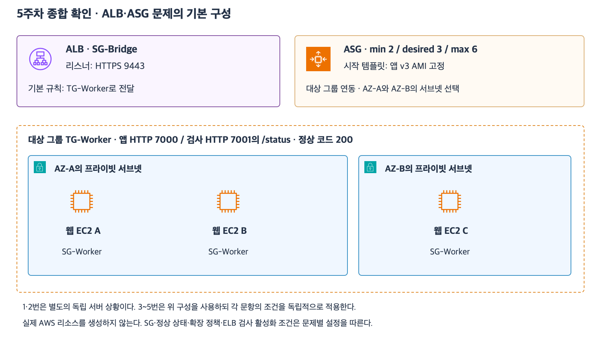

# 9주차 첫 수업 · 고가용성과 AZ 장애 시 남는 용량

8주차에서는 한 AZ가 멈춰도 ALB가 남은 정상 웹 서버로 요청을 보낼 수 있다고 가정했다.
이번에는 남은 서버가 전체 요청을 실제로 감당할 수 있는지 계산한다.

그림은 8주차에서 사용한 구성이다.
아래 예제의 인스턴스 수와 처리량은 별도로 주어진다.

## 1. 장애 경로와 남는 용량

**고가용성(High Availability)**은 일부 구성 요소가 실패해도 서비스를 계속 제공할 수 있는 성질이다.
**장애 격리(Fault isolation)**는 장애의 영향이 다른 구성 요소로 번지는 범위를 줄이는 것이다.
**여유 용량(Headroom)**은 현재 부하를 처리하고도 남는 용량이다.

AZ-A와 AZ-B에 웹 EC2가 각각 3대씩 있다고 가정한다.
각 인스턴스는 초당 요청 100개를 안정적으로 처리한다.
평상시 요청은 초당 420개다.
DB와 공유 세션 저장소는 두 AZ 중 하나가 멈춰도 사용 가능하다고 가정한다.

| 상황 | 정상 서버 | 처리 가능량 | 판단 |
|---|---:|---:|---|
| 평상시 | 6대 | 600개/초 | 420개/초 처리 가능 |
| 서버 1대 장애 | 5대 | 500개/초 | 420개/초 처리 가능 |
| AZ 하나 장애 | 3대 | 300개/초 | 120개/초 부족 |

AZ 장애 후 ALB가 요청을 정상 대상으로 보내도 남은 서버의 처리량은 300개/초다.
이 예제에서 장애 직후 420개/초를 처리하려면 남을 수 있는 어느 AZ에도 최소 5대가 미리 준비되어 있어야 한다.
5대는 주어진 처리량을 기준으로 계산한 최소치다.

## 2. 장애 직후와 복구 이후

**Scale-out**은 서버 대수를 늘리는 수평 확장이다.
ASG가 새 인스턴스를 시작해도 앱이 준비되고 ALB 헬스 체크를 통과하기까지 시간이 걸린다.
즉시 처리해야 하는 부하에는 그 시점에 정상 상태인 대상의 용량을 계산한다.
요구사항이 일정 시간의 성능 저하를 허용한다면 그 시간 안에 증설이 끝나는지도 확인한다.

## 3. 웹 서버를 옮겨도 필요한 상태

**상태 분리**는 로그인 세션이나 업로드 파일처럼 여러 요청에서 다시 쓰는 데이터를 개별 웹 서버 밖에 저장하는 설계다.
예를 들어 웹 B는 요청의 세션 ID로 공유 세션 저장소에서 로그인 상태를 확인한다.
세션 저장소가 실패하면 웹 B가 정상이어도 로그인 상태가 필요한 요청은 실패할 수 있다.
ALB 헬스 체크가 성공했다는 결과는 설정한 검사 경로가 정상 응답했다는 뜻이다.
그 결과만으로 주문 처리나 로그인 같은 모든 사용자 흐름이 정상이라고 판단할 수 없다.

## 확인 문제

AZ-A와 AZ-B에 웹 EC2가 각각 4대씩 있다.
EC2 한 대의 안정적인 처리량은 초당 100개이고 전체 요청은 초당 550개다.
ALB는 비정상 대상을 제외하며 남은 정상 대상에 요청을 전달한다.
새 EC2는 시작부터 ALB 헬스 체크 통과까지 3분이 걸린다.
DB와 공유 세션 저장소는 정상이라고 가정한다.

**1-1.** AZ-A의 EC2 한 대만 멈추면 남은 웹 계층은 초당 몇 개를 처리할 수 있는가?
550개를 모두 처리할 수 있는가?

**1-2.** AZ-A 전체가 멈추면 남은 웹 계층은 초당 몇 개를 처리할 수 있는가?
부족한 처리량은 얼마인가?

**2-1.** 어느 AZ가 멈추더라도 장애 직후부터 초당 550개를 처리하려면 각 AZ에 정상 EC2가 최소 몇 대 준비되어 있어야 하는가?

**2-2.** 현재 구성에서 장애가 난 뒤 ASG가 필요한 서버를 추가한다면 장애 직후의 처리량 부족도 해결되는가?
새 서버가 요청을 받기까지의 시간을 근거로 설명하자.

**3-1.** 로그인 세션을 웹 A의 RAM에만 저장했다.
웹 A 장애 후 요청을 받은 웹 B가 기존 로그인 상태를 이어가려면 어떤 구조로 바꿔야 하는가?

**3-2.** 웹 B의 ALB 헬스 체크는 통과하지만 공유 세션 저장소가 장애 상태다.
기존 로그인 상태가 필요한 요청도 정상이라고 볼 수 있는가?
