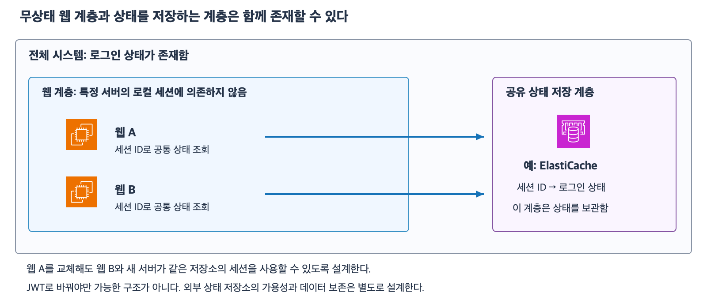

# 9주차 두 번째 수업 · 헬스 체크와 공유 의존성

웹 서버 A와 B는 독립적으로 실행되지만 두 서버가 같은 세션 저장소를 조회한다.
이처럼 여러 서버가 함께 사용하는 구성 요소를 **공유 의존성**이라고 한다.

## 무엇을 검사할까?

- `/ready`는 이 서버의 앱이 초기화를 끝내고 HTTP 요청을 받을 수 있는지 확인한다.
- 별도의 로그인 점검은 테스트 세션을 조회해 사용자 로그인 경로가 실제로 작동하는지 확인한다.

예를 들어 상품 목록은 세션 없이 볼 수 있지만 주문 내역은 세션이 필요하다고 하자.
공유 세션 저장소가 멈추면 상품 목록은 계속 제공할 수 있고 주문 내역 조회는 실패할 수 있다.
이 구성에서 ALB가 서버별 `/ready`를 검사하고 별도의 로그인 점검에 알람을 연결하면 두 종류의 실패를 구분할 수 있다.

## ALB가 모든 대상을 비정상으로 판단하면

대상 그룹의 등록 대상 중 정상 대상이 있으면 기본 설정의 ALB는 정상 대상으로 요청을 보낸다.
등록 대상이 모두 비정상이면 ALB는 그 대상들에 요청을 전달할 수 있다.
이 동작을 **fail-open**이라고 한다.
대상의 헬스 체크 상태는 비정상으로 남고 실제 요청의 성공 여부는 앱과 의존성 상태에 달려 있다.

[AWS ALB 대상 그룹 헬스 체크 문서](https://docs.aws.amazon.com/elasticloadbalancing/latest/application/target-group-health-checks.html)

## 확인 문제

두 AZ에 웹 A와 B가 한 대씩 있고 둘 다 같은 ALB 대상 그룹에 등록되어 있다.
ALB는 기본 설정을 사용하며 아래 상황에서는 헬스 체크 결과가 이미 반영됐다고 가정한다.
`/menu`는 세션 없이 열 수 있고 `/my-orders`는 반드시 공유 세션 저장소에서 기존 세션을 읽어야 한다.

**1-1.** 세션 저장소는 정상이고 A의 앱만 멈춰 `/ready`가 실패한다. B는 통과한다. ALB는 새 요청을 어디로 보내는가?

**1-2.** 이번에는 A와 B의 앱이 모두 정상이고 세션 저장소만 멈췄다. ALB가 앱 준비 상태만 확인하는 `/ready`를 검사할 때 `/menu`와 `/my-orders`는 각각 어떻게 되는가?

**2-1.** ALB 검사 경로를 바꿔 세션 조회 실패 시 HTTP 503을 반환하게 했다. 세션 저장소가 멈춰 A와 B 모두 비정상이 됐다. ALB가 두 서버에 대한 요청 전달을 전부 중단한다고 볼 수 있는가?

**2-2.** 메뉴는 계속 제공하면서 세션 장애는 별도로 감지하려면 ALB 검사와 로그인 점검에서 각각 무엇을 확인해야 하는가?

## 확인 문제 평가 · 2026-11-09

하위 문항 정답 3개, 부분 정답 1개.

- **1-1.** A만 비정상이므로 ALB는 새 요청을 B로 보낸다.
- **1-2.** 두 대상 모두 정상으로 남는다. `/menu`는 성공하고 기존 세션이 필요한 `/my-orders`는 실패한다.
- **2-1.** 두 대상 모두 비정상이어도 ALB는 fail-open으로 요청을 계속 전달할 수 있다.
- **2-2.** ALB에서 `/ready`를 검사하고 별도 로그인 점검에 알람을 연결하는 방향은 맞다. 로그인 점검이 실제로 무엇을 확인하는지 보완한다. 예를 들어 테스트 세션 ID로 세션을 조회하고 기대한 로그인 상태를 확인한다. 조회가 실패하거나 시간 초과가 나면 알람을 발생시킨다.

**2-2 보완 정답.** 테스트 세션 ID로 공유 저장소를 조회해 로그인 상태를 확인하고 조회 실패 또는 시간 초과 시 알림을 보낸다.
