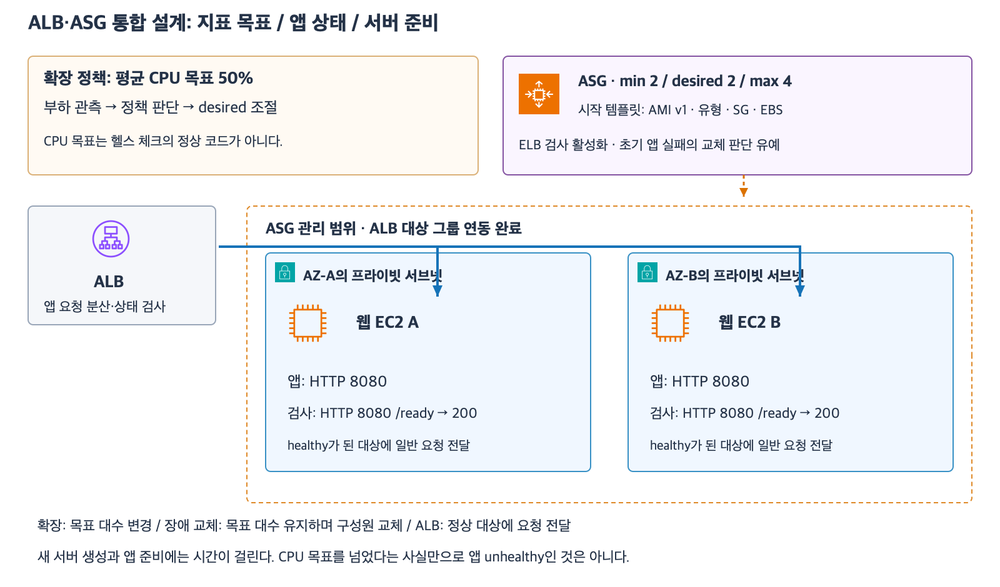

# 9주차 세 번째 수업 · 목표 추적과 최소 용량

그림은 이전 수업에서 사용한 구성이다.
아래 예제에서는 요청 수를 확장 지표로 사용한다.

## 1. 트래픽이 늘 때 어떤 지표를 볼까?

**목표 추적(Target tracking)**은 지표가 목표값에 가까워지도록 ASG가 희망 용량을 조정하는 정책이다.
예를 들어 요청마다 처리 비용이 비슷한 웹 앱은 `ALBRequestCountPerTarget`으로 대상당 1분 요청 수를 기준 삼을 수 있다.
CPU가 실제 병목인 앱이라면 평균 CPU 사용률도 지표가 될 수 있다.
ASG는 설정한 최소·최대 용량 범위 안에서 조정한다.

## 2. 장애 직후 필요한 용량은 어떻게 확보할까?

예를 들어 두 AZ에 웹 EC2를 균등하게 배치하고 한 대가 분당 300건을 안정적으로 처리한다고 하자.
한 AZ가 멈춘 직후에도 분당 750건을 처리해야 한다면 남은 AZ에 최소 3대가 필요하다.
따라서 양쪽에 3대씩 정상 대상을 확보해야 한다.
최소 용량 6은 그룹 전체의 축소 하한이다.
각 AZ에 실제로 3대씩 정상 등록되어 있는지도 확인해야 한다.

정책 목표가 대상당 분당 240건이고 최대 용량이 8대라면 정상 대상 8대에서 분당 1,920건까지 목표 수준을 유지할 수 있다.
분당 2,000건이 들어오면 대상당 250건이므로 정책 목표는 넘지만 대당 안정 처리 한도 300건에는 여유가 있다.
추가 인스턴스가 생겨도 앱 초기화와 ALB 헬스 체크를 거친 후에 사용자 요청을 받는다.

[AWS EC2 Auto Scaling 목표 추적 정책](https://docs.aws.amazon.com/autoscaling/ec2/userguide/as-scaling-target-tracking.html)

## 확인 문제

두 AZ에 웹 EC2가 균등하게 배치돼 있다.
현재 ASG 최소 용량은 4대, 최대 용량은 10대다.
대상당 목표는 분당 400건이고 EC2 한 대의 안정 처리 한도는 분당 500건이다.
요청 비용은 비슷하고 ALB가 정상 대상에 요청을 고르게 보낸다고 가정한다.
한 AZ 장애 직후에도 평소 요청인 분당 1,600건을 처리해야 한다.

**1-1.** 트래픽이 늘어날 때 대상 한 대에 들어오는 요청 수를 기준으로 확장하려면 어떤 지표를 사용할까?

**1-2.** 트래픽이 분당 4,500건으로 늘었다. 정상 대상이 최대인 10대까지 늘어난 상태에서 대상당 요청 수는 얼마인가? 정책 목표와 안정 처리 한도를 각각 충족하는가?

**2-1.** 트래픽이 낮아져 정상 대상이 최소 용량인 4대까지 줄었다. 이 상태에서 AZ 하나가 멈추면 분당 1,600건을 모두 처리할 수 있는가? 부족량은 얼마인가?

**2-2.** 어느 AZ가 멈추더라도 장애 직후 분당 1,600건을 처리하려면 각 AZ에 정상 대상이 최소 몇 대씩 필요할까? 균등 배치를 전제로 ASG 최소 용량을 얼마로 잡고 실제로 무엇을 확인할까?

## 확인 문제 평가 · 2026-11-09

정답 1개, 부분 정답 3개.

- **1-1.** 지표 선택은 정답이다. 정확한 이름은 `ALBRequestCountPerTarget`이다.
- **1-2.** 4,500 ÷ 10 = 대당 분당 450건이다. 정책 목표 400건은 초과하고 안정 처리 한도 500건 이내다.
- **2-1.** 한 AZ가 멈추면 2대가 남는다. 안정 처리량은 2 × 500 = 분당 1,000건이고 부족량은 1,600 − 1,000 = 분당 600건이다.
- **2-2.** 각 AZ에 최소 4대가 필요하다. 균등 배치라면 ASG 최소 용량은 총 8대로 설정하고 각 AZ에 ALB 헬스 체크를 통과한 대상이 실제로 4대 이상인지 확인한다.

**첫 보완.** 2-1의 부족량 분당 600건은 정답이다. 1-2의 대당 실제 부하 및 두 기준 비교와 2-2의 ASG 전체 최소 용량을 다시 확인한다.

**재확인 완료.** 실제 부하인 대당 분당 450건이 정책 목표 400건을 초과하고 안정 처리 한도 500건 이내라는 비교를 확인했다. 두 AZ의 ASG 전체 최소 용량은 총 8대라고 답했다.
