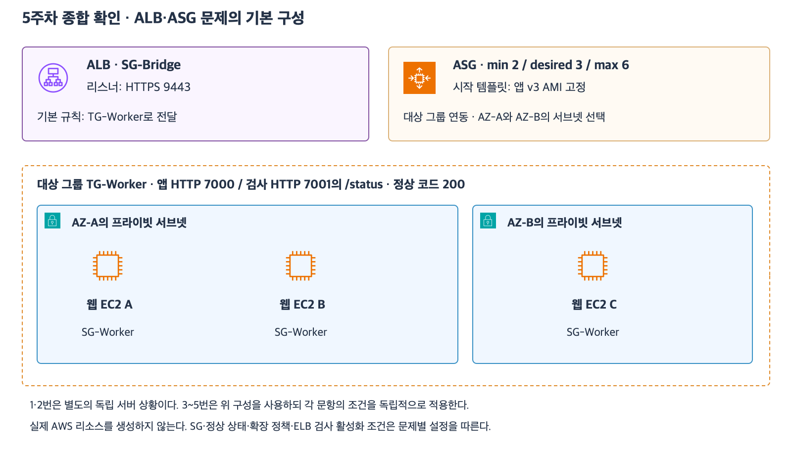

# 9주차 종합 확인 · 고가용성과 확장성

그림은 ALB와 두 AZ의 웹 서버 배치를 보여 주는 이전 수업의 참고 그림이다.
이 문제에서 서버 대수와 공유 세션 조건은 아래 설명을 따른다.

## 시나리오

쇼핑몰 웹 서버는 같은 ALB 대상 그룹에 등록되어 있고 하나의 ASG가 두 AZ에 관리한다.
현재 AZ-A와 AZ-B에 정상 EC2가 3대씩 있다.
ASG는 최소 6대와 최대 12대로 설정되어 있다.
EC2 한 대의 안정 처리 한도는 분당 600건이고 목표 추적 정책은 대당 분당 450건을 목표로 한다.
ALB는 정상 대상에 요청을 고르게 보내며 기본 헬스 체크 라우팅을 사용한다.
새 EC2가 시작된 뒤 앱 초기화와 ALB 헬스 체크 통과까지 4분이 걸린다.
평소 요청은 분당 2,100건이다.
장애 시에는 ALB가 비정상 대상을 판정한 직후를 기준으로 계산한다.

## 확인 문제

### 1. 장애 직후 처리량

**1-1.** AZ-A에서 웹 EC2 한 대만 멈췄다. 남은 안정 처리량은 분당 몇 건이고 평소 요청을 모두 처리할 수 있는가?

**1-2.** 대신 AZ-A 전체가 멈췄다. 남은 안정 처리량과 분당 부족량은 각각 얼마인가?

### 2. 최소 용량과 증설

**2-1.** 어느 AZ가 멈춰도 평소 요청을 즉시 처리해야 한다. 균등 배치라면 각 AZ에 정상 대상이 최소 몇 대씩 필요하고 ASG 최소 용량은 총 몇 대여야 하는가?

**2-2.** 현재 3대씩인 상태에서 AZ 장애 직후 ASG가 새 EC2를 시작한다. 그 즉시 부족량이 해소되는가? 이유를 설명하자.

### 3. 목표와 처리 한도

**3-1.** 두 AZ가 정상이고 행사 중 분당 6,000건이 들어온다. 정상 대상이 최대인 12대라면 대당 요청 수는 얼마인가? 정책 목표와 안정 처리 한도를 각각 충족하는가?

### 4. 공유 세션 장애

**4-1.** 상품 목록은 세션 없이 열 수 있지만 주문 내역은 공유 저장소에서 기존 세션을 읽어야 한다. 웹 앱은 정상이고 세션 저장소만 멈췄다. ALB의 `/ready`가 앱 준비 상태만 검사한다면 두 기능은 각각 어떻게 되는가?

**4-2.** 같은 장애에서 세션 조회까지 ALB 검사에 포함해 모든 등록 대상이 비정상으로 판정됐다. ALB는 요청 전달을 전부 중단하는가? 이 동작을 무엇이라고 부르는가?

### 5. 검사 설계

**5-1.** 개별 웹 앱 장애가 난 서버에는 요청을 보내지 않으면서, 공유 세션 장애가 날 때 상품 목록을 계속 제공하고 별도 알림을 받으려면 ALB 검사와 별도 점검이 각각 무엇을 확인해야 하는가?

## 종합 확인 평가 · 2026-11-09

하위 문항 정답 7개, 부분 정답 1개. 큰 문항 기준 정답 4개, 부분 정답 1개.

- **1-1.** 5 × 600 = 분당 3,000건. 평소 요청을 모두 처리할 수 있다.
- **1-2.** 3 × 600 = 분당 1,800건. 분당 300건이 부족하다.
- **2-1.** 각 AZ에 정상 대상이 최소 4대 필요하다. 균등 배치 기준 ASG 최소 용량은 총 8대다.
- **2-2.** 즉시 해소되지 않는다. 새 EC2는 시작 후 앱 초기화와 ALB 헬스 체크를 거쳐 요청을 받기까지 4분이 걸린다. 이때 ALB는 이미 정상인 대상에 사용자 요청을 계속 보낸다.
- **3-1.** 부분 정답. 두 기준에 대한 판단 방향은 맞았다. 대당 실제 부하는 6,000 ÷ 12 = 분당 500건이다. 정책 목표 450건을 초과하고 안정 처리 한도 600건 이내다.
- **4-1.** 상품 목록은 열 수 있다. 기존 세션을 읽어야 하는 주문 내역은 실패한다.
- **4-2.** ALB는 fail-open으로 비정상 대상으로도 요청을 계속 전달할 수 있다.
- **5-1.** ALB는 개별 앱 준비 상태를 확인한다. 별도 점검은 테스트 세션 ID로 공유 세션을 조회해 로그인 상태를 확인하고 실패나 시간 초과를 알린다.

**3-1 보완.** 분당 6,000건을 정상 대상 12대가 고르게 받으면 대당 몇 건인지 계산한다.

**3-1 보완 정답.** 대당 실제 요청 수는 분당 500건이라고 정정했다.
